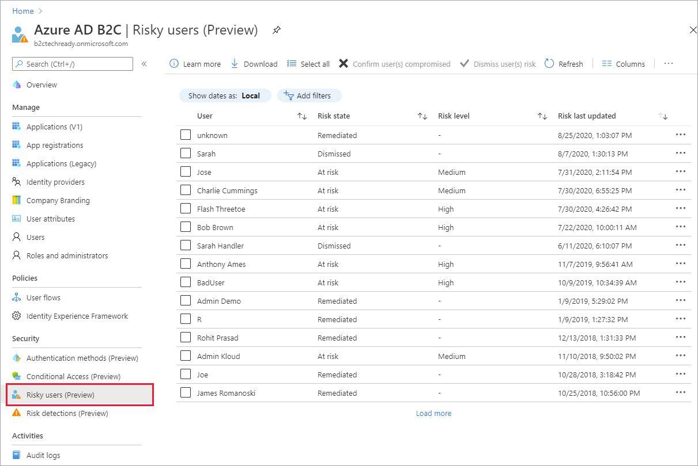
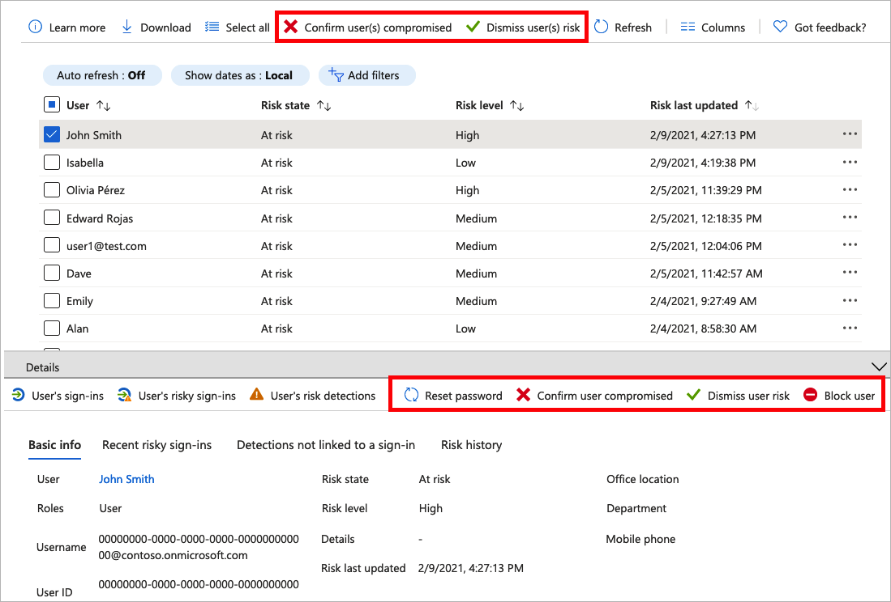
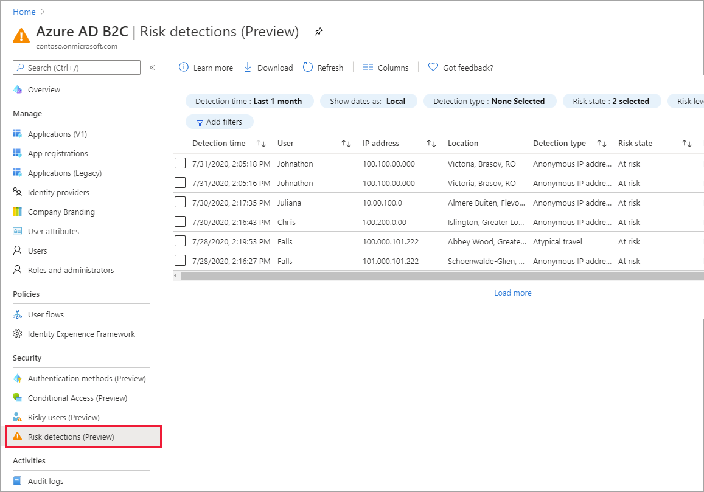

# Investigate risk with Identity Protection in Azure AD B2C

[!INCLUDE [active-directory-b2c-identity-protection-retirement](../../includes/active-directory-b2c-identity-protection-retirement.md)]

[!INCLUDE [active-directory-b2c-end-of-sale-notice-b](../../includes/active-directory-b2c-end-of-sale-notice-b.md)]

ID Protection capabilities are no longer available in Azure Active Directory B2C (Azure AD B2C) P1 or P2 tenants. This retirement includes the *Risky users* and *Risk detections* reports previously available in P1. The report descriptions and procedures in this article are retained for historical reference and no longer apply to Azure AD B2C tenants.

## Overview

Before retirement, Azure AD B2C Identity Protection provided two reports. The *Risky users* report identified users at risk and provided details about detections. The *risk detections* report provided information about each risk detection, including type, other risks triggered at the same time, and sign-in attempt location.

Each report listed detections for the selected period and supported filtering and downloads. Administrators could also use [Microsoft Graph API and Microsoft Graph PowerShell SDK](../active-directory/identity-protection/howto-identity-protection-graph-api.md) to continuously export the data.

## Service limitations and considerations

Before retirement, Identity Protection had the following behavior and limitations:

- Identity Protection was on by default.
- Identity Protection was available for both local and social identities, such as Google or Facebook. For social identities, Conditional Access had to be activated. Detection was limited because the external identity provider managed the social account credentials.
- Azure AD B2C tenants supported only a subset of the [Microsoft Entra ID Protection risk detections](../active-directory/identity-protection/overview-identity-protection.md). The following risk detections were supported:

|Risk detection type  |Description  |
|---------|---------|
| Atypical travel     | Sign-in from an atypical location based on the user's recent sign-ins.        |
|Anonymous IP address     | Sign-in from an anonymous IP address (for example: Tor browser, anonymizer VPNs).        |
|Malware linked IP address     | Sign-in from a malware linked IP address.         |
|Unfamiliar sign-in properties     | Sign-in with properties we've not seen recently for the given user.        |
|Admin confirmed user compromised    | An admin has indicated that a user was compromised.             |
|Password spray     | Sign-in through a password spray attack.      |
|Microsoft Entra threat intelligence     | Microsoft's internal and external threat intelligence sources have identified a known attack pattern.        |

## Pricing tier

ID Protection capabilities are no longer available in either Azure AD B2C P1 or P2 tenants. P1 no longer provides report-only access to ID Protection, and upgrading to P2 isn't an option because P2 retired. For billing information, see [Azure AD B2C billing](./billing.md).

## Prerequisites

The following prerequisites and procedures applied before ID Protection retirement. Meeting these prerequisites doesn't restore access to the retired capabilities.

[!INCLUDE [active-directory-b2c-customization-prerequisites](../../includes/active-directory-b2c-customization-prerequisites.md)]

## Investigate risky users

With the information provided by the risky users report, administrators can find:

- The **Risk state**, showing which users are **At risk**, have had risk **Remediated**, or have had risk **Dismissed**
- Details about detections
- History of all risky sign-ins
- Risk history
 
Administrators can then choose to take action on these events. Administrators can choose to:

- Reset the user password
- Confirm user compromise
- Dismiss user risk
- Block user from signing in
- Investigate further using Azure ATP

An administrator can choose to dismiss a user's risk in the Azure portal or programmatically through the Microsoft Graph API [Dismiss User Risk](/graph/api/riskyusers-dismiss?preserve-view=true&view=graph-rest-beta). Administrator privileges are required to dismiss a user's risk. Remediating a risk can be performed by the risky user or by an administrator on the user's behalf, for example through a password reset.

### Navigating the risky users report

Before retirement, administrators used these steps to open the Risky users report. The report is no longer available in Azure AD B2C tenants.

1. Sign in to the [Azure portal](https://portal.azure.com/).
1. If you have access to multiple tenants, select the **Settings** icon in the top menu to switch to your Azure AD B2C tenant from the **Directories + subscriptions** menu.
1. Under **Azure services**, select **Azure AD B2C**. Or use the search box to find and select **Azure AD B2C**.
1. Under **Security**, select **Risky users**.

   

    Selecting individual entries expands a details window below the detections. The details view allows administrators to investigate and perform actions on each detection.

    

## Risk detections report

The risk detections report contains filterable data for up to the past 90 days (three months).

With the information provided by the risk detections report, administrators can find:

- Information about each risk detection including type.
- Other risks triggered at the same time.
- Sign-in attempt location.

Administrators can then choose to return to the user's risk or sign-ins report to take actions based on information gathered.

### Navigating the risk detections report

Before retirement, administrators used these steps to open the Risk detections report. The report is no longer available in Azure AD B2C tenants.

1. In the Azure portal, search for and select **Azure AD B2C**.
1. Under **Security**, select **Risk detections**.

   

## Next steps

- [Add Conditional Access to a user flow](conditional-access-user-flow.md).
