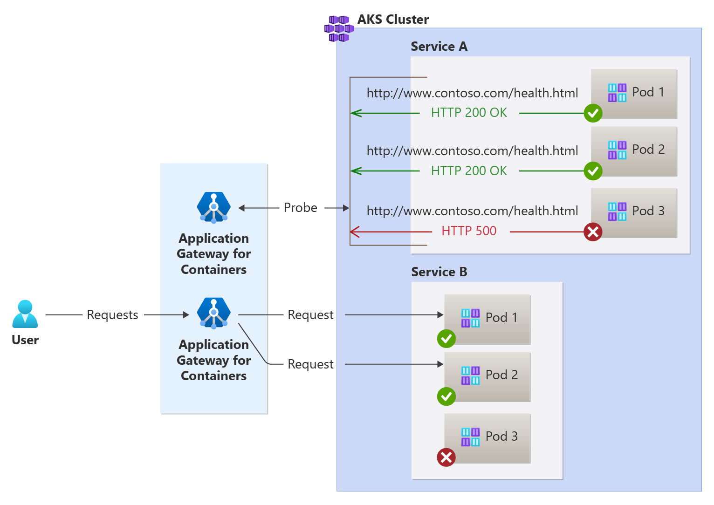

# Custom health probe for Application Gateway for Containers

Application Gateway for Containers monitors the health of all backend targets by default. As backend targets become healthy or unhealthy, Application Gateway for Containers only distributes traffic to healthy endpoints.

In addition to using default health probe monitoring, you can also customize the health probe to suit your application's requirements. This article discusses both default and custom health probes.

Application Gateway for Containers selects the health probe configuration in the following order:

1. Use the HealthCheckPolicy custom resource (CR).
2. If there's no HealthCheckPolicy CR, use the [readiness probe](https://kubernetes.io/docs/tasks/configure-pod-container/configure-liveness-readiness-startup-probes/#define-readiness-probes).
3. If there's no readiness probe defined, use the [default health probe](#default-health-probe).

The following properties make up custom health probes:

| Property | Description |
| -------- | ----------- |
| interval | How often health probes should be sent to the backend target. The duration must be greater than 0 seconds. |
| timeout | How long to wait for a probe response before marking it as a failure. The duration must be greater than 0 seconds. |
| healthyThreshold | Number of consecutive successful health probes required before marking the target endpoint healthy. The value must be greater than 0. |
| port | Optional destination port for probes sent directly to backend pod IP addresses. Specify the pod's listening port, not the Kubernetes Service's `port`. If omitted, probes use the resolved backend endpoint port. |
| unhealthyThreshold | Number of consecutive failed health probes required before marking the target endpoint unhealthy. The value must be greater than 0. |
| grpc | Specified if the backend service is expecting gRPC connections. Use `{}` for default settings, or specify optional `authority` and `service` fields. Can't be combined with `http`. |
| (http) | Specified if the backend service is expecting HTTP connections. Can't be combined with `grpc`. |
| (http) host | The HTTP Host header sent in the request to the backend target. |
| (http) path | The specific path of the request. If a single file should be loaded, the path might be /index.html. |
| (http -> match) statusCodes | Contains two properties, `start` and `end`, that define the inclusive range of valid HTTP status codes returned from the backend. |
| useTLS | Specifies if the health check should enforce TLS. Set to `true` to use TLS for health probes; an applicable BackendTLSPolicy is required. If omitted or `false`, probes inherit backend TLS when the probe port is omitted or equals the referenced Service's `port`. Otherwise, probes use cleartext, even if the probe port equals the Service's `targetPort`. |

### Probe ports and Service ports

Health probes connect directly to backend pod IP addresses. An explicit HealthCheckPolicy `port` overrides the probe destination port and isn't translated through the Service's `targetPort`.

For example, if a Service exposes `port: 443` with `targetPort: 8443`, configure the ports as follows:

| Resource field | Value |
| -------------- | ----- |
| HTTPRoute backend reference port | `443` |
| BackendTLSPolicy `default.ports[].port` | `443` |
| HealthCheckPolicy `default.port` | `8443`, or omit to inherit the backend endpoint port |

To probe the TLS listener, set `useTLS: true`. Setting the HealthCheckPolicy port to `443` in this example sends probes to pod port 443, not pod port 8443.

[](./media/custom-health-probe/custom-health-probe.png#lightbox)

## Default health probe

Application Gateway for Containers automatically configures a default health probe when you don't define a custom probe configuration or configure a readiness probe. The monitoring behavior works by making an HTTP GET request to the IP addresses of configured backend targets. For default probes, if the backend target is configured for HTTPS, the probe uses HTTPS to test health of the backend targets.

For more implementation details, see [HealthCheckPolicyConfig](api-specification-kubernetes.md#alb.networking.azure.io/v1.HealthCheckPolicyConfig) in the API specification.

When the default health probe is used, the following values for each health probe property are used:

| Property | Default Value |
| -------- | ------------- |
| interval | 5 seconds |
| timeout | 3 seconds |
| healthyThreshold | 1 probe |
| unhealthyThreshold | 3 probes |
| port | The resolved backend endpoint port for the Service port referenced by the HTTPRoute or Ingress. For example, if Service port 443 maps to `targetPort: 8443`, probes connect to pod port 8443. |
| (http) host | localhost |
| (http) path | / |
| useTLS | HTTP for HTTP and HTTPS when backend TLS is configured.<sup>1</sup> |

<sup>1</sup> HTTPS is used when a BackendTLSPolicy applies to the referenced backend Service port (for Gateway API implementation), or an IngressExtension specifies a backendSetting protocol of HTTPS (for Ingress API implementation).

> [!NOTE]
> Health probes are initiated with the `User-Agent` value of `Microsoft-Azure-Application-LB/AGC`.

## Custom health probe

In both Gateway API and Ingress API, you define a custom health probe by creating a [HealthCheckPolicy resource](api-specification-kubernetes.md#alb.networking.azure.io/v1.HealthCheckPolicy) and referencing the Service to probe. When you reference the Service by using an HTTPRoute or Ingress resource configured to use Application Gateway for Containers, the custom health probe is used for each reference.

In this example, Application Gateway for Containers sends HTTPS probes directly to the pods that make up _test-service_ on port 8123, using the HTTP Host header `contoso.com` and path `/`. The backend pods must accept TLS connections on port 8123. A probe is sent every 5 seconds and waits 3 seconds before determining the connection times out. An HTTP response code between 200 and 299, inclusive, is considered healthy. All other responses are considered unhealthy.

```bash
kubectl apply -f - <<EOF
apiVersion: alb.networking.azure.io/v1
kind: HealthCheckPolicy
metadata:
  name: gateway-health-check-policy
  namespace: test-infra
spec:
  targetRef:
    group: ""
    kind: Service
    name: test-service
    namespace: test-infra
  default:
    interval: 5s
    timeout: 3s
    healthyThreshold: 1
    unhealthyThreshold: 1
    port: 8123
    # grpc: {} # defined if probing a gRPC endpoint
    http:
      host: contoso.com
      path: /
      match:
        statusCodes:
        - start: 200
          end: 299
    useTLS: true
EOF
```
