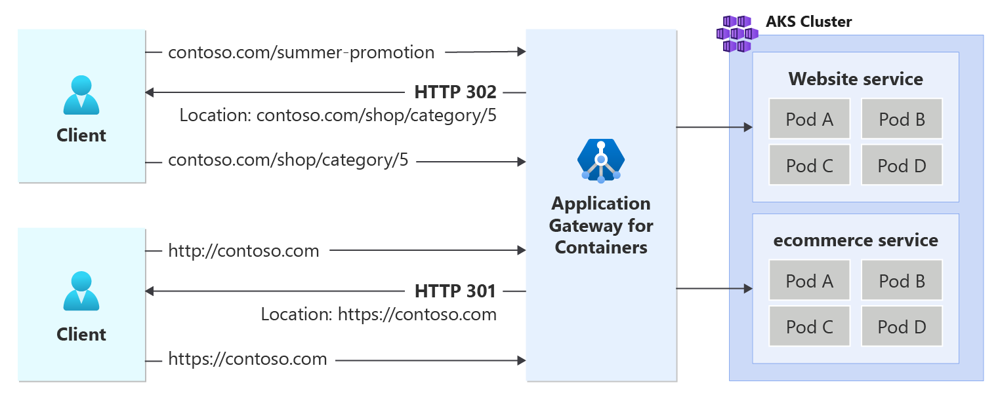

# URL Redirect for Azure Application Gateway for Containers - Gateway API

Application Gateway for Containers can return a redirect response to the client based on three aspects of a URL: protocol, hostname, and path. For each redirect, you choose the HTTP status code returned to the client, which tells the client whether the redirect is permanent or temporary and whether the request method and body must be preserved.

## Usage details

URL redirects take advantage of the [RequestRedirect rule filter](https://gateway-api.sigs.k8s.io/reference/api-spec/main/spec/#httprequestredirectfilter) as defined by Kubernetes Gateway API.

## Redirection

A redirect sets the response status code returned to clients to help them understand the purpose of the redirect. Application Gateway for Containers supports the following status codes in the `statusCode` field of the RequestRedirect filter:

| Status code | Meaning | Permanent | Preserves method and body |
|---|---|---|---|
| 301 | Moved Permanently | Yes | No. Clients may change POST to GET. |
| 302 | Found | No | No. Clients may change POST to GET. |
| 303 | See Other | No | No. The client follows up with GET (or HEAD) and drops the body. |
| 307 | Temporary Redirect | No | Yes. A client that automatically follows the redirect must preserve the method and body. |
| 308 | Permanent Redirect | Yes | Yes. A client that automatically follows the redirect must preserve the method and body. |

- **301 (Moved Permanently):** The target resource has a new permanent URI. Future references to this resource should use one of the enclosed URIs. Use 301 for HTTP to HTTPS redirection of browser traffic.
- **302 (Found):** The target resource is temporarily under a different URI. Since the redirection can change, the client should continue to use the effective request URI for future requests.
- **303 (See Other):** The target resource redirects the user agent to a different resource, as indicated by a URI in the `Location` header field.
- **307 (Temporary Redirect):** The resource is temporarily available at another URI. A client that automatically follows the redirect must preserve the request method and body. Future requests should continue using the original URI.
- **308 (Permanent Redirect):** The resource has a new permanent URI. A client that automatically follows the redirect must preserve the request method and body. Future requests should use the new URI.

> [!TIP]
> Many clients rewrite a POST to a GET when they follow a 301 or 302 redirect, and the request body is dropped. If the redirected request isn't a GET or HEAD, use 307 or 308 instead. For example, use 308 rather than 301 for a permanent HTTP-to-HTTPS redirect when POST or other method/body-sensitive requests must retain their semantics.

If you don't specify `statusCode`, Application Gateway for Containers returns 302, the Gateway API default.

## Redirection capabilities

- Use protocol redirection to move the client from an unencrypted traffic scheme to an encrypted one, such as HTTP to HTTPS redirection.

- Use hostname redirection to match the fully qualified domain name (FQDN) of the request. Commonly, you use this type of redirection to redirect an old domain name to a new domain name, such as `contoso.com` to `fabrikam.com`.

- Use path redirection to replace parts of the path. This type of redirection has two variants: `ReplacePrefixMatch` and `ReplaceFullPath`.
  - `ReplacePrefixMatch` replaces only the matched prefix and keeps the rest of the path. For example, with a `PathPrefix` match of `/shop` and a replacement of `/store`, `/shop` redirects to `/store` and `/shop/checkout` redirects to `/store/checkout`.
  - `ReplaceFullPath` replaces the entire path with a fixed value. For example, `/shop` and `/shop/checkout` both redirect to `/store`.

The following figure illustrates an example of a request destined for _contoso.com/summer-promotion_ being redirected to _contoso.com/shop/category/5_. In addition, a second request initiated to contoso.com via http protocol returns a redirect to initiate a new connection to its https variant.

[](./media/how-to-url-redirect-gateway-api/url-redirect.png#lightbox)

## Prerequisites

1. If following the BYO deployment strategy, ensure you set up your Application Gateway for Containers resources and ALB Controller ([Add-on](quickstart-deploy-application-gateway-for-containers-alb-controller-addon.md) or [Helm](quickstart-deploy-application-gateway-for-containers-alb-controller-helm.md)).
2. If you're using the ALB managed deployment strategy, provision your ALB Controller ([Add-on](quickstart-deploy-application-gateway-for-containers-alb-controller-addon.md) or [Helm](quickstart-deploy-application-gateway-for-containers-alb-controller-helm.md)) and provision the Application Gateway for Containers resources via the [ApplicationLoadBalancer custom resource](quickstart-create-application-gateway-for-containers-managed-by-alb-controller.md).
3. Deploy sample HTTP application:

    Apply the following deployment.yaml file on your cluster to deploy a sample application and TLS certificate to demonstrate redirect capabilities.

    ```bash
    kubectl apply -f https://raw.githubusercontent.com/MicrosoftDocs/azure-docs/refs/heads/main/articles/application-gateway/for-containers/examples/https-scenario/ssl-termination/deployment.yaml
    ```

    This command creates the following on your cluster:

    - a namespace called `test-infra`
    - one service called `echo` in the `test-infra` namespace
    - one deployment called `echo` in the `test-infra` namespace
    - one secret called `listener-tls-secret` in the `test-infra` namespace

## Deploy the required Gateway API resources

# [ALB managed deployment](#tab/alb-managed)

1. Create a Gateway

    ```bash
    kubectl apply -f - <<EOF
    apiVersion: gateway.networking.k8s.io/v1
    kind: Gateway
    metadata:
      name: gateway-01
      namespace: test-infra
      annotations:
        alb.networking.azure.io/alb-namespace: alb-test-infra
        alb.networking.azure.io/alb-name: alb-test
    spec:
      gatewayClassName: azure-alb-external
      listeners:
      - name: http-listener
        port: 80
        protocol: HTTP
        allowedRoutes:
          namespaces:
            from: Same
      - name: https-listener
        port: 443
        protocol: HTTPS
        allowedRoutes:
          namespaces:
            from: Same
        tls:
          mode: Terminate
          certificateRefs:
          - kind : Secret
            group: ""
            name: listener-tls-secret
    EOF
    ```

[!INCLUDE [application-gateway-for-containers-frontend-naming](../../../includes/application-gateway-for-containers-frontend-naming.md)]

# [Bring your own (BYO) deployment](#tab/byo)

1. Set the following environment variables

    ```bash
    RESOURCE_GROUP='<resource group name of the Application Gateway For Containers resource>'
    RESOURCE_NAME='alb-test'

    RESOURCE_ID=$(az network alb show --resource-group $RESOURCE_GROUP --name $RESOURCE_NAME --query id -o tsv)
    FRONTEND_NAME='frontend'
    ```

2. Create a Gateway

    ```bash
    kubectl apply -f - <<EOF
    apiVersion: gateway.networking.k8s.io/v1
    kind: Gateway
    metadata:
      name: gateway-01
      namespace: test-infra
      annotations:
        alb.networking.azure.io/alb-id: $RESOURCE_ID
    spec:
      gatewayClassName: azure-alb-external
      listeners:
      - name: http-listener
        port: 80
        protocol: HTTP
        allowedRoutes:
          namespaces:
            from: Same
      - name: https-listener
        port: 443
        protocol: HTTPS
        allowedRoutes:
          namespaces:
            from: Same
        tls:
          mode: Terminate
          certificateRefs:
          - kind : Secret
            group: ""
            name: listener-tls-secret
      addresses:
      - type: alb.networking.azure.io/alb-frontend
        value: $FRONTEND_NAME
    EOF
    ```

---

Once the gateway resource is created, ensure the status is valid, the listener is _Programmed_, and an address is assigned to the gateway.

```bash
kubectl get gateway gateway-01 -n test-infra -o yaml
```

Example output of successful gateway creation.

```yaml
status:
  addresses:
  - type: Hostname
    value: xxxx.yyyy.alb.azure.com
  conditions:
  - lastTransitionTime: "2023-06-19T21:04:55Z"
    message: Valid Gateway
    observedGeneration: 1
    reason: Accepted
    status: "True"
    type: Accepted
  - lastTransitionTime: "2023-06-19T21:04:55Z"
    message: Application Gateway For Containers resource has been successfully updated.
    observedGeneration: 1
    reason: Programmed
    status: "True"
    type: Programmed
  listeners:
  - attachedRoutes: 0
    conditions:
    - lastTransitionTime: "2023-06-19T21:04:55Z"
      message: ""
      observedGeneration: 1
      reason: ResolvedRefs
      status: "True"
      type: ResolvedRefs
    - lastTransitionTime: "2023-06-19T21:04:55Z"
      message: Listener is accepted
      observedGeneration: 1
      reason: Accepted
      status: "True"
      type: Accepted
    - lastTransitionTime: "2023-06-19T21:04:55Z"
      message: Application Gateway For Containers resource has been successfully updated.
      observedGeneration: 1
      reason: Programmed
      status: "True"
      type: Programmed
    name: https-listener
    supportedKinds:
    - group: gateway.networking.k8s.io
      kind: HTTPRoute
```

### Route HTTPS traffic to the backend

Create an HTTPRoute resource for `contoso.com` that handles traffic received via HTTPS.

```bash
kubectl apply -f - <<EOF
apiVersion: gateway.networking.k8s.io/v1
kind: HTTPRoute
metadata:
  name: https-contoso
  namespace: test-infra
spec:
  parentRefs:
  - name: gateway-01
    sectionName: https-listener
  hostnames:
  - "contoso.com"
  rules:
  - backendRefs:
    - name: echo
      port: 80
EOF
```

When the HTTPRoute resource is created, ensure the HTTPRoute resource shows _Accepted_ and the Application Gateway for Containers resource is _Programmed_.

```bash
kubectl get httproute https-contoso -n test-infra -o yaml
```

Verify the Application Gateway for Containers resource is successfully updated for each HTTPRoute.

```yaml
status:
  parents:
  - conditions:
    - lastTransitionTime: "2023-06-19T22:18:23Z"
      message: ""
      observedGeneration: 1
      reason: ResolvedRefs
      status: "True"
      type: ResolvedRefs
    - lastTransitionTime: "2023-06-19T22:18:23Z"
      message: Route is Accepted
      observedGeneration: 1
      reason: Accepted
      status: "True"
      type: Accepted
    - lastTransitionTime: "2023-06-19T22:18:23Z"
      message: Application Gateway For Containers resource has been successfully updated.
      observedGeneration: 1
      reason: Programmed
      status: "True"
      type: Programmed
    controllerName: alb.networking.azure.io/alb-controller
    parentRef:
      group: gateway.networking.k8s.io
      kind: Gateway
      name: gateway-01
      namespace: test-infra
```

### Redirect HTTP to HTTPS (301 or 308)

Create an HTTPRoute resource for `contoso.com` with a RequestRedirect filter that redirects HTTP traffic to HTTPS. This example uses 301, which suits browser traffic.

```bash
kubectl apply -f - <<EOF
apiVersion: gateway.networking.k8s.io/v1
kind: HTTPRoute
metadata:
  name: http-to-https-contoso-redirect
  namespace: test-infra
spec:
  parentRefs:
  - name: gateway-01
    sectionName: http-listener
  hostnames:
  - "contoso.com"
  rules:
  - filters:
    - type: RequestRedirect
      requestRedirect:
        scheme: https
        statusCode: 301
EOF
```

> [!NOTE]
> If clients send POST, PUT, PATCH, or DELETE requests over HTTP, such as API clients or webhooks, set `statusCode: 308` instead. A 308 redirect tells the client to repeat the same request, including its method and body, over HTTPS.

When the HTTPRoute resource is created, ensure the HTTPRoute resource shows _Accepted_ and the Application Gateway for Containers resource is _Programmed_.

```bash
kubectl get httproute http-to-https-contoso-redirect -n test-infra -o yaml
```

Verify the Application Gateway for Containers resource is successfully updated for each HTTPRoute.

```yaml
status:
  parents:
  - conditions:
    - lastTransitionTime: "2023-06-19T22:18:23Z"
      message: ""
      observedGeneration: 1
      reason: ResolvedRefs
      status: "True"
      type: ResolvedRefs
    - lastTransitionTime: "2023-06-19T22:18:23Z"
      message: Route is Accepted
      observedGeneration: 1
      reason: Accepted
      status: "True"
      type: Accepted
    - lastTransitionTime: "2023-06-19T22:18:23Z"
      message: Application Gateway For Containers resource has been successfully updated.
      observedGeneration: 1
      reason: Programmed
      status: "True"
      type: Programmed
    controllerName: alb.networking.azure.io/alb-controller
    parentRef:
      group: gateway.networking.k8s.io
      kind: Gateway
      name: gateway-01
      namespace: test-infra
```

### Redirect paths (302 and 307)

Create an HTTPRoute resource for `contoso.com` with two path redirects:

- `/summer-promotion` returns a 302 redirect to the fixed path `/shop/category/5`, which suits a temporary campaign link opened in a browser.
- `/api/v1` returns a 307 redirect that replaces the prefix with `/api/v2`, so `/api/v1/orders` redirects to `/api/v2/orders`. Because 307 preserves the method and body, a POST to `/api/v1/orders` is repeated as a POST to `/api/v2/orders`. Use 308 instead if the move is permanent.

Because this HTTPRoute omits `sectionName`, unlike the http to https HTTPRoute resource, these redirect rules apply to both HTTP and HTTPS requests.

```bash
kubectl apply -f - <<EOF
apiVersion: gateway.networking.k8s.io/v1
kind: HTTPRoute
metadata:
  name: path-redirects
  namespace: test-infra
spec:
  parentRefs:
  - name: gateway-01
  hostnames:
  - "contoso.com"
  rules:
  - matches:
    - path:
        type: PathPrefix
        value: /summer-promotion
    filters:
    - type: RequestRedirect
      requestRedirect:
        path:
          type: ReplaceFullPath
          replaceFullPath: /shop/category/5
        statusCode: 302
  - matches:
    - path:
        type: PathPrefix
        value: /api/v1
    filters:
    - type: RequestRedirect
      requestRedirect:
        path:
          type: ReplacePrefixMatch
          replacePrefixMatch: /api/v2
        statusCode: 307
EOF
```

When the HTTPRoute resource is created, ensure the HTTPRoute resource shows _Accepted_ and the Application Gateway for Containers resource is _Programmed_.

```bash
kubectl get httproute path-redirects -n test-infra -o yaml
```

Verify the Application Gateway for Containers resource is successfully updated for each HTTPRoute.

```yaml
status:
  parents:
  - conditions:
    - lastTransitionTime: "2023-06-19T22:18:23Z"
      message: ""
      observedGeneration: 1
      reason: ResolvedRefs
      status: "True"
      type: ResolvedRefs
    - lastTransitionTime: "2023-06-19T22:18:23Z"
      message: Route is Accepted
      observedGeneration: 1
      reason: Accepted
      status: "True"
      type: Accepted
    - lastTransitionTime: "2023-06-19T22:18:23Z"
      message: Application Gateway For Containers resource has been successfully updated.
      observedGeneration: 1
      reason: Programmed
      status: "True"
      type: Programmed
    controllerName: alb.networking.azure.io/alb-controller
    parentRef:
      group: gateway.networking.k8s.io
      kind: Gateway
      name: gateway-01
      namespace: test-infra
```

## Test access to the application

Now you're ready to send some traffic to your sample application, via the FQDN assigned to the frontend. Use the following command to get the FQDN and its IP address.

```bash
fqdn=$(kubectl get gateway gateway-01 -n test-infra -o jsonpath='{.status.addresses[0].value}')
fqdnIp=$(dig +short $fqdn)
```

### Test the HTTP to HTTPS redirect

When you specify the server name indicator using the curl command, `http://contoso.com` should return a response from the Application Gateway for Containers with a `location` header defining a 301 redirect to `https://contoso.com`.

```bash
curl -k --resolve contoso.com:80:$fqdnIp http://contoso.com/ -v
```

Via the response we should see:

```text
* Added contoso.com:80:xxx.xxx.xxx.xxx to DNS cache
* Hostname contoso.com was found in DNS cache
*   Trying xxx.xxx.xxx.xxx:80...
* Connected to contoso.com (xxx.xxx.xxx.xxx) port 80 (#0)
> GET / HTTP/1.1
> Host: contoso.com
> User-Agent: curl/7.81.0
> Accept: */*
>
* Mark bundle as not supporting multiuse
< HTTP/1.1 301 Moved Permanently
< location: https://contoso.com/
< date: Mon, 26 Feb 2024 22:56:23 GMT
< server: Microsoft-Azure-Application-LB/AGC
< content-length: 0
<
* Connection #0 to host contoso.com left intact
```

If you set `statusCode: 308` on the HTTP to HTTPS HTTPRoute, the response shows `HTTP/1.1 308 Permanent Redirect` with the same `location` header.

### Test the 302 path redirect

When you specify the server name indicator by using the curl command, `https://contoso.com/summer-promotion` returns a 302 redirect to `https://contoso.com/shop/category/5`.

```bash
curl -k --resolve contoso.com:443:$fqdnIp https://contoso.com/summer-promotion -v
```

Via the response we should see:

```text
> GET /summer-promotion HTTP/2
> Host: contoso.com
> user-agent: curl/7.81.0
> accept: */*
>
< HTTP/2 302
< location: https://contoso.com/shop/category/5
< date: Mon, 26 Feb 2024 22:58:43 GMT
< server: Microsoft-Azure-Application-LB/AGC
<
* Connection #0 to host contoso.com left intact
```

### Test the 307 path redirect

Send a POST request to `https://contoso.com/api/v1/orders`. Application Gateway for Containers returns a 307 redirect to `https://contoso.com/api/v2/orders`.

```bash
curl -k --resolve contoso.com:443:$fqdnIp -X POST -d '{"item":"a"}' -H "Content-Type: application/json" https://contoso.com/api/v1/orders -v
```

Through the response you see:

```text
> POST /api/v1/orders HTTP/2
> Host: contoso.com
> user-agent: curl/7.81.0
> accept: */*
> content-type: application/json
> content-length: 12
>
< HTTP/2 307
< location: https://contoso.com/api/v2/orders
< date: Thu, 05 Nov 2026 20:45:00 GMT
< server: Microsoft-Azure-Application-LB/AGC
<
* Connection #0 to host contoso.com left intact
```

To see the client follow the redirect with the original method and body, add `-L` to the curl command. curl repeats the request as `POST /api/v2/orders` with the same body. If you use a 301 or 302 redirect, curl switches the follow-up request to a GET and drops the body.

Congratulations, you installed ALB Controller, deployed a backend application, and used Gateway API to configure an HTTP to HTTPS redirect, path-based redirection, and a method-preserving 307 redirect.
