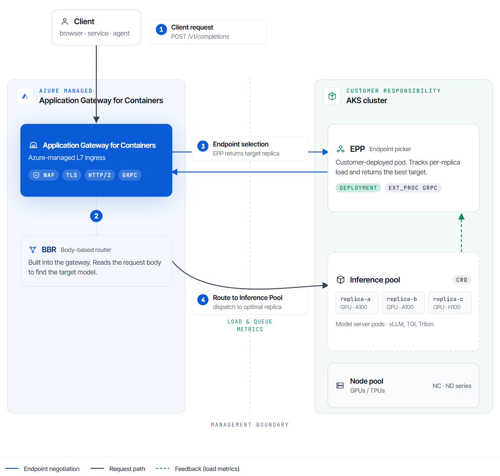

# Application Gateway for Containers - Inference gateway

AI inference workloads don't behave like traditional stateless HTTP applications. Requests are often model-specific, long-running, expensive to serve, and sensitive to runtime signals such as accelerator availability, queue depth, request priority, token budget, and model server capacity.

Application Gateway for Containers inference gateway supports these workloads by integrating with the Kubernetes [Gateway API Inference Extension](https://gateway-api-inference-extension.sigs.k8s.io/), which adds inference-aware backends to the Gateway API model. By using the inference gateway, you can expose self-hosted model servers through Application Gateway for Containers with model-aware and load-aware routing behavior.

The inference gateway is purpose-built for serving large language models (LLMs) and other inference workloads. It routes requests based on model server signals rather than generic load balancing, which lowers time to first token (TTFT), reduces timeouts under load, and improves GPU efficiency. Built on the ingress capabilities of Application Gateway for Containers, the inference gateway also lets you pair AI workloads with capabilities like the web application firewall (WAF) to secure traffic before it reaches your model servers.

Many self-hosted inference runtimes, including vLLM, expose [OpenAI-compatible HTTP APIs](https://platform.openai.com/docs/api-reference) such as `/v1/chat/completions`, `/v1/completions`, and `/v1/models`. OpenAI-compatible refers to the API format, not a restriction to OpenAI-hosted models. If another model family is served through a runtime or proxy that uses this format, Application Gateway for Containers can use the `model` field in the JSON request body for body-based routing.

> [!IMPORTANT]
> The Application Gateway for Containers inference gateway is currently in preview. 
> See the [Supplemental Terms of Use for Microsoft Azure Previews](https://azure.microsoft.com/support/legal/preview-supplemental-terms/) for legal terms that apply to Azure features that are in beta, preview, or otherwise not yet released into general availability.

## Building blocks of the inference gateway

An inference gateway combines three parts: a Gateway API implementation that handles ingress, an `InferencePool` backend defined by the Gateway API Inference Extension, and an endpoint picker that chooses a model server pod for each request. Application Gateway for Containers provides the first part and a managed body-based routing processor. You provide the `InferencePool` and the endpoint picker in your cluster.

- **InferencePool**: A backend resource (`inference.networking.k8s.io/v1`) that represents a group of model server pods, the port they serve on, and a reference to the endpoint picker that selects a pod for each inference request.
- **Endpoint Picker (EPP)**: The role, defined by the Gateway API Inference Extension, of the component that selects an endpoint for each request. The gateway calls the EPP by using the endpoint picker protocol defined by the extension. The EPP returns the model server pod that should serve the request. EPP describes a contract, not a single product, and any implementation of the protocol can fill the role.
- **Body-based routing (BBR)**: A request processor that inspects an OpenAI-compatible request body, extracts the model name, and makes it available to the gateway as the `X-Gateway-Model-Name` header for model-aware routing.

Application Gateway for Containers runs the BBR processor as a managed part of the gateway, so there's no separate body-based routing or payload-processing tier to deploy, scale, or patch. Because the inference gateway uses the Gateway API Inference Extension API, you configure it through standard Gateway API resources, and platform teams can use a Kubernetes-native API model for inference traffic instead of introducing a separate ingress configuration model.

### Changes in Gateway API Inference Extension v1.6

Starting with v1.6, the Gateway API Inference Extension project focuses on the core specification: the `InferencePool` API, the endpoint picker protocol, and conformance tests. Implementation-specific components moved to the [llm-d](https://github.com/llm-d/llm-d-router) project:

| Component | Before v1.6 | v1.6 and later |
| --- | --- | --- |
| `InferencePool` | Gateway API Inference Extension (`inference.networking.k8s.io/v1`) | Unchanged |
| Full-featured endpoint picker | Gateway API Inference Extension | llm-d router |
| `InferenceObjective` | Gateway API Inference Extension (`inference.networking.x-k8s.io/v1alpha2`) | llm-d router (`llm-d.ai/v1`) |
| `InferenceModelRewrite` | Gateway API Inference Extension (`inference.networking.x-k8s.io/v1alpha2`) | llm-d router (`llm-d.ai/v1alpha2`) |
| `EndpointPickerConfig` (EPP configuration file) | Gateway API Inference Extension | llm-d router |
| Body-based routing | Gateway API Inference Extension | llm-d inference payload processor. Application Gateway for Containers provides a managed BBR, so you don't need to deploy it. |
| Lightweight endpoint picker (LWEPP) | Not available | Gateway API Inference Extension, as a reference implementation |

If you created `InferenceObjective` or `InferenceModelRewrite` resources with the `inference.networking.x-k8s.io/v1alpha2` API, install the llm-d CRDs and re-create the resources with the llm-d API versions. The `InferencePool` API doesn't change.

## Endpoint picker implementations

The routing behavior you get from an `InferencePool` depends on the EPP implementation that the pool references. Application Gateway for Containers calls the EPP through the standard protocol and doesn't depend on a specific implementation. Two implementations are maintained alongside the specification:

| Implementation | Maintained by | Intended use | Scheduling capabilities |
| --- | --- | --- | --- |
| **llm-d router** | [llm-d](https://github.com/llm-d/llm-d-router) | Production inference serving | Pluggable scorers (prefix-cache affinity, queue depth, KV cache utilization, active requests), saturation detection, flow control with priority bands, `InferenceObjective`, and `InferenceModelRewrite`. |
| **Lightweight EPP (LWEPP)** | [Gateway API Inference Extension](https://github.com/kubernetes-sigs/gateway-api-inference-extension) | Reference implementation for conformance testing and protocol validation | Minimal endpoint selection. It doesn't include the llm-d router's scorer plugins, flow control, or support for `InferenceObjective` and `InferenceModelRewrite`. |

Use the llm-d router when you want the load-aware, cache-aware, and priority-aware behaviors described in this article. Use LWEPP to validate that your gateway, `InferencePool`, and model servers are wired correctly with the smallest possible EPP.

Each `InferencePool` references one EPP deployment. The llm-d router is typically installed per pool by using its Helm chart, which creates the `InferencePool`, the EPP deployment, and its configuration together.

## How Application Gateway for Containers uses inference resources

Application Gateway for Containers continues to use standard Gateway API resources for ingress configuration. Inference behavior is activated when an `HTTPRoute` backend reference targets an `InferencePool` instead of a Kubernetes `Service`.

For non-inference routes, Application Gateway for Containers keeps the existing Gateway API behavior. Routes that target Kubernetes `Service` backends don't invoke the EPP and don't receive inference-specific routing behavior, even when the `Service` selects the same model server pods.

For inference routes, the control plane reconciles the Gateway API and inference resources and programs the data plane so that:

- The `HTTPRoute` selects the `InferencePool` backend.
- The `InferencePool` selects the model server pods that belong to the pool.
- The EPP associated with the pool is invoked for endpoint selection.
- The selected model server endpoint receives the request.
- Optional model-aware routing uses the request model name extracted by BBR.

## Request flow

A typical inference request follows this path. The numbered steps map to the labels in the following diagram:

1. **Client request**: A client sends an OpenAI-compatible request to the Application Gateway for Containers frontend, and the Gateway listener accepts it.
1. **Body-based routing (BBR)**: For model-aware routes, the managed BBR processor inspects the request body, extracts the model name, and injects the `X-Gateway-Model-Name` header. The `HTTPRoute` can then match on that value to select the appropriate `InferencePool`.
1. **Endpoint selection**: When the matched route targets an `InferencePool`, Application Gateway for Containers invokes the pool's EPP. The EPP evaluates the request and model server telemetry and returns the selected endpoint. By using the llm-d router, the EPP can also hold the request in a priority queue until capacity is available, or rewrite the requested model name, before it returns an endpoint.
1. **Route to the InferencePool**: Application Gateway for Containers forwards the request to the selected model server pod, and the model server's response returns to the client through the gateway.

## Routing capabilities

The inference gateway supports these routing patterns for self-hosted AI workloads. Application Gateway for Containers provides model-aware routing, traffic splitting, and failure handling. Endpoint selection, priority, and model rewrites run in the EPP, so those behaviors depend on the EPP implementation and the plugins and features that you enable in it.

- **Model-aware routing**: Route requests based on the model name in OpenAI-compatible request bodies, which the managed BBR processor extracts.
- **Traffic splitting and rollouts across pools**: Use standard `HTTPRoute` weighted `backendRefs` to split traffic across `InferencePool` backends for canary or blue-green rollouts of a model that runs on separate pods.
- **Model rewrites within a pool**: With the llm-d router, use `InferenceModelRewrite` resources to map the model name that clients request to one or more target models served by the same pool, with weights. For example, clients keep requesting `support-assistant` while the EPP sends 90 percent of requests to the `support-v1` LoRA adapter and 10 percent to `support-v2`. The router returns the client's requested model name in the response.
- **Load-aware and cache-aware endpoint selection**: The EPP scores endpoints by using model server telemetry, such as queue depth and KV cache utilization. When the EPP enables prefix-cache-aware scoring, requests that share a prompt prefix, such as turns of the same conversation, go to the same replica to raise cache hits and lower TTFT.
- **Request priority and overload protection**: With the llm-d router, define `InferenceObjective` resources (`llm-d.ai/v1`) that assign a priority to a class of traffic on a pool, and have clients select an objective with the `x-llm-d-inference-objective` request header. When flow control is enabled and the pool is saturated, the EPP queues requests in priority bands, dispatches higher-priority requests first, and sheds lower-priority requests when their band is full or their time-to-live expires.
- **Resilient endpoint selection**: Configure EPP failure behavior with `FailOpen` or `FailClose`, depending on whether availability or strict endpoint selection is more important for a pool.
- **Gateway API compatibility**: Continue using Gateway, HTTPRoute, ReferenceGrant, and standard Gateway API status conditions for ingress configuration.

## Secure inference

Keep model servers private behind the managed gateway and apply the platform's security capabilities to inference traffic.

- **Web application firewall (WAF)**: The inference gateway pairs natively with the existing [WAF capability in Application Gateway for Containers](how-to-waf-gateway-api.md), applying protections to AI traffic before requests reach your model servers.
- **Protection for expensive backends**: Because policy is enforced at the managed edge, malformed or abusive requests can be inspected and blocked before they reach the EPP or consume scarce GPU capacity.

## Example scenarios

The following scenarios show common ways to use the inference gateway:

- **Serve and roll out model versions**: Route OpenAI-compatible requests to an `InferencePool` by model name. To roll out a new LoRA adapter on the same pods, use an `InferenceModelRewrite` to shift a percentage of requests to the new adapter. To roll out a model that runs on separate pods, use weighted `HTTPRoute` backendRefs across two `InferencePool` backends.
- **Reuse cached context for multi-turn conversations**: Enable prefix-cache-aware scoring in the llm-d router so that follow-up turns of a conversation return to the replica that already holds its KV cache, which reduces prefill work and TTFT.
- **Prioritize latency-critical traffic**: Define `InferenceObjective` resources for high-priority and low-priority workloads on a shared pool. Interactive chat requests carry the high-priority objective, while batch jobs use a lower priority that waits for spare capacity and is shed first when the pool is saturated.

## InferencePool compared with Service

A Kubernetes `Service` remains the right backend abstraction for standard application traffic. Use an `InferencePool` when the backend is a group of model server pods that need inference-specific endpoint selection.

| Backend type | Use for | Routing behavior |
| --- | --- | --- |
| `Service` | Standard HTTP, gRPC, and application backends | Gateway routes to service endpoints using standard load-balancing behavior. |
| `InferencePool` | Self-hosted model server pods | Gateway invokes the configured EPP, then routes to the selected model server endpoint. |

An `InferencePool` includes a pod selector, target port information, and an endpoint picker reference (`endpointPickerRef`). The EPP selects the endpoint for a request. A single EPP is associated with a single pool.

## Failure behavior

Inference routing is request-time behavior, so the failure mode of the endpoint picker matters.

The `endpointPickerRef` of an `InferencePool` supports these failure modes:

- **FailOpen**: If the EPP is unavailable or doesn't respond, the gateway continues with standard endpoint selection for the pool. This choice preserves availability but loses EPP behaviors such as cache affinity, priority, and model rewrites until the EPP recovers.
- **FailClose**: If the EPP is unavailable or doesn't respond, the gateway rejects the request. This choice prevents traffic from being sent without the required endpoint selection decision. `FailClose` is the default.

If your pool relies on `InferenceModelRewrite` to map a client-facing model name to a model the servers actually load, requests that bypass the EPP under `FailOpen` reach the model server with the original model name. Ensure the model servers can serve that name, or use `FailClose` for the pool.

For model-aware routing that depends on request body parsing, Application Gateway for Containers favors correctness. If the model name can't be extracted for a route that requires BBR, the request is rejected instead of being silently routed to the wrong model backend.

## Operational considerations

Plan for the following considerations when running inference workloads behind Application Gateway for Containers:

- **EPP capacity**: The EPP is on the request path for `InferencePool` backends. Size and monitor it like a critical application component, and run more than one replica for production pools.
- **EPP configuration**: With the llm-d router, the scorer plugins, their weights, saturation detection, and flow control are set in the router's `EndpointPickerConfig`, usually through Helm values. Some capabilities, such as flow control, are behind feature gates and are off by default.
- **Model server telemetry**: The EPP needs fresh model server metrics to make high-quality routing decisions. Confirm that your model server exposes the metrics that your EPP configuration expects.
- **GPU capacity and scheduling**: Model server pods often require GPU node pools, device plugins, and model download credentials. The gateway and the EPP don't require GPUs.
- **Autoscaling**: Scale model server pods on inference signals such as queue depth and KV cache utilization by using the Horizontal Pod Autoscaler or KEDA. Autoscaling adds capacity as demand grows, while the EPP routes around replicas that are already saturated.
- **Streaming responses**: Many chat completion workloads use server-sent events. Validate streaming behavior when testing end-to-end latency and timeout settings.
- **Observability**: Monitor Gateway and HTTPRoute status, InferencePool status, EPP health, model server readiness, and model server metrics such as active requests and queue depth. The llm-d router also exposes Prometheus metrics for its scheduling, flow control, and model rewrite decisions.

## Limitations

- The inference gateway focuses on self-hosted inference workloads running on Kubernetes. Routing directly to public or managed model provider endpoints is outside the scope of this integration.
- JWT validation defined by an `AuthPolicy` isn't currently supported on routes whose backend is an `InferencePool`.
- The Gateway API Inference Extension and the llm-d router evolve independently from Application Gateway for Containers and from each other. Use API versions and manifests that match the CRDs installed on your cluster: the `InferencePool` CRD from the Gateway API Inference Extension, and the `InferenceObjective` and `InferenceModelRewrite` CRDs from the llm-d router release that you deploy.

## Next steps

- [Configure Application Gateway for Containers inference gateway](how-to-inference-gateway.md)
- [Application Gateway for Containers components](application-gateway-for-containers-components.md)
- [Gateway API Inference Extension documentation](https://gateway-api-inference-extension.sigs.k8s.io/)
- [llm-d router](https://github.com/llm-d/llm-d-router)
