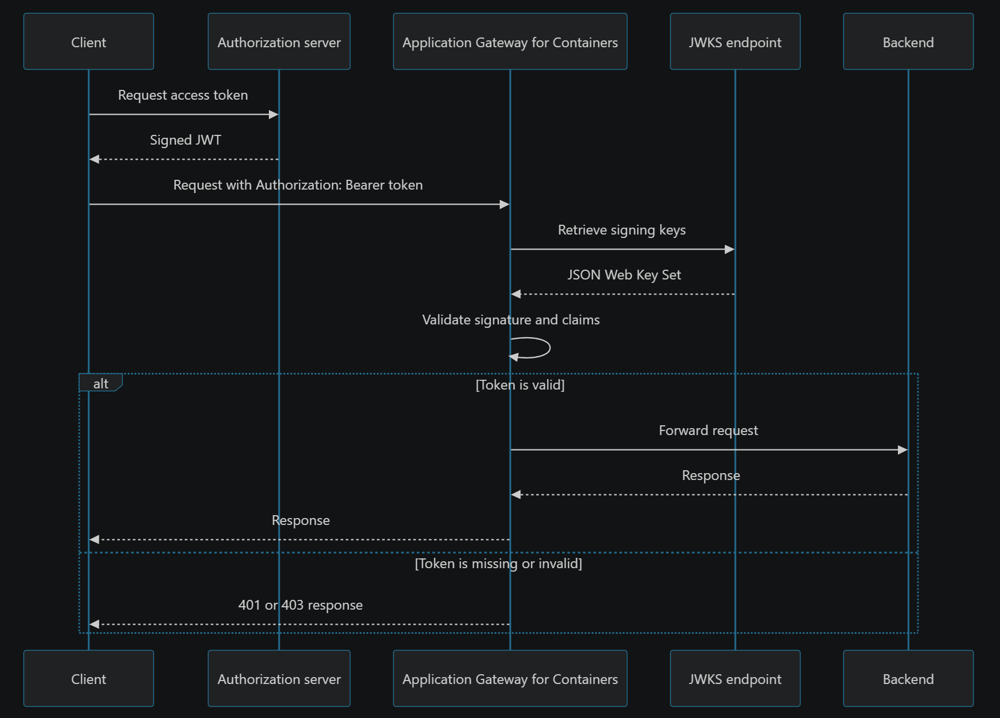
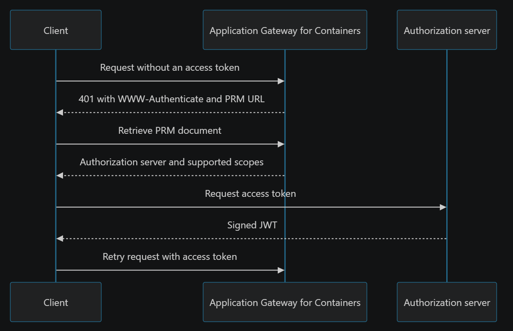

# JWT validation for Application Gateway for Containers

Application Gateway for Containers can authenticate requests before they reach your backend applications. By attaching an `AuthPolicy` resource to an Application Gateway for Containers resource, Gateway, or route, you can centralize JSON Web Token (JWT) validation at the gateway instead of implementing the same validation in every application.

JWT validation works with Microsoft Entra ID and third-party identity providers that issue JWT bearer access tokens and publish signing keys at an HTTPS JSON Web Key Set (JWKS) endpoint that the gateway can reach and trust.

> [!IMPORTANT]
> JWT validation and the `AuthPolicy` API are currently in preview.<br>
> See the [Supplemental Terms of Use for Microsoft Azure Previews](https://azure.microsoft.com/support/legal/preview-supplemental-terms/) for legal terms that apply to Azure features that are in beta, preview, or otherwise not yet released into general availability.

## What JWT validation provides

JWT validation provides the following capabilities:

- Validates bearer JWTs by using keys retrieved from a remote JSON Web Key Set (JWKS) endpoint.
- Validates the token signature, issuer, lifetime, and, when configured, audience.
- Applies JWT validation consistently to HTTP, gRPC, and Model Context Protocol (MCP) routes.
- Inherits policy from an `ApplicationLoadBalancer` or `Gateway` and allows a route to override or opt out of the inherited policy.
- Optionally publishes OAuth 2.0 Protected Resource Metadata as defined by [RFC 9728](https://www.rfc-editor.org/rfc/rfc9728).
- Rejects unauthenticated requests at the gateway so they don't reach the backend.

JWT validation verifies caller identity at the gateway. Your identity provider issues tokens, and your application makes authorization decisions such as checking roles, permissions, or resource ownership. Token issuance, interactive sign-in, browser session management, and integration with external authorization services are outside the scope of JWT validation.

## Protocol applicability

JWT validation processes bearer access tokens that clients send to the gateway. It doesn't implement an interactive sign-in protocol.

| Protocol | How it applies |
| --- | --- |
| OAuth 2.0 | Clients get bearer access tokens from an authorization server and send them to the gateway. Application Gateway for Containers validates JWT access tokens but doesn't issue them. |
| OpenID Connect (OIDC) | OIDC can be used between a client and identity provider to sign in a user before the client obtains an OAuth access token. JWT validation doesn't initiate OIDC sign-in, redirect users, manage an OIDC session, or process ID tokens as credentials for backend access. |
| SAML 2.0 | SAML assertions aren't accepted as request credentials, and JWT validation doesn't initiate or process SAML sign-in. An identity provider can use SAML upstream and then issue an OAuth JWT access token that the client presents to the gateway. |
| WS-Federation | WS-Federation tokens aren't accepted as request credentials, and JWT validation doesn't initiate or process WS-Federation sign-in. An identity provider can use WS-Federation upstream and then issue an OAuth JWT access token that the client presents to the gateway. |

OAuth Protected Resource Metadata is an OAuth discovery mechanism. It doesn't add OIDC, SAML, or WS-Federation sign-in support to the gateway.

## How JWT validation works

Application Gateway for Containers introduces a Kubernetes custom resource named `AuthPolicy` for configuring JWT validation at the gateway. You attach an `AuthPolicy` to an `ApplicationLoadBalancer`, `Gateway`, `HTTPRoute`, `GRPCRoute`, or `MCPRoute` resource. The policy identifies the resource to protect and describes the trusted JWT issuer. When a client sends a request, the gateway uses the policy to validate the token before forwarding the request to the backend.

The JWT configuration includes the following fields:

- `issuer` is compared with the token's `iss` claim.
- `audiences` lists accepted `aud` claim values. A token is accepted when at least one token audience matches a configured value.
- `jwks.remote.uri` identifies the HTTPS endpoint from which the gateway retrieves public signing keys.

Clients send a token in the HTTP authorization header:

```http
Authorization: Bearer <access-token>
```

The following request flow occurs:

1. A client obtains an access token from an authorization server.
1. The client sends the token to an Application Gateway for Containers frontend.
1. The gateway retrieves and caches signing keys from the configured JWKS endpoint.
1. The gateway validates the token against the policy.
1. If the token is valid, the gateway forwards the request to the selected backend. If the token is missing or invalid, the gateway rejects the request without contacting the backend.

[](./media/jwt-validation/jwt-validation-flow.png#lightbox)

Application Gateway for Containers returns `401 Unauthorized` for a missing token and most token-validation failures. A token with an audience that the policy doesn't allow returns `403 Forbidden`.

## How JWT validation works with WAF

Web Application Firewall (WAF) and JWT validation provide complementary layers of protection. WAF protects applications from web attacks and other unwanted HTTP traffic, while JWT validation verifies the identity represented by a token.

When WAF and an `AuthPolicy` apply to the same request, Application Gateway for Containers evaluates them in the following order:

1. WAF inspects the request and applies its managed and custom rules. If WAF blocks the request, JWT validation and the backend don't process it.
1. If the request passes WAF evaluation, Application Gateway for Containers validates the JWT according to the effective `AuthPolicy`.
1. Application Gateway for Containers forwards the request to the backend only when it passes both evaluations.

JWT validation doesn't replace WAF, and WAF doesn't authenticate callers. Because WAF evaluates first, review WAF logs when a request is blocked before token validation takes place. If the request passes WAF but is rejected with `401 Unauthorized` or `403 Forbidden`, verify the token and `AuthPolicy` configuration.

>[!NOTE]
> OAuth Protected Resource Metadata is an exception to the normal WAF and JWT validation order. If protected resource metadata is configured, a `GET` request to `/.well-known/oauth-protected-resource` returns the metadata document with `200 OK` before WAF evaluation.

## Policy attachment and inheritance

An `AuthPolicy` can target one of the following resources:

| API group | Target kind | Scope |
| --- | --- | --- |
| `alb.networking.azure.io` | `ApplicationLoadBalancer` | All Gateways and routes associated with the managed Application Gateway for Containers resource |
| `gateway.networking.k8s.io` | `Gateway` | All routes attached to the Gateway |
| `gateway.networking.k8s.io` | `HTTPRoute` | One HTTP route |
| `gateway.networking.k8s.io` | `GRPCRoute` | One gRPC route |
| `alb.networking.azure.io` | `MCPRoute` | One MCP route |

The policy and its target must be in the same Kubernetes namespace. Cross-namespace references and `ReferenceGrant` aren't supported. Policies apply to the entire target resource; listener or rule selection with `sectionNames` isn't supported.

Policy precedence follows the resource hierarchy:

1. A route-level policy has the highest precedence.
1. A Gateway-level policy applies when the route doesn't have its own policy.
1. An `ApplicationLoadBalancer`-level policy applies when neither the route nor Gateway has its own policy.

A more specific policy replaces the inherited policy; policies aren't merged. For example, a route-level policy with a different audience replaces the audience inherited from its Gateway.

To intentionally make a route public while its parent is protected, attach a route-level policy with an empty JWT block:

```yaml
spec:
  jwt: {}
```

An empty `jwt` block is an explicit opt-out. Don't use a partially configured JWT block to opt out.

## OAuth protected resource metadata

OAuth Protected Resource Metadata helps OAuth clients discover which authorization servers and scopes a protected resource supports. When you configure `oauth.protectedResourceMetadata`, Application Gateway for Containers:

- Serves a JSON metadata document at a well-known URL derived from the protected resource identifier. For example, metadata for `https://contoso.com` is available at `https://contoso.com/.well-known/oauth-protected-resource`, while metadata for `https://contoso.com/pathA` is available at `https://contoso.com/.well-known/oauth-protected-resource/pathA`.
- Includes a `WWW-Authenticate` challenge that references the metadata endpoint in `401 Unauthorized` responses.
- Publishes the resource identifier, authorization servers, supported scopes, and `header` as the supported bearer-token transport.

PRM is optional and is involved only when a client needs to discover how to authenticate. It isn't part of token validation or requests from clients that already know the authorization server and required scopes.

[](./media/jwt-validation/jwt-validation-flow-prm.png#lightbox)

When routes on the same hostname use different identity providers, attach a separate `AuthPolicy` to each route and configure a distinct protected resource identifier for each route. For example, an `HTTPRoute` for `https://contoso.com/pathA` can trust `idp1` and publish metadata at `https://contoso.com/.well-known/oauth-protected-resource/pathA`, while an `HTTPRoute` for `https://contoso.com/pathB` can trust `idp2` and publish metadata at `https://contoso.com/.well-known/oauth-protected-resource/pathB`. The `WWW-Authenticate` challenge for each route directs the client to the corresponding metadata document.

Route selection determines which `AuthPolicy` validates a request. Protected Resource Metadata helps the client discover the correct authorization server; it doesn't select the policy or identity provider. Don't configure multiple route-specific metadata documents with the same protected resource identifier because they resolve to the same well-known URL.

The metadata endpoint remains accessible without a token so clients can discover how to authenticate. Publishing a scope in this document doesn't make the gateway enforce that scope; the backend must still make authorization decisions.

## Fail-closed behavior

Authentication configuration fails closed:

- A populated `jwt` block must include both `issuer` and `jwks`.
- The JWKS URI must be an absolute HTTPS URL with a valid host and port.
- If an attached policy is invalid or can't be enforced, the affected target doesn't silently become public.
- An invalid inherited policy denies descendant routes unless a route has a valid, more-specific policy or explicit `jwt: {}` opt-out.
- If multiple `AuthPolicy` resources target the same resource, the conflicting policy isn't accepted.

Use the policy's `Accepted` and `ResolvedRefs` status conditions to determine whether the policy is valid. Correct the policy before troubleshooting the backend.

## Considerations

- Use HTTPS listeners so bearer tokens are encrypted between clients and the gateway.
- The JWKS hostname must be resolvable and reachable from the Application Gateway for Containers data plane.
- The JWKS endpoint must present a certificate trusted by the gateway and valid for the endpoint hostname.
- Plan signing-key rotation so old and new public keys overlap in the JWKS document while previously issued tokens remain valid.
- Only one `AuthPolicy` should target a resource. Use inheritance and route-level overrides instead of attaching multiple policies to the same target.
- CORS and authentication solve different problems. Browser applications that send an `Authorization` header across origins also need a CORS policy that allows that header.
- JWT validation is only supported with Gateway API. Ingress API is not supported.

## Next steps

- [Configure JWT validation for Application Gateway for Containers - Gateway API](how-to-jwt-validation-gateway-api.md).
