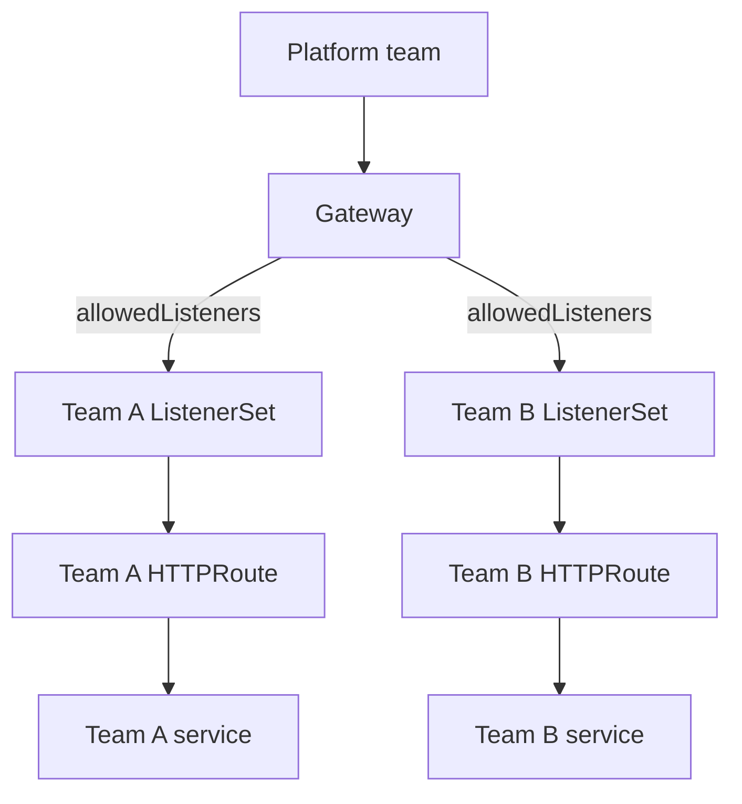

# Multi-team shared gateway

Enterprises running multiple application teams on Azure Kubernetes Service (AKS) often want to standardize application delivery without deploying and operating a separate gateway stack for every team. A centralized Application Gateway for Containers deployment gives the platform team one place to manage Azure gateway infrastructure, frontends, lifecycle, and security capabilities such as TLS and Web Application Firewall (WAF). Centralization shouldn't require the platform team to configure every application hostname and route.

Application Gateway for Containers supports a multi-team operating model that separates platform ownership from application onboarding. The platform team controls access to the gateway and its shared infrastructure. Application teams independently configure how their applications receive traffic while continuing to use the routing, TLS, security, and observability capabilities of Application Gateway for Containers.

ALB Controller exposes this model through Gateway API [`ListenerSet`](https://gateway-api.sigs.k8s.io/geps/gep-1713/) resources. The platform team authorizes selected namespaces on an Application Gateway for Containers-backed Gateway. Application teams create ListenerSets and routes in those namespaces, and ALB Controller combines that configuration and programs it onto the Application Gateway for Containers data plane. Because each ListenerSet is separate from the Gateway and other ListenerSets, teams don't need permission to modify platform-owned or other teams' configuration.

This approach provides:

- A common Application Gateway for Containers data plane and frontend for multiple application teams.
- Central control of gateway infrastructure, lifecycle, and security capabilities.
- Self-service hostname and route onboarding for application teams.
- Namespace-based control over which teams may add listeners to the Gateway.
- Independent status and policy scope for each team's listeners.

## Roles and responsibilities

A delegated listener model typically separates responsibilities as follows:

| Role | Responsibilities |
| --- | --- |
| Platform team | Owns the Application Gateway for Containers resource, Gateway, frontend addresses, and the namespaces that may attach ListenerSets |
| Application team | Owns a ListenerSet, the listeners defined in it, routes attached to those listeners, and its backend workloads |

The platform team doesn't need to add a listener to the Gateway each time an application team onboards a hostname. Instead, it authorizes selected namespaces, and each authorized team manages a ListenerSet in its own namespace. Use Kubernetes role-based access control (RBAC) to limit each team to its own namespace and reserve write access to the parent Gateway for the platform team.

## How delegation works

Delegation uses two separate attachment controls:

- The parent Gateway's `spec.allowedListeners` field determines which namespaces can attach `ListenerSets`.
- Each listener's `allowedRoutes` field determines which routes can attach to that listener.

These controls grant different permissions. `allowedListeners` delegates listener management; `allowedRoutes` delegates route attachment. Allowing a namespace to attach a `ListenerSet` doesn't automatically allow every route to attach to its listeners. These fields control Gateway API attachment. Use Kubernetes RBAC to control who can create or change the resources.

Gateways don't accept `ListenerSets` by default. The platform team must configure `allowedListeners.namespaces.from` with one of the following values:

| Value | ListenerSets that can attach |
| --- | --- |
| `None` | No ListenerSets |
| `Same` | ListenerSets in the Gateway's namespace |
| `All` | ListenerSets in any namespace |
| `Selector` | ListenerSets in namespaces whose labels match the configured selector |

Use `Selector` when application namespaces follow an onboarding or governance process. It delegates configuration only to namespaces carrying an approved label, without opening the Gateway to every namespace in the cluster.

The `ListenerSet` references its parent Gateway through `spec.parentRef`. Application routes then reference the `ListenerSet` instead of the Gateway. A route can use `sectionName` to select one listener in the `ListenerSet`.

## Listener merging and conflicts

Application Gateway for Containers programs the parent Gateway's listeners and the listeners from its attached ListenerSets onto the same gateway infrastructure. Listener names don't need to be unique across the Gateway and its ListenerSets.

When listeners conflict, precedence is determined in this order:

1. Listeners defined on the parent Gateway.
1. Listeners from the oldest ListenerSet.
1. If creation timestamps are equal, ListenerSets ordered alphabetically by `<namespace>/<name>`.

A lower-precedence listener that conflicts on hostname, port, or protocol isn't programmed. Other valid listeners in the same ListenerSet can continue to operate. Review each listener's status conditions instead of relying only on the ListenerSet's top-level status.

## Namespace and reference boundaries

A ListenerSet can be in the same namespace as its parent Gateway or in another namespace allowed by `spec.allowedListeners`.

Cross-namespace object references made by a ListenerSet follow Gateway API `ReferenceGrant` rules. For example, when an HTTPS listener refers to a certificate Secret in another namespace, that Secret's namespace must contain a `ReferenceGrant` that permits the ListenerSet to reference it.

Reference grants aren't inherited between the parent Gateway and its ListenerSets:

- A grant for a Gateway doesn't authorize a ListenerSet.
- A grant for a ListenerSet doesn't authorize the parent Gateway or a sibling ListenerSet.

The same principle applies to routes and their cross-namespace backend references. The resource making the reference must be authorized by a grant in the target namespace.

## Policy scope

A policy that supports `ListenerSet` as a target can apply to one ListenerSet without changing listeners on the parent Gateway or sibling ListenerSets. A policy can use `sectionName` when that policy supports targeting an individual ListenerSet listener.

Policy target support is policy-specific. Don't assume that every policy that can target a Gateway can also target a ListenerSet. Review the documentation for the policy before using it with delegated listeners.

Policies attached to routes continue to apply when those routes use a ListenerSet as their parent.

## Status and operations

Use both top-level and per-listener status conditions when diagnosing a ListenerSet:

- `Accepted=True` indicates that the ListenerSet can attach to its parent Gateway. A ListenerSet with a mix of valid and invalid listeners can still be accepted.
- `Programmed=True` indicates that the accepted ListenerSet configuration was programmed.
- Per-listener `Accepted`, `Programmed`, `ResolvedRefs`, and `Conflicted` conditions identify listener-specific problems.
- The parent Gateway reports the number of attached ListenerSets.

If the platform team changes `allowedListeners` so that a previously attached ListenerSet is no longer allowed, Application Gateway for Containers withdraws its listeners from the data path. Treat changes to namespace labels and `allowedListeners` as production routing changes.

## Delegation isn't infrastructure isolation

ListenerSets provide configuration ownership and policy scoping on shared gateway infrastructure. They don't create:

- A separate Application Gateway for Containers data plane.
- An independent frontend address.
- A separate scaling or failure domain.
- A complete security boundary between tenants.

Use separate Gateways or Application Gateway for Containers deployments when workloads require independent infrastructure, lifecycle, capacity, or stronger isolation guarantees.

## When to use delegated listeners

Use ListenerSets when:

- A platform team owns a Gateway that multiple application teams use.
- Application teams need to onboard and manage hostnames independently.
- Kubernetes RBAC prevents application teams from modifying the Gateway.
- A common infrastructure and failure domain is acceptable.

Use listeners directly on the Gateway when one team owns the Gateway and all of its listener configuration. Use separate gateways when teams require independent infrastructure or isolation.

## Next steps

To configure namespace-based delegation and attach an application route, see [Configure a multi-team shared gateway with Gateway API ListenerSet](how-to-multi-team-listeners-gateway-api.md).
