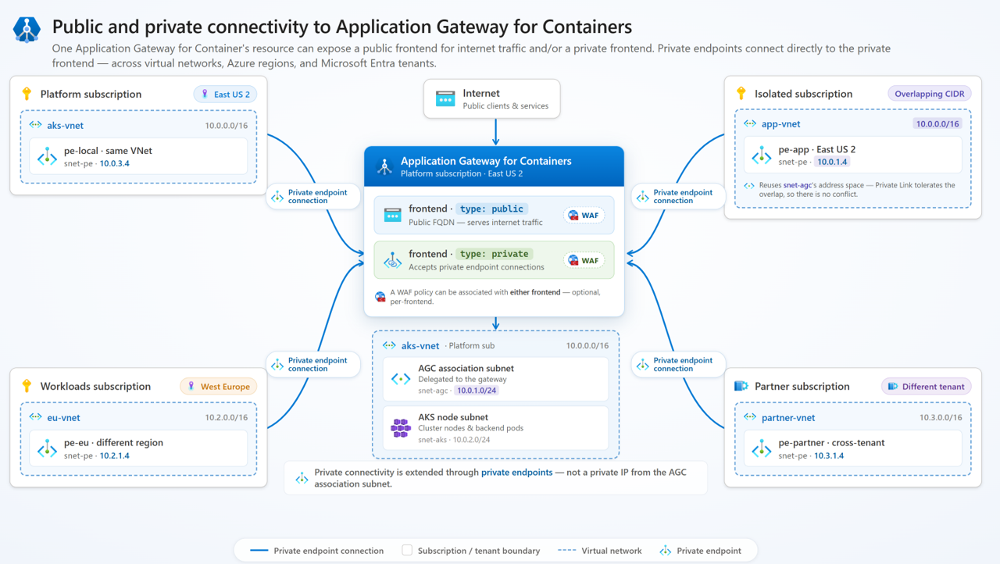

# Private ingress with Application Gateway for Containers

> [!IMPORTANT]
> Private ingress for Application Gateway for Containers is currently in **preview**.
> See the [Supplemental Terms of Use for Microsoft Azure Previews](https://azure.microsoft.com/support/legal/preview-supplemental-terms/) for legal terms that apply to Azure features that are in beta, preview, or otherwise not yet released into general availability.

Many workloads today are designed to be internet-facing applications. However, many applications continue to be private as supporting services or are intended to be provided only to internal lines of business. This restriction might be due to organizational policy, compliance requirements, or because another service (a CDN, a firewall, or a partner gateway) is the intended internet entry point.

Private ingress on Application Gateway for Containers removes the public IP address from the frontend. The gateway still accepts traffic, but only from clients connected through an Azure Private Link private endpoint. Because private endpoints work across virtual networks, subscriptions, and Microsoft Entra tenants, the same isolation model scales from a simple single-VNet deployment to complex multi-subscription enterprise topologies.

## Why private ingress

Consider a workload that should only receive traffic from a known set of upstream services. Without a private frontend, the Application Gateway for Containers FQDN resolves to a public IP that anyone on the internet can send requests to. Even with Network Security Groups, WAF policies, and authentication controls at the application layer, an organization might disallow exposing a public IP to remove internet exposure risk.

A private frontend eliminates that exposure. There's no public IP address to discover, scan, or attack. The only way to reach the frontend is through an explicitly provisioned and approved private endpoint connection. This architecture provides:

- **Elimination of internet attack surface**: No public IP means no direct internet path to the frontend, regardless of what firewall rules or WAF policies are in place.
- **Enforcement of known ingress paths**: Every client must be explicitly provisioned with a private endpoint. Connections from unknown sources are structurally impossible, not just filtered.
- **Cross-boundary private connectivity**: Private Link private endpoints work across VNets, Azure subscriptions, and Microsoft Entra tenants. A partner organization, a separate business unit, or a service in a different region can connect privately without VNet peering, shared address spaces, or transit routing.
- **Compliance and data residency controls**: For regulated workloads, ensuring that inbound traffic never traverses the public internet is often a hard requirement. Private ingress provides an architecture that satisfies that constraint at the network layer, not just the policy layer.

## Design patterns

Private ingress is most valuable when Application Gateway for Containers sits behind an upstream service that is the actual internet entry point. The following sections describe the most common patterns.

### Network virtual appliance or firewall as the internet entry point

Some organizations require all internet-facing traffic to pass through a centralized network virtual appliance (NVA) or firewall service—for threat intelligence filtering, intrusion detection and prevention (IDPS), TLS inspection, or compliance logging. Application Gateway for Containers private ingress enables that topology by allowing the firewall to connect to a private frontend via a private endpoint.

```
[Internet client] → [Azure Firewall / NVA (IDPS, TLS inspection)] 
                  → [Private Endpoint] → [AGC private frontend] → [AKS pod]
```

> [!IMPORTANT]
> **Client IP visibility is lost in this topology.** When an Azure Firewall or NVA sits in front of Application Gateway for Containers, the firewall performs SNAT on the traffic before passing it to the private endpoint. As a result, Application Gateway for Containers sees the firewall instance's IP address—not the original client's IP address—as the source. The `X-Forwarded-For` header inserted by Application Gateway for Containers will contain the firewall's private IP, not the end user's address.
>
> For workloads that require the original client IP (for geolocation, logging, rate limiting by IP, or fraud detection), this is a significant tradeoff. For this reason, many deployments place Application Gateway for Containers **in front of** the firewall rather than behind it. In the reverse topology, Application Gateway for Containers receives internet traffic directly, inserts the original `X-Forwarded-For` header, and the firewall inspects traffic between Application Gateway for Containers and the AKS cluster—preserving the client IP for application use. For detailed guidance on combining Application Gateway and Azure Firewall, see [Azure Firewall and Application Gateway for virtual networks](/azure/architecture/example-scenario/gateway/firewall-application-gateway).

The firewall-in-front topology is appropriate when:
- Client IP visibility is not required by the application.
- Centralized firewall policy mandates that **all** internet-bound traffic enters through a single NVA, and exceptions to that policy aren't permitted.
- Another upstream service (such as Azure Front Door) already inserts the original client IP into an HTTP header that the application can consume.

### Internal applications with no internet access

Not every Kubernetes workload serves internet traffic. Internal APIs, corporate portals, data pipelines, and platform services are often accessed only by clients inside an organization's network. A private frontend with private endpoints to known VNets or connected on-premises networks is a natural fit.

```
[Corporate client (on-premises or internal VNet)] 
  → [Private Endpoint] → [AGC private frontend] → [AKS pod]
```

In this pattern, Application Gateway for Containers provides Kubernetes-native Layer 7 routing, health probing, WAF, and TLS—all the capabilities of a public deployment—without the internet exposure.

### Cross-cluster service communication

When services running in separate Kubernetes clusters need to communicate with each other, the routing path matters. If Cluster A calls a service exposed by Cluster B through a public frontend, that traffic hairpins out to a public IP and back—even if both clusters are in the same region. That routing creates unnecessary exposure and unnecessary latency for what should be private, internal traffic.

A private frontend on Application Gateway for Containers resolves both problems. Cluster A connects to Cluster B's Application Gateway for Containers private frontend through a private endpoint, so traffic stays entirely within Azure's private network fabric.

```
[Pod in Cluster A] → [Private Endpoint] → [AGC private frontend (Cluster B)] → [AKS pod (Cluster B)]
```

This pattern scales cleanly across regions without requiring VNet peering. When Cluster A is in Region A and Cluster B is in Region B, establishing VNet peering across regions introduces routing complexity and shared address space constraints. A private endpoint connection, by contrast, works across any Azure regions without peering—and tolerates overlapping CIDR ranges between the two clusters' VNets. Service discovery is handled through DNS: each cluster resolves the private frontend FQDN to the private endpoint IP address allocated in its own subnet.

### Cross-subscription and cross-tenant access

Private endpoints work across Azure subscriptions and Microsoft Entra tenants. This makes private ingress useful when:

- A platform team manages Application Gateway for Containers in a shared services subscription, and application teams in separate subscriptions need to connect to it privately.
- A partner organization in a different Microsoft Entra tenant needs to access a shared service without establishing VNet peering or transitive routing.
- Isolated test or staging environments with overlapping IP address spaces need to connect to a shared ingress endpoint. Private Link tolerates overlapping CIDRs because connectivity doesn't depend on IP routing at the VNet layer.

## How it works

An Application Gateway for Containers public frontend exposes an FQDN that resolves to an internet-routable IP address. A private frontend has no public IP address. The FQDN that the service generates resolves only after a private endpoint is connected and approved, and only to the private IP address allocated in the client's subnet.

The following diagram shows the topology of private ingress across multiple subscriptions and tenants:

[](./media/private-ingress/private-ingress-topology.png#lightbox)

> [!IMPORTANT]
> Private connectivity is extended through **private endpoints**—not from a private IP on the Application Gateway for Containers association subnet. The association subnet is an internal implementation detail and isn't directly addressable by remote clients.

## Frontend types

The Kubernetes gateway class (Gateway API) or Ingress class annotation (Ingress API) determines whether Application Gateway for Containers creates a public or private frontend.

| Class | Frontend type | Description |
|---|---|---|
| `azure-alb-external` | Public | Creates a frontend with an internet-accessible, routable public IP address. |
| `azure-alb-internal` | Private | Creates a frontend with no public IP address. Access is only possible through connected and approved private endpoints. |

For the Ingress API, specify the class using the `kubernetes.io/ingress.class` annotation with either `azure-alb-external` or `azure-alb-internal`.

A single Application Gateway for Containers resource can have both a public and a private frontend simultaneously. This configuration allows you to serve internet traffic on one frontend and private traffic on another, with separate routing rules and WAF policies for each.

## Private endpoint connectivity

When you create a private endpoint that targets an Application Gateway for Containers private frontend, you must approve the connection before traffic can flow:

- **Automatic approval**: When the private endpoint and the Application Gateway for Containers resource are in the same subscription, connections may be automatically approved at creation time if you have private endpoint permissions.
- **Manual approval**: For cross-subscription or cross-tenant scenarios, the Application Gateway for Containers resource owner must manually approve the private endpoint connection.

The following table summarizes supported connectivity topologies:

| Scenario | Details |
|---|---|
| Same virtual network | A subnet in the same virtual network as the Application Gateway for Containers association subnet. |
| Remote virtual network, same region | Any virtual network in the same Azure region, regardless of peering. |
| Remote virtual network, different region | Any virtual network in a different Azure region. Overlapping CIDRs are tolerated. |
| Different subscription, same tenant | Any virtual network in a different Azure subscription within the same Microsoft Entra tenant. |
| Different subscription, different tenant | Any virtual network in a different Azure subscription and a different Microsoft Entra tenant. |

## Web Application Firewall support

You can associate WAF policies with a private frontend by using a `SecurityPolicy` resource, just like with public frontends. WAF association is per frontend and optional. For more information, see [Web Application Firewall on Application Gateway for Containers](web-application-firewall.md).

## Limitations

- Private frontend configuration is available to Application Gateway for Containers association resources that you create on or after April 23, 2026.
- Private frontends are only available in REST API version **2026-03-01** and greater.
- ALB Controller v1.13 or newer must be used

## Related content

- [Configure private ingress with Application Gateway for Containers - Gateway API](how-to-private-ingress-gateway-api.md)
- [Application Gateway for Containers components](application-gateway-for-containers-components.md)
- [Azure Firewall and Application Gateway for virtual networks](/azure/architecture/example-scenario/gateway/firewall-application-gateway)
- [Azure Front Door Private Link origins](../../frontdoor/private-link.md)
