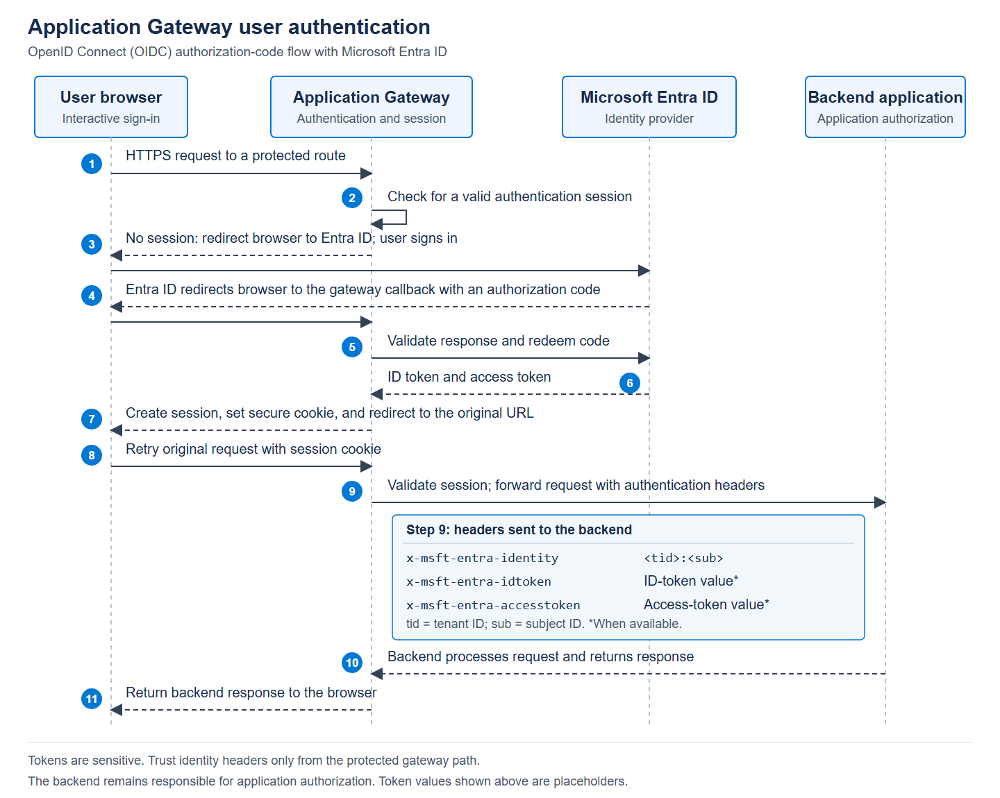
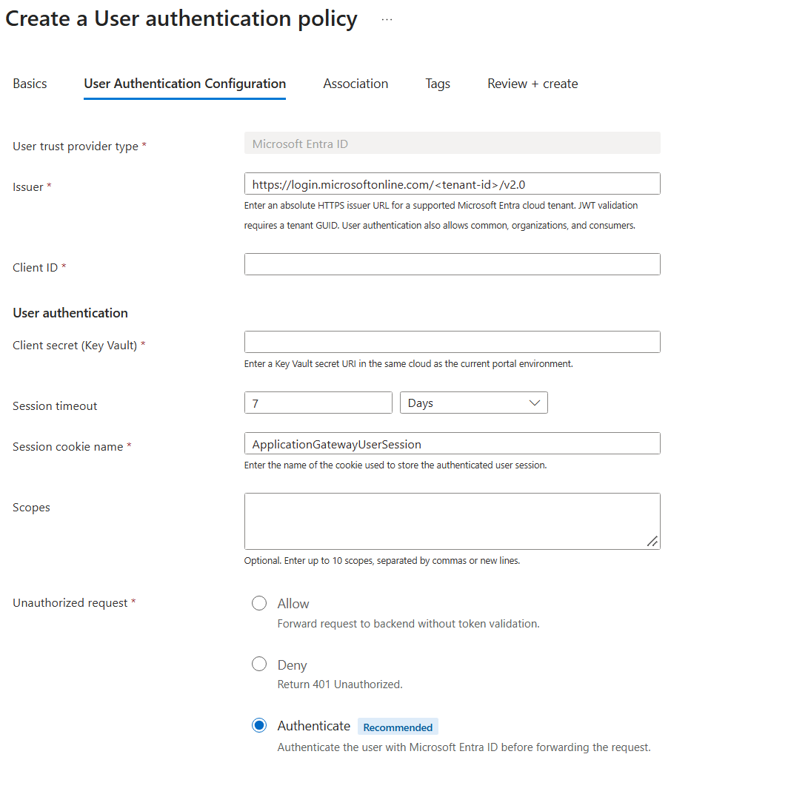

# User authentication in Azure Application Gateway (preview)

You can configure [Azure Application Gateway](/azure/application-gateway/overview) to authenticate users before they access your web applications. Application Gateway uses the OpenID Connect (OIDC) authorization-code flow to redirect unauthenticated browser users to an identity provider, establish an authenticated session, and forward authenticated requests to your backend.

Configure user authentication through a centralized authentication policy. One policy can protect routing rules on multiple Application Gateway instances, helping you apply consistent sign-in and session configuration across applications.

> [!NOTE]
> Application Gateway user authentication is currently in preview. This preview version is provided without a service-level agreement and isn't recommended for production workloads. Certain features might not be supported or might have constrained capabilities. For more information, see [Supplemental Terms of Use for Microsoft Azure Previews](https://azure.microsoft.com/support/legal/preview-supplemental-terms/).

## Key capabilities

- **OIDC user sign-in**: Uses the authorization-code flow to authenticate browser users with an identity provider.
- **Authentication offload**: Handles redirects, authorization-code redemption, and authenticated sessions at the gateway.
- **Central policy management**: Defines sign-in and session settings once instead of repeating them for each gateway.
- **Multiple gateway associations**: Applies one authentication policy to routing rules across multiple Application Gateway instances.
- **Flexible request handling**: Authenticates, allows, or denies unauthenticated requests according to the policy.

### User authentication vs. JWT validation

Use user authentication when:

- Browser users need interactive sign-in.
- You want Application Gateway to manage redirects, authorization-code redemption, and session cookies.
- You want users to access the app without sending a bearer token on every request.

Use JWT validation when:

- Clients (API, service, automation) send bearer tokens on every request.
- You need token-based validation without interactive browser redirects.

| Capability | User authentication | JWT validation |
| --- | --- | --- |
| Primary client | Web browser and interactive user | API client, service, or workload |
| Protocol behavior | OIDC authorization-code flow | JWT bearer-token validation |
| Redirect to identity provider | Yes | No |
| Gateway session cookie | Yes | No |
| Token required on every request | No | Yes |

## Prerequisites

Before you create a user authentication policy:

- Create or use a Standard_v2 or WAF_v2 Application Gateway.
- Configure an HTTPS listener, trusted TLS certificate, backend target, and an eligible routing rule.
- Use a public DNS name whose certificate matches the application host name.
- Ensure Application Gateway can reach Microsoft Entra ID and Azure Key Vault over HTTPS.
- Enable a managed identity on each associated Application Gateway.
- Grant each gateway managed identity permission to read the Key Vault secret.

During preview, Basic and Advanced routing rules are supported (including Advanced rules with path conditions). The separate path-based routing rule type isn't supported.

## Register an application in Microsoft Entra ID

1. In the [Azure portal](https://portal.azure.com), go to **Microsoft Entra ID** > **App registrations**.
2. Select **New registration**.
3. Enter a name for the web application.
4. Select the supported account type, and then select **Register**.
5. Record the **Application (client) ID** and **Directory (tenant) ID**.
6. Go to **Certificates & secrets**, create a client secret, and copy the secret value.
7. Go to **Authentication**. Add or edit the **Web** platform redirect URI.
8. When you create the user authentication policy, copy the generated callback URI and add that exact value as the redirect URI. The scheme, host, path, port, and character casing must match exactly.

OIDC requires the `openid` scope. Add `profile`, `email`, or app-specific scopes only when your application requires those claims.

## Store the client secret in Azure Key Vault

For Key Vault creation and setup instructions, see [Quickstart: Set and retrieve a secret from Azure Key Vault using Azure portal](/azure/key-vault/secrets/quick-create-portal).

1. Create or select an Azure Key Vault.
2. Add the app registration client secret as a Key Vault secret.
3. Grant each associated Application Gateway managed identity permission to read the secret.
4. Record the Key Vault secret identifier (URI), which you use in policy configuration.

> [!IMPORTANT]
> Don't paste client secrets into documentation, scripts, policy JSON, or Application Gateway configuration directly. Store secrets in Azure Key Vault and reference the secret identifier.

## User authentication flow

Headers that the gateway forwards to the backend after it validates the session can include:

- `x-msft-entra-identity` (`<tid>:`)
- `x-msft-entra-idtoken` (when available)
- `x-msft-entra-accesstoken` (when available)

## Create a centralized user authentication policy

1. In the [Azure portal](https://ms.portal.azure.com/?exp.AzurePortal_isauthenticationpolicyon=true#home), open the Application Gateway that has the routing rules you want to protect.
2. Under **Settings**, select **Authentication policies (Preview)**.
3. Select **Create** > **User authentication**.
4. Configure **Basics**:

   | Field | Required | Value |
   | --- | --- | --- |
   | **Subscription** | Yes | The subscription that contains the gateway. |
   | **Resource group** | Yes | The resource group that contains the gateway. Select **Create new** to add one. |
   | **Policy for** | Read-only | **Application gateway (Regional)**. |
   | **Policy name** | Yes | A name that's unique in the resource group. |
   | **Region** | Yes | The gateway's region. |

5. Configure **User Authentication Configuration**:

   | Field | Required | Value |
   | --- | --- | --- |
   | **User trust provider type** | Read-only | **Microsoft Entra ID**. |
   | **Issuer** | Yes | `https://login.microsoftonline.com/<tenant-id>/v2.0` for Azure public cloud. Replace `<tenant-id>` with the Directory (tenant) ID. For other supported Entra clouds, use the corresponding HTTPS issuer URL. |
   | **Client ID** | Yes | The **Application (client) ID** from the app registration. |
   | **Client secret (Key Vault)** | Yes | The Key Vault secret URI from the previous section. Use a vault in the same cloud as the portal. |
   | **Session timeout** | No | The session lifetime, expressed in days, hours, or minutes. Default: 7 days. |
   | **Session cookie name** | Yes | The session cookie name. Default: `ApplicationGatewayUserSession`. |
   | **Scopes** | No | Up to 10 scopes, separated by commas or new lines. Default: `openid, profile, email`. |
   | **Unauthorized request** | Yes | **Authenticate**, **Allow**, or **Deny**, as described in [Choose unauthenticated-request behavior](#choose-unauthenticated-request-behavior). |

   

6. Configure **Association**:
   1. Select the Application Gateway. Only gateways in the selected subscription, resource group, and region appear.
   2. Select the routing rules that should require sign-in.
   3. Repeat for additional eligible gateways that should share the policy.

7. (Optional) Add **Tags** to categorize the policy.
8. On **Review + create**, review settings and select **Create**.
9. Wait for status to show **Provisioned** on the **Authentication policies (Preview)** page.

Settings on a centralized policy apply to every associated routing rule. Use a separate policy when applications require different tenants, client registrations, scopes, session settings, or unauthenticated-request behavior.

During preview, a routing rule must use an HTTPS listener to be eligible for an authentication policy. A routing rule can be associated with only one authentication policy at a time.

## Choose unauthenticated-request behavior

| Action | Behavior | Typical use |
| --- | --- | --- |
| **Authenticate** (recommended) | Redirect the browser to the identity provider. | Applications that require users to sign in. |
| **Allow** | Forward the request without starting sign-in. | Applications that intentionally support both anonymous and personalized experiences. |
| **Deny** | Return `401 Unauthorized` without a redirect. | Routes that must reject anonymous access without an interactive flow. |

Use **Authenticate** for the standard browser sign-in experience. If you select **Allow**, your backend must safely handle both authenticated and anonymous requests.

## Expected outcomes of requests

| Request | `Authenticate` behavior | `Allow` behavior | `Deny` behavior |
| --- | --- | --- | --- |
| Valid session | Forward to backend | Forward to backend | Forward to backend |
| No session | Start sign-in redirect flow | Forward unauthenticated | Return `401 Unauthorized` |
| Expired/invalid session | Start sign-in redirect flow | Forward unauthenticated | Return `401 Unauthorized` |

## Verify the setup

1. Open a private browser window and browse to a protected URL.
2. Verify redirect to Microsoft Entra ID and successful sign-in for an authorized user.
3. Verify redirect back to the registered callback URI and then to the original URL.
4. Verify the backend receives and processes the request successfully.
5. Verify backend authorization decisions are correct for the signed-in user (for example, role- or claim-based checks).
6. Verify backend logs and diagnostics show expected identity context for authenticated requests.
7. Refresh the page and confirm the existing session is reused.
8. Repeat with an unauthorized user, expired session, and an unassociated route.

## Troubleshoot user authentication

| Symptom | Expected HTTP status or error | What it typically means | First checks |
| --- | --- | --- | --- |
| Browser isn't redirected to sign in | No `302` challenge to Entra ID | Request didn't hit a route protected with **Authenticate**. | Confirm host/path maps to associated routing rule and policy action is **Authenticate**. |
| Redirect loop after sign-in | Repeated `302` redirects between app and Entra ID | Session cookie isn't being persisted, or callback/host mismatch exists. | Verify cookie acceptance, session timeout, consistent host name, and exact redirect URI registration. |
| Sign-in fails at callback | `404` at callback path, or app error page | Redirect URI or route mapping doesn't match configured callback endpoint. | Confirm callback URI from policy exactly matches app registration and reaches the associated listener/rule. |
| Unauthenticated request rejected | `401 Unauthorized` | Expected when action is **Deny** and request has no valid session. | Confirm this behavior is intended; otherwise change action to **Authenticate** or **Allow**. |
| Sign-in completes but backend returns forbidden | `403 Forbidden` or app-specific authorization error | User is authenticated, but backend authorization fails. | Validate backend role/claim/scope checks and tenant-specific authorization logic. |
| Token/code redemption or provider call failure | `5xx` from gateway/app and sign-in doesn't complete | Gateway can't complete identity-provider or secret access path. | Verify issuer URL, client ID, client secret URI, managed identity access to Key Vault, and network reachability. |
| Backend misses identity context headers | Backend logs missing `x-msft-entra-identity` | Request bypassed protected path or backend trust logic is incorrect. | Verify request reaches protected rule, successful session validation occurred, and backend trusts headers only from the gateway path. |

## Related content

- [JSON Web Token (JWT) validation in Azure Application Gateway](json-web-token-overview.md)
- [OpenID Connect on the Microsoft identity platform](/entra/identity-platform/v2-protocols-oidc)
- [OAuth 2.0 authorization-code flow](/entra/identity-platform/v2-oauth2-auth-code-flow)
- [Use Azure Key Vault secrets](/azure/key-vault/secrets/quick-create-portal)
