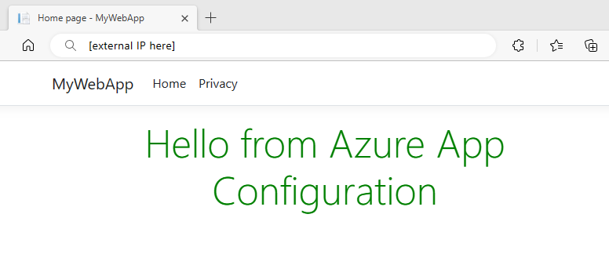
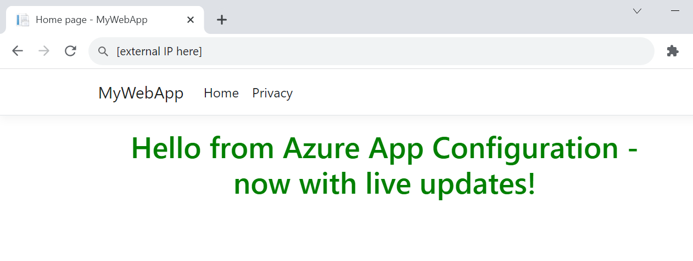

# Tutorial: Use dynamic configuration in Azure Kubernetes Service

If you use Azure Kubernetes Service (AKS), this tutorial shows you how to enable dynamic configuration for your workloads in AKS by leveraging Azure App Configuration and its Kubernetes Provider. The tutorial assumes that you work through the quickstart and have an App Configuration Kubernetes Provider set up, so before proceeding, make sure you complete the [Use Azure App Configuration in Azure Kubernetes Service](./quickstart-azure-kubernetes-service.md) quickstart.

> [!TIP]
> See [options](./howto-best-practices.md#azure-kubernetes-service-access-to-app-configuration) for workloads hosted in Kubernetes to access Azure App Configuration.

## Prerequisites

Finish the quickstart: [Use Azure App Configuration in Azure Kubernetes Service](./quickstart-azure-kubernetes-service.md).

## Reload data from App Configuration

1. Open the *appConfigurationProvider.yaml* file located in the *Deployment* directory. Then, add the `refresh` section under the `configuration` property. It enables the Kubernetes provider to reload the entire configuration whenever it detects a change in any of the selected key-values (those starting with *Settings:* and having no label). For more information about monitoring configuration changes, see [Best practices for configuration refresh](./howto-best-practices.md#configuration-refresh).

    ```yaml
    apiVersion: azconfig.io/v1
    kind: AzureAppConfigurationProvider
    metadata:
      name: appconfigurationprovider-sample
    spec:
      endpoint: <AppConfigurationEndpoint>
      target:
        configMapName: configmap-created-by-appconfig-provider
        configMapData: 
          type: json
          key: mysettings.json
      auth:
        workloadIdentity:
          managedIdentityClientId: <ManagedIdentityClientId>
      configuration:
        refresh:
          enabled: true
    ```

    > [!TIP]
    > You can set the `interval` property of the `refresh` to specify the minimum time between configuration refreshes. In this example, you use the default value of 30 seconds. Adjust to a higher value if you need to reduce the number of requests made to your App Configuration store.

1. Open the *deployment.yaml* file in the *Deployment* directory and add the following content to the `spec.containers` section. Your application loads configuration from a volume-mounted file the App Configuration Kubernetes provider generates. By setting this environment variable, your application can [use polling to monitor changes in mounted files](/dotnet/api/microsoft.extensions.fileproviders.physicalfileprovider.usepollingfilewatcher).

    ```yaml
    env:
    - name: DOTNET_USE_POLLING_FILE_WATCHER
      value: "true"
    ```

1. Run the following command to deploy the change. Replace the namespace if you're using your existing AKS application.
   
   ```console
   kubectl apply -f ./Deployment -n appconfig-demo
   ```

1. Open a browser window, and navigate to the IP address obtained in the [previous step](./quickstart-azure-kubernetes-service.md#deploy-the-application). The web page looks like this:

    


1. Update the following key-values in your App Configuration store.

    | Key | Value |
    |---|---|
    | Settings:Message | Hello from Azure App Configuration - now with live updates! |

1. After refreshing the browser a few times, you'll see the updated content once the ConfigMap is updated in 30 seconds.

    

## Reload ConfigMap and Secret

App Configuration Kubernetes provider generates ConfigMaps or Secrets that can be used as environment variables or volume-mounted files. This tutorial demonstrated how to load configuration from a JSON file using the [.NET JSON configuration provider](/dotnet/core/extensions/configuration-providers#json-configuration-provider), which automatically reloads the configuration whenever a change is detected in the mounted file. As a result, your application gets the updated configuration automatically whenever the App Configuration Kubernetes provider updates the ConfigMap.

If your application is dependent on environment variables for configuration, it may require a restart to pick up any updated values. In Kubernetes, the application restart can be orchestrated using rolling updates on the corresponding pods or containers. To automate configuration updates, you may leverage third-party tools like [stakater/Reloader](https://github.com/stakater/Reloader), which can automatically trigger rolling updates upon any changes made to ConfigMaps or Secrets.

## Troubleshooting

If configuration changes don't appear in your application, check the provider's status, the generated ConfigMap, and the provider logs.

### Check the provider status

Run the following command to view the provider's status:

```console
kubectl get AzureAppConfigurationProvider appconfigurationprovider-sample -n appconfig-demo -o yaml
```

After a successful sync, the `phase` field in the `status` section is `Complete`. The following excerpt shows the status of a provider with key-value refresh enabled:

```yaml
status:
  lastReconcileTime: "2026-10-29T02:47:56Z"
  lastSyncTime: "2026-10-29T02:47:56Z"
  message: Complete sync key-values from App Configuration to target ConfigMap or Secret.
  phase: Complete
  refreshStatus:
    lastKeyValueRefreshTime: "2026-10-29T02:41:05Z"
```

Use the timestamps in the `status` section to understand the provider's activity:

| Field | Description |
|---|---|
| `lastReconcileTime` | The time of the initial configuration load, or the latest check for changes if refresh is enabled. |
| `lastSyncTime` | The time of the most recent successful sync, even if no configuration values changed. |
| `refreshStatus.lastKeyValueRefreshTime` | The time of the last successful key-value refresh after a change was detected in a monitored key-value or sentinel key. |
| `refreshStatus.lastFeatureFlagRefreshTime` | The time of the last successful feature flag refresh after a change was detected in the selected feature flags. |
| `refreshStatus.lastKeyVaultReferenceRefreshTime` | The time of the last successful refresh of secrets from Key Vault. |

These timestamps don't indicate when the next refresh check will occur.

### Check the ConfigMap

Run the following command to view the ConfigMap's data and annotations:

```console
kubectl get configmap configmap-created-by-appconfig-provider -n appconfig-demo -o yaml
```

The `azconfig.io/LastReconcileTime` annotation under `metadata.annotations` records when the provider last created or updated the ConfigMap. It isn't updated on every refresh check.

> [!NOTE]
> This annotation differs from `status.lastReconcileTime` on the provider resource, which can update even when the ConfigMap isn't updated.

If the ConfigMap contains the updated values but your application still uses old values, see [Reload ConfigMap and Secret](#reload-configmap-and-secret).

### View provider logs

If the status shows an error or expected updates are missing, run the following command to view the provider logs:

```console
kubectl logs deployment/az-appconfig-k8s-provider -n azappconfig-system
```

Use the `message` field in the provider's status and any errors in the logs to investigate failed syncs. For common authentication and setup issues, see the [quickstart FAQ](./quickstart-azure-kubernetes-service.md#faq).

## FAQ

#### Why didn't the refresh timestamp change?

A refresh check doesn't always find new data. For example, `lastKeyValueRefreshTime` only advances when key-value refresh is enabled, the provider detects a change in the monitored key-values, and the refresh succeeds. A check that finds no changes can still update `lastReconcileTime` and `lastSyncTime`.

#### When will the provider check for changes again?

For Helm installations, set `logVerbosity` to `3` by passing `--set logVerbosity=3` when installing or upgrading the provider. The default value is `1`. For more information, see [Installation](./reference-kubernetes-provider.md#installation).

For example, the messages might include:

```text
There's no change to the selected key values, just exit and revisit them after refresh interval
Revisit AzureAppConfigurationProvider "appconfigurationprovider-sample" in "appconfig-demo" namespace after 29.793750266s
```

The first message indicates that the key-value check found no changes. The duration in the second message is the estimated wait until the earliest check across all enabled refresh types: key-values, feature flags, and Key Vault secrets. It applies specifically to key-values only when key-value refresh is the only enabled type. Delayed or failed requests can postpone updates.

#### What happens when the provider pod restarts?

After the provider pod restarts, it reloads the latest selected data from App Configuration. When this operation succeeds, it updates the generated ConfigMap and Secret (if configured), the sync timestamps, and the ConfigMap annotation. The refresh intervals start again, so the next check can occur at a different time than before the restart.

Restarting doesn't necessarily update `lastKeyValueRefreshTime` or `lastFeatureFlagRefreshTime`. These timestamps record successful refreshes after the provider detects changes, not every reload.

## Next steps

To learn more about the Azure App Configuration Kubernetes Provider, see [Azure App Configuration Kubernetes Provider reference](./reference-kubernetes-provider.md).