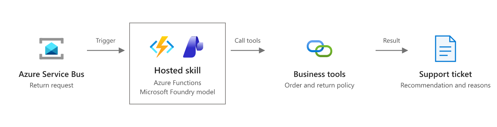
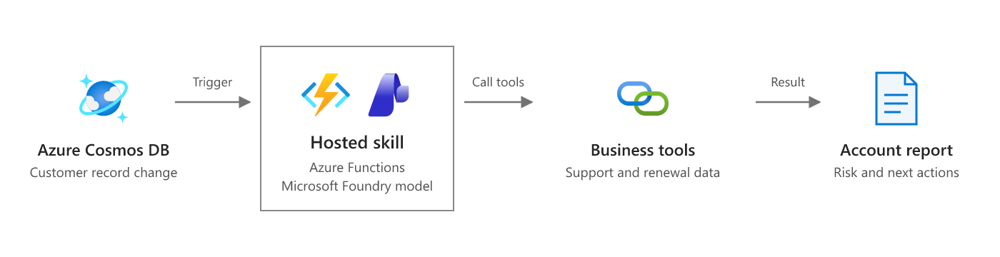
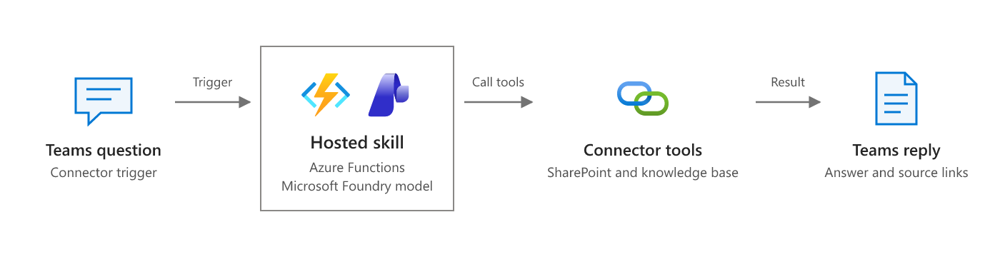
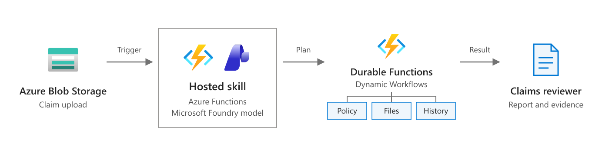
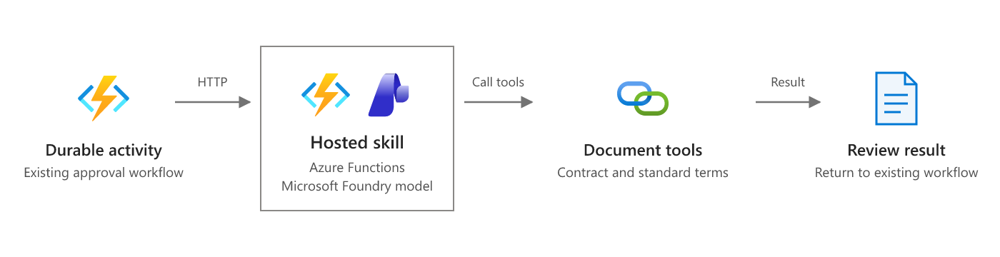
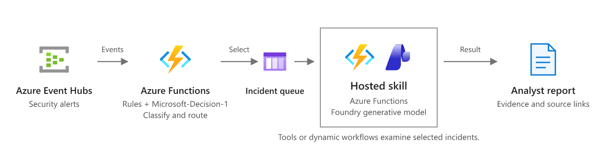
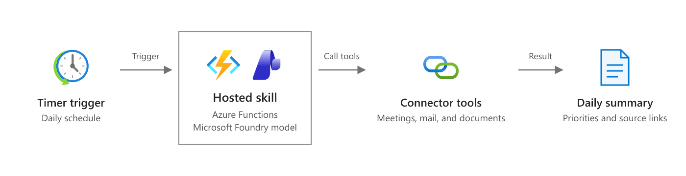
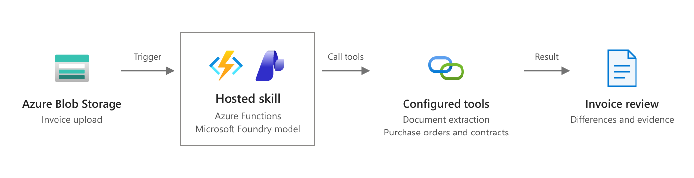

# Azure Functions hosted skills scenarios

Business events sometimes need more than a fixed set of rules. A customer request can need an explanation, a document can need comparison with a policy, or an alert can need evidence from several systems.

By using [Azure Functions hosted skills](functions-hosted-skills.md), you can define this work in an `.agent.md` file. A trigger starts the hosted skill. The hosted skill uses a model and configured tools to examine the input, get related information, and produce a result.

The following sections describe common scenarios. Use regular function code for fixed rules and exact calculations. Add a hosted skill where the work needs AI reasoning.

[!INCLUDE [functions-hosted-skills-preview](../../includes/functions-hosted-skills-preview.md)]

These scenarios are design examples, not complete sample applications. Configure the connections, tools, permissions, and business rules that each example needs. Available connector triggers and actions depend on the connected service and preview support.

## Process customer requests from messages

Use a queue-triggered hosted skill to handle requests that need information from several business systems.

For example, a customer requests a return after the return period ends because the product arrived damaged. An Azure Storage queue or Azure Service Bus queue starts the hosted skill. The hosted skill checks the order, return policy, and support history through configured tools. It then adds a recommendation and its reasons to a support ticket.

**Why hosted skills:** Hosted skills use an LLM, tools, and connectors to analyze complex requests against information from external systems and summarize the findings. You define this work in natural language instead of implementing the model and tool-calling loop in function code.

Keep refund and inventory changes behind business rules and approval checks. Use a request identifier to prevent duplicate messages from causing duplicate actions.

- [Configure queue and Service Bus triggers](functions-hosted-skills-reference.md#supported-trigger-types)
- [Design Azure Functions for identical input](functions-idempotent.md)

## Respond to database changes

Use a database-triggered hosted skill to investigate a record change and prepare the next action.

For example, a change in an Azure Cosmos DB customer record shows a decrease in product use. The hosted skill reads related support tickets and renewal information. It prepares a report for the account owner that explains the risk, lists the evidence, and suggests follow-up work.

**Why hosted skills:** A coded threshold check detects lower use, but doesn't explain it. A hosted skill combines support and renewal information to explain each case, rather than relying only on predefined diagnostic rules.

Store the report separately from the monitored records to avoid a loop in which the hosted skill triggers itself.

- [Configure database triggers](functions-hosted-skills-reference.md#supported-trigger-types)
- [Azure Cosmos DB trigger for Azure Functions](functions-bindings-cosmosdb-v2-trigger.md)

## Answer questions from connector events

Use a connector trigger to start a hosted skill when a question arrives in a connected service. Use connector tools to get source information and send the answer.

For example, a supported Microsoft Teams event in a dedicated help channel starts the hosted skill. The hosted skill searches an internal knowledge base or SharePoint documents through configured tools. It posts an answer with source links, or sends the question to a person when it can't find sufficient evidence.

**Why hosted skills:** A connector can start either type of function. Hosted skills add question interpretation and tool selection through Markdown instructions, instead of a coded search and response path for each question type.

Limit the trigger to the intended channel or supported mention event. Check that the recipient can access the source information before you include it in a reply.

- [Use managed connectors in Azure Functions](functions-connectors-overview.md)
- [Configure connector MCP tools](functions-hosted-skills-reference.md#azure-connectors)

## Plan a multistep review

Use dynamic workflows when the required checks depend on the input and independent checks can run in parallel.

For example, an uploaded insurance claim starts a hosted skill. The hosted skill creates a plan to check policy coverage, required documents, and claim history. A dynamic workflow runs the approved workflow-safe tools or specialist hosted skills through Durable Functions, then returns results for a review report.

**Why hosted skills:** Describe the review goal in natural language instead of writing Durable Functions orchestration code. The hosted skill builds a plan from the claim's contents and permitted tools, and Dynamic Workflows executes it through Durable Functions.

Dynamic workflows can preserve execution state through worker restarts. Explicitly grant the tools and specialists that a plan can use. Keep payment decisions in a separate approval process. Dynamic workflows are an experimental feature with [current limitations](functions-hosted-skills-dynamic-workflows.md#considerations).

- [Dynamic workflows in Azure Functions hosted skills](functions-hosted-skills-dynamic-workflows.md)
- [Create and run dynamic workflows](functions-hosted-skills-dynamic-workflows-how-to.md)

## Add AI to an existing workflow

Use a hosted skill for one reasoning step without replacing an existing business workflow.

For example, a contract approval process already uses Durable Functions for validation, legal review, approval, and signing. A durable activity calls an HTTP-triggered hosted skill to compare a new contract with standard terms. The hosted skill uses configured document tools and returns a structured review with nonstandard clauses, source references, and reasons for concern. The existing workflow uses the result to create a legal review task.

**Why hosted skills:** Clause meaning can differ even when keywords match. A hosted skill applies review instructions and document tools to explain those differences, while coded activities retain control of validation and approval.

Call the hosted skill from an activity, not directly from orchestrator code. This pattern uses HTTP integration; it doesn't require a hosted skill activity trigger. Keep approval and signing under the existing workflow's control.

- [Configure HTTP triggers and structured responses](functions-hosted-skills-reference.md#agent-file-reference)
- [Durable orchestrator code constraints](/azure/durable-task/common/durable-task-code-constraints)

## Investigate selected events

Use function code and a decision model to select events before you start AI-based investigations.

For example, Azure Event Hubs receives security alerts. A function applies fixed rules, removes duplicates, and groups related alerts into incidents. It then calls the Microsoft-Decision-1 decision API in Microsoft Foundry. A `choice` question selects an application-defined route, such as `investigate`, `aggregate`, `routine`, or `uncertain`, and returns probabilities for each option.

The function sends incidents selected for investigation to a queue-triggered hosted skill. The hosted skill uses a generative model and configured tools to examine logs, sign-in records, and network information. A dynamic workflow can run independent checks in parallel and prepare an evidence-based report for an analyst. Microsoft-Decision-1 selects the route; it doesn't generate investigation plans or written explanations.

**Why hosted skills:** Event selection doesn't explain an incident. A hosted skill can choose relevant evidence and investigation steps for each case, rather than requiring you to code every diagnostic path.

Keep critical alerts on a fixed-rule path that bypasses model filtering. Evaluate routing thresholds against labeled alerts, and send uncertain results or failed decisions for review instead of discarding alerts. Limit investigation concurrency and model usage.

- [Azure Event Hubs trigger for Azure Functions](functions-bindings-event-hubs-trigger.md)
- [Deploy and use Microsoft-Decision-1 in Microsoft Foundry](/azure/foundry/foundry-models/how-to/use-foundry-models-microsoft-decision)
- [Workflow incident triage sample](https://github.com/Azure/azure-functions-agents-runtime/tree/main/samples/workflow-incident-triage)

## Prepare a scheduled work summary

Use a timer-triggered hosted skill to collect related information from connected services on a schedule.

For example, a hosted skill runs each morning. It uses configured tools for Outlook, Teams, and document sources to find meetings, important messages, and unresolved requests. It sends a short summary with priorities, meeting preparation notes, and source links to an approved recipient.

**Why hosted skills:** A coded function can collect scheduled data. A hosted skill can connect meetings with messages and documents, then explain what needs attention rather than produce a fixed-format list.

Plan the schedule in UTC, or use a time zone setting that your hosting plan supports. For local business times, account for daylight saving changes. Limit source access and delivery to the intended user or group.

- [Configure a timer-triggered hosted skill](functions-hosted-skills-reference.md#trigger-examples)
- [Timer trigger time zones](functions-bindings-timer.md#ncrontab-time-zones)

## Process uploaded invoices

Use a blob-triggered hosted skill to compare an uploaded document with business records.

For example, a PDF invoice arrives in Azure Blob Storage. The hosted skill calls a document extraction tool, such as a custom tool that uses Azure AI Document Intelligence. It then compares the extracted fields with purchase orders and contract terms through configured business tools. It creates a review report that explains differences and links to the source records.

**Why hosted skills:** Coded checks can compare totals and identifiers. A hosted skill can interpret invoice descriptions and contract terms to explain a difference that exact field matching alone can't resolve.

Validate amounts and account identifiers with code. Require approval before payment, and prevent duplicate uploads from creating duplicate payment requests.

- [Configure blob triggers](functions-hosted-skills-reference.md#supported-trigger-types)
- [Add custom Python tools](functions-hosted-skills-reference.md#custom-python-tools)
- [Azure AI Document Intelligence overview](/azure/ai-services/document-intelligence/overview)

## Related content

- [What are Azure Functions hosted skills?](functions-hosted-skills.md)
- [Build an event-driven AI app with Azure Functions hosted skills](scenario-hosted-skills.md)
- [Build and test a hosted skill with the hosted skills canvas](functions-hosted-skills-canvas.md)
- [Azure Functions hosted skills reference](functions-hosted-skills-reference.md)
