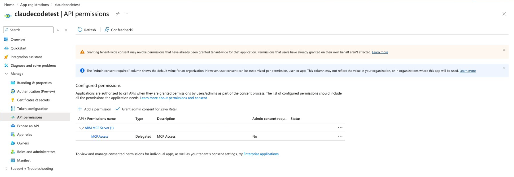
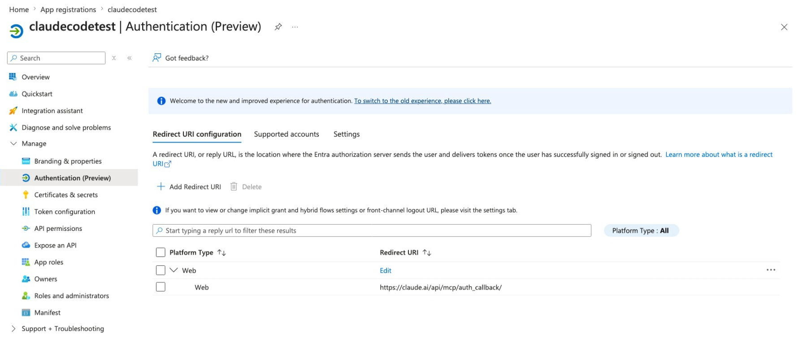
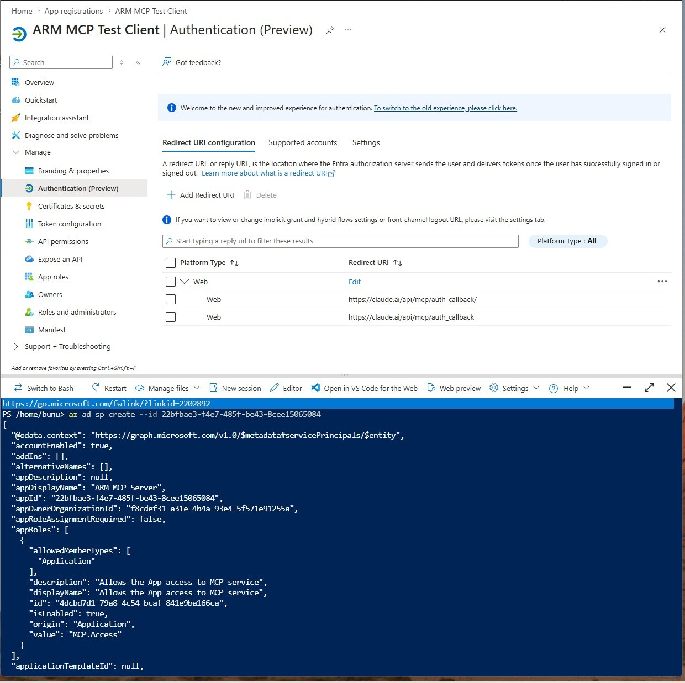
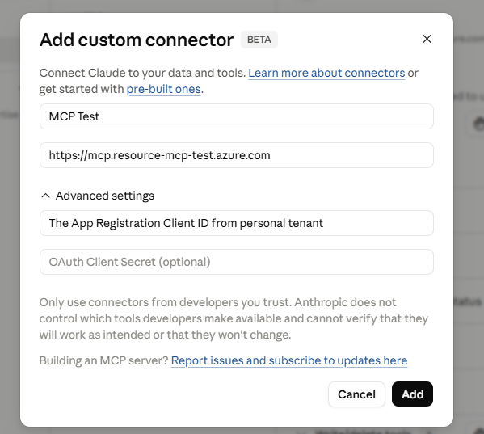
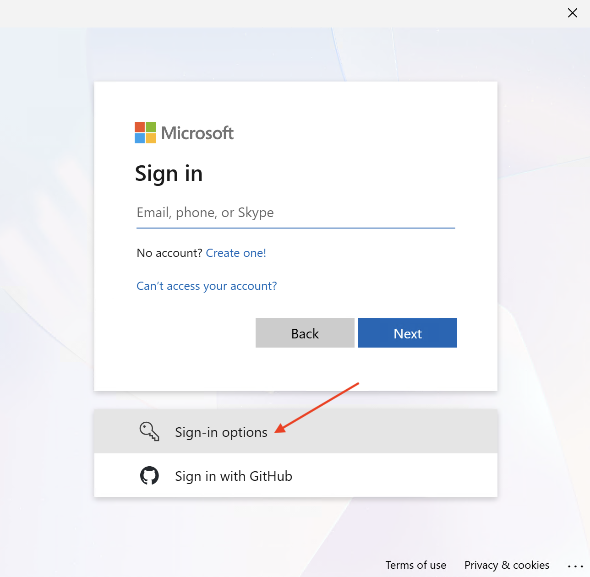
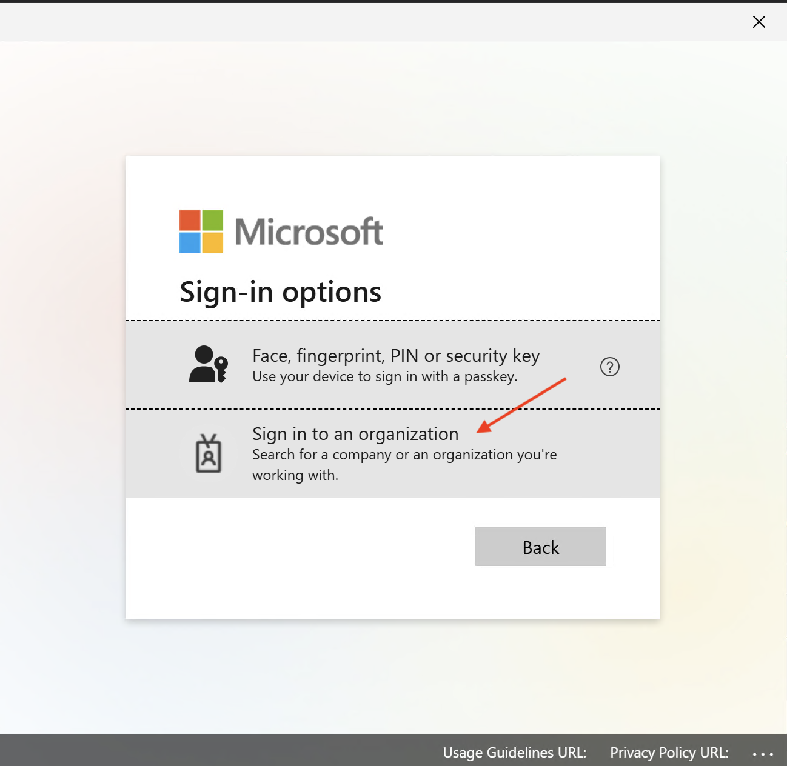
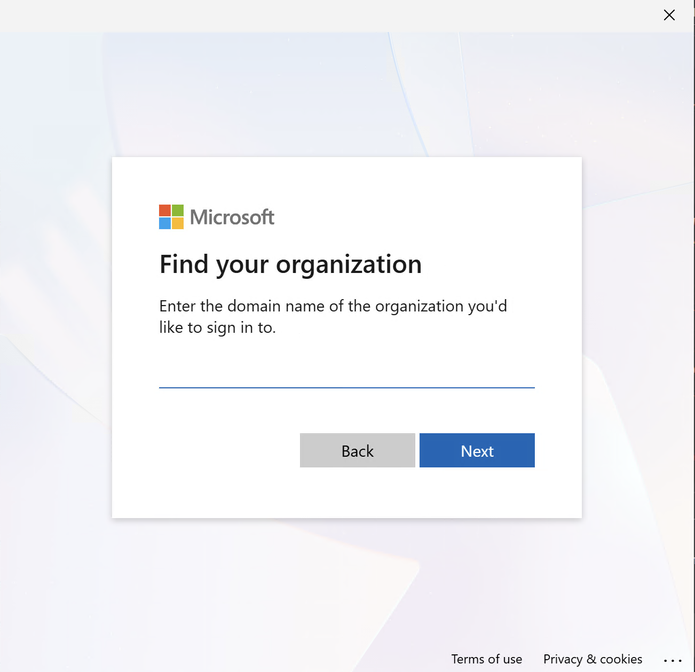
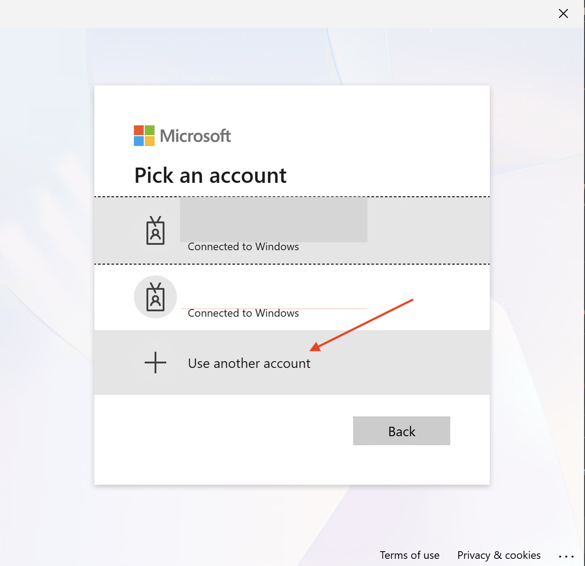

# Configure an MCP client for the ARM MCP server

Use this guide to connect your AI agent or harness of choice to the Azure Resource Manager (ARM) MCP server when it requires manual Microsoft Entra app registration or OAuth configuration. Your agent or harness must support MCP and the server's authentication requirements. In this guide, "MCP client" refers to the agent or harness connecting to the server.

Clients with built-in Microsoft Entra ID support, such as Visual Studio Code with GitHub Copilot and GitHub Copilot CLI, can use their supported setup and sign-in flows instead. See the [quickstart](azure-resource-manager-mcp-quickstart.md) for connection guidance and a Visual Studio Code setup example.

The following screenshots and connector configuration example in this article use Claude. The same Microsoft Entra app registration and ARM MCP endpoint concepts apply to other MCP clients, but their settings, OAuth flows, and callback requirements might differ.

## Prerequisites

- Permission to create or update Microsoft Entra app registrations in your tenant.
- Permission to grant delegated API permissions for the client app.
- Access to the target MCP client's connector or OAuth settings.

## Required endpoint and identity values

Use the following endpoint when configuring your client and app registration. The GUIDs in this article are fictitious examples. Obtain the current resource application ID and `MCP.Access` permission ID from the [ARM MCP server repository](https://github.com/Azure/Azure-Resource-Manager-MCP), and replace the example GUIDs in the scope, manifest, and command before using them.

| Setting | Value or example |
| --- | --- |
| Endpoint | `https://mcp.management.azure.com` |
| Resource application ID | `00001111-aaaa-2222-bbbb-3333cccc4444` |
| Delegated scope | `api://00001111-aaaa-2222-bbbb-3333cccc4444/MCP.Access` |
| Permission ID (`MCP.Access`) | `11112222-bbbb-3333-cccc-4444dddd5555` |

## 1. Create a client app registration

In Microsoft Entra ID, create an app registration for your MCP client integration.

## 2. Add required delegated permission

Add delegated `MCP.Access` for the ARM MCP resource application. In app manifest terms, this permission is represented as:

```json
[
  {
    "resourceAppId": "00001111-aaaa-2222-bbbb-3333cccc4444",
    "resourceAccess": [
      {
        "id": "11112222-bbbb-3333-cccc-4444dddd5555",
        "type": "Scope"
      }
    ]
  }
]
```

After you save the manifest, confirm the delegated permission appears on the **API permissions** page.



## 3. Configure redirect URI

Configure the redirect URI required by your MCP client's OAuth callback flow. Use the exact callback URL required by that client.

- For web-based connectors, add the callback URI as a **Web** redirect URI.
- For local native clients, use the localhost callback URI format required by the client.



## 4. Create ARM MCP service principal in your tenant

Create the ARM MCP resource service principal if it doesn't already exist in the tenant:

```bash
az ad sp create --id 00001111-aaaa-2222-bbbb-3333cccc4444
```



## 5. Create a client secret when required

If your client uses a confidential OAuth app, create a client secret and store only the **secret value** in your client's secure secret store.

If your client supports a public client with PKCE, prefer that model and avoid client secrets.

## 6. Configure the MCP client connection

In your client connector settings, configure:

- ARM MCP endpoint URL
- Client application ID
- Client secret (if required)
- Callback port or redirect URI settings required by the client

Example connector configuration:



## 7. Sign in and validate

Sign in through the client and verify the tool list is returned successfully.

The signed-in account must have sufficient Azure permissions for the requested operations. For broad testing, ensure the account has access to at least one subscription.

## Tenant selection notes

Sign-in commonly defaults to the account's home tenant. If you need a different tenant:

1. Disconnect the current account in the client.
2. Reconnect and choose an alternate sign-in option.
3. Select organizational sign-in and enter the target tenant domain.
4. Complete sign-in with an account in that tenant.









## Troubleshooting

- If the client reports dynamic client registration is unsupported, use a manually registered Entra app as documented earlier in this article.
- If sign-in succeeds but tools fail with authorization errors, verify delegated `MCP.Access` consent and Azure RBAC at the target scope.
- If callback or redirect errors occur, confirm the configured redirect URI exactly matches the client callback URL.

## Related content

- [What is the ARM MCP server?](azure-resource-manager-mcp-overview.md)
- [Quickstart: Get started with the ARM MCP server](azure-resource-manager-mcp-quickstart.md)
- [Secure and govern ARM MCP server use](azure-resource-manager-mcp-governance.md)
