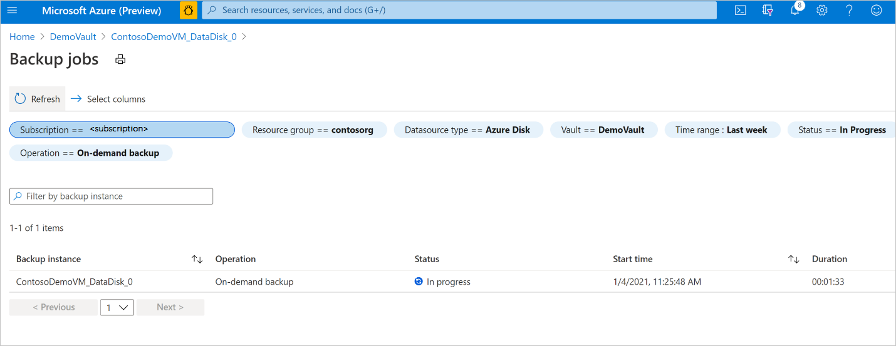
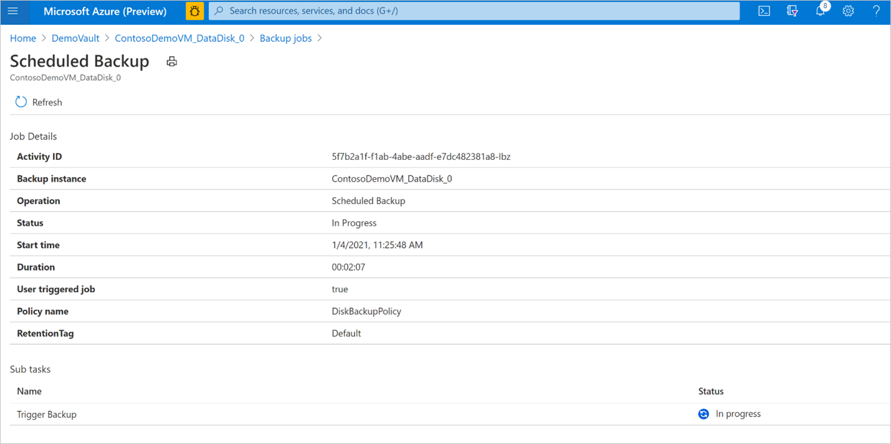
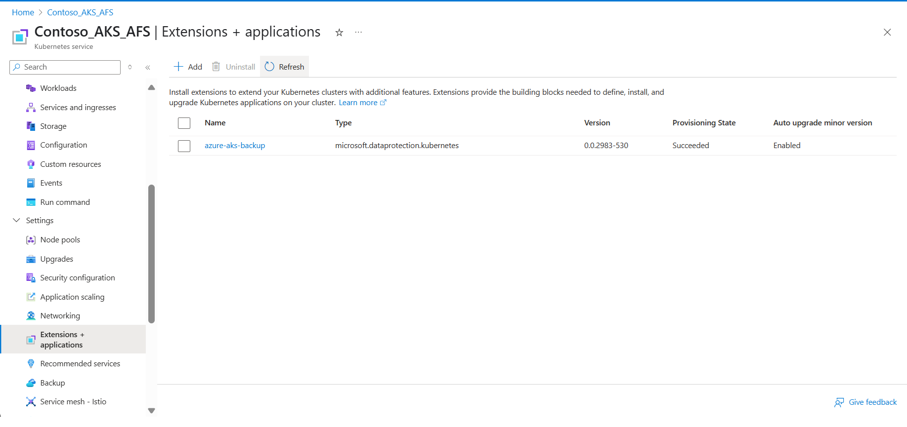
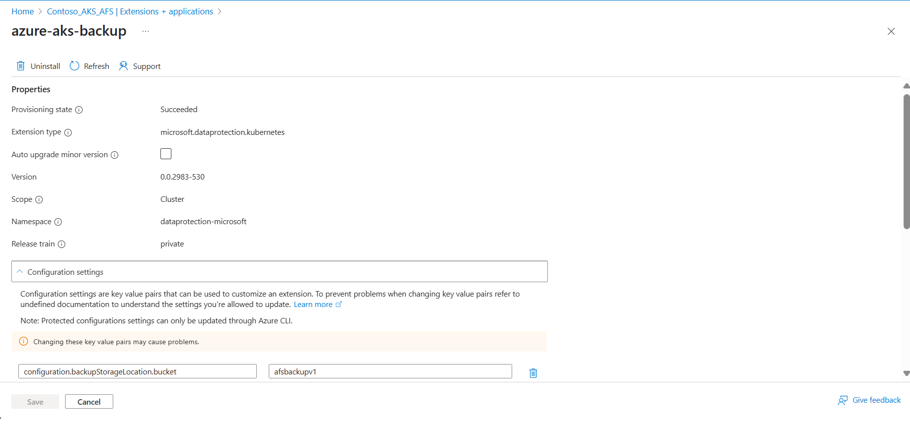
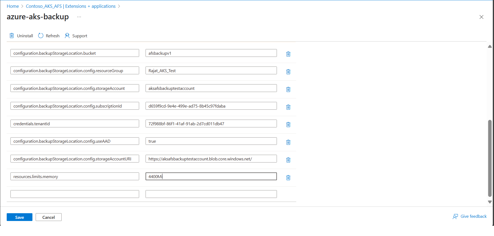

# Manage Azure Kubernetes Service backups using Azure Backup 

This article describes how to register resource providers on your subscriptions for using Backup Extension and Trusted Access. Also, it provides you with the Azure CLI commands to manage them.

Azure Backup now allows you to back up AKS clusters (cluster resources and persistent volumes attached to the cluster) using a backup extension, which must be installed in the cluster. AKS cluster requires Trusted Access enabled with Backup vault, so that the vault can communicate with the Backup Extension to perform backup and restore operations.

In addition, it helps to describe how to manage backup for the Azure Kubernetes Service clusters from the Azure portal.

## Resource provider registrations

Resource Provider registration is required for installing the Backup Extension, and initiating any backup and restore operation. You can  do this registration as a Subscription Owner. Generally, the Resource Provider is already registered in an Azure subscription. If not, register the `Microsoft.KubernetesConfiguration` resource provider.

After the registration is complete, you can perform backup and restore operations on all the cluster under the subscription.

### Register the Backup Extension

To install Backup Extension, you need to register `Microsoft.KubernetesConfiguration` resource provider on the subscription. To perform the registration, run the following command:

   ```azurecli-interactive
   az provider register --namespace Microsoft.KubernetesConfiguration
   ```

The registration can take up to *10 minutes*. To monitor the registration process, run the following command:

   ```azurecli-interactive
   az provider show --name Microsoft.KubernetesConfiguration --output table
   ```

## Edit a backup instance for Azure Kubernetes Service (AKS) using the Azure portal

After you configure backup for a cluster, your workloads and requirements can change: new namespaces are added, retention needs grow, or you want to start (or stop) protecting a certain type of persistent volume. By using **Edit backup instance**, you can update these settings in place, without stopping protection or reconfiguring backup from scratch.

> [!NOTE]
>
> The updated policy and configuration take effect from the next scheduled or on-demand backup. Existing recovery points aren't modified and continue to reflect the configuration that was in effect when they were created.

To edit an AKS backup instance, follow these steps:

1. In the [Azure portal](https://portal.azure.com/), go to **Resiliency** > **Backup and recovery** > **Protected items**.

1. On the **Protected items** pane, filter the **Datasource type** to **Kubernetes Services**, and select the backup instance you want to edit.

1. On the backup instance pane, select **Edit backup instance**.

   :::image type="content" source="./media/azure-kubernetes-service-cluster-manage-backups/edit-backup-instance.png" alt-text="Screenshot showing the option to edit backup instance." lightbox="./media/azure-kubernetes-service-cluster-manage-backups/edit-backup-instance.png":::

1. On the **Edit backup instance** pane, on the **Select policy** tab, to assign a different policy, choose a different policy from the list. You can review the policy details (backup schedule and retention rules) by selecting **View details**.

   If you don't want to change the policy, leave the current policy selected.

   :::image type="content" source="./media/azure-kubernetes-service-cluster-manage-backups/edit-backup-instance-change-policy.png" alt-text="Screenshot showing the option to reassign policy." lightbox="./media/azure-kubernetes-service-cluster-manage-backups/edit-backup-instance-change-policy.png":::

1. On the **Modify backup instance** tab, choose **Select** to update the settings you want to change:

   | Setting | Description |
   | --- | --- |
   | **Namespaces** | Select **All (including future namespaces)** to back up every namespace, including namespaces created later. Or select **Choose from list** to pick specific namespaces to include or exclude. |
   | **Include persistent volumes** | Select whether to back up persistent volumes. When selected, choose the volume types to include: **Azure Disk** and/or **Azure Files (preview)**. |
   | **Include cluster scope resources** | Select to back up cluster-scoped resources. |
   | **Resource types** | Optionally specify the Kubernetes resource types to include or exclude (for example, `Deployment`, `Secret`). |
   | **Labels** | Optionally add label selectors (`key=value`) so that only resources with matching labels are backed up. |
   | **Hooks** | Optionally add or remove backup hooks deployed in the cluster. Learn more about [backup hooks](azure-kubernetes-service-cluster-backup.md#use-hooks-during-aks-backup). |

   :::image type="content" source="./media/azure-kubernetes-service-cluster-manage-backups/edit-backup-instance-change-configuration.png" alt-text="Screenshot showing the option to edit backup instance configuration." lightbox="./media/azure-kubernetes-service-cluster-manage-backups/edit-backup-instance-change-configuration.png":::

1. Select **Validate**. After validation succeeds, select **Review + save**, review the changes, and then select **Save**.

## Monitor backup and restore operations

The Azure Backup service creates a job for scheduled backups or if you trigger an on-demand backup or restore operation for tracking. You can view and track the status of a job.

### Monitor a backup operation

The Azure Backup service creates a job for scheduled backups or if you trigger an on-demand backup operation for tracking. To view the backup job status:

1. Go to **Resiliency** and select **Protected Items** under **Protection Inventory**.

   The **Protected Items** pane shows all the backup instances created across the subscriptions. Use the filters to access the backup instance. Select the protected item and open it.

   :::image type="content" source="./media/backup-managed-disks/jobs-dashboard.png" alt-text="Screenshot shows the jobs dashboard." lightbox="./media/backup-managed-disks/jobs-dashboard.png":::

1. Select **Associated Items** to open the dashboard for the backup instance. You can see the backup jobs for the last seven days. 

1. To view the status of the backup operation, select **View all** to show ongoing and past jobs of this backup instance.

   

1. Review the list of backup and restore jobs and their status. Select a job from the list of jobs to view job details.

   

### Monitor a restore operation

After you trigger the restore operation, the backup service creates a job for tracking. Azure Backup displays notifications about the job in the portal. To view the restore job progress:

1. Go to **Resiliency** and select **Protected Items** under **Protection Inventory**.

   The **Protected Items** pane shows all the backup instances created across the subscriptions. Use the filters to access the backup instance. Select the protected item and open it.

   :::image type="content" source="./media/azure-kubernetes-service-cluster-manage-backups/protected-items-dashboard.png" alt-text="Screenshot that shows the Protected items dashboard." lightbox="./media/azure-kubernetes-service-cluster-manage-backups/protected-items-dashboard.png":::

1. Select **Associated Items** to open the dashboard for the backup instance. You can see the backup jobs for the last seven days. 

1. To view the status of the restore operation, select **View all** to show ongoing and past jobs of this backup instance.

1. On the **Backup jobs** pane, review the list of backup and restore jobs and their status. Select a restore job from the list of jobs to view job details.

    :::image type="content" source="./media/azure-kubernetes-service-cluster-manage-backups/view-all-jobs.png" alt-text="Screenshot that shows the list of backup jobs." lightbox="./media/azure-kubernetes-service-cluster-manage-backups/view-all-jobs.png":::

1. On the **Restore** pane, review the selected restore job details.

    :::image type="content" source="./media/azure-kubernetes-service-cluster-manage-backups/restore-job-details.png" alt-text="Screenshot that shows the restore job details." lightbox="./media/azure-kubernetes-service-cluster-manage-backups/restore-job-details.png":::


### Monitor backup and restore jobs with the status completed with warnings

When you schedule or request a backup or restore operation, the system creates a job that corresponds to the operation and tracks its progress. If the operation fails, these jobs help you identify error codes and fix issues so you can run a successful job later. 

For AKS backup, backup and restore jobs can show the status **Completed with Warnings**. This status appears when the backup and restore operation isn't fully successful due to issues in user-defined configurations or internal state of the workload.

:::image type="content" source="./media/azure-kubernetes-service-cluster-manage-backups/backup-restore-jobs-completed-with-warnings.png" alt-text="Screenshot shows the backup and restore jobs completed with warnings." lightbox="./media/azure-kubernetes-service-cluster-manage-backups/backup-restore-jobs-completed-with-warnings.png":::

For example, if a backup job for an AKS cluster finishes with the status **Completed with Warnings**, the system creates a restore point but doesn't back up all the resources in the cluster as specified in the backup configuration. The job shows warning details that explain the *issues* and *resources* that were impacted during the operation.

To view these warnings, select **View Details** next to **Warning Details**.

:::image type="content" source="./media/azure-kubernetes-service-cluster-manage-backups/example-backup-job-with-warning-details.png" alt-text="Screenshot shows the job warning details." lightbox="./media/azure-kubernetes-service-cluster-manage-backups/example-backup-job-with-warning-details.png"::: 

Learn [how to identify and resolve the error](azure-kubernetes-service-backup-troubleshoot.md#aks-backup-extension-installation-error-resolutions). 

## Backup Extension related operations

This section provides the set of Azure CLI commands to perform create, update, or delete operations on the Backup Extension. You can use the update command to change compute limits for the underlying Backup Extension Pods.

### Install Backup Extension

To install the Backup Extension, run the following command:

   ```azurecli-interactive
   az k8s-extension create --name azure-aks-backup --extension-type microsoft.dataprotection.kubernetes --scope cluster --cluster-type managedClusters --cluster-name <aksclustername> --resource-group <aksclusterrg> --release-train stable --configuration-settings blobContainer=<containername> storageAccount=<storageaccountname> storageAccountResourceGroup=<storageaccountrg> storageAccountSubscriptionId=<subscriptionid>
   ```

### View Backup Extension installation status

To view the progress of Backup Extension installation, use the following command:

   ```azurecli-interactive
   az k8s-extension show --name azure-aks-backup --cluster-type managedClusters --cluster-name <aksclustername> --resource-group <aksclusterrg>
   ```

### Update resources in Backup Extension

To update blob container, CPU, and memory in the Backup Extension, use the following command:

   ```azurecli-interactive
   az k8s-extension update --name azure-aks-backup --cluster-type managedClusters --cluster-name <aksclustername> --resource-group <aksclusterrg> --release-train stable --configuration-settings [blobContainer=<containername> storageAccount=<storageaccountname> storageAccountResourceGroup=<storageaccountrg> storageAccountSubscriptionId=<subscriptionid>] [cpuLimit=1] [memoryLimit=1Gi]
   
   []: denotes the 3 different sub-groups of updates possible (discard the brackets while using the command)

   ```

### Delete Backup Extension installation operation

To stop the Backup Extension install operation, use the following command:

   ```azurecli-interactive
   az k8s-extension delete --name azure-aks-backup --cluster-type managedClusters --cluster-name <aksclustername> --resource-group <aksclusterrg>
   ```

### Grant permission on storage account

The backup extension creates a User Assigned Managed Identity in the cluster's managed resource group. This identity needs to be provided *Storage Blob Data Contributor Permission* on storage account by running the following command:

   ```azurecli-interactive
   az role assignment create --assignee-object-id $(az k8s-extension show --name azure-aks-backup --cluster-name <aksclustername> --resource-group <aksclusterrg> --cluster-type managedClusters --query aksAssignedIdentity.principalId --output tsv) --role 'Storage Blob Data Contributor' --scope /subscriptions/<subscriptionid>/resourceGroups/<storageaccountrg>/providers/Microsoft.Storage/storageAccounts/<storageaccountname> 
   ```

## Trusted Access related operations

To enable Trusted Access between Backup vault and AKS cluster, use the following Azure CLI command:

   ```azurecli-interactive
   az aks trustedaccess rolebinding create \
   --resource-group <aksclusterrg> \
   --cluster-name <aksclustername> \
   --name <randomRoleBindingName> \
   --source-resource-id $(az dataprotection backup-vault show --resource-group <vaultrg> --vault <VaultName> --query id -o tsv) \
   --roles Microsoft.DataProtection/backupVaults/backup-operator   
   ```

Learn more about [other commands related to Trusted Access](/azure/aks/trusted-access-feature#trusted-access-feature-overview).

## Manage operations using the Azure portal

This section describes several Azure Backup supported management operations that make it easy to manage Azure Kubernetes Service cluster backups.

### Adjusting CPU and Memory for Azure Backup for AKS

Azure Backup for AKS relies on pods deployed within the AKS cluster as part of the backup extension under the namespace `dataprotection-microsoft`. To perform backup and restore operations, these pods have specific CPU and memory requirements.

#### Default Resource Reservations

| Deployment / pod family | Container | CPU request | CPU limit | Memory request | Memory limit |
|---|---|---|---|---|---|
| dataprotection-microsoft-kubernetes-agent | Velero | 500m | 1000m | 256Mi | 2Gi |
| dataprotection-microsoft-kubernetes-agent | Fluent Bit sidecar | 20m | 40m | 64Mi | 128Mi |
| dataprotection-microsoft-controller | Controller (manager) | 10m | 300m | 64Mi | 256Mi |
| dataprotection-microsoft-controller | Fluent Bit sidecar | 20m | 40m | 64Mi | 128Mi |
| dataprotection-microsoft-geneva-service | Geneva (mdsd) | 20m | 100m | 256Mi | 600Mi |

#### Component-specific memory-limit settings

The Helm chart supports separate memory limits for the following components:

| Component | Memory-limit setting |
|---|---|
| Velero | `resources.limits.memory` |
| Controller | `controller.resources.limits.memory` |
| Fluent Bit sidecars in both agent and controller pods | `fluentBit.resources.limits.memory` |
| Geneva mdsd | `geneva.mdsd.resources.limits.memory` |

#### Resolve OOMKilled Errors by Increasing CPU and Memory

An OOMKilled event typically occurs when a container exceeds its configured memory limit or is selected as a victim during node-level memory pressure. 

If the number of resources in the cluster exceeds 1000, the extension pod `dataprotection-microsoft-kubernetes-agent` may require additional CPU and memory beyond the default reservation. If the required resources exceed the allocated limits, you might encounter a _UserErrorBackupPluginPodRestartedDuringBackup_ or _UserErrorBackupPluginPodRestartedDuringRestore_ error due to OOMKilled (Out of Memory) error during backup or restore operation.

To verify whether the issue was caused by an OOMKilled event, review the memory usage of the Velero container in the `dataprotection-microsoft-kubernetes-agent` pod using your monitoring solution, if available. Reviewing the container's memory consumption can help determine whether it was terminated due to memory exhaustion. It is also recommended to check the memory utilization of the node hosting the pod.
	
Alternatively, you can confirm whether the agent pod was terminated with an Out of Memory (OOM) condition.

```azurecli
$ kubectl describe pod [The full name of the agent pod] -n dataprotection-microsoft
...
 "reason": "OOMKilled",
 "exitCode": 137,
...
```

If the root cause is confirmed to be an OOMKilled event, manually update the resource settings for the extension pods by following these steps to help ensure successful backup and restore operations.

1. Open the AKS cluster in the Azure portal.

    :::image type="content" source="./media/azure-kubernetes-service-cluster-manage-backups/aks-cluster.png" alt-text="Screenshot shows AKS cluster in Azure portal." lightbox="./media/azure-kubernetes-service-cluster-manage-backups/aks-cluster.png":::

1. Navigate to Extensions + Applications under Settings in the left-hand pane.

    

1. Select on the extension titled "azure-aks-backup".

    

1. Scroll down, add new value under configuration settings and then click Save. 
 
   `resources.limits.memory : 4400Mi`

    

> [!NOTE]
>
> If the node where the extension pod is provisioned doesn't have the required CPU or memory, and you've only updated the resource limits, the pod may be repeatedly killed. To resolve this, update the configuration settings using `resources.requests.cpu` and `resources.requests.memory`. It is recommended setting same value of requests and limits if the pod resource usage is high. This prevents pods from being scheduled on nodes that do not have enough available resources to satisfy their resource limits.

 
#### Verifying the Changes

After you update the settings, check whether the resources of the `dataprotection-microsoft-kubernetes-agent` pod are applied correctly. Once the pod restarted after updating the settings and is applied successfully, wait for a scheduled backup to run or initiate an on-demand backup. If you still experience an OOMKilled failure, repeat the steps above and gradually increase memory limits and if it still persists increase `resources.limits.cpu` parameter also.

### Enable network access on the staging storage account for restore operation

Ensure the staging storage account for restore operation is accessible through a public network. If the storage account uses a private endpoint, update its network access settings before executing a restore operation.

To enable network access on the staging storage account, follow these steps:

1. In the Azure portal, go to the **Staging storage account** > **Security + Networking** > **Networking**. 

2. In the **Public access** tab, select **Manage** under **Public network access**. 

3. On the **Public network access** pane, select **Enable from selected networks** as **Public network access scope**. 

   :::image type="content" source="./media/azure-kubernetes-service-cluster-manage-backups/staging-storage-account-enable-selected-network.png" alt-text="Screenshot shows how to enable selected network access on staging storage account." lightbox="./media/azure-kubernetes-service-cluster-manage-backups/staging-storage-account-enable-selected-network.png":::

4. Under **Resource instances**, choose **Resource type** as `Microsoft.DataProtection/BackupVaults`, and then select the **Backup vault** where your backup is stored.

   :::image type="content" source="./media/azure-kubernetes-service-cluster-manage-backups/staging-storage-account-allow-resource-type.png" alt-text="Screenshot shows how to allow specify resource type." lightbox="./media/azure-kubernetes-service-cluster-manage-backups/staging-storage-account-allow-resource-type.png":::

5. Under **Exceptions**, select **Allow trusted Microsoft services to access this resource**. 

   :::image type="content" source="./media/azure-kubernetes-service-cluster-manage-backups/staging-storage-account-allow-trusted-access.png" alt-text="Screenshot shows how to allow trusted Microsoft services" lightbox="./media/azure-kubernetes-service-cluster-manage-backups/staging-storage-account-allow-trusted-access.png":::

6. Select **Save** to implement the updates.

### Stop Protection

There are three ways by which you can stop protecting an Azure Disk:

- **Stop Protection and Retain Data (Retain forever)**: This option helps you stop all future backup jobs from protecting your cluster. However, Azure Backup service retains the recovery points that are backed-up forever. You need to pay to keep the recovery points in the vault (see [Azure Backup pricing](https://azure.microsoft.com/pricing/details/backup/) for details). You are able to restore the disk, if needed. To resume cluster protection, use the **Resume backup** option.

- **Stop Protection and Retain Data (Retain as per Policy)**: This option helps you stop all future backup jobs from protecting your cluster. The recovery points are retained as per policy and will be chargeable according to [Azure Backup pricing](https://azure.microsoft.com/pricing/details/backup/). However, the latest recovery point is retained forever.

- **Stop Protection and Delete Data**: This option helps you stop all future backup jobs from protecting your clusters and delete all the recovery points. You won't be able to restore the disk or use the **Resume backup** option.

> [!NOTE]
>
> Even if AKS Backup is stopped or backups fail, the last restore point is always retained beyond the defined retention period, ensuring at least one restore point remains available.

#### Stop Protection and Retain Data

1. Go to the **Resiliency** and select **Protected Items** under **Protection Inventory**.

   The **Protected Items** pane shows all the backup instances created across the subscriptions. Use the filters to access the backup instance you would like to take a look at. Select on the protected item and open it.

   :::image type="content" source="./media/backup-managed-disks/jobs-dashboard.png" alt-text="Screenshot shows the jobs dashboard." lightbox="./media/backup-managed-disks/jobs-dashboard.png":::

1. Now select on the **Associated Items** to open up the dashboard for the backup instance. 

1. Select **Stop Backup**.

   :::image type="content" source="./media/manage-azure-managed-disks/select-disk-backup-instance-to-stop-inline.png" alt-text="Screenshot showing the selection of the Azure disk backup instance to be stopped." lightbox="./media/manage-azure-managed-disks/select-disk-backup-instance-to-stop-expanded.png":::
 
1. Select one of the following data retention options:

   1. Retain forever
   1. Retain as per policy
 
   :::image type="content" source="./media/manage-azure-managed-disks/data-retention-options-for-disk-inline.png" alt-text="Screenshot showing the options to stop disk backup instance protection." lightbox="./media/manage-azure-managed-disks/data-retention-options-for-disk-expanded.png":::

   You can also select the reason for stopping backups  from the drop-down list.

1. Select **Stop Backup**.

1. Select **Confirm** to stop data protection.

   :::image type="content" source="./media/manage-azure-managed-disks/confirm-stopping-disk-backup-inline.png" alt-text="Screenshot showing the options for disk backup instance retention to be selected." lightbox="./media/manage-azure-managed-disks/confirm-stopping-disk-backup-expanded.png":::

#### Stop Protection and Delete Data

1. Go to the **Resiliency** and select **Protected Items** under **Protection Inventory**.

   The **Protected Items** pane shows all the backup instances created across the subscriptions. Use the filters to access the backup instance you would like to take a look at. Select on the protected item and open it.

   :::image type="content" source="./media/backup-managed-disks/jobs-dashboard.png" alt-text="Screenshot shows the jobs dashboard." lightbox="./media/backup-managed-disks/jobs-dashboard.png":::

1. Now select on the **Associated Items** to open up the dashboard for the backup instance. 

1. Select **Stop Backup**.

1. Select **Delete Backup Data**.

   Provide the name of the backup instance, reason for deletion, and any other comments.

   :::image type="content" source="./media/manage-azure-managed-disks/details-to-stop-disk-backup-inline.png" alt-text="Screenshot for the confirmation for stopping disk backup." lightbox="./media/manage-azure-managed-disks/details-to-stop-disk-backup-expanded.png":::

1. Select **Stop Backup**.

1. Select **Confirm** to stop data protection.

   :::image type="content" source="./media/manage-azure-managed-disks/confirm-stopping-disk-backup-inline.png" alt-text="Screenshot showing the options for disk backup instance retention to be selected." lightbox="./media/manage-azure-managed-disks/confirm-stopping-disk-backup-expanded.png":::

### Resume Protection

If you have selected the **Stop Protection and Retain data** option, you can resume protection for your clusters.

>[!Note]
>When you resume protecting a backup instance, the existing backup policy will start applying to new recovery points only. Recovery points that have already expired based on their original retention duration, as defined by the backup policy in effect at the time of their creation, will be cleaned up.

Use the following steps:

1. Go to the **Resiliency** and select **Protected Items** under **Protection Inventory**.

   The **Protected Items** pane shows all the backup instances created across the subscriptions. Use the filters to access the backup instance you would like to take a look at. Select on the protected item and open it.

   :::image type="content" source="./media/backup-managed-disks/jobs-dashboard.png" alt-text="Screenshot shows the jobs dashboard." lightbox="./media/backup-managed-disks/jobs-dashboard.png":::

1. Now select on the **Associated Items** to open up the dashboard for the backup instance. 

1. Select **Resume Backup**.

   :::image type="content" source="./media/manage-azure-managed-disks/resume-disk-protection-inline.png" alt-text="Screenshot showing the option to resume protection of disk." lightbox="./media/manage-azure-managed-disks/resume-disk-protection-expanded.png":::

1. Select **Resume backup**.

   :::image type="content" source="./media/manage-azure-managed-disks/resume-disk-backup-inline.png" alt-text="Screenshot showing the option to resume disk backup." lightbox="./media/manage-azure-managed-disks/resume-disk-backup-expanded.png":::

### Delete Backup Instance

If you choose to stop all scheduled backup jobs and delete all existing backups, use **Delete Backup Instance**.

To delete an AKS cluster backup instance, follow these steps:

1. Select **Delete** on the backup instance screen.

   :::image type="content" source="./media/manage-azure-managed-disks/initiate-deleting-backup-instance-inline.png" alt-text="Screenshot showing the process to delete a backup instance." lightbox="./media/manage-azure-managed-disks/initiate-deleting-backup-instance-expanded.png":::

1. Provide confirmation details including name of the Backup instance, reason for deletion, and other comments.

   :::image type="content" source="./media/manage-azure-managed-disks/confirm-deleting-backup-instance-inline.png" alt-text="Screenshot showing to confirm the deletion of backup instances." lightbox="./media/manage-azure-managed-disks/confirm-deleting-backup-instance-expanded.png":::

1. Select **Delete** to confirm and proceed with deleting backup instance.


## Next steps

- Back up Azure Kubernetes Service cluster using [Azure portal]](azure-kubernetes-service-cluster-backup.md), [Azure PowerShell](azure-kubernetes-service-cluster-backup-using-powershell.md)
- [Restore Azure Kubernetes Service cluster](azure-kubernetes-service-cluster-restore.md)
- [Supported scenarios for backing up Azure Kubernetes Service cluster](azure-kubernetes-service-cluster-backup-support-matrix.md)
