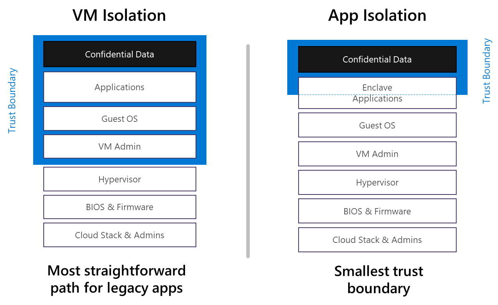
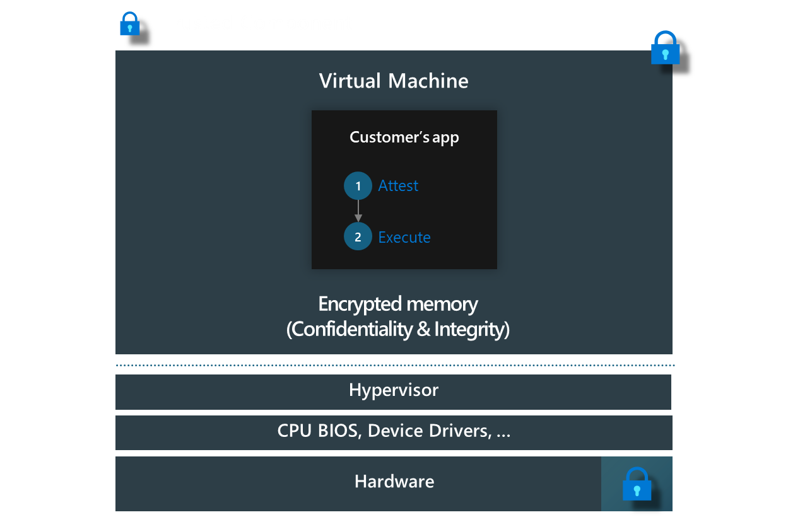
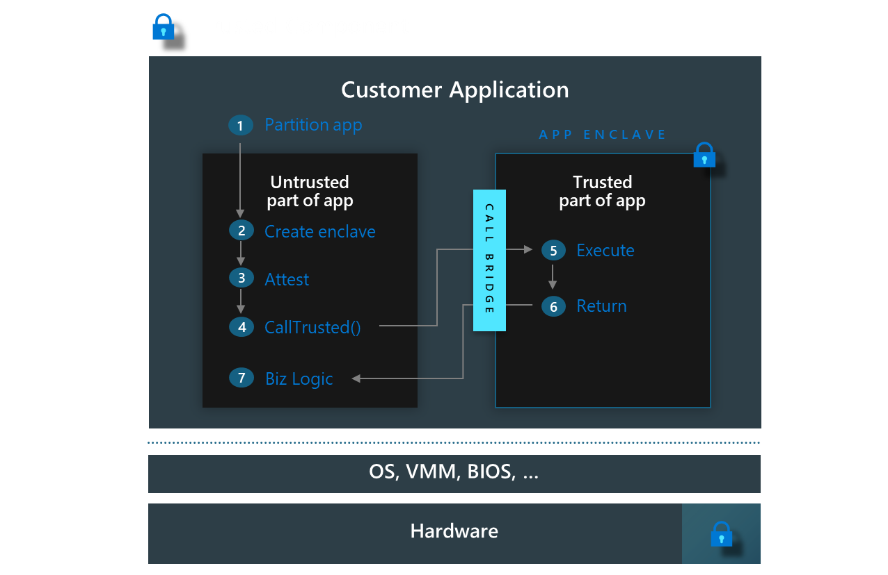

# Deployment models in confidential computing

Azure confidential computing supports multiple deployment models to meet different security, portability, and operational requirements.

## Infrastructure as a service

Under the infrastructure as a service (IaaS) deployment model in cloud computing, you can use:

- *Confidential virtual machines (VMs)* based on [AMD SEV-SNP](confidential-vm-overview.md) or [Intel TDX](tdx-confidential-vm-overview.md) for VM isolation.
- *Application enclaves* with [Intel SGX](confidential-computing-enclaves.md) for specialized app-level isolation scenarios.

These options differ primarily by trust boundary and deployment complexity.

The IaaS model gives on-demand access to compute, storage, networking, and virtualization. Azure manages the underlying infrastructure so you can focus on the guest OS and applications. For many teams, this model balances strong control with cloud scalability and operational simplicity.

## Platform as a service

For platform as a service (PaaS), use [confidential containers](confidential-containers.md), including Azure Container Instances confidential containers and AKS confidential VM node pools.

Intel SGX container and enclave-aware models are available for advanced scenarios, but most new deployments should start with SNP or TDX-backed VM isolation and managed container offerings.

Choose the right model based on your application architecture, required trust boundary, and migration constraints.

Although VMs remain important, containers offer more flexibility for modern software environments. Containers can support apps that:

- Run across multiple clouds.
- Connect to microservices.
- Use multiple programming languages and frameworks.
- Use automation and Azure Pipelines, including CI/CD.

Containers can also increase portability and improve resource efficiency through elastic scaling.

Choose confidential VMs when:

- You have legacy applications that you can't modify or containerize but still need protection for data in use.
- You run multiple applications that require different operating systems.
- You need a full guest OS environment.
- You're migrating your existing VMs from on-premises to Azure.

Choose confidential containers when:

- You need tighter cost and resource efficiency with faster deployment cycles.
- You're building a cloud-native solution and control source code and deployment pipelines.
- You need multicloud support.

Both options provide strong security with different operational tradeoffs.

## Comparison of security boundaries

Confidential VMs and confidential containers have different security postures.

### Confidential VMs (SNP/TDX)

Confidential VMs provide hardware-encrypted protection for an entire VM, so the host administrator can't access it without authorization. This protection level includes the hypervisor, which the CSP manages. Use this type of confidential VM to prevent the CSP from accessing data and code that run within the VM.

VM admins, apps, and other services running inside the VM operate beyond the protected boundaries. These users and services can access data and code within the VM.

### Application enclaves (specialized)

Application enclaves help protect memory spaces inside a VM by using hardware-based encryption. The security boundary is more restricted than confidential VMs, but this model requires enclave-aware development and specialized operational patterns.

Intel SGX can provide strong function-level isolation, but this path is typically best for existing enclave-native applications or niche requirements.

## Related content

- [Learn about confidential VM options](virtual-machine-options.md).
- [Learn about confidential containers](confidential-containers.md).
- [Learn about confidential computing enclaves (specialized)](confidential-computing-enclaves.md).
