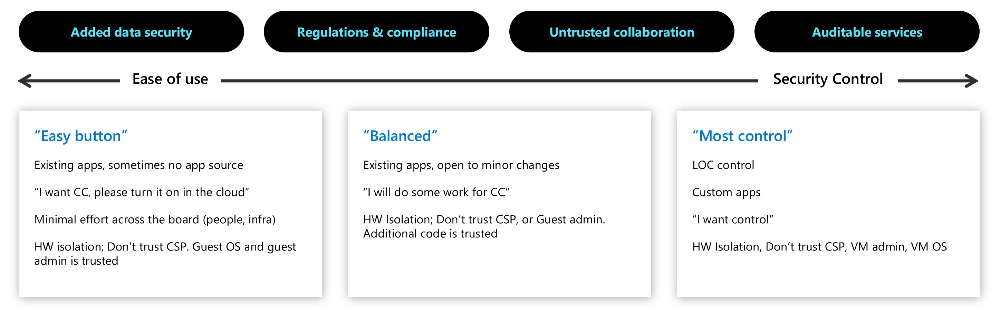

# Building confidential computing solutions

Azure confidential computing supports a range of implementation choices, from lift-and-shift migration to specialized enclave application design. For most workloads, start with VM-level TEEs (AMD SEV-SNP or Intel TDX) and managed confidential container offerings.

## Solutions

Use the following order of preference for most solution designs:

- Existing applications without source code changes can use confidential VMs based on AMD SEV-SNP or Intel TDX for fast onboarding.
- Containerized workloads can use [confidential containers](confidential-containers.md) on Azure Container Instances and Azure Kubernetes Service confidential VM node pools for strong protection with limited operational overhead.
- Specialized application-enclave workloads can use Intel SGX-based designs when function-level isolation is required and enclave-aware development is acceptable.

## Learn more

To design modern confidential solutions, start with [Azure confidential VM options](virtual-machine-options.md) and [confidential containers](confidential-containers.md).

For specialized enclave-aware implementations, see [enclave application development](application-development.md) and [open-source tools](enclave-development-oss.md).

Explore [partners and open-source tools for confidential containers](confidential-containers.md), including options for Azure Kubernetes workloads.

## Next steps

- [Review confidential VM options (AMD SEV-SNP and Intel TDX)](virtual-machine-options.md).
- [Review confidential container options](confidential-containers.md).
- [Learn about application enclave development (specialized)](application-development.md).
