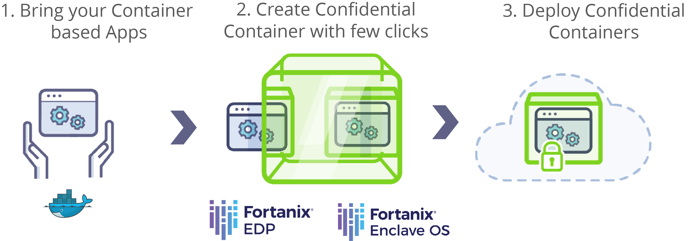
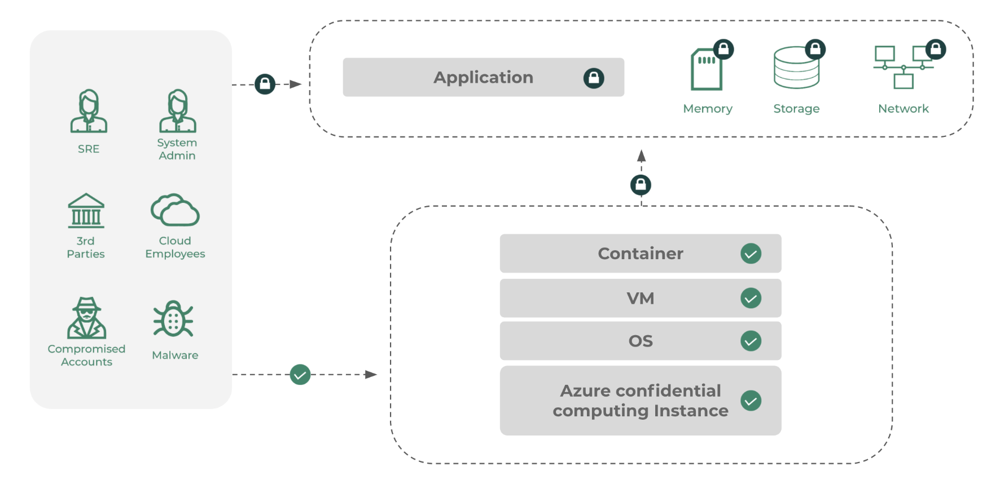

# Confidential containers on Azure Kubernetes Service (AKS) with Intel SGX enclaves

> [!IMPORTANT]
> For most container deployments, start with [confidential containers on Azure Container Instances](/azure/container-instances/container-instances-confidential-overview) or [AKS confidential VM node pools](confidential-node-pool-aks.md). Use this SGX guidance for specialized enclave-based workloads.

[Confidential containers](confidential-containers.md) help you run existing unmodified container applications of most **common programming languages** runtimes (Python, Node, Java, and more) in the Intel SGX based Trusted Execution Environment (TEE).
This packaging model typically doesn't need any source-code modifications or recompilation and is the fastest method to run in Intel SGX enclaves. Typical deployment for standard Docker containers requires open-source SGX wrapper software or an Azure partner solution.
In this packaging and execution model, each container application loads in the trusted boundary (enclave) with hardware-based isolation enforced by the Intel SGX CPU. Each container running in an enclave receives its own memory encryption key delivered from the Intel SGX CPU.
This model works well for off-the-shelf container applications available in the market or custom apps currently running on general-purpose nodes.
To run an existing Docker container, applications on confidential computing nodes require Intel Software Guard Extensions (SGX) wrapper software to help container execution within the bounds of the special CPU instruction set.
SGX creates direct execution to the CPU to remove the guest operating system (OS), host OS, or hypervisor from the trust boundary. This step reduces attack surface area while achieving process-level isolation within a single node.

The overall process for running unmodified containers involves changes to how you package your container today, as detailed in the following section.

:::image type="content" source="./media/confidential-containers/confidential-containers-deploy-steps.png" alt-text="Diagram of confidential container conversion, with new steps for enabling Intel SGX and AKS.":::

The SGX wrapper software needed to help run standard containers is offered by Azure software partners or open-source software (OSS) solutions.

## Partner enablers

Developers can choose software providers based on their features, integration with Azure services, and tooling support.

> [!IMPORTANT]
> Azure software partners often involve licensing fees on top of your Azure infrastructure. Verify all partner software terms independently.

### Fortanix

[Fortanix](https://www.fortanix.com/) provides portal and command-line interface (CLI) experiences to convert their containerized applications to SGX-capable confidential containers. You don't need to modify or recompile the application. Fortanix provides the flexibility to run and manage a broad set of applications. You can use existing applications, new enclave-native applications, and prepackaged applications. Start with Fortanix's [Enclave Manager](https://em.fortanix.com/) UI or [REST APIs](https://www.fortanix.com/api/). Create confidential containers by using Fortanix's quickstart guide for AKS.

### Anjuna

[Anjuna](https://www.anjuna.io/) provides SGX platform software to run unmodified containers on AKS. For more information, see Anjuna's [documentation about functionality and sample applications](https://www.anjuna.io/partners/microsoft-azure).

Get started with a sample Redis Cache and Python Custom Application [here](https://www.anjuna.io/partners/microsoft-azure).

## OSS enablers

> [!NOTE]
> Azure confidential computing and Microsoft aren't directly affiliated with these projects and solutions.  

### Gramine

[Gramine](https://grapheneproject.io/) is a lightweight guest OS designed to run a single Linux application with minimal host requirements. Gramine runs applications in an isolated environment. It includes tooling support for converting existing Docker containers to SGX-ready containers.

For more information, see Gramine's [sample application and deployment on AKS](https://github.com/gramineproject/contrib/tree/master/Examples/aks-attestation).

### Occlum

[Occlum](https://occlum.io/) is a memory-safe, multiprocess library OS (LibOS) for Intel SGX. The OS enables legacy applications to run on SGX with little to no modifications to source code. Occlum transparently protects the confidentiality of user workloads while allowing an easy "lift and shift" to existing Docker applications.

For more information, see Occlum's [deployment instructions and sample apps on AKS](https://github.com/occlum/occlum/blob/master/docs/azure_aks_deployment_guide.md).

### Marblerun

[Marblerun](https://marblerun.sh/) is an orchestration framework for confidential containers. You can run and scale confidential services on SGX-enabled Kubernetes. Marblerun takes care of boilerplate tasks like verifying the services in your cluster, managing secrets for them, and establishing enclave-to-enclave mTLS connections between them. Marblerun also ensures that your cluster of confidential containers adheres to a manifest defined in simple JSON. You can verify the manifest with external clients through remote attestation.

This framework extends the confidentiality, integrity, and verifiability properties of a single enclave to a Kubernetes cluster.

Marblerun supports confidential containers created with Graphene, Occlum, and EGo, with [examples for each SDK](https://docs.edgeless.systems/marblerun/#/examples?id=examples). The framework runs on Kubernetes alongside your existing cloud-native tooling. There's a CLI and helm charts. Marblerun also supports confidential computing nodes on AKS. Follow Marblerun's [guide to deploy Marblerun on AKS](https://docs.edgeless.systems/marblerun/#/deployment/cloud?id=cloud-deployment).

## Confidential Containers reference architectures

- [Confidential big-data processing with Apache Spark on AKS with Intel SGX confidential containers](/azure/architecture/example-scenario/confidential/data-analytics-containers-spark-kubernetes-azure-sql). 

## Get in touch

Do you have questions about your implementation? Do you want to become an enabler for confidential containers? Send an email to <acconaks@microsoft.com>.

## Next steps

- [Deploy confidential VM node pools in AKS](/azure/aks/use-cvm)
- [Deploy AKS cluster with Intel SGX Confidential VM Nodes (specialized)](./confidential-enclave-nodes-aks-get-started.md)
- [Microsoft Azure Attestation](/azure/attestation/overview)
- [Intel SGX Confidential Virtual Machines (specialized)](virtual-machine-solutions-sgx.md)
- [Azure Kubernetes Service (AKS)](/azure/aks/intro-kubernetes)
