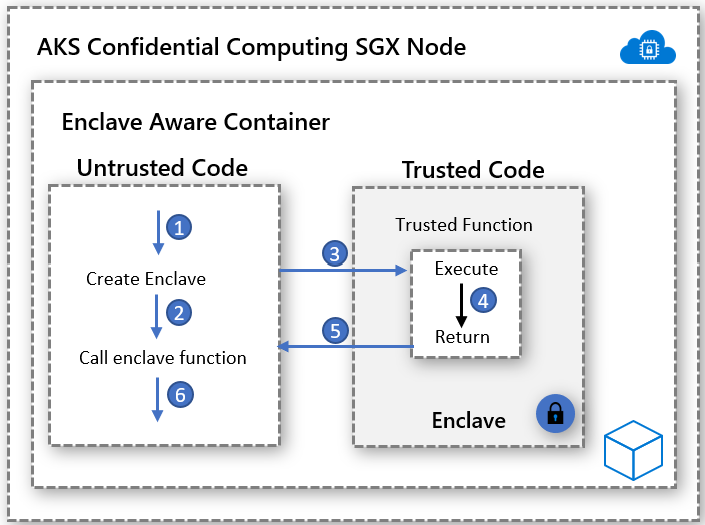

# Enclave-aware containers with Intel SGX (specialized)

> [!IMPORTANT]
> For most container workloads, start with [confidential containers on Azure](confidential-containers.md) and [confidential VM node pools on AKS](confidential-node-pool-aks.md). This article is for specialized enclave-aware development.

An enclave is a protected memory region that provides confidentiality for data and code execution. It's an instance of a Trusted Execution Environment (TEE) that's secured by hardware. Confidential computing VMs on AKS use [Intel Software Guard Extensions (SGX)](https://software.intel.com/sgx) to create isolated enclave environments in the nodes between each container application.

Just like Intel SGX virtual machines, container applications that are developed to run in enclaves have two components:

- An untrusted component (called the host) and
- A trusted component (called the enclave).

Enclave-aware containers application architecture gives you the most control over the implementation while keeping the code footprint in the enclave low. Minimizing the code that runs in the enclave helps reduce the attack surface.

## Enablers

### Open Enclave SDK
[Open Enclave SDK](https://github.com/openenclave/openenclave/tree/master/docs/GettingStartedDocs) is a hardware-agnostic open-source library for developing C and C++ applications that use hardware-based Trusted Execution Environments. The current implementation provides support for Intel SGX and preview support for [OP-TEE OS on Arm TrustZone](https://optee.readthedocs.io/en/latest/general/about.html).

Get started with an Open Enclave-based container application [here](https://github.com/openenclave/openenclave/tree/master/docs/GettingStartedDocs).

### Intel SGX SDK
Intel maintains the software development kit for building SGX applications for both Linux and Windows container workloads. Windows containers aren't currently supported by AKS confidential computing nodes.

Get started with Intel SGX-based applications [here](https://software.intel.com/content/www/us/en/develop/topics/software-guard-extensions/sdk.html).

### Confidential Consortium Framework (CCF)
The Confidential Consortium Framework (CCF) is an open-source framework for building a new category of secure, highly available, and performant applications that focus on multiparty compute and data. CCF can enable high-scale, confidential networks that meet key enterprise requirements. It provides a means to accelerate production and enterprise adoption of consortium-based blockchain and multiparty compute technology.

Get started with Azure confidential computing and CCF [here](https://github.com/Microsoft/CCF).

### Confidential Inferencing ONNX Runtime

The open-source enclave-based ONNX runtime establishes a secure channel between the client and the inference service. This channel ensures that neither the request nor the response can leave the secure enclave.

This solution allows you to bring existing ML trained models and run them confidentially while providing trust between the client and server through attestation and verifications.

Get started with ML model lift and shift to ONNX runtime [here](https://aka.ms/confidentialinference).

### EGo

The open-source [EGo SDK](https://www.ego.dev) brings support for the Go programming language to enclaves. EGo builds upon the Open Enclave SDK. It aims to make it easy to build confidential microservices. Follow this [step-by-step guide](https://github.com/edgelesssys/ego/tree/master/samples/aks) to deploy an EGo-based service on AKS.

## Container-based sample implementations

[Azure samples for enclave-aware containers on AKS](https://github.com/Azure-Samples/confidential-computing/tree/main/containersamples)

[Deploy AKS cluster with Intel SGX confidential VM nodes](./confidential-enclave-nodes-aks-get-started.md)

<!-- LINKS - external -->
[Azure Attestation](/azure/attestation/overview)

<!-- LINKS - internal -->
[Intel SGX Confidential Virtual Machine on Azure](./virtual-machine-solutions-sgx.md)
[Confidential Containers](./confidential-containers.md)
