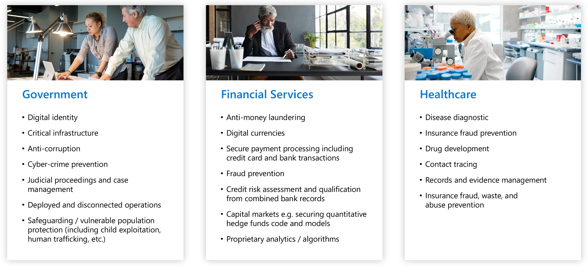
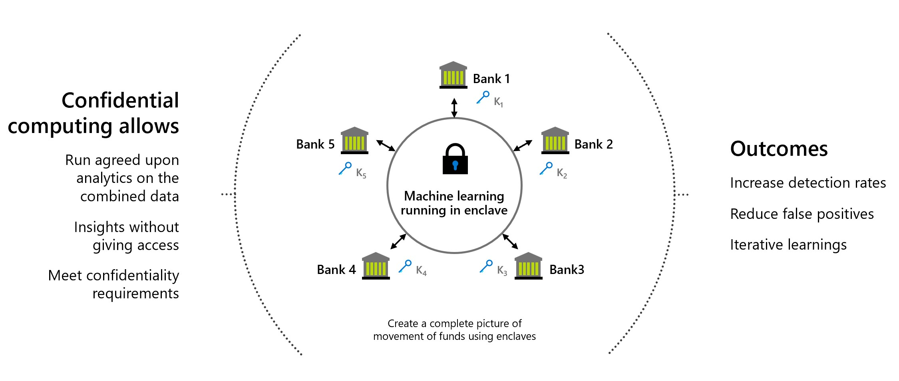
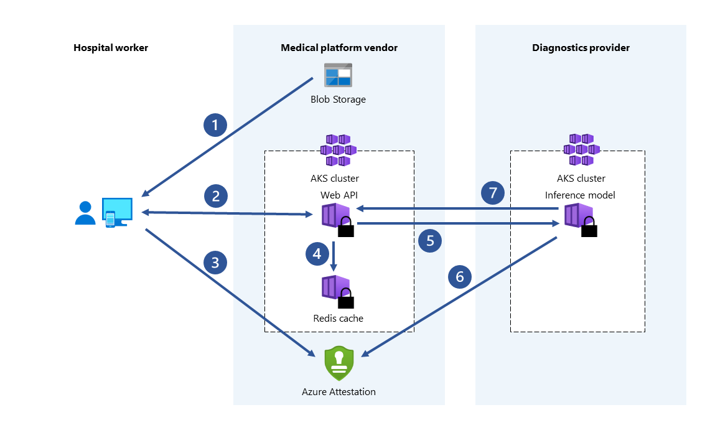
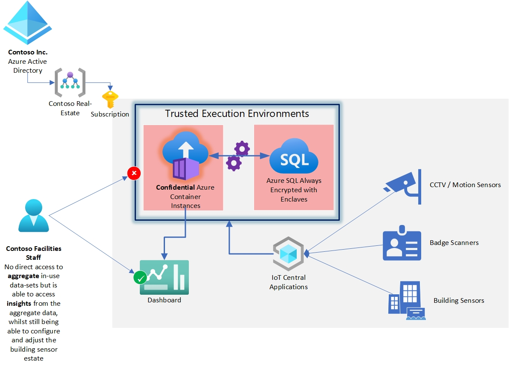
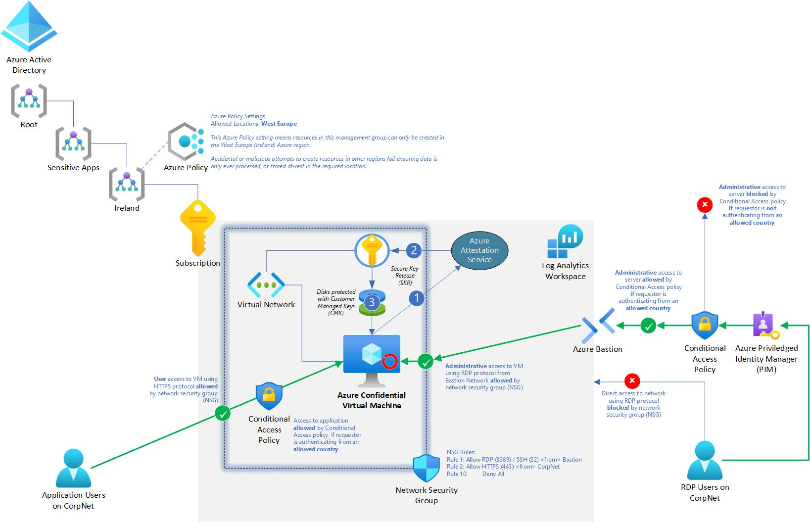
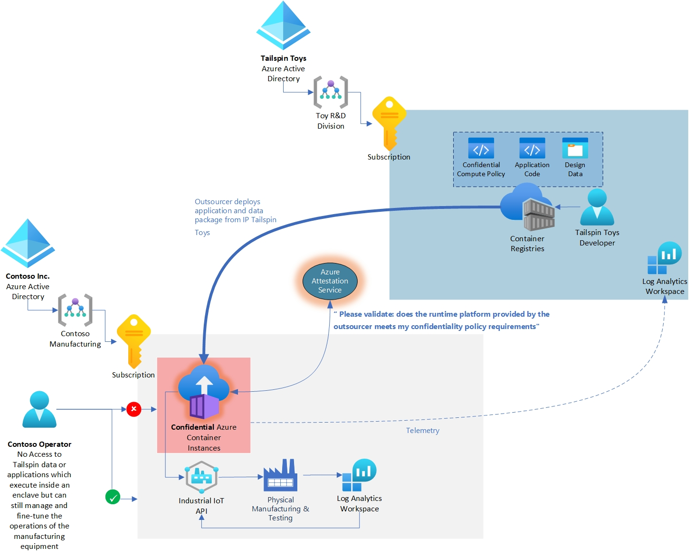

# Confidential computing use cases

Confidential computing helps protect workloads from the host, hypervisor, host administrators, and other privileged actors. Depending on your threat model, use it to:

- **Prevent unauthorized access.** Process sensitive data in the cloud with hardware-backed protection for data in use.
- **Meet regulatory requirements.** Migrate sensitive workloads while maintaining control over data access and handling.
- **Enable low-trust collaboration.** Analyze data across organizations without exposing participant data to one another.
- **Isolate sensitive processing.** Run workloads where service operators can't read customer data.

## Confidential computing scenarios

Confidential computing applies to many scenarios in regulated industries, including government, financial services, and healthcare.

For example, preventing access to sensitive data helps protect the digital identity of citizens from all parties involved, including the cloud provider that stores it. The same sensitive data might contain biometric data that's used for finding and removing known images of child exploitation, preventing human trafficking, and aiding digital forensics investigations.

This article highlights common scenarios and can be used as a starting point for architecture decisions.

After you read this article, you can answer the following questions:

- What are some scenarios for Azure confidential computing?
- What are the benefits of using Azure confidential computing for multiparty scenarios, enhanced customer data privacy, and blockchain networks?

## Secure multiparty computation

For example, the use of machine learning for healthcare services has grown significantly through access to larger datasets and imagery of patients captured by medical devices. Disease diagnosis and drug development benefit from multiple data sources. Hospitals and health institutes can collaborate by sharing their patient medical records with a centralized Trusted Execution Environment (TEE).

Machine learning services that run in the TEE aggregate and analyze data. This aggregated data analysis can provide higher prediction accuracy because of training models that are based on consolidated datasets. By using confidential computing, hospitals can minimize the risk of compromising the privacy of their patients.

Azure confidential computing lets you process data from multiple sources without exposing raw input to other participants. This capability supports anti-money laundering, fraud detection, and healthcare analytics.

Multiple parties can upload data to one enclave in a VM. An authorized party triggers the computation, but no participant can view another participant's raw data.

In secure multiparty computing, encrypted data enters the enclave, is processed inside the TEE, and returns as encrypted output for authorized recipients.

### Anti-money laundering

In this secure multiparty computation example, multiple banks share data with each other without exposing personal data of their customers. Banks run agreed-upon analytics on the combined sensitive dataset. The analytics on the aggregated dataset can detect the movement of money by one user between multiple banks, without the banks accessing each other's data.

Through confidential computing, these financial institutions can increase fraud detection rates, address money laundering scenarios, reduce false positives, and continue learning from larger datasets.

### Drug development in healthcare

Partnered health facilities contribute private health datasets to train a machine learning model. Each facility can see only its own dataset. No other facility, or even the cloud provider, can see the data or training model. All facilities benefit from using the trained model. When the model is created with more data, the model becomes more accurate. Each facility that contributes to training the model can use it and receive useful results.

### Protecting privacy with IoT and smart-building solutions

Many countries or regions have strict privacy laws about gathering and using data on people's presence and movements inside buildings. This data might include information that's personally identifiable data from closed-circuit television (CCTV) or security badge scans. Or it might be indirectly identifiable, but when grouped together with different sets of sensor data, it could be considered personally identifiable.

Privacy must be balanced with cost and environmental needs in scenarios when organizations want to understand occupancy or movement to provide the most efficient use of energy to heat and light a building.

Determining which areas of corporate real estate are under- or overoccupied by staff from individual departments typically requires processing some personally identifiable data alongside less individual data like temperature and light sensors.

In this use case, the primary goal is to allow analysis of occupancy data and temperature sensors to be processed alongside CCTV motion-tracing sensors and badge-swipe data to understand usage without exposing the raw aggregate data to anyone.

Confidential computing is used here by placing the analysis application inside a TEE where the in-use data is protected by encryption. In this example, the application is running on confidential containers on Azure Container Instances.

The aggregate datasets from many types of sensors and data feeds are managed in an Azure SQL database with the feature Always Encrypted with secure enclaves. This feature protects in-use queries by encrypting them in memory. The server administrator is prevented from accessing the aggregate dataset while it's being queried and analyzed.

## Legal or jurisdictional requirements

Legal or regulatory requirements are commonly applied to FSI and healthcare to limit where certain workloads are processed and stored at rest.

In this use case, Azure confidential computing technologies are used with Azure Policy, network security groups (NSGs), and Microsoft Entra Conditional Access to ensure that the following protection goals are met for the rehosting of an existing application:

- The application is protected from the cloud operator while in use by using confidential computing.
- The application resources are deployed only in the West Europe Azure region.
- Consumers of the application authenticating with modern authentication protocols are mapped to the sovereign region from which they're connecting. Access is denied unless they're in an allowed region.
- Access by using administrative protocols (like the Remote Desktop Protocol and the Secure Shell protocol) is limited to access from Azure Bastion, which is integrated with Privileged Identity Management (PIM). The PIM policy requires a Microsoft Entra Conditional Access policy that validates the sovereign region from which the administrator is accessing.
- All services log actions to Azure Monitor.

## Manufacturing: IP protection

Manufacturing organizations protect the intellectual property (IP) around their manufacturing processes and technologies. Often, organizations outsource manufacturing to non-Microsoft parties that deal with physical production processes. These companies could be considered hostile environments where active threats exist to steal that IP.

In this example, Tailspin Toys is developing a new toy line. The specific dimensions and innovative designs of its toys are proprietary. The company wants to keep the designs safe but also be flexible about which company it chooses to physically produce its prototypes.

Contoso, a high-quality 3D printing and testing company, provides the systems that physically print prototypes at large scale and runs them through safety tests that are required for safety approvals.

Contoso deploys customer-managed containerized applications and data within the Contoso tenant, which uses its 3D printing machinery via an IoT-type API.

Contoso uses the telemetry from the physical manufacturing systems to drive its billing, scheduling, and materials ordering systems. Tailspin Toys uses telemetry from its application suite to determine how successfully its toys can be manufactured and defect rates.

Contoso operators can load the Tailspin Toys application suite into the Contoso tenant by using the container images that are provided over the internet.

The Tailspin Toys configuration policy mandates deployment on hardware that's enabled with confidential computing. As a result, all Tailspin Toys application servers and databases are protected while in use from Contoso administrators even though they're running in the Contoso tenant.

For example, a rogue admin at Contoso might try to move the containers provided by Tailspin Toys to general x86 compute hardware that can't provide a TEE. This behavior could mean the potential exposure of confidential IP.

In this case, the Azure Container Instance policy engine refuses to release the decryption keys or start containers if the attestation call reveals that the policy requirements can't be met. Tailspin Toys IP is protected in use and at rest.

The Tailspin Toys application itself is coded to periodically make a call to the attestation service and report the results back to Tailspin Toys over the internet to ensure there's a continual heartbeat of security status.

The attestation service returns cryptographically signed details from the hardware that supports the Contoso tenant to validate that the workload is running inside a confidential enclave as expected. The attestation is outside the control of the Contoso administrators and is based on the hardware root of trust that confidential computing provides.

## Enhanced customer data privacy

Even though the security level provided by Azure is quickly becoming one of the top drivers for cloud computing adoption, customers trust their providers to different extents. Customers ask for:

- Minimal hardware, software, and operational trusted computing bases (TCBs) for sensitive workloads.
- Technical enforcement rather than only business policies and processes.
- Transparency about the guarantees, residual risks, and mitigations that they get.

Confidential computing allows customers incremental control over the TCB that's used to run their cloud workloads. Customers can precisely define all the hardware and software that have access to their workloads (data and code). Azure confidential computing provides the technical mechanisms to verifiably enforce this guarantee. In short, customers retain full control over their secrets.

### Data sovereignty

In government and public agencies, Azure confidential computing raises the degree of trust in the solution's ability to protect data sovereignty in the public cloud. Thanks to the increasing adoption of confidential computing capabilities into PaaS services in Azure, a higher degree of trust is achieved with a reduced effect on the innovation ability that's provided by public cloud services.

Azure confidential computing is an effective response to the needs of sovereignty and digital transformation of government services.

### Reduced chain of trust

Because of investment and innovation in confidential computing, the cloud service provider is now removed from the trust chain to a significant degree.

Confidential computing can expand the number of workloads that are eligible for public cloud deployment. The result is the rapid adoption of public services for migrations and new workloads, which improves the security posture of customers and quickly enables innovative scenarios.

### Bring Your Own Key (BYOK) scenarios

The adoption of hardware security modules (HSMs) like [Azure Key Vault Managed HSM](/azure/key-vault/managed-hsm/overview) enables secure transfer of keys and certificates to protected cloud storage. With an HSM, the cloud service provider isn't allowed to access such sensitive information.

Secrets that are being transferred never exist outside an HSM in plaintext form. Scenarios for the sovereignty of keys and certificates that are client generated and managed can still use cloud-based secure storage.

## Secure blockchain

A blockchain network is a decentralized network of nodes. Operators or validators run and maintain these nodes to ensure integrity and reach consensus on the state of the network. The nodes are replicas of ledgers and track blockchain transactions. Each node has a full copy of the transaction history, which helps ensure integrity and availability in a distributed network.

Blockchain technologies built on top of confidential computing can use hardware-based privacy to enable data confidentiality and secure computations. In some cases, the entire ledger is encrypted to safeguard data access. Sometimes the transaction occurs within a compute module inside the enclave within the node.
