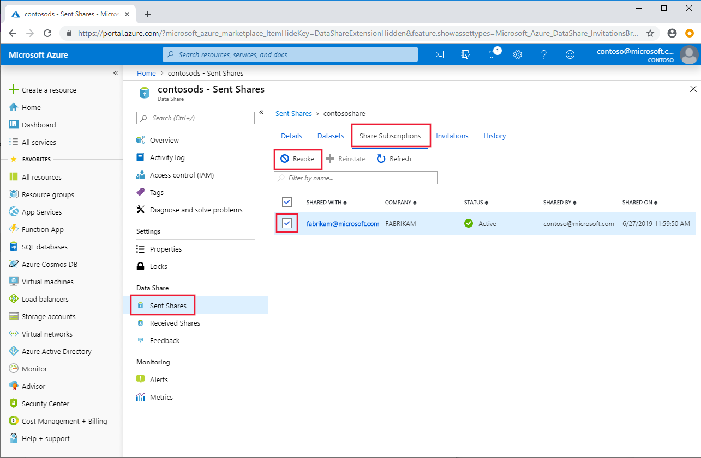

# How to revoke a consumer's share subscription in Azure Data Share

> [!IMPORTANT]
> Azure Data Share is being retired. You can no longer create new Azure Data Share accounts, and existing capabilities will remain in maintenance mode through October 30, 2027. For retirement timelines, transition guidance, and recommended next steps, see the [Azure Data Share retirement announcement](https://aka.ms/ADS-Deprecation).

This article explains how to revoke a share subscription from one or more of your consumers using Azure Data Share. This prevents a consumer from triggering any more snapshots. If the consumer hasn't yet triggered a snapshot, they won't receive the data once the share subscription is revoked. If they previously triggered a snapshot, the latest data that they have stays in their account.

## Navigate to a sent data share

In Azure Data Share, navigate to your sent share and select the **Share Subscriptions** tab.

 

Check the boxes next to the recipients whose share subscriptions you would like to delete and then select **Revoke**. The consumer will no longer get updates to their data.

## Related content

Learn more about how to [monitor your data shares](how-to-monitor.md).
