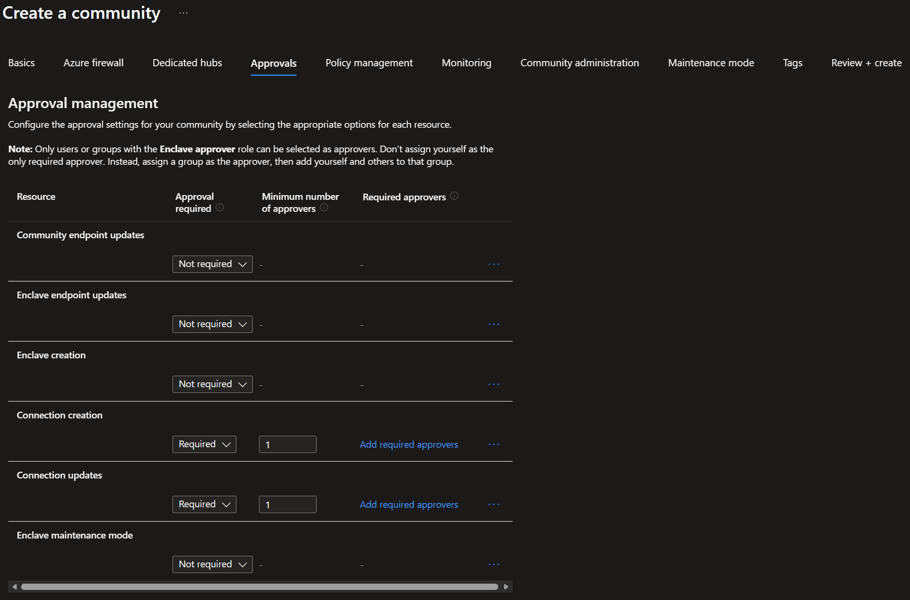
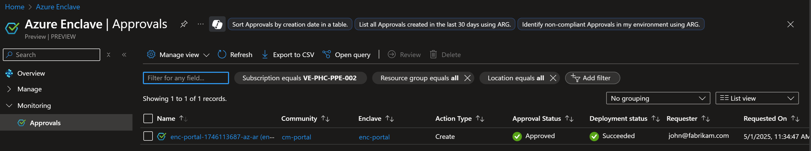

# Tutorial: Use approvals for enclave onboarding and external connectivity

In this tutorial, you use approvals to control a realistic workflow: onboarding a new enclave for an application team, then enabling and refining external connectivity through a community endpoint and enclave connection.

This tutorial mirrors the core resources from the 1-x tutorial path (community, enclave, endpoint, and connection) but focuses on the approvals experience for higher-risk changes.

## Scenario

A fictional customer, **Fabrikam Financial**, runs a shared Azure Enclave community for regulated workloads. A platform engineer needs to:

- Create a new enclave for a payments workload.
- Allow the workload to reach a partner API over HTTPS.
- Update connectivity settings after security review.

Fabrikam requires approvals for:

- `Enclave creation`
- `Community endpoint updates`
- `Enclave connection updates`

## Prerequisites

Before you start, make sure you have:

- An Azure subscription with access to Azure Enclave.
- A user account that can create community and enclave resources.
- At least one approver assigned the **Enclave Approver Role** at the correct scope.
- Familiarity with the base deployment flow from these tutorials:
  - [Tutorial 1-1: Deploy an Azure Enclave community](./1-1-create-community.md)
  - [Tutorial 1-2: Create enclaves in an Azure Enclave community](./1-2-create-enclaves-inside-community.md)
  - [Tutorial 1-5: Create enclave or community endpoint resources in Azure Enclave](./1-5-create-enclave-endpoint-connections.md)

For approval concepts and roles, see [Understand approvals](./understand-approvals.md) and [Configure approvals](./configure-approvals.md).

## Step 1: Create the community with approvals enabled

1. In the Azure portal, open `Azure Enclave` and select `Communities`.
2. Select `Create` and enter your basics settings (for example, `cmt-fabrikam`, `East US`, and your address space).
3. Go to the `Approvals` tab.
4. Configure these approval requirements:
   - `Enclave creation`: `Required`, `Minimum number of approvers = 1`
   - `Community endpoint updates`: `Required`, `Minimum number of approvers = 1`
   - `Enclave connection updates`: `Required`, `Minimum number of approvers = 1`
5. Complete `Review + create`, and then select `Create`.

> [!NOTE]
> In production, define approvers as security groups and use a minimum approver count that matches your governance policy.

## Step 2: Submit and approve enclave creation

1. As the requestor, go to `Enclaves` and select `Create`.
2. Enter enclave details for the new workload enclave (for example, `ve-Enclave-Payments`) and submit the request.
3. As an approver, open `Approvals` from the Azure Enclave service, community, or enclave view.
4. Find the pending `Enclave` creation request and review the requested details.
5. Select `Approve` to allow deployment to continue.
6. Return to `Enclaves` and confirm the enclave provisioning state is `Succeeded`.

## Step 3: Create a community endpoint for partner egress

1. Open your community and select `Community Endpoints` > `Create`.
2. Enter endpoint basics (for example, `ce-fabrikam-partner-api`).
3. Add a rule for partner API egress:
   - `Destination Type`: `FQDN`
   - `Destination`: `api.partner.example`
   - `Protocol`: `HTTPS`
   - `Port`: `443`
4. Select `Review + create`, and then select `Create`.

## Step 4: Update the community endpoint and complete approval

After security review, Fabrikam narrows the destination from a broad test value to a production-specific value. That update requires approval.

1. Open `Community Endpoints`, select `ce-fabrikam-partner-api`, and select `Edit`.
2. Update one rule value (for example, a stricter FQDN) and save.
3. Open `Approvals` and review the pending `Community endpoint update` request.
4. Approve the request.
5. Confirm the endpoint reflects the approved update.

For the approval review process, see [Manage approval requests](./manage-approvals.md).

## Step 5: Create an enclave connection and then update it with approval

1. In the community, select `Enclave Connections` > `Create`.
2. Create a connection from your source enclave (for example, `ve-Enclave-Payments`) to the community endpoint (`ce-fabrikam-partner-api`).
3. After creation succeeds, open the connection and change one setting that triggers an update request (for example, source CIDR range).
4. Open `Approvals`, review the pending `Enclave connection update` request, and approve it.
5. Confirm the connection state is healthy after the approved update.

## Validate results

At the end of this tutorial, verify:

- The enclave creation request required approval and completed successfully.
- Community endpoint update required approval before the change took effect.
- Enclave connection update required approval before the change took effect.
- Approval history shows who approved each request and when.

## Clean up resources

If you no longer need this environment, delete the tutorial resources:

1. Delete the enclave connection.
2. Delete the community endpoint.
3. Delete the enclave.
4. Delete the community.

For full cleanup guidance, see:

- [Tutorial 1-1: Deploy an Azure Enclave community](./1-1-create-community.md)
- [Tutorial 1-2: Create enclaves in an Azure Enclave community](./1-2-create-enclaves-inside-community.md)
- [Tutorial 1-5: Create enclave or community endpoint resources in Azure Enclave](./1-5-create-enclave-endpoint-connections.md)

## Next steps

- [Manage approval requests](./manage-approvals.md)
- [Configure approvals](./configure-approvals.md)
- [Understand approvals](./understand-approvals.md)

