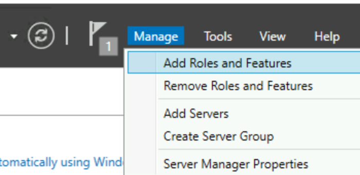
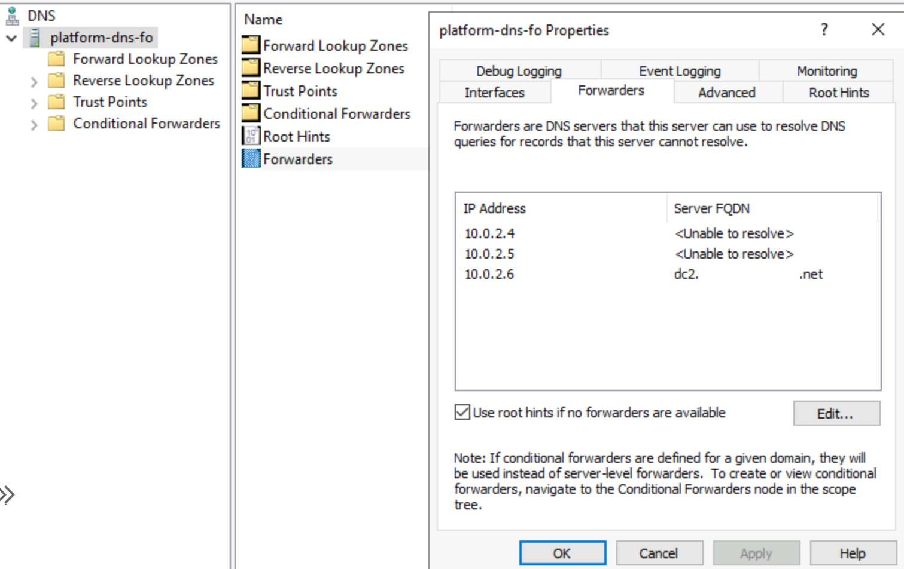
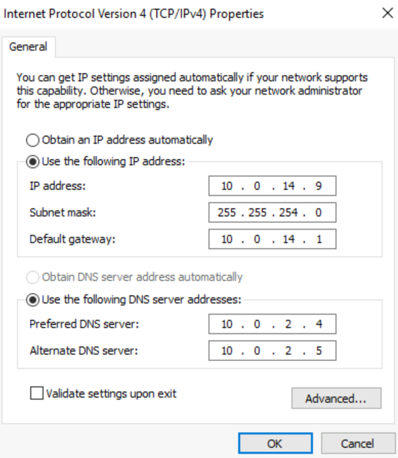

# Create a Domain Name Service (DNS) forwarder

Use this guide to configure a Windows Server VM as a DNS forwarder for workloads in an Azure Enclave virtual network. The following example uses the `contoso5.com` domain and domain controllers at `10.0.2.4`, `10.0.2.5`, and `10.0.2.6`. Replace these example values with the domain and IP addresses for your environment. Learn more about [DNS Forwarding](/windows-server/networking/dns/forwarding).

## Prerequisites

- A [community](./what-community.md), [enclave](./what-enclave.md), and [workload](./what-workload.md).
- The IP addresses of the domain controllers that can resolve the domain.
- Confirm that the domain controllers or their upstream DNS servers can also resolve other names your workloads require, including Azure service names.
- A workload resource group and an enclave subnet configured for your deployment. Subnet names can vary; verify the subnet configured for your enclave instead of assuming a fixed name.
- Network routes and security rules that allow DNS traffic over TCP and UDP port `53` from workloads to the DNS forwarder, and from the forwarder to the domain controllers.

## Create and configure the DNS forwarder VM

1. Create a Windows Server VM in the workload resource group and in a subnet configured for your enclave. Don't assign a public IP address.
1. Assign the VM network interface a static private IP address from the subnet's address range. Record this address; you'll configure the virtual network to use it as its DNS server.
1. In `Server Manager`, select `Manage`, and then select `Add Roles and Features`.

   

1. In the wizard, select `Next` until you reach `Server Roles`, select `DNS Server`, accept the recommended features, and complete the installation.
1. In `Server Manager`, select `Tools`, and then select `DNS`.
1. In DNS Manager, select the DNS forwarder VM, open `Forwarders`, and add the domain controller IP addresses. For this example, add `10.0.2.4`, `10.0.2.5`, and `10.0.2.6`.

   

   

## Configure virtual network DNS

1. Open the virtual network used by the enclave.
1. In the virtual network settings, select **DNS**.
1. Configure the custom DNS server as the DNS forwarder VM's static private IP address. Don't enter the domain controller IP addresses here; the forwarder sends queries to those servers.
1. This setting directs the virtual network's DNS queries to the forwarder. Ensure the domain controllers or their upstream DNS servers can resolve all other names your workloads need.
1. Save the change. Restart existing VMs that need to use the updated virtual network DNS settings.

## Validate name resolution

1. On a VM in the virtual network, run `ipconfig /all` and confirm that the adapter's DNS server list includes the DNS forwarder's static private IP address.
1. Choose a fully qualified hostname that has an A record in your domain. Run `nslookup <known-hostname>.contoso5.com. <dns-forwarder-private-ip>`, replacing the placeholders with the hostname and forwarder's static private IP address. Confirm that `nslookup` identifies the forwarder as the DNS server and returns the expected A record.
1. Run `nslookup <known-hostname>.contoso5.com.` to confirm that the VM's configured DNS server returns the expected record. These query results don't establish whether a new query reached a domain controller or the DNS forwarder returned a cached answer.
