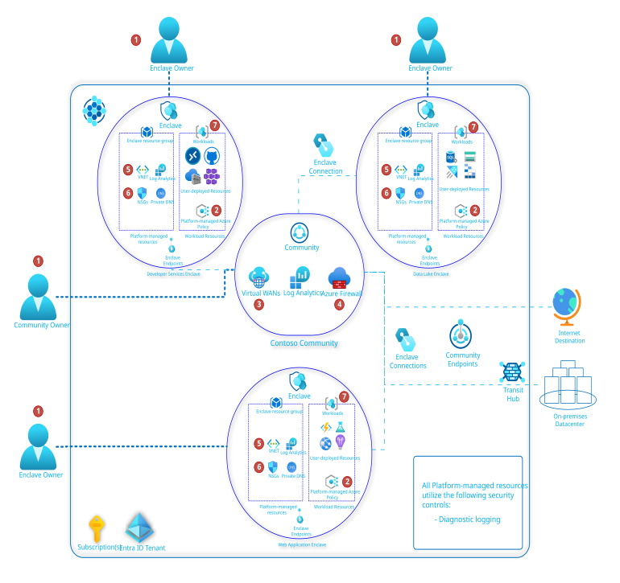

# Defense in depth for Azure Enclave

Defense in depth uses multiple safeguards so that a single control isn't the only protection for your environment. This article describes areas to review when planning security for Azure Enclave. The controls that apply to a deployment depend on its configuration, environment, and the API version used.

## Identity and governance

- Use [Azure role-based access control (Azure RBAC)](https://aka.ms/azure-rbac) to review who can access resources and what actions their roles allow. Check role assignments at the scopes relevant to your resources.
- Review [Azure Policy assignments and compliance](./what-azure-enclave.md#multi-layered-governance-security-and-monitoring) for the resource groups and resources in your deployment. The applicable assignments depend on the configuration and API version.

## Network controls

- Azure Enclave networking can involve [Azure Virtual WAN](/azure/virtual-wan/virtual-wan-about), [Azure Firewall](/azure/firewall/overview), [virtual networks](/azure/virtual-network/virtual-networks-overview), and [network security groups](/azure/virtual-network/network-security-groups-overview). Review the routes and rules configured for your environment; don't assume that every traffic path uses the same controls.
- Check that network rules allow required traffic and deny traffic that isn't needed. Validate the effective routes and security rules for each workload and connection.
- Review [workloads](./what-workload.md), endpoints, and connections to understand which resource groups and network paths are configured for each application.

## Monitoring and diagnostics

Diagnostic and flow-log settings vary by Mission API version. In `2025-11-01-preview`, `enclaveDefaultSettings.diagnosticDestination` uses `CommunityOnly`, `EnclaveOnly`, or `Both`. The `2026-03-01-preview` and `2026-04-01` schemas retain that property and add `monitoringSettings`, which models `diagnosticDestinations` separately from `flowLogDestination`. The newer destination objects include `destinationType` values such as `CommunityWorkspace`, `EnclaveWorkspace`, and `CustomWorkspace`. Check the API version and configuration used by your deployment before relying on a destination or expecting logs to be sent.

The API fields describe available configuration; they don't by themselves establish that diagnostics or Activity Logs are enabled or delivered automatically. Review the [Azure Monitor diagnostic settings](/azure/azure-monitor/essentials/diagnostic-settings) and [Azure Activity Log](https://aka.ms/activity-log) guidance for the services you use.

## Review your security layers

Periodically review role assignments, policy compliance, network paths, and configured diagnostic destinations. Test that users and workloads can perform required operations and that access outside those requirements is restricted. For additional guidance, see [Azure Enclave best practices](./best-practices.md) and the [shared responsibility model](./shared-responsibility-model.md).
