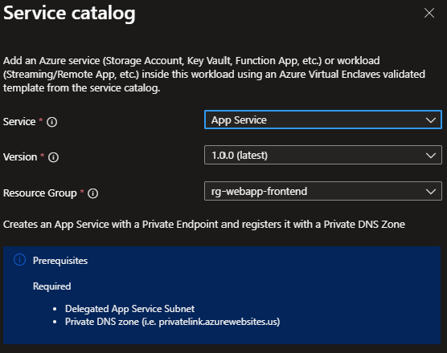

# Deploy an App Service Web App from the service catalog into a workload

Azure Enclave is a cloud networking service that provides organizations with highly sensitive data the ability to quickly deploy and manage workloads across Commercial and air-gapped Azure clouds at scale. In this article, you:

- Deploy a service catalog App Service Web App template into an existing workload from the Azure portal.
- Review an architecture example for a [basic web application](/azure/architecture/web-apps/app-service/architectures/basic-web-app)

> [!NOTE]
> 
> This sample deployment is just for demonstration purposes and doesn't represent all the best practices for network, systems, or applications administration.

## Before you begin
- This article assumes a basic understanding of networking and Azure Enclave concepts. For more information, see [Best practices of Azure Enclave](./best-practices.md).

- You need an Azure account with an active subscription. If you don't have one, [create an account for free](https://azure.microsoft.com/free/).

- You need a [community](./what-community.md), [enclave](./what-enclave.md), [workload](./what-workload.md), and at least one [workload resource group](./what-workload.md#workload-resource-group), with permissions to create resources in the workload resource group.

- Enable the required [maintenance mode](./maintenance-mode.md) for your enclave so the deployment can add Private Link resources to the enclave managed resource group. The required mode depends on the Mission API version and the deployment configuration.

## Prerequisites
If your organization's policies require Customer-Managed Keys (CMK) encryption, create the required key and managed identity before deployment. Use the [Common Dependencies service catalog template](./deploy-common-dependencies-service-catalog.md) to create these resources.

1. Subnets for private endpoints and App Service integration: Use subnets you create during enclave creation or [create new subnets](./create-new-enclave-subnet.md) after enclave creation. The private endpoint subnet shouldn't have [subnet delegation](/azure/virtual-network/subnet-delegation-overview).
  - Create a private endpoint subnet. A `/26` subnet, such as `10.0.2.0/26`, is an example size and isn't a universal requirement.
    - Add NSG rule set
    - Don't delegate this subnet
    - Use this subnet for private endpoint resources
  - Create an App Service integration subnet. A `/26` subnet, such as `10.0.2.64/26`, is an example size and isn't a universal requirement.
    - Add NSG rule set
    - Add subnet delegation `Microsoft.Web/serverFarms`
    - Use this subnet for App Service resources

  > [!NOTE]
  > 
  > You can't resize a subnet once resources are deployed inside the subnet.

1. Create the private DNS zone required for the App Service private endpoint. The zone name is cloud-specific. For example, use `privatelink.azurewebsites.net` in Azure global or `privatelink.azurewebsites.us` in Azure Government. Create the zone under `Additional Private DNS Zone names` in the [Private DNS Zones service catalog template](./deploy-private-dns-zones-service-catalog.md).

## Deploy the template
1. Navigate to the [workload](./what-workload.md) for the intended deployment.
1. Select the `+Add Azure Service` button.
1. Select the `App Service` service template from the [service catalog list](./list-service-catalog-templates.md) dropdown, confirm the version you need (default: `latest`), and select `Next`.

1. Enter all required parameters on each tab.
1. Adjust any of the prepopulated parameters as needed.
1. Select `Review + Create` then `Create`.

Wait for the deployment to complete successfully before you take any actions within the deployed resources.

## Validate the deployment
Go to the specified resource group and confirm that the deployment created the expected resources, including an App Service, App Service plan, private endpoint, and network interface.

## Delete the deployment
If you don't plan on keeping these resources, clean up unnecessary resources to avoid Azure charges. Before deleting a resource group, confirm that it doesn't contain resources used by other deployments, including shared subnets, private DNS zones, CMK resources, Key Vaults, or managed identities.

## Recommendations
- [Add tags](/azure/azure-resource-manager/management/tag-resources) to service catalog deployments to track important information for that resource such as:
  - Owner: `<main POC>`
  - Deployer: `<yourName>`
  - Purpose: `<prod user web app>`
  - Service Catalog Name: `<App Service Web App>`
  - Service Catalog Version: `<version you deployed>`
- Consider adding an [Azure Policy to enforce and inherit tags](/azure/azure-resource-manager/management/tag-policies)
