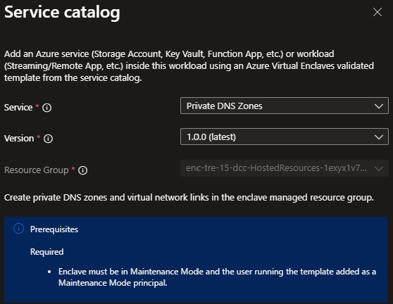

# Deploy private DNS zones from the service catalog into a workload

Azure Enclave is a cloud networking service that provides organizations with highly sensitive data the ability to quickly deploy and manage workloads across Commercial and air-gapped Azure clouds at scale. In this how-to guide, you:

- Deploy a Private DNS Zones service catalog template into an existing Azure Enclave workload from the Azure portal. The template creates private DNS zones and virtual network links for Azure Storage, Key Vault, Azure SQL, Container Registry, or additional private DNS zone names. This configuration allows you to connect privately and securely to the Azure service. For more information, see [Private Link](/azure/private-link/private-link-overview).

> [!NOTE]
>
> This sample deployment is just for demo purposes and doesn't represent all the best practices for network, systems, or applications administration.

## Before you begin
- This quickstart assumes a basic understanding of networking and Azure Enclave concepts. For more information, see [Best practices of Azure Enclave](./best-practices.md).

- You need an Azure account with an active subscription. If you don't have one, [create an account for free](https://azure.microsoft.com/free/).

- You need a [community](./what-community.md), [enclave](./what-enclave.md), [workload](./what-workload.md), and a workload resource group with permissions to create resources in that resource group.

- Enable `General` [maintenance mode](./maintenance-mode.md) for your enclave. The template requires General maintenance mode and the user running the template must be an enclave maintenance mode principal.

## Prerequisites

- Identify the workload resource group where you want to deploy the private DNS zones.
- Ensure the enclave virtual network and the required virtual network links are available to the deployment.
- Review the [private DNS zones required for Azure services](/azure/private-link/private-endpoint-dns) before you deploy dependent resources.

## Available private DNS zones

The template includes these predefined private DNS zones:

- `Storage File`: required for Azure Files.
- `Storage Queue`: required for Azure Queue storage.
- `Storage Table`: required for Azure Table storage.
- `Storage Blob`: required for Azure Blob Storage.
- `Key Vault`: required for Azure Key Vault.
- `Azure SQL`: required for Azure SQL.
- `Container Registry`: required for Azure Container Registry.
- `Additional`: an optional JSON array of extra DNS zone names. For example, `["privatelink.table.cosmos.azure.com","privatezone1.com"]` adds a Cosmos DB zone and a custom zone.

The template deploys the private DNS zones and virtual network links to the selected workload resource group. The virtual network links connect the zones to the enclave virtual network.

## Deploy the template
1. Navigate to the workload for the intended deployment.
1. Select the `+Add an Azure Service` button.
1. Select the `Private DNS Zones` service template from the [service catalog list](./list-service-catalog-templates.md) dropdown, confirm the version you need (default: `latest`), and select `Next`.

> [!NOTE]
> 
> This template deploys resources into the selected workload resource group. It links the zones to the enclave virtual network.

1. Enter the required parameters on each tab.
1. Adjust any of the prepopulated parameters as needed.
1. Select `Review + Create`, and then select `Create`.

Wait for the deployment to report successful completion before you take any actions on the deployed resources.

## Validate the deployment
Go to the selected workload resource group and confirm that:

- Each selected private DNS zone was created.
- Each virtual network link references the enclave virtual network.
- The zone names match the requirements of the Azure services or custom domains you plan to access.

> [!NOTE]
> 
> Don't delete the workload resource group if it contains other resources. Delete only the private DNS zones and virtual network links that you no longer need.

## Delete the deployment
If you don't plan on keeping these resources, delete the private DNS zones and virtual network links that you created. Ensure that other workloads don't require these resources before you delete them.

## Recommendations
- [Add tags](/azure/azure-resource-manager/management/tag-resources) to service catalog deployments to track important information for that resource such as:
  - Owner: `main POC`
  - Deployer: `yourName`
  - Purpose: `prod private DNS zones`
  - Service Catalog Name: `Private DNS Zones`
  - Service Catalog Version: `version you deployed`
- Consider adding an [Azure Policy to enforce and inherit tags](/azure/azure-resource-manager/management/tag-policies).
