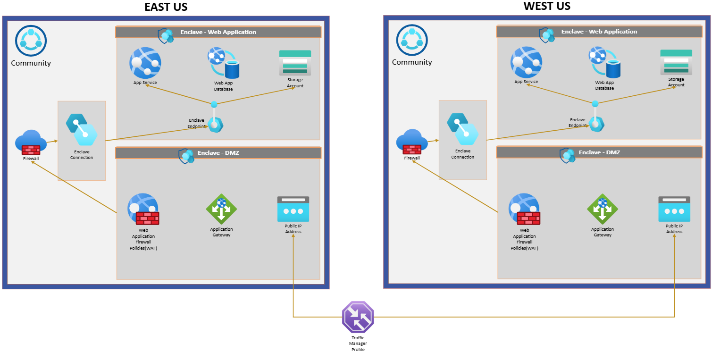

# Disaster recovery planning within Azure Enclave

This article describes considerations for planning disaster recovery for workloads deployed in Azure Enclave. A multi-region design can reduce disruption, but recovery depends on workload architecture, data protection, traffic routing, and the capabilities of the Azure services in your design.

## Create a disaster recovery plan

For each critical workload, define recovery time and recovery point objectives (RTO and RPO), identify dependencies and recovery owners, and document failover and failback procedures. Test the plan regularly and update it when the workload or its dependencies change.

### Plan workload deployments across regions

If your workload requires regional redundancy, plan how to deploy and maintain its resources in a primary region and a secondary region. Confirm that each service and configuration in your design supports the required regions and recovery objectives. Depending on your deployment scenario, a load-balancing service might distribute or redirect traffic. Review [load-balancing options](/azure/architecture/guide/technology-choices/load-balancing-overview) and the [tutorial for creating a multi-region app in Azure App Service](/azure/app-service/tutorial-multi-region-app) when those services fit your workload.

- **Primary region**: The region where the workload normally operates, such as East US.

- **Secondary region**: The region used to recover the workload, such as West US. Determine how its data and configuration are kept ready for recovery.

### Protect and synchronize data

Choose a data-protection approach that meets your workload's RTO and RPO. Replication, backup, and redundancy options differ by service; verify the behavior and recovery steps for each service you use. Evaluate whether [Azure Site Recovery](/azure/site-recovery/site-recovery-overview) is appropriate for your workload, and review [Azure Storage redundancy options](/azure/storage/common/storage-redundancy).

### Define and test failover

Document how your design detects a regional outage, who initiates or approves recovery, how traffic is directed to the recovery environment, and how you return to normal operations. Test these procedures regularly, including the steps needed to verify the workload and fail back.

## Evaluate traffic-routing options

The traffic-routing service and failover behavior depend on your workload's architecture and endpoint type. Review current service guidance before choosing a design. [Application Gateway](/azure/application-gateway/overview) and [Azure Traffic Manager](/azure/traffic-manager/traffic-manager-overview) are examples to evaluate; they aren't a combined failover configuration.

### Example services to evaluate

[Application Gateway](/azure/application-gateway/overview) is a load balancer that makes routing decisions based on the attributes of an HTTP request. It integrates with Web Application Firewall (WAF) to provide protection at the application level, ensuring that incoming traffic is inspected and filtered based on predefined security rules.

[Azure Traffic Manager](/azure/traffic-manager/traffic-manager-overview) is a DNS-based traffic load balancer for distributing traffic to public-facing application endpoints. For more information about using Traffic Manager with Application Gateway, see [Use Azure Application Gateway with Azure Traffic Manager](/azure/traffic-manager/traffic-manager-use-with-application-gateway).

To utilize an app service within Azure Enclave while maintaining secure and efficient communication, you can use the Application Gateway to act as a bridge between the web application and a demilitarized zone (DMZ) enclave. All incoming traffic is routed through the Web Application Firewall (WAF) by deploying an Application Gateway that inspects and filters requests based on predefined security policies. This helps ensure that only legitimate traffic reaches the application and effectively mitigates potential threats and enhances the security posture of the infrastructure.

Configure traffic-routing and health-check behavior according to the chosen services and workload topology. Test the expected routing and recovery behavior before relying on it during a regional outage.

The combination of traffic-routing, gateway, firewall, and data-protection services requires workload-specific configuration. Verify their supported endpoints, routing behavior, and regional data-recovery capabilities against current service documentation before relying on them for disaster recovery.

## Conclusion

An effective disaster recovery plan documents workload dependencies, data recovery, traffic routing, and the responsibilities and procedures for failover and failback. Regular testing helps identify gaps in the plan; it doesn't guarantee uninterrupted service during a regional failure.

Review the recovery objectives and service capabilities for your specific workload, and update the plan as the design changes.

## Resources

- For more information on how Azure Site Recovery works: [Azure Site Recovery documentation](/azure/site-recovery/)
- For more information on the integration of WAF and Azure Front Door: [Web Application Firewall (WAF) on Azure Front Door](/azure/frontdoor/web-application-firewall)
- [Use Azure App Gateway with Azure Traffic Manager](/azure/traffic-manager/traffic-manager-use-with-application-gateway)
- Guidance on how to configure WAF policies for an application gateway can be found here: [Create Web Application Firewall (WAF) policies for Application Gateway](/azure/web-application-firewall/ag/create-waf-policy-ag)
- [Tutorial: Create a multi-region app - Azure App Service](/azure/app-service/tutorial-multi-region-app)