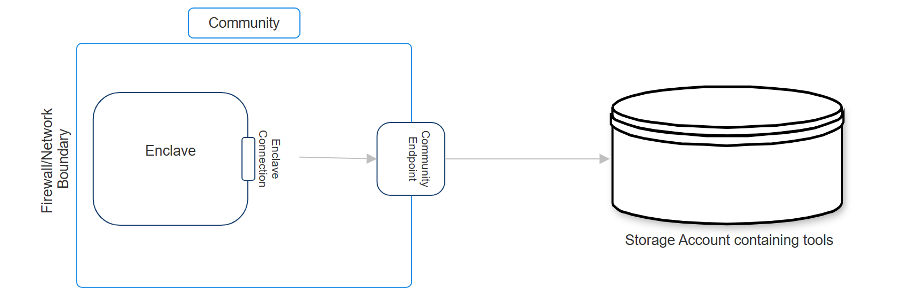

# Transfer data into an enclave

Traffic within an individual enclave subnet is allowed by default. Communication across enclave subnets is disabled by default (`allowSubnetCommunication: false`); enable it only when needed. The Admin VM's management subnet has separate, scoped rules. Network reachability doesn't guarantee service discovery. For more information, see [What is an enclave?](./what-enclave.md)

## Configure connectivity to the data source

To allow an enclave to reach an external storage account or tool host over HTTPS, create a community endpoint and an enclave connection:

1. Identify the storage account's endpoint host. For Azure Storage, use the host for the service that contains your data, such as the account's Blob service endpoint.
1. Create a [community endpoint](./create-community-endpoint-portal.md) for the destination host. Configure the endpoint rule with the destination host, the `HTTPS` protocol, and port `443`. The Mission Management REST API versions `2025-05-01-preview`, `2025-11-01-preview`, and `2026-03-01-preview` support endpoint destinations as IP addresses, CIDR ranges, or fully qualified domain names (FQDNs).
1. Create an [enclave connection](./create-enclave-connection-portal.md) from the enclave that will access the data to the community endpoint.

An enclave endpoint is intended for destinations in another enclave; its protocol options differ from community endpoints. For details, see [Create an enclave endpoint](./create-enclave-endpoint-portal.md).

## Transfer the data

1. Connect to the [Admin VM](./understand-admin-vm.md) or another resource in the enclave that can reach the data source.
1. Choose a transfer tool supported in your environment, such as [AzCopy](https://aka.ms/azcopy), the [Azure portal](https://aka.ms/azureportal), or [Azure Storage Explorer](https://aka.ms/storageexplorer). Confirm the tool's availability, network path, and required Azure Storage permissions for your environment.
1. Copy the data from the storage account to the intended destination in the enclave. Follow the selected tool's instructions and verify that the expected files are present at the destination.

Azure Enclave lists AzCopy as an Azure Toolbox artifact. Check the current environment's availability and network requirements before relying on the artifact. For more information, see [Azure Toolbox](https://aka.ms/aztoolbox).

If you have trouble creating a connection, see [Create a connection from the Azure portal](./create-enclave-connection-portal.md) or contact [Azure Support](https://azure.microsoft.com/support/).
