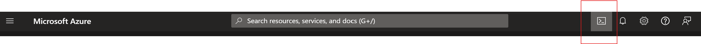
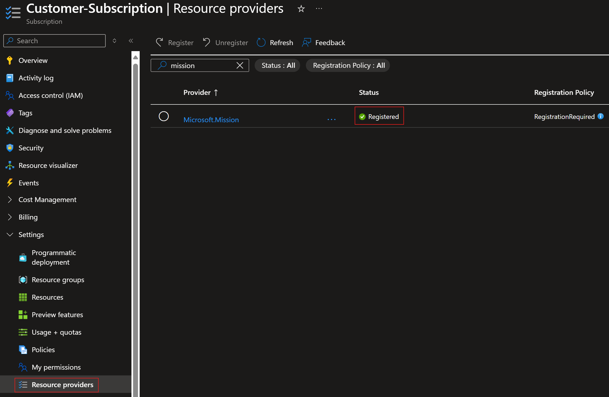

# Get started with Azure Enclave

This guide provides the steps to onboard to Azure Enclave by enabling the resource provider and granting permissions over your Azure subscription.

## Prerequisites

  - You must already have an Azure tenant and subscription.
  - You must be an Owner of an existing Azure subscription.

## Register the `Microsoft.Mission` Resource Provider and grant permissions

### Option 1: PowerShell (Fastest)

You can run the following code to quickly register all required resource providers to begin using Azure Enclave.
1. Sign-in to your Azure tenant and open the subscription resource
2. In the Azure portal, select the `Cloud Shell` icon at the top of the window here



3. [Set context](/powershell/azure/context-persistence#create-a-new-azure-context-from-subscription-information) to your subscription.
4. Copy and paste this code into the Cloud Shell and press enter.

```
# Register the Azure Enclave Resource Provider and grant permissions to the Resource Provider application

$resourceProviders = @(
   "Microsoft.Advisor",
   "Microsoft.AlertsManagement",
   "Microsoft.Authorization",
   "Microsoft.Automation",
   "Microsoft.Billing",
   "Microsoft.Capacity",
   "Microsoft.ChangeAnalysis",
   "Microsoft.ClassicSubscription",
   "Microsoft.CognitiveServices",
   "Microsoft.Compute",
   "Microsoft.Consumption",
   "Microsoft.CostManagement",
   "Microsoft.DesktopVirtualization",
   "Microsoft.Features",
   "Microsoft.GuestConfiguration",
   "Microsoft.insights",
   "Microsoft.KeyVault",
   "Microsoft.Logic",
   "Microsoft.ManagedIdentity",
   "Microsoft.MarketplaceOrdering",
   "Microsoft.Network",
   "Microsoft.OperationalInsights",
   "Microsoft.OperationsManagement",
   "Microsoft.PolicyInsights",
   "Microsoft.Portal",
   "Microsoft.ResourceGraph",
   "Microsoft.ResourceHealth",
   "Microsoft.ResourceNotifications",
   "Microsoft.Resources",
   "Microsoft.Security",
   "Microsoft.SecurityInsights",
   "Microsoft.SerialConsole",
   "Microsoft.SqlVirtualMachine",
   "Microsoft.Storage",
   "Microsoft.support",
   "Microsoft.Web",
   "Microsoft.Mission"
)

$resourceProviders | foreach {Register-AzResourceProvider -ProviderNamespace $_ -Verbose}

```

5. (Optional) Enable EncryptionAtHost feature

The [EncryptionAtHost](/azure/virtual-machines/linux/disks-enable-host-based-encryption-cli) feature enables encryption at the compute host level.

```azurecli
# Register the feature
az feature register --namespace Microsoft.Compute --name EncryptionAtHost

# Check registration status (may take 10-15 minutes)
az feature show --namespace Microsoft.Compute --name EncryptionAtHost

# Once registered, refresh the provider
az provider register --namespace Microsoft.Compute
```

6. Once the update is complete, proceed to [Azure setup](./best-practices.md#azure-setup) or [next steps](#next-steps).

### Option 2: Azure portal

1. Sign-in to your Azure tenant and open the subscription resource.
2. Open the `Resource Providers` on the left side under `Settings`.
3. The [listed resource providers](#option-1-powershell-fastest) must be registered in the subscription. The [PowerShell](#option-1-powershell-fastest) script to enable these resource providers is the fastest option and includes the authoritative source of resource providers. These images are provided as an example of the view you should see in the end.

:::image type="content" source="./media/onboard-providers-1.png" alt-text="Screenshot showing the first set of resource providers required by Azure Enclave." border="true" lightbox="./media/onboard-providers-1.png":::

:::image type="content" source="./media/onboard-providers-2.png" alt-text="Screenshot showing the second set of resource providers required by Azure Enclave." border="true" lightbox="./media/onboard-providers-2.png":::

4. Search for and select `Microsoft.Mission` and select `Register`.

   

5. Proceed to [Azure setup best practices](./best-practices.md#azure-setup) or [next steps](#next-steps).

For reference, you can also review the generic instructions for enabling a [preview feature](/azure/azure-resource-manager/management/preview-features).

## Transition steps for preview customers

Customers who used Azure Enclave before November 2025 need to re-register the Azure Enclave resource provider so your subscriptions can use the latest API with the latest features and improvements.

Complete these steps to use the latest Azure Enclave API:
1. In the Azure portal, navigate to your subscription.
2. Open the `Resource Providers` on the left side under `Settings`.
3. Search for and select `Microsoft.Mission` and select `Re-register`.
4. Repeat these steps for any more subscriptions.

## Next Steps

Now the Azure Enclave resource provider can begin deploying Azure Enclave resources into your subscription on your behalf.

  - Start building your Azure Enclave Community:

    - [Create a community](./create-community-portal.md)
    - [Create an enclave](./create-enclave-portal.md)
    - [Create a workload](./create-workload-portal.md)

  - Establish network connectivity within your Community

    - [Create an Enclave Endpoint](./create-enclave-endpoint-portal.md)
    - [Create an enclave connection](./create-enclave-connection-portal.md)
    - [Create a transit hub](./create-transit-hub-portal.md)
    - [Create a Community Endpoint](./create-community-endpoint-portal.md)

  - Create resources within your workloads to meet your objectives.
    - Create resources from the [Service Catalog](./list-service-catalog-templates.md)
    - Create resources with an [template](/azure/azure-resource-manager/templates/deploy-to-resource-group) or [bicep template](/azure/azure-resource-manager/bicep/deploy-to-resource-group) from [these examples](https://github.com/Azure/azure-quickstart-templates/tree/master/quickstarts)
