# Create a private endpoint for Azure Data Manager for Energy
[Azure Private Link](../private-link/private-link-overview.md) provides private connectivity from a virtual network to Azure platform as a service (PaaS). It simplifies the network architecture and secures the connection between endpoints in Azure by eliminating data exposure to the public internet.

By using Azure Private Link, you can connect to an Azure Data Manager for Energy instance from your virtual network via a private endpoint, which is a set of private IP addresses in a subnet within the virtual network. You can then limit access to your Azure Data Manager for Energy instance over these private IP addresses. 

You can connect to an Azure Data Manager for Energy instance that's configured with Private Link by using an automatic or manual approval method. To learn more, see the [Private Link documentation](../private-link/private-endpoint-overview.md#access-to-a-private-link-resource-using-approval-workflow).

This article describes how to set up a private endpoint for Azure Data Manager for Energy. 

> [!NOTE]
> To enable private endpoint, public access must be disabled for Azure Data Manager for Energy. If public access is enabled and private endpoint is created, the instance will only be accessed via private endpoint and not by public access.

> [!NOTE]
> Terraform currently does not support private endpoint creation for Azure Data Manager for Energy.

## Prerequisites

[Create a virtual network](../virtual-network/quick-create-portal.md) and subnet in the subscription that contains the private endpoint. The private endpoint must be in the same region as its virtual network. The Azure Data Manager for Energy instance can be in another region, subscription, or tenant.

For automatic approval, use a virtual network in the same subscription as the Azure Data Manager for Energy instance. For a different subscription or tenant, follow [Create a private endpoint across subscriptions or tenants](#create-a-private-endpoint-across-subscriptions-or-tenants).

### Register resource providers in both subscriptions

Register the following providers in **both** the subscription that hosts the Azure Data Manager for Energy instance and the subscription that hosts the private endpoint:

| Resource provider | Purpose |
| --- | --- |
| `Microsoft.OpenEnergyPlatform` | Azure Data Manager for Energy |
| `Microsoft.Network` | Private endpoint and virtual network |

This requirement also applies when the subscriptions belong to different tenants. Registering `Microsoft.OpenEnergyPlatform` in the private endpoint's subscription doesn't require creating an Azure Data Manager for Energy instance there. For background, see [Approve private endpoint connections across subscriptions](../private-link/how-to-approve-private-link-cross-subscription.md).

An authorized administrator must check each subscription in its owning tenant. In PowerShell, repeat these Azure CLI commands for each subscription, replacing the tenant and subscription identifiers. If both resources use the same subscription, check it once.

```powershell
az login --tenant "<tenant-id>"
$subscriptionId = "<subscription-id>"

az provider show --subscription $subscriptionId --namespace Microsoft.OpenEnergyPlatform --query registrationState --output tsv
az provider show --subscription $subscriptionId --namespace Microsoft.Network --query registrationState --output tsv
```

Both results must be `Registered`. Register any missing provider and wait for completion:

```powershell
az provider register --subscription $subscriptionId --namespace Microsoft.OpenEnergyPlatform --wait
az provider register --subscription $subscriptionId --namespace Microsoft.Network --wait
```

Allow time for permissions to propagate. Registration doesn't automatically restart a failed approval; see [Recover a failed approval](#recover-a-failed-approval).

## Create a private endpoint during instance provisioning by using the Azure portal 

Use the following steps to create a private endpoint while provisioning Azure Data Manager for Energy resource:

1. During the creation of Azure Data Manager for Energy instance, select the **Networking** tab.

    [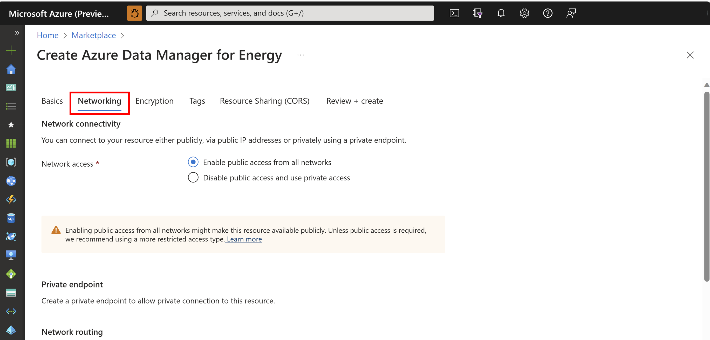](media/how-to-manage-private-links/private-links-11-networking-tab.png#lightbox)

1. In the Networking tab, select **Disable public access and use private access** and then choose **Add** under Private endpoint.

    [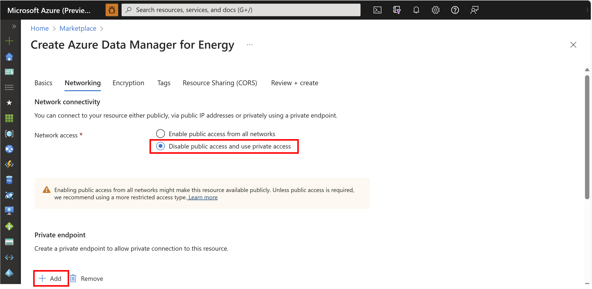](media/how-to-manage-private-links/private-links-12-add-private-endpoint.png#lightbox)

1. In **Create private endpoint**, enter or select the following information and select **OK**:

    |Setting| Value|
    |--------|-----|
    |Subscription| Select your subscription|
    |Resource group| Select a resource group|
    |Location| Select the region where you want to deploy the private endpoint|
    |Name| Enter a name for your private endpoint. The name must be unique|
    |Target sub-resource| **Azure Data Manager for Energy** by default|

    **Networking:**

    |Setting| Value|
    |--------|-----|
    |Virtual network| Select the virtual network in which you want to deploy your private endpoint|
    |Subnet| Select the subnet|

    **Private DNS integration:**

    |Setting| Value|
    |--------|-----|
    |Integrate with private DNS zone| Leave the default value - **Yes**|
    |Private DNS zone| Leave the default value|

    [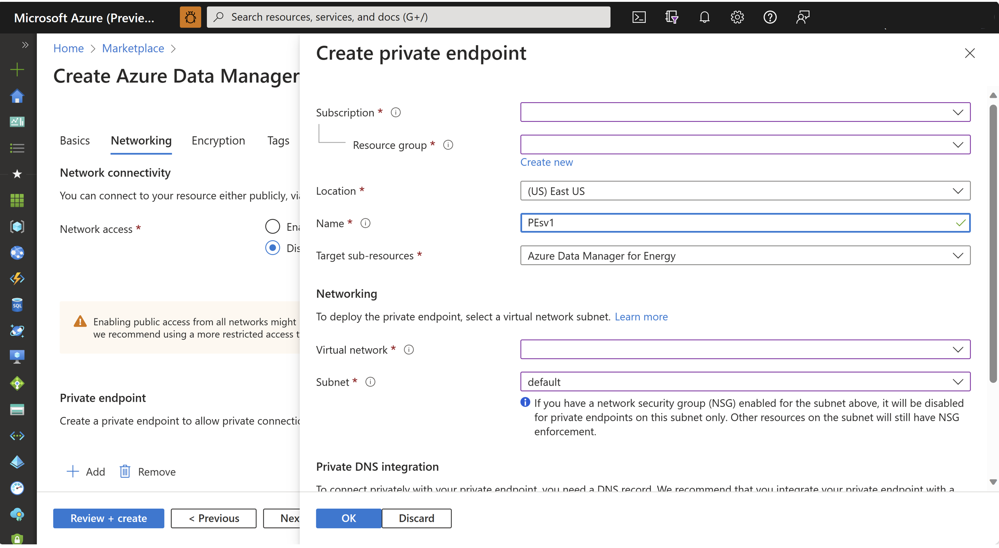](media/how-to-manage-private-links/private-links-13-create-private-endpoint.png#lightbox)

    [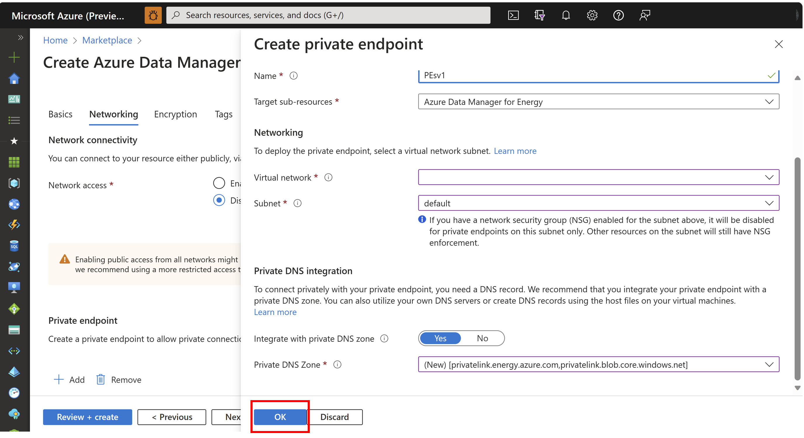](media/how-to-manage-private-links/private-links-14-private-dns.png#lightbox)


1. Verify the private endpoint details in the Networking tab and next, select **Review+Create** after completing other tabs.

    [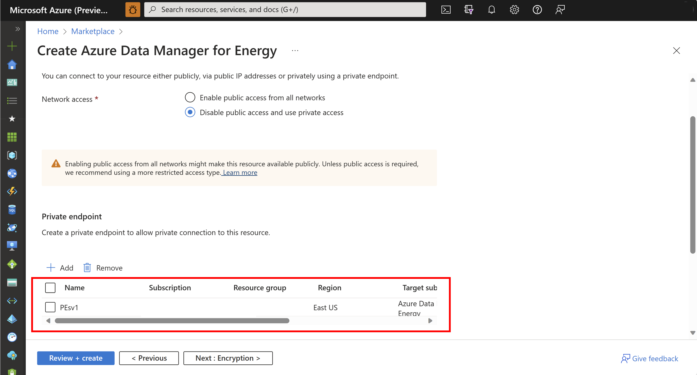](media/how-to-manage-private-links/private-links-15-review-private-endpoint.png#lightbox)

1. On the Review + create page, Azure validates your configurations.
When you see Validation passed, select the **Create** button.
1. An Azure Data Manager for Energy instance is created with private link.
1. You can navigate to Networking post instance provisioning and see the private endpoint created under **Private access** tab.

    [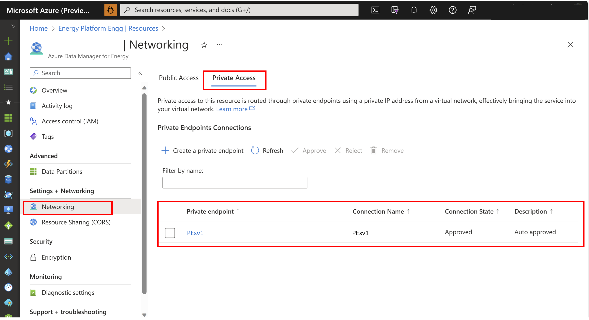](media/how-to-manage-private-links/private-links-16-validate-private-endpoint.png#lightbox)

## Create a private endpoint post instance provisioning by using the Azure portal 

Use the following steps to create a private endpoint for an existing Azure Data Manager for Energy instance by using the Azure portal:

1. From the **All resources** pane, choose an Azure Data Manager for Energy instance.
1. Select **Networking** from the list of settings.       
1. On the **Public Access** tab, select **Enabled from all networks** to allow traffic from all networks.

    [](media/how-to-manage-private-links/private-links-1-Networking.png#lightbox)
	
    If you want to block traffic from all networks, select **Disabled**.

1. Select the **Private Access** tab, and then select **Create a private endpoint**.
 
    [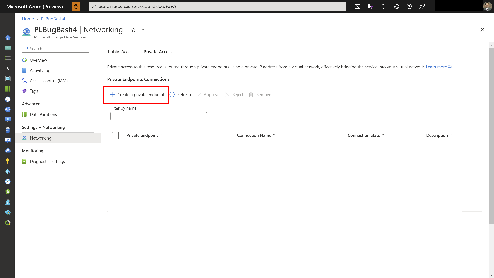](media/how-to-manage-private-links/private-links-2-create-private-endpoint.png#lightbox)
 
1. In the **Create a private endpoint** wizard, on the **Basics** page, enter or select the following details:

    |Setting| Value|
    |--------|-----|
    |**Subscription**| Select your subscription for the project.|
    |**Resource group**| Select a resource group for the project.|
    |**Name**| Enter a name for your private endpoint. The name must be unique.|
    |**Region**| Select the region where you want to deploy Private Link. |

    [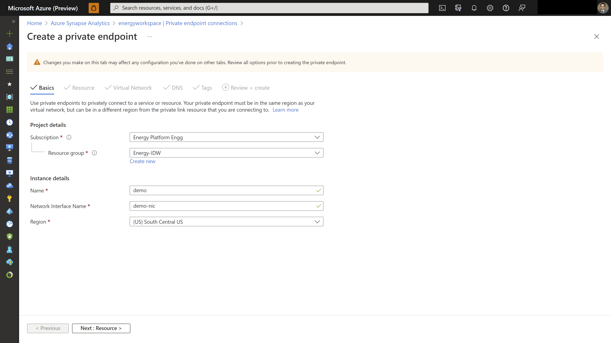](media/how-to-manage-private-links/private-links-3-basics.png#lightbox)
	
    > [!NOTE]
    > Automatic approval happens only when the Azure Data Manager for Energy instance and the virtual network for the private endpoint are in the same subscription.

1. Select **Next: Resource**. On the **Resource** page, confirm the following information:

    |Setting| Value|
    |--------|--------|
    |**Subscription**| Your subscription|
    |**Resource type**|	**Microsoft.OpenEnergyPlatform/energyServices**|
    |**Resource**| Your Azure Data Manager for Energy instance|
    |**Target sub-resource**| **Azure Data Manager for Energy** (for Azure Data Manager for Energy) by default|
	
    [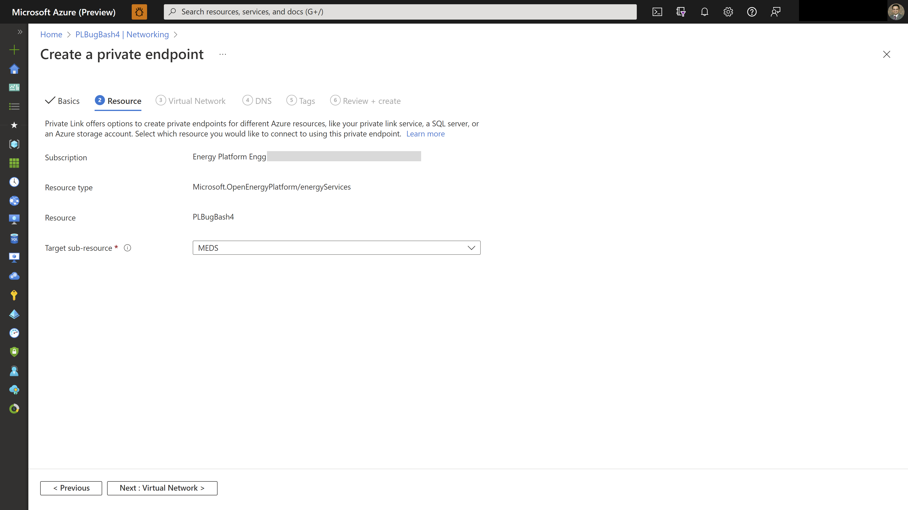](media/how-to-manage-private-links/private-links-4-resource.png#lightbox)
 
1. Select **Next: Virtual Network**. On the **Virtual Network** page, you can:

    * Configure network and private IP settings. [Learn more](../private-link/create-private-endpoint-portal.md#create-a-private-endpoint).

    * Configure a private endpoint with an application security group. [Learn more](../private-link/configure-asg-private-endpoint.md#create-a-private-endpoint-with-an-asg).

    [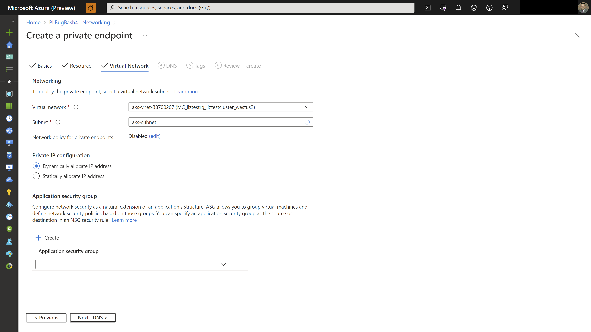](media/how-to-manage-private-links/private-links-4-virtual-network.png#lightbox)

1. Select **Next: DNS**. On the **DNS** page, you can leave the default settings or configure private DNS integration. [Learn more](../private-link/private-endpoint-overview.md#dns-configuration).

    [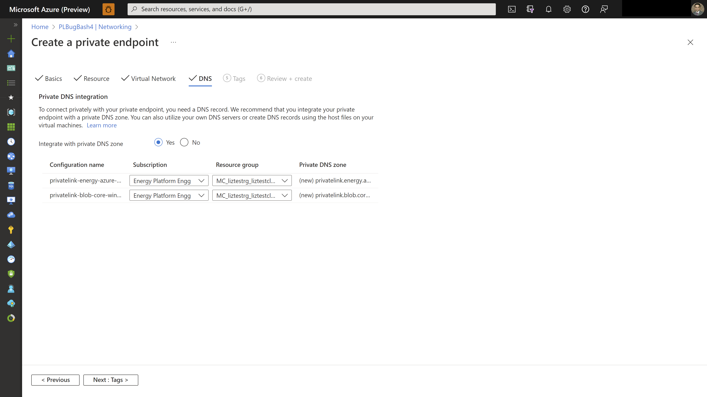](media/how-to-manage-private-links/private-links-5-dns.png#lightbox)

1. Select **Next: Tags**. On the **Tags** page, you can add tags to categorize resources.
1. Select **Review + create**. On the **Review + create** page, Azure validates your configuration.

    When you see **Validation passed**, select **Create**.

    [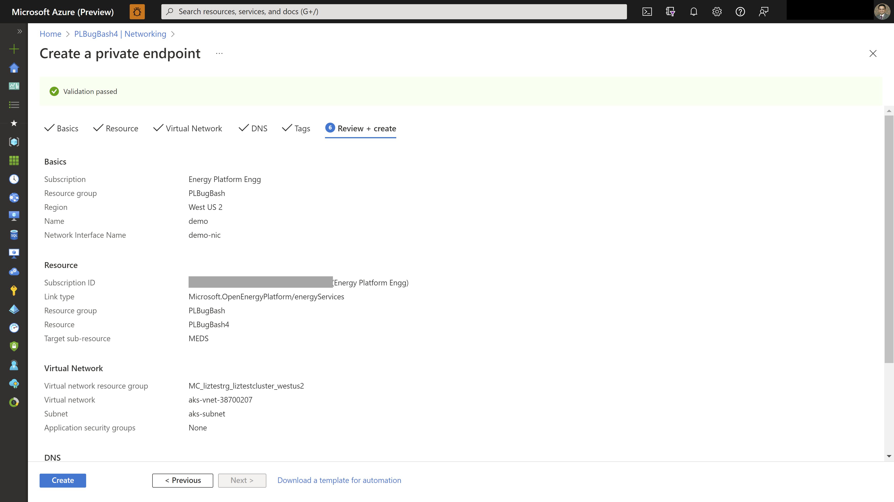](media/how-to-manage-private-links/private-links-6-review.png#lightbox)
 
1. After the deployment is complete, select **Go to resource**. 

    [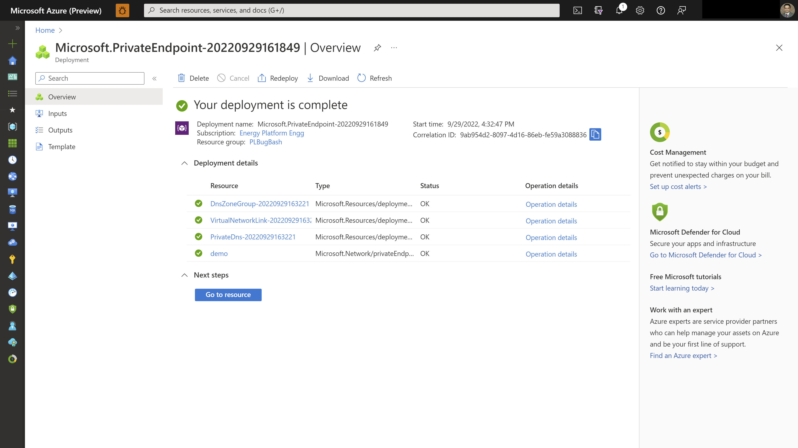](media/how-to-manage-private-links/private-links-7-deploy.png#lightbox)
  
1. Confirm that the private endpoint that you created was automatically approved.

    [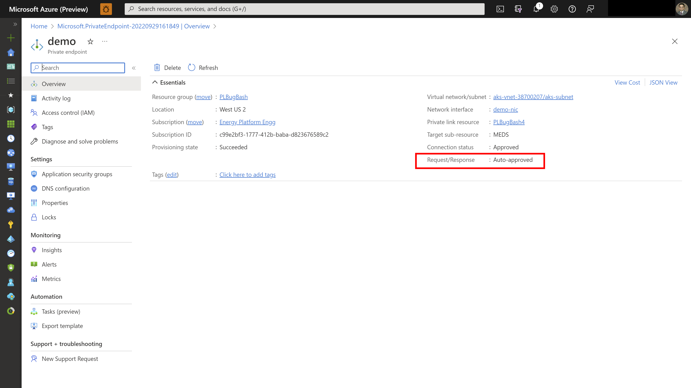](media/how-to-manage-private-links/private-links-8-request-response.png#lightbox)
 
1. Select the **Azure Data Manager for Energy** instance, select **Networking**, and then select the **Private Access** tab. Confirm that your newly created private endpoint connection appears in the list.

    [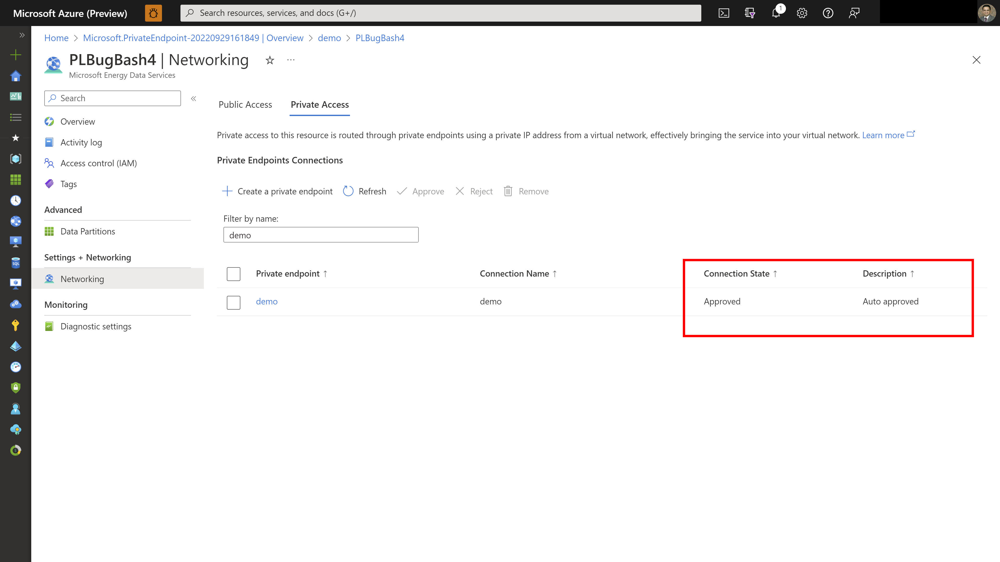](media/how-to-manage-private-links/private-links-9-auto-approved.png#lightbox)

> [!NOTE]
> When the Azure Data Manager for Energy instance and the virtual network are in different tenants or subscriptions, you need to manually approve the request. Follow [Create a private endpoint across subscriptions or tenants](#create-a-private-endpoint-across-subscriptions-or-tenants). The **Approve** and **Reject** buttons appear on the **Private Access** tab.
>
> [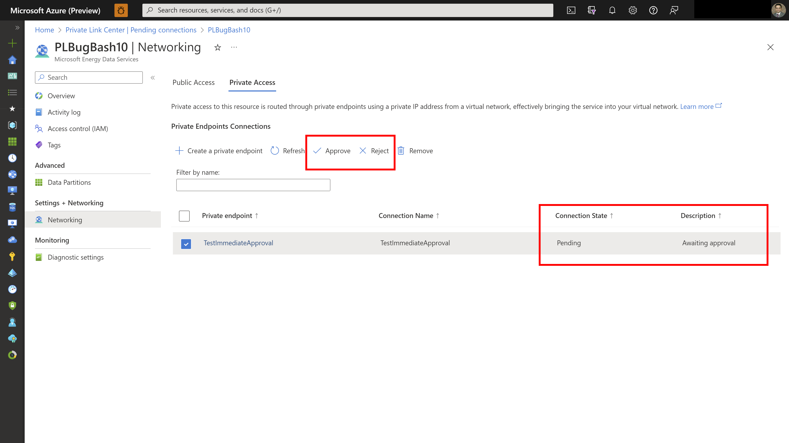](media/how-to-manage-private-links/private-links-10-awaiting-approval.png#lightbox)

## Create a private endpoint across subscriptions or tenants

Before creating the endpoint, complete the provider registration checks in [Prerequisites](#prerequisites).

1. In the tenant that hosts the Azure Data Manager for Energy instance, open the instance's **JSON View** and copy its full resource ID.

    ```text
    /subscriptions/<service-subscription-id>/resourceGroups/<service-resource-group>/providers/Microsoft.OpenEnergyPlatform/energyServices/<instance-name>
    ```

1. Switch to the tenant and subscription that will host the private endpoint. Open **Private endpoints** and select **Create**. On **Basics**, select the consumer subscription, resource group, and the same region as the consumer virtual network.
1. On **Resource**, select **Connect to an Azure resource by resource ID or alias**. Enter the instance resource ID and set **Target sub-resource** to **Azure Data Manager for Energy**. Don't enter `Microsoft.OpenEnergyPlatform/energyServices` as the target sub-resource; that's the resource type.
1. On **Virtual Network**, select the consumer virtual network and subnet.
1. On **DNS**, if automatic private DNS integration isn't available, select **No** and finish creation. You can [configure private DNS afterward](#configure-private-dns-after-endpoint-creation).
1. In the instance's tenant, open **Azure Data Manager for Energy instance > Networking > Private Access**. Match the pending connection's private endpoint ID to the endpoint you created, and select **Approve**.
1. Return to the consumer's private endpoint. Verify that its connection status is **Approved** and provisioning succeeded. Also check the service-side connection's provisioning state. Successful endpoint creation or a service-side Approved status alone doesn't prove that approval completed.

## Configure private DNS after endpoint creation

If you skipped automatic DNS integration, associate the endpoint with both of these private DNS zones:

| Private DNS zone | Purpose |
| --- | --- |
| `privatelink.energy.azure.com` | Azure Data Manager for Energy endpoint |
| `privatelink.blob.core.windows.net` | Backing storage endpoints |

Reuse existing zones, including centrally managed zones in another subscription where you have permission to manage the association. If the zones don't exist, [create the private DNS zones](../dns/private-dns-getstarted-portal.md#create-a-private-dns-zone). Don't create duplicate zones with the same names just because the endpoint wizard didn't offer integration.

### Associate the zones with the private endpoint

Use **one** private DNS zone group for both zones. Creating zones alone doesn't associate them with the endpoint.

The following PowerShell examples use Azure CLI and the full resource IDs of the zones. Sign in to the consumer tenant, then check for an existing zone group:

```powershell
$endpointSubscriptionId = "<consumer-subscription-id>"
$endpointResourceGroup = "<endpoint-resource-group>"
$endpointName = "<endpoint-name>"
$energyZoneId = "<energy-private-dns-zone-resource-id>"
$blobZoneId = "<blob-private-dns-zone-resource-id>"

az network private-endpoint dns-zone-group list `
  --subscription $endpointSubscriptionId --resource-group $endpointResourceGroup `
  --endpoint-name $endpointName --output json
```

If no group exists, create one with the service zone, then add the storage zone:

```powershell
az network private-endpoint dns-zone-group create `
  --subscription $endpointSubscriptionId --resource-group $endpointResourceGroup `
  --endpoint-name $endpointName --name default `
  --zone-name energy --private-dns-zone $energyZoneId

az network private-endpoint dns-zone-group add `
  --subscription $endpointSubscriptionId --resource-group $endpointResourceGroup `
  --endpoint-name $endpointName --name default `
  --zone-name blob --private-dns-zone $blobZoneId
```

If a group already exists, reuse its name and use `add` only for a missing zone association. Don't replace an existing group or create a second one. The `energy` and `blob` values are configuration names; the resource IDs identify the actual zones.

Run `dns-zone-group list` again. Verify successful provisioning, references to both zone IDs, and populated records in the zones' **Recordsets** pages. Read the expected hostnames and private IP addresses from the endpoint's **DNS configuration**, network interface, and zone-group record information. Don't guess backing storage names or point every hostname to the same IP address.

For command details, see [az network private-endpoint dns-zone-group](/cli/azure/network/private-endpoint/dns-zone-group).

### Link client networks and verify resolution

For each zone, open **Private DNS zones > zone > Virtual network links**. Verify that the client virtual network is linked and the link succeeded. If a link is missing, add it with **Enable auto registration** unchecked.

Auto registration here registers virtual-machine names. It isn't the resource-provider registration required in [Prerequisites](#prerequisites).

Virtual network peering alone doesn't share private DNS resolution. Link other client networks that use Azure-provided DNS, or follow your organization's central resolver design. For custom DNS servers, configure forwarding through an Azure-connected resolver and link the zones to the resolver's virtual network as required by that design. See [Private endpoint DNS integration](../private-link/private-endpoint-dns-integration.md).

Test from an application host or virtual machine that uses the client's actual DNS path. Ordinary Azure Cloud Shell can run the management commands in this article, but doesn't test resolution from inside the client virtual network.

For example, from a Windows host in the linked network:

```powershell
Resolve-DnsName "<instance-name>.energy.azure.com" -Type A
Resolve-DnsName "<storage-hostname-reported-by-the-endpoint>" -Type A
```

The final address records must match the endpoint's private IP addresses for those names. If records exist but the host resolves public addresses or fails to resolve the names, check its DNS servers, zone links, and forwarding path.

## Recover a failed approval

An approval can fail before the private endpoint's connection state is updated. Don't infer success from the service-side Approved status alone. Check the original operation's result, the service-side connection's provisioning state, and the consumer endpoint's connection state.

1. Review the error. A `403 AuthorizationFailed` when reading `Microsoft.Network/privateEndpoints/privateLinkServiceProxies` can prevent approval from completing. Check both provider registrations in both subscriptions and allow permissions to propagate. Registration isn't the only possible cause of a 403. If registration is complete and the error persists, contact Azure support with the correlation ID and denied action rather than granting broad subscription roles to the service application.
1. Wait until the previous approval operation is terminal, correct the authorization issue, and submit approval again on the **same connection**. Registration alone doesn't restart the operation. Avoid overlapping retries.
1. If an older connection shows **Approved** with provisioning state **Failed** and the portal doesn't offer approval, sign in to the instance's tenant and resubmit approval through Azure CLI using the full service-side private endpoint connection resource ID:

    ```powershell
    az login --tenant "<service-tenant-id>"
    $connectionId = "/subscriptions/<service-subscription-id>/resourceGroups/<service-resource-group>/providers/Microsoft.OpenEnergyPlatform/energyServices/<instance-name>/privateEndpointConnections/<connection-name>"

    az network private-endpoint-connection approve --id $connectionId `
      --description "Approve after correcting authorization"
    ```

1. Read the connection and consumer endpoint again. Verify the consumer connection is **Approved** and provisioning succeeded before treating recovery as complete. Don't rely only on the initial approval command response.

Don't reject the connection as a reset or recreate the endpoint just to retry approval. A rejected connection can't simply be approved again.

## Manage multiple endpoints in the same virtual network
### Access via IP vs DNS
In the same virtual network, you can create multiple endpoints. Each end point will have a different IP. It is not possible to resolve one host name with two difference IPs. 
- If you access the resource via IP: 
   - The resource will be accessible only via the latest private IP address. 
   - All the previous private IPs in the same vnet will become dangling. 
   - Even when you delete the latest IP, all the previous IPs still remain dangling. 
- If you access via DNS name:  You won't see any difference.


### Know which endpoint the resource is connected to
1. Go to any of the private endpoints, to the DNS configuration, and to Private DNS Zone associated with ADME resource.

[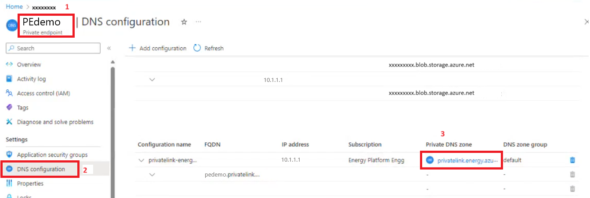](media/how-to-manage-private-links/private-links-17-dns-config.png#lightbox)


2. In the private DNS zone, check the IP associated with the entry for your Azure Data Manager for Energy instance.

[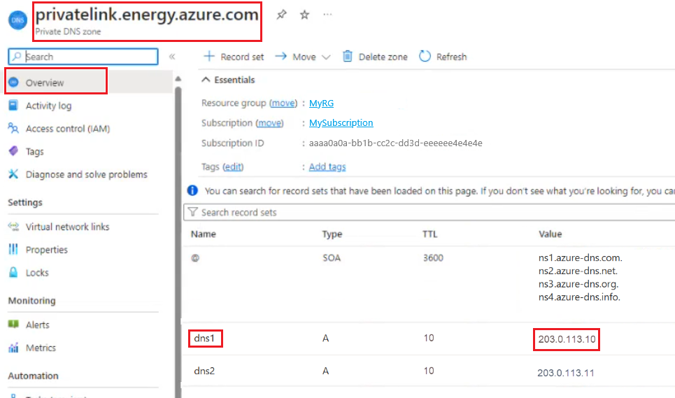](media/how-to-manage-private-links/private-links-18-dns-zone.png#lightbox)


3. This is the IP to which your resource is connected.

## New data partitions with static IP private endpoints
It is preferable to create private endpoints with dynamic IP to enable dynamic data partition creation. If you initiate the creation of new data partitions with static IPs private endpoint, it will fail. Each new data partition requires three additional static IPs which the static IP private endpoint is not able to provide. 


To create new data partitions successfully with static IP private endpoint, follow the below steps:
1. Create a new private endpoint with either dynamic IP or enable public access.
2. Delete existing private endpoint with static IP from Azure Data Manager for Energy instance and delete it from Azure resources also.
3. Create new data partitions successfully.
4. Delete the newly created private endpoint with dynamic IP and/or disable public access.
5. Create a new private endpoint with static IP. This step will now ask to assign additional static IPs needed for new data partition.
[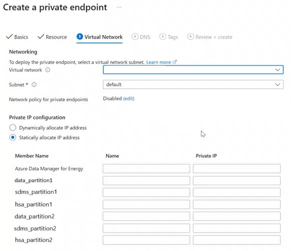](media/how-to-manage-private-links/private-links-19-static-ip.png#lightbox)

## Next steps
<!-- Add a context sentence for the following links -->
To learn more about using Customer Lockbox as an interface to review and approve or reject access requests.
> [!div class="nextstepaction"]
> [Use Lockbox for Azure Data Manager for Energy](how-to-create-lockbox.md)
