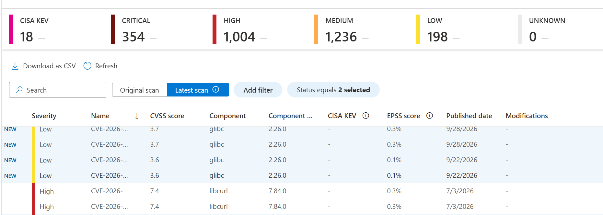
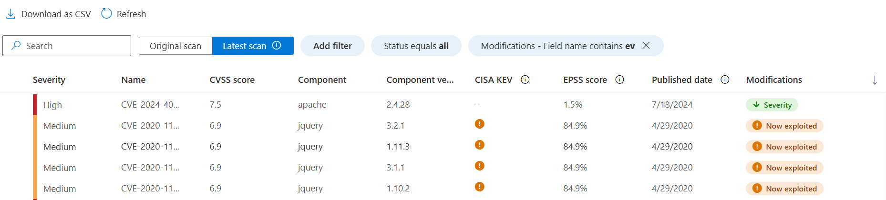
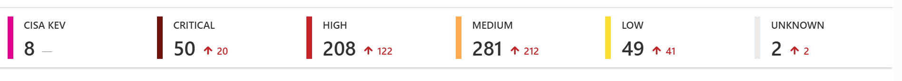

---
# Required metadata
# For more information, see https://learn.microsoft.com/en-us/help/platform/learn-editor-add-metadata
# For valid values of ms.service, ms.prod, and ms.topic, see https://learn.microsoft.com/en-us/help/platform/metadata-taxonomies

title: Understanding latest CVEs in firmware analysis
description: Learn how to interpret and investigate the latest CVEs data in firmware analysis results
author:      abthachi # GitHub alias
ms.author:   abthachi # Microsoft alias
ms.service: azure
ms.topic: concept-article
ms.date:     10/26/2026
ms.subservice: azure-firmware-analysis
---

  # Understanding latest CVE data

When you analyze a firmware image, the analysis identifies known vulnerabilities by using the CVE information available at that time. However, vulnerability information continues to evolve. New CVEs are published, and existing CVE records might be updated with more details, including changes to severity, affected products, or vulnerability status.

As a result, the vulnerabilities associated with a firmware image might change over time, even if the firmware itself remains unchanged.

The latest CVEs view helps you stay informed about these changes by providing updated vulnerability results for previously analyzed firmware images, without requiring a new firmware analysis. By using this view, you can identify newly reported vulnerabilities and review changes to previously identified CVEs.

The original scan results remain available as a historical record of the vulnerabilities identified when the firmware was first analyzed. Together, these views help you understand both the original findings and the latest known vulnerability state of your firmware.

## What the Original scan and Latest scan show

- **Original scan:** preserves the CVE results from the image’s initial analysis at upload time. This view doesn't reflect vulnerability information such as additional CVEs that might now apply or updates to the original identified list.

- **Latest scan:** re-evaluates the components identified in the image against updated vulnerability information and the CISA Known Exploited Vulnerabilities (KEV) catalog. It shows the current results, including CVEs newly identified for the image and updated information about existing CVEs.

Latest scan uses the image’s existing software bill of materials (SBOM). It doesn't repeat the full firmware analysis or identify more components. For example, if you add a new SBOM analyzer after the image’s initial analysis, latest scan doesn't retroactively find CVEs for components that analyzer might have identified.

## Why CVE results can change

A CVE can appear in latest scan because updated vulnerability information newly associates it with a component already identified in the image. Information about a CVE that you initially identified at the original upload can also change, including its severity or KEV status. These changes affect the information used to assess the same image, and they don't indicate that the firmware was updated.

## Identifying new and modified CVEs

The Latest scan list shows the current CVE results and highlights differences from Original scan:

- **New** means a CVE appears in latest scan but not in the original scan for this image. Use the status filter and select **New** to view these results. A CVE marked **New** doesn't necessarily mean the CVE was recently published; it means it's new to this image’s results.

- **Modifications** The modifications column identifies a relevant change to a CVE result, such as a severity change or addition to the KEV catalog. A modified CVE is not necessarily a new CVE.

To investigate a result, start with its affected component and version, then review its severity, KEV status, CVE details, and any available fixed-version information - for example, by applying a filter for fixed-in versions. Consider how you use that component in the device and its deployment before deciding what action to take.

## Background on CISA KEV status

The CISA KEV catalog identifies vulnerabilities known to be exploited. KEV status is a useful signal when prioritizing which CVEs to review. Use the KEV status column or filter in the CVE list to find results marked as KEV, including CVEs whose KEV status changed since the original scan. See [Understand weaknesses data](/azure/firmware-analysis/understand-weaknesses-data).

A KEV match does not mean firmware analysis detected exploitation of your device. Likewise, a CVE match warrants investigation but does not, on its own, establish that the particular device is exploitable. Review the affected component and deployment context alongside the catalog status.

## Interpreting the summary banner

The banner shows CVE totals by severity and the change in each severity total relative to the original scan. A severity delta isn't a count of new CVEs. It can reflect both newly identified CVEs and severity changes to CVEs already present in the original scan.

For example, if an existing CVE changes from High to Critical, the Critical total can increase without any new CVE being added. +5 Critical therefore doesn't necessarily mean five new Critical CVEs. To see CVEs newly identified for the image, filter the list to Status: New.

## Understanding the dates

- **Published date** is when the National Vulnerability Database (NVD) published the CVE, not when Firmware Analysis first identified it in your image. 

- **Last CVE database update**, shown above the list, indicates when the vulnerability information used for the Latest scan view was updated.

A CVE marked **New** can have an older Published date. For example, updated affected-component or version information can make an already-published CVE newly applicable to a component in the image. 

