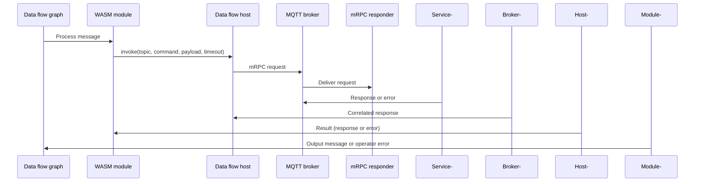

# Call services from WASM data flow graphs with the command invoker

The command invoker host API lets a WebAssembly (WASM) module call a service through the Azure IoT Operations MQTT broker and use the reply while it processes a message. A WASM module can't open network connections, so the data flow host manages the MQTT connection. Your module supplies the request and handles the response.

In this article, you build a module whose map operator calls a `GetValue` command and replaces the incoming message payload with the response. You:

1. Create the module project and graph definition.
1. Write the map operator that invokes the command.
1. Build the module, and publish it and the graph definition to your container registry.
1. Create a minimal responder that always returns `{"value":37.4}`.
1. Deploy the graph and run the responder.
1. Publish a message to the graph and verify that the output payload is `{"value":37.4}`.

## Prerequisites

Ensure you have:

- An Azure IoT Operations instance and permission to create data flow graphs in its resource group. See [Deploy Azure IoT Operations](../deploy-iot-ops/howto-deploy-iot-operations.md). You need a cluster to test command invocations, because the Azure IoT Operations Data Flow extension for Visual Studio Code and the `dataflow-dev` CLI don't run the command invoker locally. For a development loop, you can use a single-node cluster, such as K3s. See [Prepare your Azure Arc-enabled Kubernetes cluster](../deploy-iot-ops/howto-prepare-cluster.md).
- `kubectl` access to the Kubernetes cluster that runs Azure IoT Operations.
- The prerequisites listed in [Build WASM modules for data flows](howto-build-wasm-modules.md#prerequisites).
- An Azure container registry, a [registry endpoint](howto-configure-registry-endpoint.md) that points to it, and the ORAS CLI. See [Deploy WASM modules and graph definitions](howto-deploy-wasm-graph-definitions.md).

Set the following variables for the instance and graph that you use in this article. Use `GRAPH_NAME` as the graph name when you deploy it:

```bash
RESOURCE_GROUP=<RESOURCE_GROUP>
AIO_INSTANCE_NAME=<AIO_INSTANCE_NAME>
GRAPH_NAME=enrich
```

You also need an mRPC *responder*: a service that subscribes to the request topic and answers each command by using a command executor from the Azure IoT Operations Protocol SDK. For an example, see [Create a minimal responder](#create-a-minimal-responder).

## mRPC commands

*mRPC* is the request-response convention that Azure IoT Operations layers on top of MQTT. The host publishes your module's request to a request topic and waits for the correlated response:

```text
GetValue("asset-42") -> { "value": 37.4 }
```

## When to use the command invoker

Use the command invoker when you need to combine each message with data or a decision that lives in another service. Common patterns include:

- **Remote enrichment**. Receive telemetry that carries an asset or device identifier, call `GetValue(identifier)` on an edge service, and add the returned fields to the message.
- **Lookup or validation**. Ask another service to confirm, calibrate, or classify a value before the message continues through the graph.
- **Routing decisions**. Ask a service which destination or path a message should take.

Don't use the command invoker in these cases:

- You only need per-message computation with no external data. Use a plain map operator instead.
- You need durable state that persists across messages. Use the [state store](howto-wasm-state-store.md).
- You need low-latency, in-process AI inference. Use [in-band ONNX inference](howto-wasm-onnx-inference.md).

## Architecture

The following diagram shows how a command flows from your module to the responder and back:

<!--

-->

:::image type="content" source="media/webassembly-command-invoker/command-invocation-flow.svg" alt-text="Sequence diagram showing a WASM module asking the data flow host to send an mRPC request through an MQTT broker to a responder and return the correlated response." border="false":::

The host validates the request, sends it over the data flow's own connection to the local Azure IoT Operations MQTT broker, waits for the correlated response, and returns the result to your module.

> [!IMPORTANT]
> The [default MQTT broker listener](../manage-mqtt-broker/howto-configure-brokerlistener.md#default-brokerlistener) doesn't configure client authorization, so by default any WASM module can invoke any command on the broker. Treat modules as trusted code. To restrict which request topics a data flow can publish to, [configure MQTT broker authorization](../manage-mqtt-broker/howto-configure-authorization.md) for the data flow's identity. Rules that match that identity also apply to the data flow's MQTT sources and destinations.

## Create the module project

Create a Rust library project named `enrich`:

```bash
cargo new --lib enrich
cd enrich
```

Configure the SDK registry in `.cargo/config.toml` and set `[lib] crate-type = ["cdylib"]` in `Cargo.toml` by following the **Standard tools** tab of [Build WASM modules for data flows](howto-build-wasm-modules.md#create-a-new-graph-with-custom-wasm-modules).

Use `wasm_graph_sdk` 1.7. In your module's `Cargo.toml`, update the dependencies from the versions in the build article:

```toml
[dependencies]
wit-bindgen = "0.38"
wasm_graph_sdk = { version = "~1.7", registry = "aio-wg" }
```

`~1.7` allows 1.7.x patch updates but not 1.8.

## Enable the command invoker in your graph definition

The command invoker is a host import that your module requires. Declare the API version that provides it in the `moduleRequirements` section of your graph definition. For `moduleRequirements` details, see [Version compatibility](howto-configure-wasm-graph-definitions.md#version-compatibility).

Save the following graph definition as `graph.yaml` in the `enrich` project directory. The graph uses a source, a single map operator that calls the command, and a sink:

```yaml
metadata:
  $schema: "https://www.schemastore.org/aio-wasm-graph-config-1.1.0.json"
  name: "Enrichment graph"
  version: "1.0.0"

moduleRequirements:
  apiVersion: "1.7.0"
  runtimeVersion: "1.1.0"

operations:
  - operationType: "source"
    name: "input"
  - operationType: "map"
    name: "enrich/map"
    module: "enrich:1.0.0"
  - operationType: "sink"
    name: "output"

connections:
  - from: { name: "input" }
    to: { name: "enrich/map" }
  - from: { name: "enrich/map" }
    to: { name: "output" }
```

## Call a command from a map operator

Replace `src/lib.rs` in the `enrich` project with the following map operator. It invokes `GetValue` through `wasm_graph_sdk::command_invoker` and replaces the message payload with the response:

```rust
use wasm_graph_sdk::command_invoker::{self, CommandRequest, FormatIndicator, SerializedPayload};
use wasm_graph_sdk::macros::map_operator;

const COMMAND_TOPIC: &str = "services/value/getvalue";
const COMMAND_NAME: &str = "GetValue";

#[map_operator]
fn enrich(input: DataModel) -> Result<DataModel, Error> {
    let DataModel::Message(mut message) = input else {
        return Err(Error {
            message: "expected a message input".to_string(),
        });
    };

    // This example expects the incoming payload to contain UTF-8 JSON.
    let payload = message.payload.read();

    let invoke_result = command_invoker::invoke(&CommandRequest {
        topic: COMMAND_TOPIC.to_string(),
        command_name: COMMAND_NAME.to_string(),
        payload: SerializedPayload {
            payload,
            content_type: "application/json".to_string(),
            format_indicator: FormatIndicator::Utf8EncodedCharacterData,
        },
        custom_user_data: vec![("caller".to_string(), "enrich-operator".to_string())],
        timeout_secs: 3,
    });

    let response = invoke_result.map_err(|error| Error {
        message: format!("mRPC command invocation failed: {error:?}"),
    })?;

    // The response replaces the payload, so describe it with the response's
    // content type and drop the input schema.
    message.content_type = response.payload.content_type.map(BufferOrString::String);
    message.schema = None;
    message.payload = BufferOrBytes::Bytes(response.payload.payload);
    Ok(DataModel::Message(message))
}
```

For simplicity, this example replaces the payload with the response. To keep the original fields, deserialize both JSON payloads, merge the response into the input, and serialize the result.

The request and response payloads are opaque bytes. The module and responder can exchange text, Protocol Buffers, CBOR, images, compressed data, or another binary format as long as they agree on the format. Set `content_type` to the appropriate media type. For binary data, use `FormatIndicator::UnspecifiedBytes`:

```rust
payload: SerializedPayload {
    payload: image_bytes,
    content_type: "image/jpeg".to_string(),
    format_indicator: FormatIndicator::UnspecifiedBytes,
},
```

Payloads are limited by the broker's [maximum message size](../deployment-plan/deployment-planning.md#choose-your-memory-profile).

### Request fields

The `CommandRequest` record describes the command to invoke:

| Field | Description |
|---|---|
| `topic` | The concrete MQTT request topic of the responder. Wildcards (`+`, `#`) aren't allowed. |
| `command_name` | The name of the command that the responder implements. |
| `payload` | The serialized request body as a `SerializedPayload` with opaque `payload` bytes, a `content_type` string, and a `format_indicator`. |
| `custom_user_data` | Optional list of key-value user properties to send with the request. Keys can't be reserved CloudEvents attribute names. |
| `timeout_secs` | The timeout in seconds. `0` uses the default timeout, which is 5 seconds in data flows. Any other value is used as specified. |

### Response fields

On success, `invoke` returns a `CommandResponse`:

| Field | Description |
|---|---|
| `payload` | The serialized response body. `content_type` is optional; `format_indicator` describes the encoding. |
| `custom_user_data` | User properties that the responder returned with the response. |
| `timestamp` | The response timestamp, when the responder provides one. |
| `executor_id` | The client ID of the responder's command executor, when provided. |

## Handle errors

When an invocation fails, `invoke` returns an `RpcError` variant instead of a response. Your module decides how to react:

| Error | Meaning |
|---|---|
| `ConfigurationInvalid` | The request produced an invalid invoker configuration, such as an empty topic or a topic with a wildcard, or the host has no command invoker connection. |
| `PayloadInvalid` | The host couldn't build the request, or the response payload is invalid. For example, a `custom_user_data` key is a reserved CloudEvents attribute name. |
| `Timeout` | The command didn't complete within the effective timeout. |
| `ClientError` | The underlying MQTT protocol client returned an error. |
| `Cancellation` | The invocation was canceled before it completed. |
| `HeaderInvalid` | A response header was present but invalid. |
| `HeaderMissing` | A required response header was missing. |
| `ExecutionException` | The responder reported an error while running the command. |
| `UnknownError` | An unclassified protocol error occurred. |
| `InternalLogicError` | An internal protocol error occurred. |
| `StateInvalid` | The invoker was used from an invalid state. |

Choose an explicit error policy that matches your scenario:

- **Fail the message**. Return an operator `Error`. The runtime drops the message with an execution-error reason. Use this policy when enrichment is required and a message without it isn't useful.
- **Pass through**. Log the failure and return the original message unchanged. Use this policy only when the enrichment is optional.
- **Emit a structured result**. Write a result such as `{ "ok": false, "error": "timeout" }` into the message so a downstream operator can route it.

The following example uses the pass-through policy. Add the logger import at the top of the file:

```rust
use wasm_graph_sdk::logger::{self, Level};
```

In the `enrich` operator, replace the `map_err` call and the code after it with:

```rust
match invoke_result {
    Ok(response) => {
        message.content_type = response.payload.content_type.map(BufferOrString::String);
        message.schema = None;
        message.payload = BufferOrBytes::Bytes(response.payload.payload);
        Ok(DataModel::Message(message))
    }
    Err(error) => {
        logger::log(Level::Warn, "enrich/map", &format!("mRPC failed: {error:?}"));
        Ok(DataModel::Message(message))
    }
}
```

> [!IMPORTANT]
> Don't automatically retry a failed command. A timeout doesn't prove that the responder didn't run the command, so a retry can cause duplicate side effects. Retry only when the command is idempotent.

## Build and publish the module

In the `enrich` project directory, replace `<ACR_NAME>` with your registry name and run:

```bash
ACR_NAME="<ACR_NAME>"

cargo build --release --target wasm32-wasip2
cp target/wasm32-wasip2/release/enrich.wasm .

az acr login --name "$ACR_NAME"
oras push "$ACR_NAME.azurecr.io/enrich:1.0.0" --artifact-type application/vnd.module.wasm.content.layer.v1+wasm enrich.wasm:application/wasm
oras push "$ACR_NAME.azurecr.io/enrich-graph:1.0.0" --config /dev/null:application/vnd.microsoft.aio.graph.v1+yaml graph.yaml:application/yaml --disable-path-validation
```

In `graph.yaml`, `enrich:1.0.0` matches the published module. The deployment uses `enrich-graph:1.0.0`. For other registry layouts, see [Choose an artifact layout](howto-deploy-wasm-graph-definitions.md#choose-an-artifact-layout).

## Create a minimal responder

A responder is a service that connects to the same MQTT broker and runs a command executor. The [Azure IoT Operations Protocol SDK](https://github.com/Azure/iot-operations-sdks) provides an `Executor` type that handles request-response correlation. The following example uses the Rust SDK.

A WASM module can invoke commands but can't act as a responder.

The following minimal responder answers the `GetValue` command on `services/value/getvalue` with a fixed JSON value.

> [!IMPORTANT]
> This responder and its deployment manifest are minimal examples for development and functional testing. They aren't production-ready. A production responder must add application-specific validation, error handling, observability, graceful shutdown, resource limits, and availability safeguards.

From the `enrich` project directory, create a Rust binary project alongside it:

```bash
cd ..
cargo new value-responder
cd value-responder
```

In `Cargo.toml`, add the Azure IoT Operations MQTT and Protocol SDK crates and Tokio:

```toml
[dependencies]
azure_iot_operations_mqtt = "1.2.2"
azure_iot_operations_protocol = "1.1.0"
tokio = { version = "1.52", features = ["full"] }
```

Replace `src/main.rs` with the following code. The responder reads the standard Azure IoT Operations SDK environment variables for the MQTT broker connection.

```rust
use azure_iot_operations_mqtt::{
    aio::connection_settings::MqttConnectionSettingsBuilder,
    session::{Session, SessionOptionsBuilder},
};
use azure_iot_operations_protocol::{
    application::ApplicationContextBuilder,
    common::payload_serialize::{BypassPayload, FormatIndicator},
    rpc_command::{
        executor::{OptionsBuilder, ResponseBuilder},
        Executor,
    },
};

const COMMAND_TOPIC: &str = "services/value/getvalue";
const COMMAND_NAME: &str = "GetValue";

#[tokio::main]
async fn main() -> Result<(), Box<dyn std::error::Error>> {
    let connection_settings = MqttConnectionSettingsBuilder::from_environment()?.build()?;
    let session_options = SessionOptionsBuilder::default()
        .connection_settings(connection_settings)
        .build()?;
    let session = Session::new(session_options)?;

    let application_context = ApplicationContextBuilder::default().build()?;
    let options = OptionsBuilder::default()
        .request_topic_pattern(COMMAND_TOPIC)
        .command_name(COMMAND_NAME)
        .build()?;
    let mut executor: Executor<BypassPayload, BypassPayload> = Executor::new(
        application_context,
        session.create_managed_client(),
        options,
    )?;

    let respond = async move {
        while let Some(request) = executor.recv().await.transpose()? {
            // Replace this fixed payload with your command implementation.
            let response_payload = BypassPayload {
                payload: br#"{"value":37.4}"#.to_vec(),
                content_type: "application/json".to_string(),
                format_indicator: FormatIndicator::Utf8EncodedCharacterData,
            };
            let response = ResponseBuilder::default()
                .payload(response_payload)?
                .build()?;

            request.complete(response).await?;
        }
        Ok::<(), Box<dyn std::error::Error>>(())
    };

    // Run the MQTT session and command loop concurrently.
    tokio::select! {
        result = session.run() => result?,
        result = respond => result?,
    }
    Ok(())
}
```

The responder must subscribe to the request topic that your module uses. The executor selects requests by topic, not by command name, so use a distinct request topic for each command. In this example, `COMMAND_TOPIC` must be identical in the module and the responder.

### Run the responder with the Azure IoT Operations MQTT broker

To test the example responder in Azure IoT Operations, run it as a workload in the cluster. You can access the [default MQTT broker listener](../manage-mqtt-broker/howto-configure-brokerlistener.md#default-brokerlistener) only inside the cluster at `aio-broker:18883`. It requires TLS and Kubernetes service account token (SAT) authentication.

Create a file named `Dockerfile` in the `value-responder` project directory:

```dockerfile
FROM mcr.microsoft.com/azurelinux/base/rust:1 AS build
RUN tdnf install -y openssl-devel && tdnf clean all
WORKDIR /build
COPY . .
RUN cargo build --release

FROM mcr.microsoft.com/azurelinux/base/core:3.0
RUN tdnf install -y openssl && tdnf clean all
COPY --from=build /build/target/release/value-responder /value-responder
ENTRYPOINT ["/value-responder"]
```

Create a `.dockerignore` file in the same directory so local build output isn't copied into the image:

```text
target
```

Build the responder image and push it to a registry that your cluster can access. Replace `<REGISTRY>` with the registry hostname, for example, `<ACR_NAME>.azurecr.io`:

```bash
docker build --tag <REGISTRY>/value-responder:1.0.0 .
docker push <REGISTRY>/value-responder:1.0.0
```

Save the following manifest as `value-responder.yaml`. Replace `<REGISTRY>` with the same registry hostname:

```yaml
apiVersion: v1
kind: ServiceAccount
metadata:
  name: value-responder
  namespace: azure-iot-operations
---
apiVersion: apps/v1
kind: Deployment
metadata:
  name: value-responder
  namespace: azure-iot-operations
spec:
  replicas: 1
  selector:
    matchLabels:
      app: value-responder
  template:
    metadata:
      labels:
        app: value-responder
    spec:
      serviceAccountName: value-responder
      containers:
        - name: value-responder
          image: <REGISTRY>/value-responder:1.0.0
          env:
            - name: AIO_MQTT_CLIENT_ID
              value: value-responder
            - name: AIO_BROKER_HOSTNAME
              value: aio-broker
            - name: AIO_BROKER_TCP_PORT
              value: "18883"
            - name: AIO_MQTT_USE_TLS
              value: "true"
            - name: AIO_TLS_CA_FILE
              value: /var/run/certs/aio-ca/ca.crt
            - name: AIO_SAT_FILE
              value: /var/run/secrets/tokens/broker-sat
          volumeMounts:
            - name: aio-ca
              mountPath: /var/run/certs/aio-ca
              readOnly: true
            - name: broker-token
              mountPath: /var/run/secrets/tokens
              readOnly: true
      volumes:
        - name: aio-ca
          configMap:
            name: azure-iot-operations-aio-ca-trust-bundle
        - name: broker-token
          projected:
            sources:
              - serviceAccountToken:
                  path: broker-sat
                  audience: aio-internal
                  expirationSeconds: 86400
```

Deploy the responder and check its status:

```bash
kubectl apply -f value-responder.yaml
kubectl rollout status deployment/value-responder -n azure-iot-operations
kubectl logs deployment/value-responder -n azure-iot-operations
```

If you configure a `BrokerAuthorization` resource on the listener, grant the responder's service account permission to connect, subscribe to the command request topic, and publish command responses. If the data flow's listener has authorization, also grant the data flow permission to publish to the request topic and subscribe to `clients/{principal.clientId}/<REQUEST_TOPIC>`. For more information, see [Configure MQTT broker authorization](../manage-mqtt-broker/howto-configure-authorization.md#authorize-clients-that-use-kubernetes-service-account-tokens).

## Best practices and limitations

- **Set a timeout.** Set `timeout_secs` to suit your responder's latency, or use `0` for the 5-second default. The host doesn't limit the value you set. Treat a timeout as a normal, expected outcome.
- **Minimize calls per message.** Each call blocks the graph until the response or timeout arrives, so a slow or unavailable responder delays all later messages in the graph. The latency of sequential calls adds up, even across separate operators. For high-volume graphs, keep responder latency low and the timeout short.
- **Restrict request topics.** The module chooses the concrete request topic, and the host rejects topics that contain MQTT wildcards. Configure broker authorization so the data flow can publish only to the request topics it needs.

## Test your module

To run the basic scenario in this article on your Azure IoT Operations cluster:

1. Deploy the graph you [built and published](#build-and-publish-the-module) by following [Basic deployment with one WASM module](../connect-to-cloud/howto-dataflow-graph-wasm.md#example-1-basic-deployment-with-one-wasm-module). Use these node settings:

    | Node field | Value |
    | --- | --- |
    | `graphSettings.registryEndpointRef` | The name of the registry endpoint that points to your container registry. |
    | `graphSettings.artifact` | `enrich-graph:1.0.0` |
    | `sourceSettings.dataSources` | A list containing `enrichment/requests`. |
    | `destinationSettings.dataDestination` | `enrichment/results` |

    Remove the sample's `graphSettings.configuration` block.

    A successful resource deployment doesn't mean the WASM runtime is ready to process messages. For an Azure Resource Manager deployment, check the graph's health:

    ```azurecli
    az iot ops dataflowgraph show \
      --name $GRAPH_NAME \
      --profile default \
      --instance $AIO_INSTANCE_NAME \
      --resource-group $RESOURCE_GROUP \
      --query properties.status.healthState.status \
      --output tsv
    ```

    For a Kubernetes debug deployment, use:

    ```bash
    kubectl get dataflowgraph $GRAPH_NAME -n azure-iot-operations -o jsonpath='{.status.healthState.status}{"\n"}'
    ```

    Wait until the status is `Available` before publishing test messages. If it remains unavailable, check the graph's health message and the data flow pod logs.

1. Run the `value-responder` that you created in [Create a minimal responder](#create-a-minimal-responder). The responder must connect to the same Azure IoT Operations MQTT broker as the data flow.

    - To run the responder in the cluster, follow [Run the responder with the Azure IoT Operations MQTT broker](#run-the-responder-with-the-azure-iot-operations-mqtt-broker).
    - To run the responder on your development machine, install `pkg-config` and the OpenSSL development package, such as `libssl-dev` on Ubuntu, and expose a test broker listener that's reachable from outside the cluster and has TLS and authentication turned off. See [Connect clients from outside the cluster](../manage-mqtt-broker/howto-test-connection.md#connect-clients-from-outside-the-cluster). Set the following variables, replace `<BROKER_ADDRESS>` and `<BROKER_PORT>` with the listener's address and port, and then run the responder:

        ```bash
        export AIO_MQTT_CLIENT_ID=value-responder
        export AIO_BROKER_HOSTNAME=<BROKER_ADDRESS>
        export AIO_BROKER_TCP_PORT=<BROKER_PORT>
        export AIO_MQTT_USE_TLS=false
        cargo run --release
        ```

        Leave the responder running while you test the graph. Only turn off TLS and authentication on a development cluster. See [Only turn off TLS and authentication for testing](../manage-mqtt-broker/howto-test-connection.md#only-turn-off-tls-and-authentication-for-testing).

1. Subscribe to the `enrichment/results` MQTT topic and leave the subscriber running. In another terminal, publish `{"assetId":"asset-42"}` to the `enrichment/requests` topic. To connect an MQTT client, see [Test connectivity to the MQTT broker](../manage-mqtt-broker/howto-test-connection.md). Verify that the graph output payload is `{"value":37.4}`.

If an invocation times out, verify that the responder is still running, that it's connected to the same broker, and that `COMMAND_TOPIC` is identical in the module and responder. After the basic round trip succeeds, validate the request payload, response handling, timeout behavior, and error policy.

To debug and test module logic that doesn't call the command invoker, see [Debug WASM modules in VS Code](howto-debug-wasm-modules.md) and [Test WASM modules](howto-test-wasm-modules.md).

## Related content

- [Build WASM modules for data flows](howto-build-wasm-modules.md)
- [Create stateful WASM graphs with the state store](howto-wasm-state-store.md)
- [Run ONNX inference in WASM data flow graphs](howto-wasm-onnx-inference.md)
- [Configure WebAssembly (WASM) graph definitions](howto-configure-wasm-graph-definitions.md)
- [Understand WebAssembly (WASM) modules and graph definitions for data flow graphs](concepts-wasm-modules.md)
