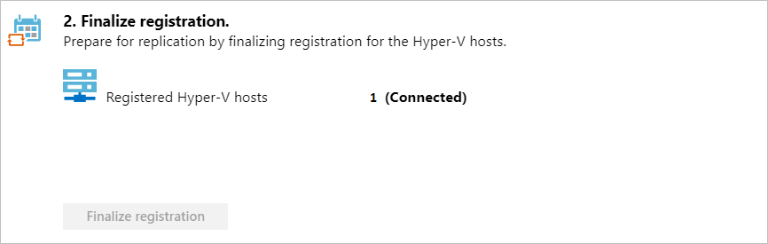

# Migrate Hyper-V VMs to Azure

This article shows you how to migrate on-premises Hyper-V virtual machines (VMs) to Azure tool.

> [!NOTE]
> Tutorials show you the simplest deployment path for a scenario so that you can quickly set up a proof of concept. Tutorials use default options where possible and don't show all possible settings and paths.

 In this tutorial, you learn how to:

> [!div class="checklist"]
> * Discover VMs you want to migrate.
> * Start replicating VMs.
> * Run a test migration to make sure everything's working as expected.
> * Run a full VM migration.

If you don't have an Azure subscription, create a [free account](https://azure.microsoft.com/pricing/free-trial/) before you begin.

## Prerequisites

Before you begin:

1. [Review](hyper-v-migration-architecture.md) the Hyper-V migration architecture.
1. [Review](migrate-support-matrix-hyper-v-migration.md#hyper-v-host-requirements) Hyper-V host requirements for migration and the Azure URLs to which Hyper-V hosts and clusters need access for VM migration.
1. [Review](migrate-support-matrix-hyper-v-migration.md#hyper-v-vms) the requirements for Hyper-V VMs that you want to migrate to Azure.
1. We recommend that you complete the [assess Hyper-V VMs](tutorial-assess-hyper-v.md) tutorial before you migrate Hyper-V servers to Azure.
1. Go to an existing project or [create a new project](./create-manage-projects.md).
1. Verify permissions for your Azure account.
     - Your Azure account needs permissions to create a VM.
     - Write to an Azure managed disk.
     - Manage failover operations for the Recovery Services vault associated with your Azure Migrate project.
1. For the required Azure Migrate built‑in roles and permission details to create a project and run discovery, assessments, and migrations, see [Prepare Azure accounts for Azure Migrate](prepare-azure-accounts.md).

> [!NOTE]
> If you're planning to upgrade your Windows operating system (OS), Azure Migrate and Modernize might download the Windows SetupDiag for error details in case upgrade fails. Ensure that the VM created in Azure after the migration has access to [SetupDiag](https://go.microsoft.com/fwlink/?linkid=870142). If there's no access to SetupDiag, you might not be able to get detailed OS upgrade failure error codes, but the upgrade can still proceed.

## Download the provider

For migrating Hyper-V VMs, you need to install the software provider (Azure Site Recovery provider and Recovery Services agent) on Hyper-V hosts or cluster nodes. The [Azure Migrate appliance](migrate-appliance.md) isn't used for Hyper-V migration.

1. In the Azure Migrate project, go to **Manage** > **Server replication**, and select **Start replication**.
2. On **Specify intent**, under **What do you want to migrate**, select **Servers or virtual machines (VMs)**. Under **Where do you want to migrate to**, select **Azure VM**.
3. In **How will you select workloads**, select **From replication provider (Hyper-V)** under **Other sources**. Select the link in the portal to start the replication provider setup.
4. In the setup page, the virtualization type is prepopulated from the previous step (Hyper-V).
5. In **Target region**, select the Azure region where you want to migrate the machines.
6. Select **Confirm that the target region for migration is ``region-name``**.
7. Select **Create resources**. This step creates a Recovery Services vault in the background.
    - You can't change the target region for this project after you select this button.
    - All subsequent migrations are to this region.

8. In **Prepare Hyper-V host servers**, download the Hyper-V Replication provider and the registration key file.
    - The registration key is needed to register the Hyper-V host with the Migration and modernization tool.
    - The key is valid for five days after you generate it.

    :::image type="content" source="./media/tutorial-migrate-hyper-v/download-provider-hyper-v-one.png" alt-text="Screenshot shows the download provider and key." lightbox="./media/tutorial-migrate-hyper-v/download-provider-hyper-v-one.png":::    


1. Copy the provider setup file and registration key file to each Hyper-V host (or cluster node) running the VMs you want to replicate.

## Install and register the provider

To install and register the provider, use the following steps by using either the UI or commands.

# [Use UI](#tab/UI)

Run the provider setup file on each host:

1. Select the file icon in the taskbar to open the folder where the installer file and registration key are downloaded.
1. Select the *AzureSiteRecoveryProvider.exe* file.
    1. In the provider installation wizard, ensure that **On (recommended)** is selected and then select **Next**.
    1. Select **Install** to accept the default installation folder.
    1. Select **Register** to register this server in the Recovery Services vault.
    1. Select **Browse**.
    1. Locate the registration key and select **Open**.
    1. Select **Next**.
    1. Ensure that **Connect directly to Azure Site Recovery without a proxy server** is selected and then select **Next**.
    1. Select **Finish**.

# [Use commands](#tab/commands)

Run the following commands on each host:

1. Extract the contents of the installer file (*AzureSiteRecoveryProvider.exe*) to a local folder (for example, *.\Temp*) on the machine, as follows:

    ```
     AzureSiteRecoveryProvider.exe /q /x:.\Temp\Extracted
    ```

1. Go to the folder with the extracted files.

    ```
    cd .\Temp\Extracted
    ```
1. Install the Hyper-V replication provider. The results are logged to *%Programdata%\ASRLogs\DRASetupWizard.log*.

    ```
    .\setupdr.exe /i 
    ```

1. Register the Hyper-V host to **Azure Migrate**.

    > [!NOTE]
    > If your Hyper-V host is registered with another Azure Migrate project that you're no longer using or deleted, you need to deregister it from that project and register it in the new one. For more information, see [Remove servers and disable protection](../site-recovery/site-recovery-manage-registration-and-protection.md?WT.mc_id=modinfra-39236-thmaure).

    ```
    "C:\Program Files\Microsoft Azure Site Recovery Provider\DRConfigurator.exe" /r /Credentials <key file path>
    ```

    - **Configure proxy rules:** If you need to connect to the internet via a proxy, use the optional parameters `/proxyaddress` and `/proxyport` to specify the proxy address (in the form `http://ProxyIPAddress`) and proxy listening port. For authenticated proxy, you can use the optional parameters `/proxyusername` and `/proxypassword`.

        ``` 
       "C:\Program Files\Microsoft Azure Site Recovery Provider\DRConfigurator.exe" /r [/proxyaddress http://ProxyIPAddress] [/proxyport portnumber] [/proxyusername username] [/proxypassword password]
        ```
 
    - **Configure proxy bypass rules:** To configure proxy bypass rules, use the optional parameter `/AddBypassUrls` and provide bypass URLs for proxy separated by ';' and run the following commands:

        ```
        "C:\Program Files\Microsoft Azure Site Recovery Provider\DRConfigurator.exe" /r [/proxyaddress http://ProxyIPAddress] [/proxyport portnumber] [/proxyusername username] [/proxypassword password] [/AddBypassUrls URLs]
        ```
        and
        ```
        "C:\Program Files\Microsoft Azure Site Recovery Provider\DRConfigurator.exe" /configure /AddBypassUrls URLs 
        ```
---

After you install the provider on hosts, go to the Azure portal to the site recovery provider setup page and select **Finalize registration**.



It can take up to 15 minutes after finalizing registration until discovered VMs appear in the tool.

## Execute migrations

> [!NOTE]
> In the portal, you can select up to 10 machines at once for replication. If you need to replicate more, then group them in batches of 10.

1. In the Azure Migrate project, go to **Manage** > **Server replication**, and select **Start replication**.

2. On **Specify intent** page, under **What do you want to migrate**, select **Servers or virtual machines (VMs)**. Under **Where do you want to migrate to**, select **Azure VM**.

3. Under **How will you select workloads**, select one of the following options:
   - If you have an existing Azure Migrate appliance, select one of the following options and proceed to **Discovery method**:
       - **From all inventory** to manually select servers.
       - **From an assessment** to use an existing assessment.
   - If you don't have an existing Azure Migrate appliance (required for assessments, wave planning, and other planning capabilities) and want to directly execute Hyper-V migrations, select **From replication provider (Hyper-V)**. If you completed the site recovery provider setup for Hyper-V, you can proceed to
     **Workloads**. Otherwise, complete the setup as per the steps provided in the previous section.

4. In **Discovery method**, select the appliance that matches your source environment (Hyper-V) and then select **Next**. If you completed the site recovery provider setup for Hyper-V, you can proceed to **Workloads**. Otherwise, complete the setup as per the steps provided in the previous section.

5. In **Workloads**,
  - Select the **Target VM security type**.
     - Azure Migrate supports migration to Trusted Launch Virtual Machines (TVMs). By default, it migrates eligible VMs as TVMs. These VMs provide enhanced security features such as secure boot and virtual TPM at no extra cost.
     - You can also migrate eligible machines to Confidential virtual machines [Learn more](../confidential-computing/confidential-vm-overview.md). If you select **Confidential virtual machines**, only eligible servers are available for selection and the rest are greyed out. Refer [CVM support matrix](migrate-to-trusted-launch-virtual-machines-with-azure-migrate.md#supported-operating-systems-for-migrating-to-confidential-virtual-machines).
  - Then, select the servers you want to migrate and select **Next**.

6. In **Target settings**, select the subscription and target region to which you want to migrate, and specify the resource group where the Azure VMs reside after migration. Complete the following settings:

  - **Storage account**: Keep the default option to use the cache storage account that the portal automatically creates for the project. To use a different storage account for replication, select it from the drop-down list.
    
   > [!NOTE]
   > - If you use private endpoint as the connectivity method for the Azure Migrate project, grant the Recovery Services vault access to the cache storage account. [**Learn more**](migrate-servers-to-azure-using-private-link.md#grant-access-permissions-to-the-recovery-services-vault)
   > - To replicate by using ExpressRoute with private peering, create a private endpoint for the cache storage account. [**Learn more**](migrate-servers-to-azure-using-private-link.md#create-a-private-endpoint-for-the-storage-account-1)
   
  - **Azure Hybrid Benefit**: Apply Azure Hybrid Benefit and save up to 76% vs. pay-as-you-go costs by using an eligible Windows Server and/or Enterprise Linux license. Check the boxes applicable to your license (Windows Server license or Enterprise Linux license).
  - **Virtual network**: Select the Azure virtual network and subnet that the Azure VMs join after migration.
  - **Availability options**: Select one of the following options:
      - **Availability Zone** – Pins the migrated machine to a specific Availability Zone in the region. Use this option to distribute machines that are part of a multinode application tier across Availability Zones. If you select this
          option, specify the Availability Zone for each selected machine on the **Compute** tab. This option is available only if the selected target region supports Availability Zones.
      - **Availability Set** – Places the migrated machine in an Availability Set. The selected target resource group must contain one or more availability sets.
      - **No infrastructure redundancy required**– Select this option if you don't require Availability Zones or Availability Sets for the migrated machines.
        
 - In **Security Details**, 
    - If the selected target security type is **Standard or Trusted Launch virtual machines**:
        - **Secure boot** is enabled by default (recommended). You can choose to remove this option. Then, proceed to **Disk encryption type** selection.
    - If the selected target security type is **Confidential virtual machines**:
        - You can optionally choose to confidentially encrypt the OS disks. This encryption provides an additional layer of encryption that binds the disk encryption keys to the
          virtual machine's TPM and makes the disk content accessible only to the VM.
        - To enable this encryption, select the **Confidential compute encryption** option and proceed to **OS disk encryption type** selection. Otherwise, proceed to **Disk
          encryption type** selection.
        - Under **OS disk encryption type**, select one of the following options:
           - Encryption at rest with platform-managed key (default, if you didn't select **Confidential compute encryption**)
           - Confidential encryption with platform-managed key (available, if you selected **Confidential compute encryption**)
           - Confidential encryption with customer-managed key (available, if you selected **Confidential compute encryption**)	

    > [!NOTE]
    > - Secure Boot is enabled by default on target VMs when Confidential OS disk encryption is selected.
    > - Only customer-managed key (CMK) are supported for confidential OS disk encryption for disks larger than 127 GB. For disks smaller than 127 GB, both platform-managed key (PMK) and customer-managed key (CMK) are supported.
    > - Confidential OS disk encryption can lengthen the standard initial VM creation time during migration due to the encryption process.
    > - Data disks currently don't support confidential encryption. However, you can secure them by using host-based encryption with customer-managed keys (CMK) or platform-managed keys (PMK).
   
       
 - **Disk encryption type**, select:
   - Encryption-at-rest with platform-managed key
   - Encryption-at-rest with customer-managed key
   - Double encryption with platform-managed and customer-managed keys
 
   > [!NOTE]
   > - To replicate VMs with customer-managed keys (CMK), [create a disk encryption set](/azure/virtual-machines/disks-enable-customer-managed-keys-portal#set-up-your-disk-encryption-set) under the target resource group. A disk encryption set object maps managed disks to a Key Vault that contains the
     CMK to use for SSE.
   > - The seed disk is created in Azure during replication/staging before cutover. Encrypting it protects data right from the first write while it resides in Azure. The **Disk encryption type** setting applies to both seed disks and the managed disks after final migration.
      
7. In **Compute**, review the VM name, size, OS disk type, and availability configuration (if selected in the previous step). VMs must conform to [Azure requirements](migrate-support-matrix-vmware-migration.md#azure-vm-requirements).

   - **VM size**: If you're using assessment recommendations, the VM size dropdown shows the recommended size. Otherwise Azure Migrate picks a size based on the closest match in the Azure subscription. Alternatively, pick a manual size in **Azure VM size**.
   - **OS disk**: Specify the OS (boot) disk for the VM. The OS disk contains the operating system bootloader and installer.
   - **Availability Zone**: Specify the Availability Zone to use.
   - **Availability Set**: Specify the Availability Set to use.
   - **Capacity reservation**: If you already have a capacity reservation for the VM SKU in the target subscription and location, specify it here for this deployment. Capacity reservations ensure that the required VM SKU is available when you start migration. You can associate a reservation now or skip this step and configure it later during the migration. The capacity reservation for the SKU can be in any resource group within the target subscription and location.[Learn more](/azure/virtual-machines/capacity-reservation-create).

8. In **Disks**, specify whether to replicate the VM disks to Azure, and select the disk type (Premium v2, Ultra Disk, Standard SSD, Standard HDD, or Premium Managed disks) in Azure. Then select **Next**.
    - You can exclude disks from replication.
    - If you exclude disks, they won't be present on the Azure VM after migration.
    - You can exclude disks if the mobility agent is already installed on that server. [Learn more](../site-recovery/exclude-disks-replication.md#exclude-limitations).

9. In **Tags**, choose to add tags to your Virtual machines, Disks, and NICs.
10. In **Review and start execution**, review the settings, and select **Execute migration** to start the initial replication for the servers.
11. When you select **Execute migration**, you start replication for the selected servers. Replication proceeds as follows:
    - When the start replication job finishes successfully, the server begins initial replication to Azure.
    - During initial replication, a VM snapshot is created. Disk data from the snapshot is replicated to replica managed disks (seed disks) in Azure.
    - After initial replication finishes, delta replication begins. The process periodically replicates incremental changes to the source disks to the replica disks in Azure and the server is ready for migration in delta replication.    

## Provision for the first time

If this is the first VM you're replicating in the Azure Migrate project, the Migration and modernization tool automatically provisions these resources in the same resource group as the project.

- **Storage account**: The Site Recovery provider software that you install on Hyper-V hosts uploads replication data for the VMs you configure for replication to a storage account (known as the cache storage account or log storage account) in your subscription. Azure Migrate and Modernize then copies the uploaded replication data from the storage account to the replica-managed disks corresponding to the VM. You need to specify the cache storage account while configuring replication for a VM. The Azure Migrate portal automatically creates one for the Azure Migrate project when you configure replication for the first time in the project.

## Track and migrate replicating servers

This section explains how to track replicating servers and perform test and final migrations.

1. In your Azure Migrate project, go to **Manage** > **Server replication**. Navigate to **Other**.
2. The following columns show the replication and migration status of your servers for which you initiated replication:
    - **Replication status**: Displays the current state of replication for the server. Learn more about [replication states](concepts-vmware-agentless-migration.md#replication-states).
    - **Replication health**: Indicates whether replication is Healthy, Warning, or Critical.
    - **Last sync**: Shows when the latest replication data was synchronized to Azure.
    - **Test migration status**: Indicates the current or most recent test migration status for the replicating server or shows as **Pending**.
    - **Migration status**: Displays the current or most recent migration status for the replicating server or shows as **Ready to migrate** if the initial replication is completed.
3. **Test migration**:
    - For servers that complete initial replication and are in **Delta sync**, you can run a test migration to validate your workloads and applications in Azure before final migration. Use an isolated Azure virtual network to avoid impacting your production environment. Test migration doesn't interrupt ongoing delta replication, and you can run multiple test migrations as needed. After validation is complete, ensure to clean up the test migration resources.
    - For the server you want to test, select the menu on the right, and then select **Test migration**.
  
       :::image type="content" source="./media/tutorial-migrate-hyper-v/start-test-migration.png" alt-text="Screenshot how to navigate to start test migration." lightbox="./media/tutorial-migrate-hyper-v/start-test-migration.png":::
       
    - In **Test migration** page:
       - Choose the **Virtual network** and **Subnet**.
       - Optionally, upgrade the operating system. To perform OS upgrade, select **Upgrade available** (only supported for Windows OS, currently in preview). Learn more about [Upgrading windows OS upgrade](how-to-upgrade-windows.md). 
       - After configuring the above settings, select **Test migration**.
        
After validation is complete, select the menu on the right of the server, and then select **Clean up test migration** to remove the test VM and associated resources.

4.  **Migration**:
    - Servers that are ready for migration show as **Ready to migrate** under the column **Migration status**.
    - To perform migration for these servers, select **Migrate** in the **Server replication** page.
    - In the **Migrate** page,
       - Select the servers you want to migrate.
       - Optionally, select the Target OS if you want to upgrade the OS (only supported for Windows OS, currently in preview). Learn more about [Upgrading windows OS upgrade](how-to-upgrade-windows.md).
       - Choose to shut down virtual machines if you want to perform a planned migration with no data loss.
       - After configuring the above settings, select **Migrate**.
  
5. View the status and migration completion time for migrated servers in the **Migration status** column.
6. . **Optional replication actions**:
   The following actions are optional and needed only for specific replication or recovery scenarios. You can access them from the menu for each server.    
     - **Stop replication**: Stops replication for the server when you no longer want to replicate or migrate it.
     - **Resynchronize**: Resynchronizes the server when replication needs to be re-established to bring the replica back in sync with the source.

## Post-migration best practices

- For increased resilience:
    - Keep data secure by backing up Azure VMs by using Azure Backup. [Learn more](../backup/quick-backup-vm-portal.md).
    - Keep workloads running and continuously available by replicating Azure VMs to a secondary region with Site Recovery. [Learn more](../site-recovery/azure-to-azure-tutorial-enable-replication.md).
- For increased security:
    - Lock down and limit inbound traffic access with [Microsoft Defender for Cloud - Just-in-time administration](../security-center/security-center-just-in-time.md).
    - Manage and govern updates on Windows and Linux machines with [Azure Update Manager](../update-manager/overview.md).
    - Restrict network traffic to management endpoints with [network security groups](../virtual-network/network-security-groups-overview.md).
    - Deploy [Azure Disk Encryption](/azure/virtual-machines/disk-encryption-overview) to help secure disks and keep data safe from theft and unauthorized access.
    - Read more about [securing IaaS resources](https://azure.microsoft.com/services/virtual-machines/secure-well-managed-iaas/) and [Microsoft Defender for Cloud](https://azure.microsoft.com/services/security-center/).
- For monitoring and management:
-  Consider deploying [Microsoft Cost Management](../cost-management-billing/cost-management-billing-overview.md) to monitor resource usage and spending.

## Next steps

Investigate the [cloud migration journey](/azure/architecture/cloud-adoption/getting-started/migrate) in the Cloud Adoption Framework for Azure.
