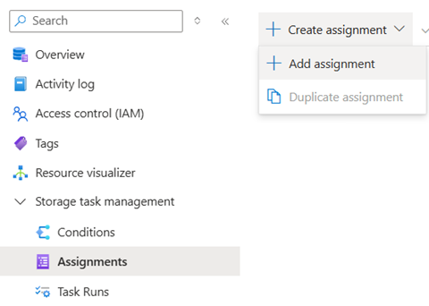
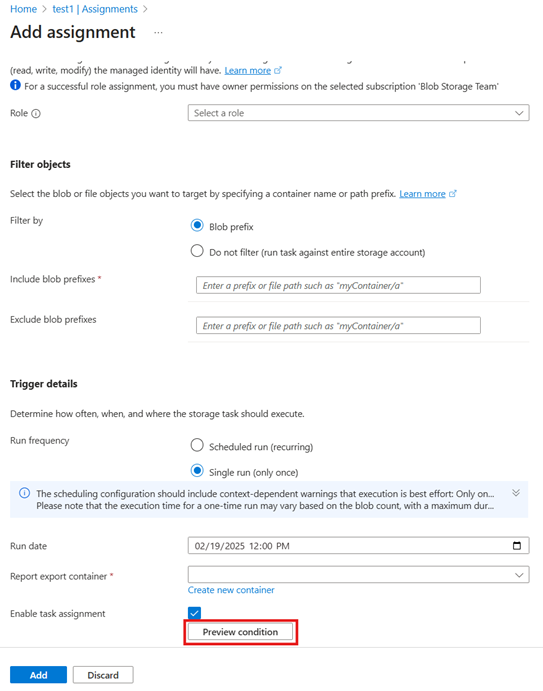
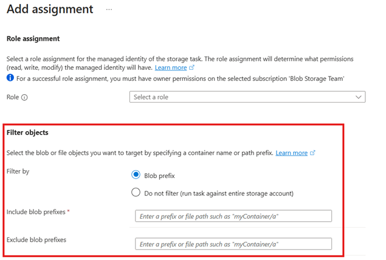

# Best practices for using storage tasks

This article provides best practice guidelines for using storage tasks.

## Composition

Design conditions that apply to multiple storage accounts. Consider enabling blob soft delete before using delete operations in your conditions, and carefully review the impact of condition groupings. This section describes each of these recommendations.

### Define storage task conditions to enable reuse across multiple storage accounts

By making conditions reusable, you eliminate the need to create individual storage task conditions for each storage account. Fewer task definitions simplify the management of a large number of storage accounts. 

Create storage task conditions that work across multiple blob containers and storage accounts. Parametrize values through container metadata, blob metadata, or blob index tags instead of hard-coding them into your conditions. For example, if you have different blob containers that each have different retention durations for their data with respect to a blob's creation time, set the retention duration for each container as a container metadata value. Create a single storage task that uses this container metadata value in the condition for any container, instead of creating separate tasks for each container with a fixed value.

Set the container metadata on any blob container across multiple storage accounts and create multiple storage task assignments by using the **Assignments** menu option of a storage task in the Azure portal.

Similarly, you can customize processing of individual blobs by using a single storage task by using blob metadata or blob index tags to set the custom duration or date values for each blob.

> [!div class="mx-imgBorder"]
> 

When you enable these task assignments, the storage task execution operates on the blobs in their respective accounts concurrently, thus enabling horizontal scaling.

### Validate edits to tasks with existing task assignments for all applicable storage account types

Changes that you make to an existing storage task are [automatically propagated to its associated task assignments](storage-task-assignment.md#updates-to-the-storage-task-definition). If you introduce a dependency on a new feature in your edit, the associated task assignments can become invalid if the feature isn't supported on that storage account. For example, if an edit to a task condition introduces a clause that depends on blob versioning, any existing task assignments on storage accounts with hierarchical namespace (HNS) can become invalid because they don't support blob versions.

To avoid such disruption, validate any edits to task assignments on all applicable storage account types.

### Consider enabling blob soft delete in a storage account before using the delete operation

For enhanced data protection, Microsoft recommends enabling blob soft delete on your storage account. Blob soft delete provides an extra layer of retention and peace of mind by allowing you to recover blobs that are accidentally deleted. By enabling blob soft delete, you can undelete blobs within the retention period, minimizing the risk of data loss due to inadvertent deletions. If blobs are accidentally deleted on a soft-deleted storage account, an undelete operation in a storage task can be used to recover the blob.

### Understand the impact of assigning a storage task to an account that has a lifecycle management policy enabled

A delete operation might fail if a lifecycle management policy attempts to delete the same blob. Therefore, if a storage task contains a delete operation and the task is assigned to an account that has an active lifecycle management policy that defines a delete action, you might experience high failure rates if they target the same set of blobs.

### Understand the impact of storage task condition groupings

Verify that the way you group conditions leads to the desired result. Incorrect grouping might result in unexpected operations. Test the grouped conditions thoroughly using the preview capability. Ensure that the conditions match the blobs as anticipated.

## Validation

Validate conditions as you compose them, and once again before you enable a storage task assignment. This section describes each of these recommendations. 

### Validate conditions as you compose them

You should validate each condition that you compose by using the condition preview feature. This feature provides an interactive experience that shows which of the selected blobs meet the condition predicate that you configured. The condition preview experience doesn't make any changes to the data. You can validate the condition against various sets of blobs by specifying different storage accounts or blob path prefixes. Incorrectly composed conditions can adversely affect your data, making this step crucial to ensure the condition is composed correctly.

See [Preview the effect of conditions](storage-task-conditions-operations-edit.md#preview-the-effect-of-conditions)

### Validate conditions before you commit a storage task assignment

The condition preview feature also appears in the **Add Assignment** pane. Before committing an assignment, use this feature to verify that the storage task operates on the correct set of blobs in the storage account. If the storage task is used in other storage account assignments, no unintended blobs are impacted.

> [!div class="mx-imgBorder"]
> 

### Use mock runs to validate before executing at scale

Before enabling a task assignment that targets a large number of blobs, consider running a **mock run** first. While the condition preview feature is useful for spot-checking your conditions against a small sample, a mock run provides a full-scale simulation across all blobs in scope.

A mock run:

- Scans and evaluates every blob that matches your prefix filters - not just a limited sample.
- Generates a detailed report listing each blob that matched the conditions and what operations would have been performed.
- Doesn't modify any data, making it safe to use in production storage accounts.

This approach is especially important when your task includes irreversible operations. Running a mock run first helps prevent unintended misconfigurations.

**Recommended workflow:**

1. Design and preview your conditions by using the condition preview feature in the Azure portal.
1. Create a mock run assignment to validate the conditions against the full blob set.
1. Review the mock run report to confirm the correct blobs would be targeted.
1. If results are satisfactory, transition the mock run assignment to a real run (run once or recurring), or create a new real run assignment.

For step-by-step instructions, see [Create and use a mock run](storage-task-mock-run.md).

## Scale and performance

Enable storage tasks one at a time. Apply techniques to optimize conditions and task assignment scheduling.

### Enable one storage task assignment at a time

Storage Actions currently supports executing one storage task assignment at a time on a storage account. If you assign and enable two storage tasks to an account simultaneously, the first task runs while the second task waits until the first task finishes. This rule applies to both single-run and recurrent scheduled task assignments.

For scheduled task assignments, if the previous task iteration is still in progress, new iterations are skipped. The next scheduled task runs at its designated trigger time after the previous task finishes. When scheduling recurrent tasks, consider the scale implications where task assignments applied to large storage accounts might take longer to complete. Therefore, schedule them such that each task run finishes before the next iteration to prevent skipping subsequent iterations.

For single-run task assignments, if a parallel task is already in progress, the new task execution is deferred for 60 minutes plus extra random minutes before attempting again. In general, to avoid confusion about which task assignment is being executed, enable only one task assignment at a time.

### Workarounds for scale limits

Storage Actions has defined scale limits. See [Resource limits](storage-task-known-issues.md#resource-limits).

To optimize the management of scale limits, consider implementing the following workarounds:

1. **Task segmentation by prefix**: Instead of assigning a single task to process all blobs in a storage account, create multiple tasks, each responsible for a specific filtered subset of blobs based on their prefixes. This segmentation approach distributes the workload more evenly and helps you stay within scale limits. You can add filters during task assignment as shown:

   > [!div class="mx-imgBorder"]
   > 

1. **Staggered scheduling**: Schedule tasks to run at different times, especially for large-scale operations. By staggering the execution times, you avoid concurrent tasks that could breach concurrency limits and cause task execution contention.

1. **Incremental processing**: Break down large tasks into smaller, incremental steps. This method ensures that each task segment completes within the given limits, reducing the risk of incomplete operations.

1. **Monitoring and adjust**: Regularly monitor task performance and progress. Adjust the task conditions, prefixes, and schedules as necessary to ensure efficient processing within scale limits.

By employing these strategies, you can effectively manage and work around the imposed scale limits, ensuring smooth and efficient task executions.

## Reliability

Storage Actions perform more reliably in accounts with [geo-redundant storage](../../storage/common/storage-redundancy.md#geo-redundant-storage) (GRS), or [geo-zone-redundant storage](../../storage/common/storage-redundancy.md#geo-zone-redundant-storage) (GZRS) configurations.

### Use geo redundancy for business continuity 

[!INCLUDE [Storage Actions continuity after a failover](~/reusable-content/ce-skilling/azure/includes/storage-actions-reliability.md)]

## Monitoring

Periodically monitor storage task executions and avoid deleting the report container where task execution reports are stored.

### Monitor tasks periodically

The charts on the `Overview` page of the Storage Actions portal summarize the execution of task assignments. Monitor this page regularly to ensure that tasks are running as expected. Use the filter or click on the respective tiles to analyze any anomalies or failures, and examine the execution reports.

### Ensure the result report container isn't deleted 

Storage Actions generate detailed reports in CSV format, which are written into the reports container configured during task assignment. These reports provide insights into operations performed during a task execution, with each row in the CSV file including information about the operations performed, the status of each operation, and any errors encountered. Ensure that the reports container isn't deleted from the storage account while the task assignment is enabled. If the result reporting container is deleted during the task run, the task execution can fail.

## Storage Actions lifecycle

### Consolidate your task definitions in a resource group or subscription

To efficiently manage related Storage Actions tasks, consider using a single resource group or subscription as a repository for your task resources. This approach allows you to create tasks and reuse them on numerous storage accounts across different subscriptions and regions, without duplication. By centralizing your task management, you can streamline data management policies, ensure consistency in task execution, and reduce administrative overhead.

## See also

- [Azure Storage Actions overview](../overview.md)
- [Azure RBAC best practices](../../role-based-access-control/best-practices.md) 
- [AKS best practices](/azure/aks/best-practices) 

