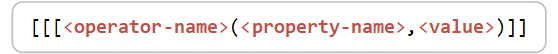
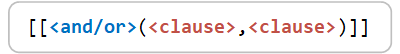
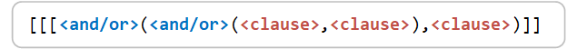
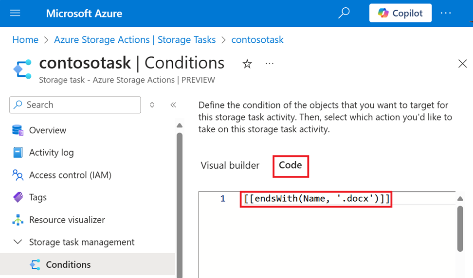
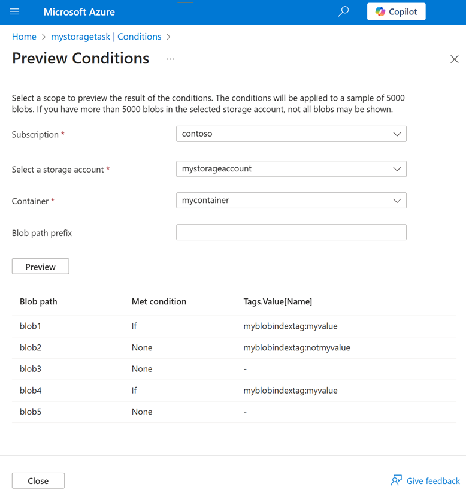

# Storage task conditions

A storage task specifies the conditions to evaluate and operations to perform on blobs. This article describes the JSON format of a condition. This format is important if you plan to create a storage task by using a tool other than the Azure portal, such as Azure PowerShell or Azure CLI. This article also lists the properties and operators that you can use in the clauses of a condition.

This article focuses on **conditions**. To learn more about **operations**, see [Storage task operations](storage-task-operations.md).

## Condition format

A condition is a logical predicate that consists of one or more _clauses_. Each clause contains a _blob property_, _a logical operator_, and a _value_. When the storage task runs, it evaluates the blob property against the value by using the comparison operator. In the JSON format, the **operator** always appears first followed by the **property**, and then the **value**. The following image shows how each element is positioned in the expression.

> [!div class="mx-imgBorder"]
> 

The following clause allows operations only on Microsoft Word documents. This clause targets all documents that end with the file extension `.docx`. Therefore, the operator is `endsWith`, the property is `Name`, and the value is `.docx`.

```json
{
   "condition": "[[[endsWith(Name, '.docx')]]"
}
```

You can also apply a _not_ operator before the operator in a condition clause. The _not_ operator is a special operator that you can position before any operator to give the opposite result of a clause. The following clause allows operations on any blob that **is not** a Microsoft Word document.

```json
{
   "condition": "[[not(endsWith(Name, '*.docx'))]]"
}
```

For the complete list of operators and property names, see the [Supported operators](#supported-operators) and [Supported properties](#supported-properties) sections of this article.

### Multiple clauses in a condition

A condition can contain multiple clauses separated by a comma along with either the string `and` or `or`. The string `and` targets objects that meet the criteria in all clauses in the condition while `or` targets objects that meet the criterion in any of the clauses in the condition. The following image shows the position of the `and` and `or` string along with two clauses.

> [!div class="mx-imgBorder"]
> 

The following JSON shows a condition that contains two clauses. Because the `and` string is used in this expression, both clauses must evaluate to `true` before an operation is performed on the object.

```json
{
"condition": "[[and(endsWith(Name, '.docx'), equals(Tags.Value[readyForLegalHold], 'Yes'))]]"
}
```

### Groups of conditions

Grouped clauses operate as a single unit separate from the rest of the clauses. Grouping clauses is similar to putting parentheses around a mathematical equation or logic expression. The `and` or `or` string for the first clause in the group applies to the whole group.

 The following image shows two clauses grouped together.

> [!div class="mx-imgBorder"]
> 

The following condition allows operations only on Microsoft Word documents where the `readyForLegalHold` tag of the document is set to a value of `Yes`. Operations are also performed on objects that are greater than 100 bytes even if the other two conditions aren't true.

```json
{
"condition": "[[or(and(endsWith(Name, '*.docx'), equals(Tags.Value[readyForLegalHold], 'Yes')), greater(Content-Length, '100'))]]"
}
```

You can apply a _not_ operator to a group to test for the opposite result of a group of clauses. The following condition allows operations only on blobs that **are not** Microsoft Word documents where the `readyForLegalHold` tag of the blob is set to a value of `Yes`. Operations are also performed on objects that are greater than 100 bytes even if the other two conditions aren't true.

```json
{
"condition": "[[or(not(and(endsWith(Name, '*.docx'), equals(Tags.Value[readyForLegalHold], 'Yes'))), greater(Content-Length, '100'))]]"
}
```

## Code view in the Azure portal

Use the visual editor in the Azure portal to generate the JSON for a condition, and then access the JSON expression by selecting the **Code** tab. This approach is useful when composing complex conditions because JSON expressions can become large, unwieldy, and difficult to create by hand. This approach also allows you to use the condition preview feature in the portal for interactive validation of the condition against your data. The following image shows the **Code** tab in the visual editor.

> [!div class="mx-imgBorder"]
> 

To learn more about the visual editor, see [Define storage task conditions and operations](storage-task-conditions-operations-edit.md).

## Condition preview

The _preview condition_ feature enables you to validate the condition against blobs in your test storage account and view whether they meet or don't meet the conditions you defined. You can find issues and optimize conditions before applying them to production data. The preview doesn't make any changes to objects in a target storage account, so it's safe to test against your data.

While condition preview is available in PowerShell, Azure CLI, and SDK environments, the easiest way to preview the effect of conditions is by using the **Preview Conditions** window in the Azure portal. You can open this window when you define conditions and as you assign storage tasks.

To preview the effect of conditions, you must specify a target subscription, storage account, and container. Because a preview can only show up to 5,000 blobs, you can also specify a prefix to narrow the list.

> [!NOTE]
> You can't use wildcard characters in the blob prefix.

The following image shows an example of a preview result in the Azure portal.

> [!div class="mx-imgBorder"]
> 

The preview result appears in a table of all objects in the selected container with the result of the condition evaluation and their property values that were used to evaluate the condition. You can sort by any field that appears in the table.

If conditions refer to properties that don't exist in the target storage account, an error appears. For example, blob index tags aren't available for accounts that have a hierarchical namespace. If a clause in a condition refers to blob index tags, a validation error appears.


## Supported properties

The following table shows the properties that you can use to compose each clause of a condition. A clause can contain string, boolean, numeric, and date and time properties.

| String                         | Date and time<sup>3</sup> | Numeric        | Boolean          |
|--------------------------------|---------------------------|----------------|------------------|
| AccessTier<sup>1</sup>         | AccessTierChangeTime      | Content-Length | Deleted          |
| BlobType<sup>2</sup>           | Creation-Time             | TagCount       | IsCurrentVersion |
| Container.Metadata.Value[Name] | DeletedTime               |                |                  |
| Container.Name                 | LastAccessTime            |                |                  |
| Metadata.Value[Name]           | Last-Modified             |                |                  |
| Name                           |                           |                |                  |
| Tags.Value[Name]               |                           |                |                  |

<sup>1</sup>    Allowed values are `Hot`, `Cool`, `Cold`, or `Archive`.

<sup>2</sup>    Allowed values are `BlockBlob`, `PageBlob`, or `AppendBlob`.

<sup>3</sup>    Can be set to a specific time or to a metadata value dynamically obtained from objects. See [Reference a value from object metadata](storage-task-conditions-operations-edit.md#reference-a-value-from-object-metadata).

## Supported operators

The following table shows the operators that you can use in a clause to evaluate the value of each type of property.

| String (case-insensitive) | String (case-sensitive) | Date and time | Numeric | Boolean |
|---|---|---|---|---|
| `contains` | `contains_cs` | `equals` | `equals` | `equals` |
| `empty`<sup>5</sup> | | `greater` | `greater` | |
| `endsWith` | `endsWith_cs` | `greaterOrEquals` | `greaterOrEquals` | |
| `equals` | `equals_cs` | `less` | `less` | |
| `matches`<sup>4</sup> | `matches_cs`<sup>4</sup> | `lessOrEquals` | `lessOrEquals` | |
| `startsWith` | `startsWith_cs` | | | |

<sup>4</sup>    The `matches` and `matches_cs` operators aren't supported for `Metadata.Value[Name]` and `Tags.Value[Name]` properties.

<sup>5</sup>    The `empty` operator tests whether a value is empty. Case sensitivity doesn't apply, and there's no `empty_cs` operator.

The **not** operator is a special operator that you can position before any of the operators that appear in this table to invert the result of a conditional clause, also called the negative result.

String operators with the suffix `_cs` are case-sensitive. For example, `endsWith(Name, '.CSV')` matches both `report.CSV` and `report.csv`, while `endsWith_cs(Name, '.CSV')` matches only `report.CSV`.

## See also

- [Storage task operations](storage-task-operations.md)
- [Define conditions and operations](storage-task-conditions-operations-edit.md)
