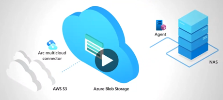

<!-- 
!########################################################
STATUS: COMPLETE

CONTENT: final

REVIEW Stephen/Fabian: COMPLETE
EDIT PASS: COMPLETE

Document score: 98 (808 words and 1 false positive)

!########################################################
-->

# What is Azure Storage Mover?

:::row:::
    :::column:::
        
    :::column-end:::
    :::column:::
        **Azure Storage Mover is a fully managed service for large-scale file and object data migration and copying**, helping customers move data from on-premises environments, other clouds, and across Azure storage locations. By using centralized management, monitoring, and incremental transfers, Storage Mover simplifies migration execution while minimizing downtime.
    :::column-end:::
:::row-end:::

## Use cases: Simplifying data migration and copy at scale

Organizations migrating to Azure or managing data across storage environments need a reliable way to transfer large datasets without building complex migration infrastructure or disrupting business operations.

## Key customer scenarios

### 1. Migrating on-premises data to Azure

Customers modernizing legacy infrastructure, retiring datacenters, or consolidating NAS and file server environments need to migrate large volumes of data while preserving file structures, permissions, and metadata.

Storage Mover supports migrations from Windows, Linux, and NAS file shares using SMB or NFS protocols to supported Azure Files and Blob Storage destinations.

- **File server modernization:** Move enterprise file shares to Azure Files while preserving supported file metadata and permissions.
- **Datacenter consolidation:** Consolidate data from multiple on-premises file servers and NAS systems into Azure Storage.
- **Minimal-downtime migrations:** Use incremental transfers to synchronize changes before final workload cutover.
- **Large offline migrations:** Combine [Azure Data Box](../databox/data-box-overview.md) for initial bulk data transfer with Storage Mover for online incremental catch-up.

**For hybrid scenarios** where customers want to retain on-premises file access and caching alongside Azure Files, [Azure File Sync](../storage/file-sync/file-sync-introduction.md) is an alternative worth considering.

### 2. Migrating data from other clouds to Azure

Customers consolidating multicloud environments, exiting another cloud provider, or bringing data closer to Azure applications, analytics, and AI services need a scalable way to migrate large datasets.

Storage Mover enables managed migrations from AWS S3 to Azure Blob Storage, with additional support for Google Cloud Storage, Oracle Cloud Infrastructure, and S3-compatible object storage sources in preview.

It also supports migrating AWS FSx for Windows File Server shares to Azure Files (preview).

**Typical scenarios include:**

- Cloud provider exits and workload migrations to Azure.
- Consolidating distributed object datasets into Azure Blob Storage.
- Bringing data into Azure for analytics, AI, and application modernization.

### 3. Moving and copying data within Azure

You might need to relocate, consolidate, or maintain extra copies of data across Azure storage accounts, subscriptions, regions, and organizational boundaries.

Storage Mover supports these scenarios for both Blob Storage and Azure Files.

**Azure Blob Storage:**

- **Regional migration:** Move data to another Azure region for workload relocation, consolidation, or data residency requirements.
- **Storage reorganization:** Consolidate Blob containers across storage accounts and subscriptions.
- **Data consolidation across Azure tenants:** Copy Blob data between different Microsoft Entra tenants to support:
    - Mergers and acquisitions, where data from acquired companies must be consolidated into a common Azure tenant.
    - Divestitures, where business units need to separate their data into independently managed tenants.
    - Customer and partner data exchange, where organizations need to transfer large datasets across tenant boundaries.
    - Analytics and AI data consolidation, bringing datasets from independently managed Azure environments into a central processing environment.

**Azure Files (preview):**

- **Regional migration:** Copy file shares between Azure regions for datacenter consolidation or workload relocation.
- **Storage consolidation:** Consolidate multiple file shares or reorganize shares across storage accounts and subscriptions.
- **Disaster recovery:** Maintain secondary copies of Azure file shares in a chosen region by using scheduled or recurring incremental copy jobs for customer managed failover.

## When should you choose Azure Storage Mover?

Storage Mover addresses the gap between individual data copy utilities and the operational complexity of enterprise-scale migrations. While unmanaged command-line tools are suited to scriptable transfers for small data sets, Storage Mover provides a centrally managed service for planning, executing, and monitoring large-scale migrations. You can also deploy Mover in the Azure Government Cloud. For more information, see [What is Azure Government?](../azure-government/documentation-government-welcome.md)

For customers with limited network bandwidth, use [Azure Data Box](../databox/data-box-overview.md) to enable offline bulk transfers, while Storage Mover handles online migrations and incremental synchronization.

## Supported sources and targets

[!INCLUDE [protocol-endpoint-agent](includes/protocol-endpoint-agent.md)]

An Azure blob container without the hierarchical namespace service feature doesn’t have a traditional file system. A standard blob container uses "virtual" folders to mimic this functionality. When this approach is used, files in folders on the source get their path prepended to their name and placed in a flat list in the target blob container.

When you migrate data from a source endpoint using the SMB protocol, Storage Mover supports the same level of file fidelity as the underlying Azure file share. Folder structure and metadata values such as file and folder timestamps, ACLs, and file attributes are maintained. During a data migration from an NFS source, the Storage Mover service represents empty folders as an empty blob in the target. The metadata of the source folder is persisted in the custom metadata field of this blob, just as they are with files.

However, migrating data from a source endpoint using the NFS protocol might require "virtual" folders during the migration. Because Azure blob containers without HNS support don’t have a traditional file system, Storage Mover uses these folders to mimic a local file system. When files are found within folders on a source endpoint, Storage Mover prepends their paths to their names and places the file in a flat list within the target blob container.

## Fully managed migrations

You need only deploy one Storage Mover instance in your subscription to handle migrations from multiple source shares, even if they’re located in different parts of the world. The storage mover resource itself doesn't process your files and folders. Rather, you deploy a migration agent near your source share to send your data directly to the selected targets in Azure.

Azure Storage Mover provides a set of management resources that can be used across every share you intend to migrate. For example, you can express your migration plan and retain oversight about migration progress and results on a per-share basis. To take advantage of this capability, create a migration project for every workload you migrate. Within the project, define the source, target, and migration settings for each source share on which your workload depends. You can remain in full control about when to start the migration of a share, track its progress, and see its results.

The [resource hierarchy article](resource-hierarchy.md) has more information about individual Storage Mover resources and how best to use them for your migration. You can also get more deployment planning details in the [planning for an Azure Storage Mover deployment](deployment-planning.md) article.

## A hybrid cloud service

[!INCLUDE [hybrid-service-explanation](includes/hybrid-service-explanation.md)]

## Using Azure Storage Mover and Azure Data Box

When you transition on-premises workloads to Azure Storage, reducing downtime and ensuring predictable periods of unavailability is crucial for users and business operations. For the initial bulk migration, you can use [Azure Data Box](/azure/databox/) and combine it with Azure Storage Mover for online catch-up.

Using Azure Data Box conserves significant network bandwidth. However, active workloads on your source storage might undergo changes while the Data Box is in transit to an Azure datacenter. The **online catch-up** phase involves updating your cloud storage with these changes before fully cutting over the workload to use the cloud data. This phase typically requires minimal bandwidth since most data already resides in Azure, and only the delta needs to be transferred. Azure Storage Mover excels in this task.

Azure Storage Mover detects differences between your on-premises storage and cloud storage, transferring updates and new files not captured by the Data Box transfer. Additionally, if the only change to a file is limited to its metadata (such as permissions), Azure Storage Mover uploads just the new metadata instead of the entire file content.

Read more details on how to use Azure Storage Mover with Azure Data Box on the [Azure Storage Blog](https://techcommunity.microsoft.com/t5/azure-storage-blog/storage-migration-combine-azure-storage-mover-and-azure-data-box/ba-p/4143354).

## Next steps

The following articles can help you become more familiar with the Storage Mover service.

- [Planning for an Azure Storage Mover deployment](deployment-planning.md)
- [Understanding the Storage Mover resource hierarchy](resource-hierarchy.md)
- [Deploying a Storage Mover agent](agent-deploy.md)
