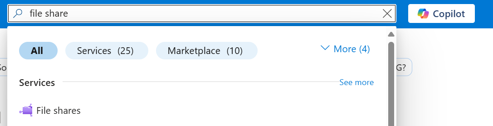
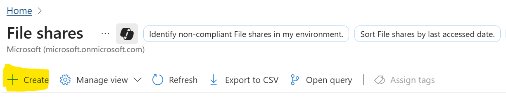
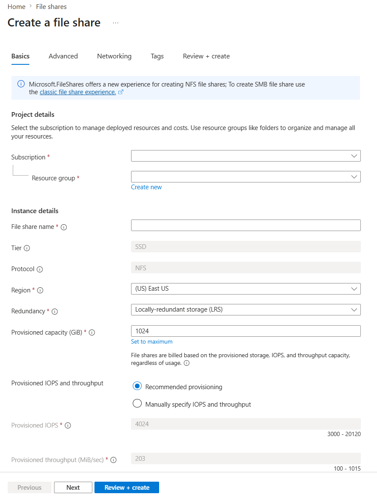
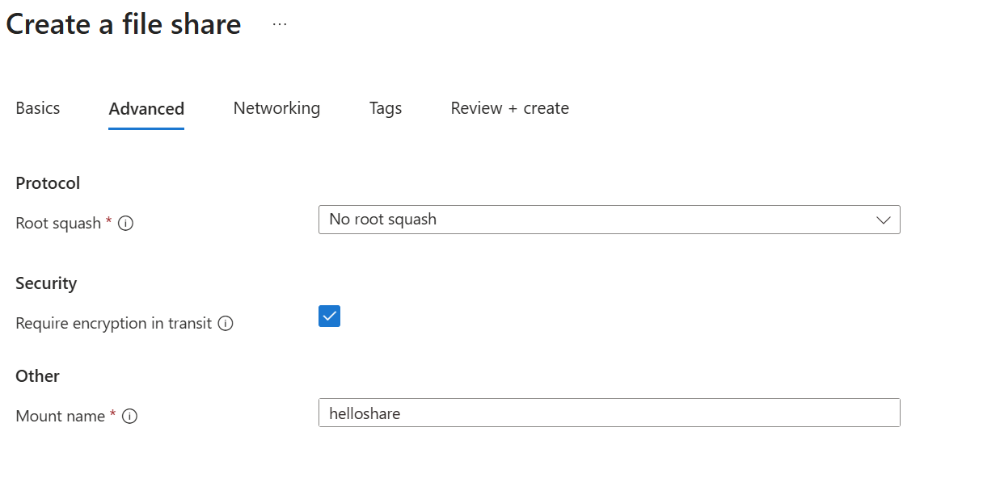
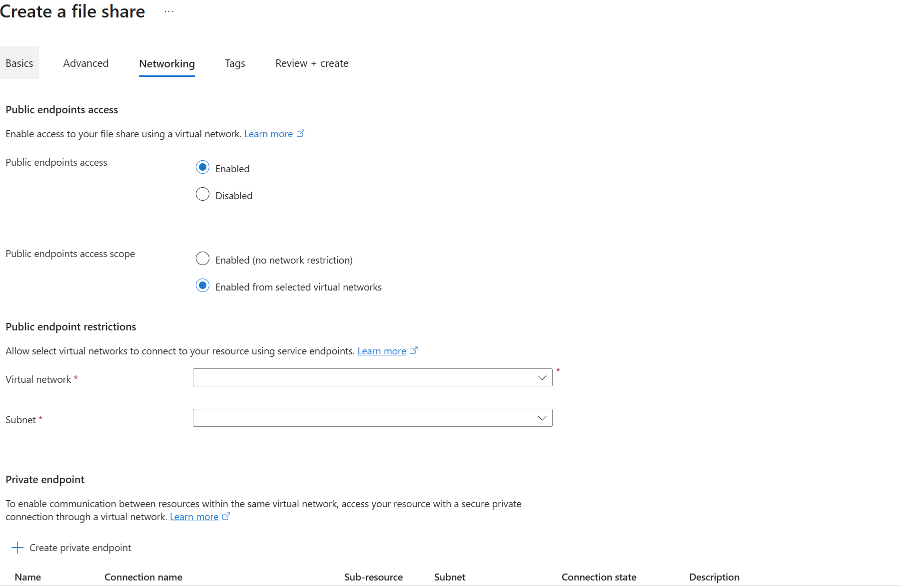
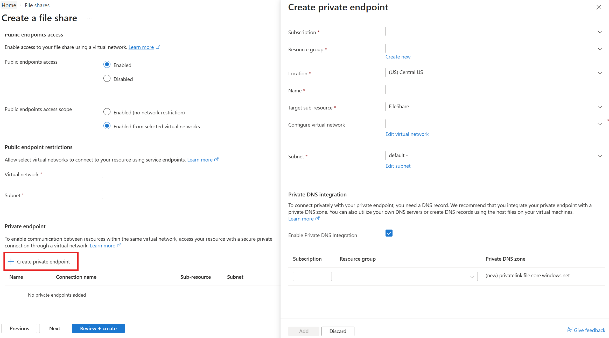

# Create an Azure file share with Microsoft.FileShares

:heavy_check_mark: **Applies to:** File shares created with the Microsoft.FileShares resource provider

:heavy_multiplication_x: **Doesn't apply to:** Classic file shares created with the Microsoft.Storage resource provider

The Microsoft.FileShares resource provider lets you deploy file shares without creating or managing a storage account. Before you create a file share, review the supported features and networking options in this article. If you need SMB, see [Create a classic file share](create-classic-file-share.md).

## Supported features

The Microsoft.FileShares resource provider and management model currently supports only NFS file shares on the SSD (premium) media tier and, in preview, on the HDD (standard) media tier. SSD media provides consistent high performance and low latency, with single-digit milliseconds for most IO operations. HDD media provides cost-effective storage for general-purpose workloads. For details about the HDD preview, see [NFS on HDD preview](#nfs-on-hdd-preview).

The Microsoft.FileShares resource provider only supports the [provisioned v2 billing model](understanding-billing.md#provisioned-v2-model), which allows you to specify how much storage, IOPS, and throughput your file share needs. The amount that you provision determines your total bill. When you create a new file share by using the provisioned v2 model, Azure provides a recommendation for how many IOPS and how much throughput you need based on the amount of provisioned storage you specify. You can choose to override these recommendations with your own values.

The Microsoft.FileShares resource provider supports locally redundant storage (LRS) and zone-redundant storage (ZRS) for SSD file shares, and only LRS for HDD file shares. It doesn't support geo-redundant storage. See [Azure Files redundancy](./files-redundancy.md) for more information.

To compare feature support for both resource providers, see the [comparison chart](files-management-concepts.md#comparing-resource-providers-microsoftstorage-versus-microsoftfileshares).

For more information on Azure Files management concepts, see [Azure Files management concepts](files-management-concepts.md).

## Prerequisites

This article assumes that you have an Azure subscription. If you don't have an Azure subscription, create a [free account](https://azure.microsoft.com/pricing/purchase-options/azure-account?cid=msft_learn) before you begin.

To use Azure PowerShell, [install the Az PowerShell module](/powershell/azure/install-azure-powershell) version 16.0.0 or later. This version includes the Az.FileShare module.

To use the Azure CLI, install the `fileshare` extension by running `az extension add --name fileshare`. If you installed the preview extension, `fileshares`, remove it first by running `az extension remove --name fileshares`.

Ensure that both Microsoft.FileShares and Microsoft.Storage resource providers are registered for the subscription. The Microsoft.FileShares resource provider is required to create NFS file shares by using the new management model described in this article. To register a resource provider, follow these steps:

1. Sign in to the Azure portal.
1. In the search box, enter *subscriptions*.
1. Select the subscription you want to use to register a resource provider.
1. Under **Settings**, select **Resource providers** to see the list of resource providers.
1. Select the resource provider you want to add and then select **Register**.

## NFS on HDD preview

NFS file shares on the HDD media tier are in **preview** for both management models. Before you create an NFS HDD file share, review these prerequisites:

- Sign up through the [preview survey](https://aka.ms/AzureFilesNFSHDD) to get access.
- Use the provisioned v2 billing model, which is the only model that Microsoft.FileShares supports.
- Use LRS. NFS HDD file shares don't support ZRS, GRS, or GZRS, and you can't change their redundancy.
- Create the file share by using Azure PowerShell or the Azure CLI. The Azure portal doesn't currently support NFS HDD.
- Use API version `2026-09-01` or later. Earlier API versions reject the HDD media tier.


## Create a file share (Microsoft.FileShares)

You can create a file share with Microsoft.FileShares by using the Azure portal, Azure PowerShell, Azure CLI, or Azure MCP Server. To learn more about using Azure MCP Server, see [Azure Files tools for the Azure MCP Server overview](/azure/developer/azure-mcp-server/tools/azure-file-shares).  

# [Portal](#tab/azure-portal)

> [!NOTE]
> The Azure portal doesn't currently support NFS HDD file shares. To create an NFS HDD file share, use the PowerShell or Azure CLI tab.

To create a file share by using the Azure portal, use the search box at the top of the Azure portal to search for **file share** and select the matching result.



Select **+ Create** to create a new file share.



### Basics

The first tab to complete when creating a file share is labeled **Basics**. It contains the required fields to create a file share.




| Field name | Input type | Values | Meaning |
|-|-|-|-|
| Subscription | Drop-down list | *Available Azure subscriptions* | The selected subscription in which to deploy the file share. |
| Resource group | Drop-down list | *Available resource groups in selected subscription* | The resource group in which to deploy the file share. A resource group is a logical container for organizing Azure resources, including file shares. |
| File share name | Text box | -- | The name of the file share must be unique across all existing file share names in Azure. It must be 3 to 63 characters long and can contain only lowercase letters, numbers, and hyphens. The name must start and end with a letter or number. |
| Tier | N/A | -- | The media tier for the file share. The Microsoft.FileShares resource provider supports the SSD media tier. The HDD media tier is in preview, but the Azure portal doesn't currently support it. |
| Protocol | N/A | -- | Microsoft.FileShares currently supports the NFS protocol. Classic file shares support SMB and NFS. |
| Region | Drop-down list | *Available Azure regions* | The region for the file share to be deployed into. This region can be the region associated with the resource group, or any other available region. |
| Provisioned capacity (GiB) | Text box | Integer  | Provisioned capacity for the file share, ranging from 32 GiB to 262,144 GiB. |
| Redundancy | Drop-down list | <ul><li>Locally redundant storage (LRS)</li><li>Zone-redundant storage (ZRS)</li></ul> | The redundancy choice for the SSD file share. See [Azure Files redundancy](files-redundancy.md) for more information. |
| Provisioned IOPS and throughput | Radio button group | <ul><li>Recommended provisioning</li><li>Manually specify IOPS and throughput:<ul><li>Provisioned IOPS</li><li>Provisioned throughput (MiB/sec)</li></ul></li></ul> | The Microsoft.FileShares resource provider only uses the [provisioned v2 billing model](understanding-billing.md#provisioned-v2-model). |

### Advanced

The **Advanced** tab is optional and provides more granular settings. You can choose to set up [root squash options](nfs-root-squash.md), require this specific file share to use the encryption in transit setting, or specify a mount name for the file share. Mount name allows you to choose a different name to use to mount the file share. By default, it's the same as the file share name. Customize it if you want a unique mount name. The same rules still apply to the naming policy. See [Naming rules and restrictions for Azure resources](../../azure-resource-manager/management/resource-name-rules.md).



### Networking

NFS file shares use network access rules to authenticate clients. You configure these rules on the individual file share. Clients can connect through a private endpoint or a service endpoint with virtual network restrictions.

A [private endpoint](../../private-link/private-endpoint-overview.md) provides a private IP address in your virtual network for access to the file share. Clients can connect from that virtual network or from peered virtual networks. For on-premises access, connect your network to the virtual network through VPN or ExpressRoute. To allow access only through private endpoints, disable public network access.

A [service endpoint](../../virtual-network/virtual-network-service-endpoints-overview.md) lets clients in a subnet reach the file share's public endpoint over the Azure backbone. Enable the service endpoint on the client subnet and allow that subnet in the file share's network rules. Allowed subnets can be in the same subscription or a different subscription, including a different Microsoft Entra tenant. There's no extra charge for service endpoints.

> [!NOTE]
> If the client subnet has a service endpoint policy, clients must use a private endpoint to access this file share. Microsoft.FileShares doesn't currently support access through service endpoints from subnets with a policy. For more information, see [Restrict outbound access with service endpoint policies](storage-files-networking-overview.md#restrict-outbound-access-with-service-endpoint-policies).

The **Networking** tab is optional. You can configure networking during creation or afterward, before clients connect. A virtual network is required to create a private endpoint.

To use service endpoints, enable public network access from selected virtual networks. Select or create the virtual network and subnet that clients use. Disabling public network access prevents access through service endpoints, but it doesn't disable the service endpoint on the subnet.



For private endpoint configurations, each file share has its own private endpoint. To get started, follow these steps:

1. Select **+ Create private endpoint**. Leave **Subscription** and **Resource group** the same. Choose the same location as the virtual network and desired name for the private endpoint. Choose FileShare for target sub-resource.
1. Choose the desired virtual network and subnet setting. Make sure you select the **Enable Private DNS Integration** checkbox.
1. Select **Add**.



### Tags

Tags are name/value pairs that you use to categorize resources and view consolidated billing by applying the same tag to multiple resources and resource groups. These tags are optional, and you can apply them after you create the file share.

### Review + create

Select **Create** on the **Review + create** tab to create the file share. The button becomes available after you complete all the required fields.

# [PowerShell](#tab/powershell)

To create a file share by using PowerShell, run the following commands. Replace the variables with your values. 

```powershell
# To learn more about the parameters for New-AzFileShare, use command 
# Get-Help New-AzFileShare

$shareName = "<your-file-share-name>"
$resourceGroup = "<your-resource-group-name>"
$region = "<intended-region-for-deployment>"

# The provisioned storage size of the share in GiB. Valid range is 32 to 262,144.
$provisionedStorageGib = 1024

# If you don't specify -ProvisionedThroughputMiBPerSec and -ProvisionedIoPerSec, the deployment uses the recommended provisioning.
$provisionedIops = 3500
$provisionedThroughput = 200

New-AzFileShare `
    -ResourceName $shareName `
    -ResourceGroupName $resourceGroup `
    -Location $region `
    -Protocol NFS `
    -ProvisionedStorageGiB $provisionedStorageGib
    # -ProvisionedIoPerSec $provisionedIops `
    # -ProvisionedThroughputMiBPerSec $provisionedThroughput

```

#### Create an NFS HDD file share (preview)

The `New-AzFileShare` cmdlet doesn't currently support the HDD media tier. Use the generic `New-AzResource` cmdlet with API version `2026-09-01` instead.

> [!NOTE]
> During the preview, NFS HDD file shares are available in the East US 2 EUAP (`eastus2euap`) region. This region uses a different Azure Resource Manager endpoint, `eastus2euap.management.azure.com`. Before you run the following commands, add an environment for that endpoint and sign in to it. This environment applies only to the commands in this section, and you can switch back to the default `AzureCloud` environment when you finish.
>
> ```powershell
> Add-AzEnvironment -Name AzureEUAP `
>     -ActiveDirectoryEndpoint "https://login.microsoftonline.com/" `
>     -ActiveDirectoryServiceEndpointResourceId "https://management.core.windows.net/" `
>     -ResourceManagerEndpoint "https://eastus2euap.management.azure.com/" `
>     -GraphEndpoint "https://graph.windows.net/"
> Connect-AzAccount -Environment AzureEUAP -Tenant "<tenant-id>" -Subscription "<subscription-id>"
> ```
>
> The tenant ID is the GUID of the Microsoft Entra tenant that your subscription belongs to. To find it, run `(Get-AzContext).Tenant.Id` if you're already signed in, or run `Get-AzTenant` to list the tenants you can access. You can also find it in the Azure portal under **Microsoft Entra ID** > **Overview** > **Tenant ID**. If you have access to only one tenant, you can omit the `-Tenant` parameter.

```powershell
$properties = @{
    mountName = $shareName
    mediaTier = "HDD"
    redundancy = "Local"
    protocol = "NFS"
    provisionedStorageGiB = 1024
    nfsProtocolProperties = @{
        rootSquash = "NoRootSquash"
        encryptionInTransitRequired = "Enabled"
    }
    publicNetworkAccess = "Enabled"
}

New-AzResource `
    -ResourceGroupName $resourceGroup `
    -ResourceName $shareName `
    -ResourceType "Microsoft.FileShares/fileShares" `
    -ApiVersion "2026-09-01" `
    -Location "eastus2euap" `
    -Properties $properties `
    -Force
```


# [Azure CLI](#tab/azure-cli)

To create a file share by using Azure CLI, run the following commands. Replace the variables with your values. 

> [!NOTE]
> To create an NFS HDD file share (preview), you need Azure CLI version 2.75.0 or later and the latest version of the `fileshare` extension. To update the Azure CLI, run `az upgrade`. To update the extension, run `az extension update --name fileshare`. To check your versions, run `az version`.
>
> Add `--media-tier HDD` to the command and use `--redundancy Local`. During the preview, NFS HDD file shares are available in the East US 2 EUAP (`eastus2euap`) region. This region uses a different Azure Resource Manager endpoint, `eastus2euap.management.azure.com`. Before you run the command, register a cloud for that endpoint and sign in to it. When you finish, switch back to the default cloud by running `az cloud set --name AzureCloud` and `az login`.
>
> ```bash
> az cloud register --name AzureEUAP \
>     --endpoint-active-directory "https://login.microsoftonline.com" \
>     --endpoint-active-directory-resource-id "https://management.core.windows.net/" \
>     --endpoint-active-directory-graph-resource-id "https://graph.windows.net/" \
>     --endpoint-resource-manager "https://eastus2euap.management.azure.com/" \
>     --endpoint-gallery "https://gallery.azure.com/" \
>     --endpoint-management "https://management.core.windows.net/" \
>     --suffix-storage-endpoint "core.windows.net" \
>     --suffix-keyvault-dns ".vault.azure.net"
> az cloud set --name AzureEUAP
> az login --tenant "<tenant-id>"
> az account set --subscription "<subscription-id>"
> ```
>
> The tenant ID is the GUID of the Microsoft Entra tenant that your subscription belongs to. To find it, run `az account show --query tenantId --output tsv` if you're already signed in, or run `az account tenant list` to list the tenants you can access. You can also find it in the Azure portal under **Microsoft Entra ID** > **Overview** > **Tenant ID**. If you have access to only one tenant, you can omit the `--tenant` parameter.

```bash
# Specify your values
shareName="<your-file-share-name>"
resourceGroup="<your-resource-group-name>"
region="<intended-region-for-deployment>"

# The provisioned storage size of the share in GiB. Valid range is 32 to 262,144.
provisionedStorageGiB=1024

# If you don't specify provisioned IOPS and throughput, the deployment uses the recommended provisioning.
# provisionedIops=3000
# provisionedThroughput=125

# Create the file share. Redundancy supports "Local" and "Zone" for SSD, and only "Local" for HDD.
az fileshare create \
    --name $shareName \
    --resource-group $resourceGroup \
    --location $region \
    --provisioned-storage-gib $provisionedStorageGiB \
    --protocol NFS \
    --redundancy Local
    # --media-tier HDD \
    # --provisioned-iops $provisionedIops \
    # --provisioned-throughput-mib $provisionedThroughput
```

---

## See also

- [Create a Linux virtual machine](/azure/virtual-machines/linux/quick-create-portal?tabs=ubuntu)
- [Mount an NFS file share on Linux](storage-files-how-to-mount-nfs-shares.md)
- [Modify a file share](modify-file-share.md)
