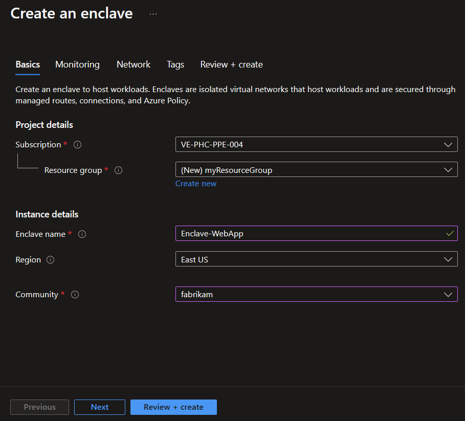
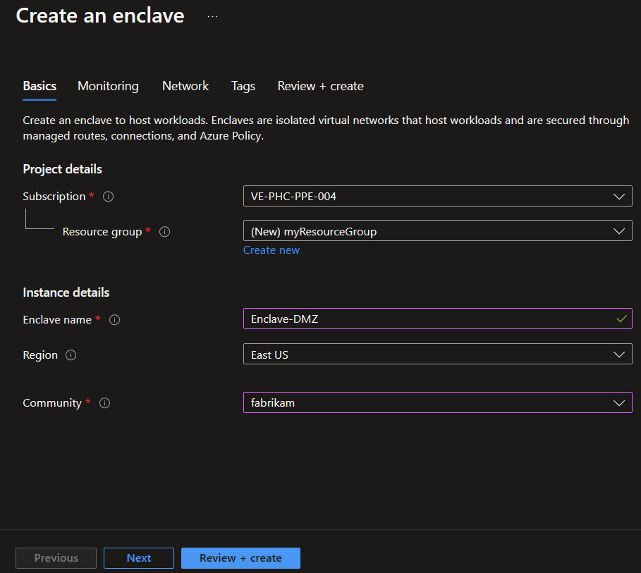

# Tutorial 1-2: Create enclaves in a community on Azure Virtual Enclaves

An enclave is an isolated Azure Virtual Network that is part of a community in which one or more workloads are hosted. 

In this tutorial, part two of eight, you deploy enclaves into a community. You learn how to:

  - Create several isolated enclaves as spokes in the hub-and-spoke network
  - View enclaves in Azure portal

## Before you begin
In the previous [tutorial](./1-1-create-community.md), you used Azure portal to create a community. If you need to create the community, return to [Tutorial 1-1 - Deploy a community](./1-1-create-community.md).

## Create an enclave using Azure Virtual Enclaves
Before creating an enclave instance, you need a resource group. An Azure resource group is a logical container into which you deploy and manage Azure resources. Learn more about each of the settings of an [enclave](./what-enclave.md) and [How-To create an enclave](./create-enclave-portal.md).

> [!Important]
>
> This tutorial uses `myResourceGroup` as a placeholder for the resource group name. If you want to use a different name, replace `myResourceGroup` with your own resource group name.

Enclave deployments take around 30-45 minutes to complete. Once it completes, open your enclave and verify that the Status is `succeeded`.

1. In the `Azure Virtual Enclaves` page, select `Enclaves` in the left menu.

2. On the `Enclaves` page, select `Create`.

3. Enter the basic details for your first enclave:
   - **Subscription**: Select an existing Subscription
   - **Resource Group**: `myResourceGroup`
   - **Enclave name**: `Enclave-WebApp`
   - **Region**: `East US`
   - **Community**: Select the community created in the earlier tutorial `fabrikam` - [1. Deploy a community](./1-1-create-community.md).

4. Select `Review + create` and validate the details for your enclave are correct, then select `Create`.

5. Now, to deploy another enclave **repeat Steps 1 and 2.** Once you're on the `Enclave Create` page, Enter these basic details for your second enclave:
   - **Subscription**: Select an existing Subscription
   - **Resource Group**: `myResourceGroup`
   - **Enclave name**: `Enclave-DMZ`
   - **Region**: `East US`
   - **Community**: Select the community created in the earlier tutorial `fabrikam` - [1. Deploy a community](./1-1-create-community.md).

6. After the enclave resources are created, you can view them in Azure portal from the fabrikam community.

7. Select an enclave name to view and manage the enclave
   

## Clean up resources
If you need to delete your enclaves created after completing this tutorial, you can delete the resources from this tutorial from the Azure portal.

## Next steps
In this tutorial, you created two sample enclaves using Azure portal. In the [next tutorial](./1-3-create-workloads-inside-enclave.md), you learn how to create several workloads within your enclave.
