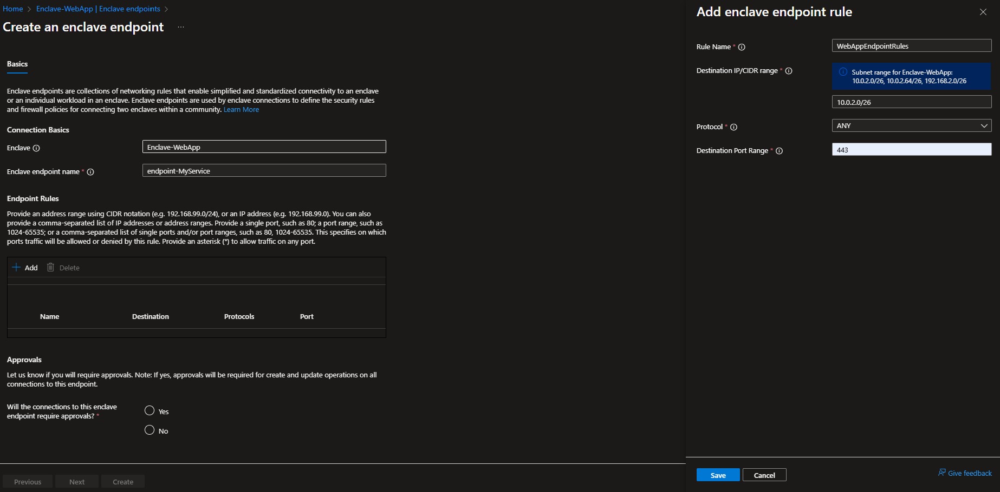
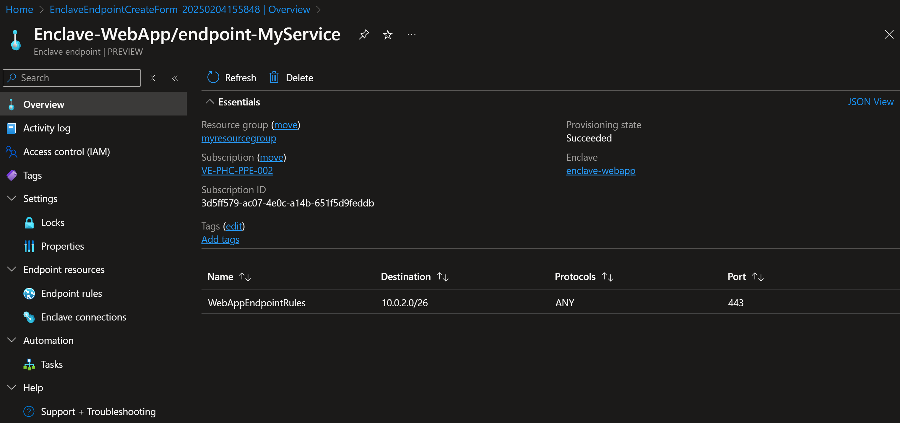
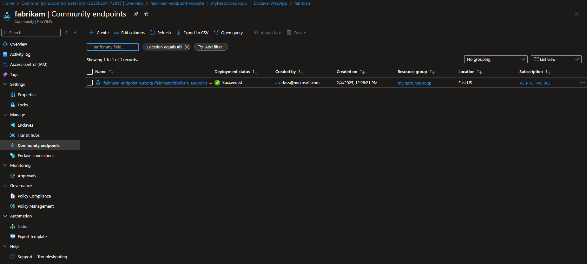
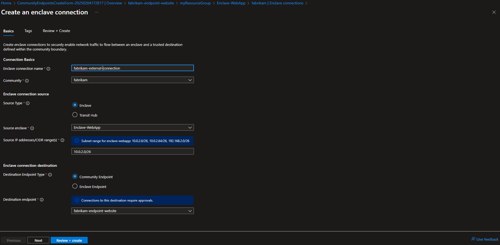
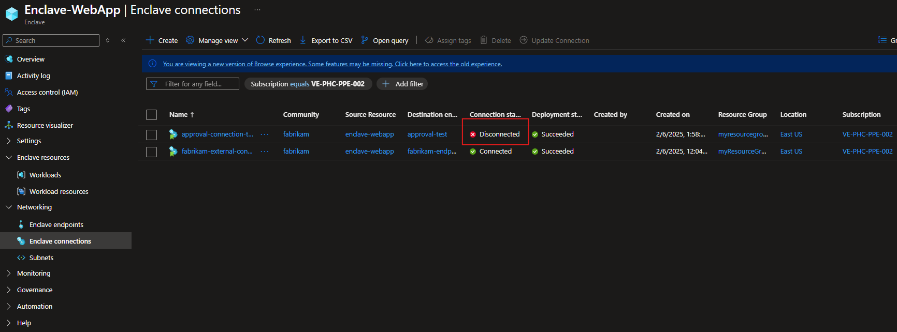
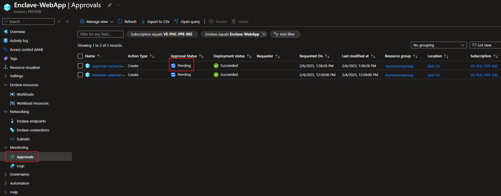

# Tutorial 1-5: Create enclave or community endpoint resources in Azure Virtual Enclaves

Community endpoints enable enclaves in a community to establish connections to resources outside of the community boundary to include public websites, public IP addresses, and external private networks through Site-to-Site (S2S) VPN or ExpressRoute connections. Enclave endpoints enable others to connect to your service by defining the means by which inbound traffic is allowed to flow into a given enclave once a connection is made.

In this tutorial, part six of eight, you create community and enclave endpoint resources. You learn how to:

  - Create community endpoint resources in communities
  - Create enclave endpoint resources in enclaves
  - View your endpoints in Azure portal

## Before you begin
In the previous tutorials, you created a [community](./1-1-create-community.md) and an [enclave](./1-2-create-enclaves-inside-community.md) using the Azure portal.

If you haven't created those resources yet, return to those earlier tutorials.

## Create an enclave endpoint

1. Navigate to an enclave hosting a service you want to make available to other enclaves in the community

2. While in your enclave's page, select `Enclave Endpoints` on the left side, and select `Create`.

4. Enter the details for your app/service and then select `Save`
   - Enclave: Select the existing enclave `Enclave-WebApp`.
   - Enclave endpoint name: Name of the enclave endpoint `endpoint-MyService`
   - Select `Add` to add Endpoint Rules that represent how to access your app/service
      - Name: `WebAppEndpointRules`
      - Destination: `<See the information box that gives your enclave subnet range (for example 10.0.2.0/26)>`
      - Protocol: `ANY`
      - Port: `443`

5. Select `Yes`, select `Review + Create`, and select `Create`

6. Once the endpoint resource is created, you can view them in Azure portal from the Enclave-WebApp `Enclave Endpoints`.

## Create a community endpoint

1. Navigate to the `fabrikam` community, select `Community Endpoints`

2. Select `Create`

3. Enter the details for your app/service
   - Community endpoint name: Name of the community endpoint `fabrikam-endpoint-website`
   - Select `Add` to add Endpoint Rules that represent how to access your app/service
      - Name: 'Website-Rule'
      - Destination Type: FQDN
      - Destination: *microsoft.com
      - Protocol: HTTPS
      - Port: 443

4. Select `Save`

5. Select `Yes`, select `Review + Create`, and select `Create`

6. Once the endpoint resource is created, you can view them in Azure portal from the Enclave-WebApp enclave endpoint page.

## Create an enclave  associated to an Endpoint

1. From the `fabrikam` community, select  `Enclave Connections`

2. Select `Create`

3. Enter the details for your app/service
   - Enclave connection name: Name of the connection `fabrikam-external-connection`
   - community: Select `fabrikam` from the dropdown
   - Source Type: Select `Enclave`
   - Source enclave: Select `Enclave-WebApp` from the dropdown
   - Source IP addresses/CIDR range(s): `<See the information box that gives your enclave subnet range (for example 10.0.2.0/26)>`
   - Destination Endpoint Type: Select `Community Endpoint`
   - Destination endpoint: Select `fabrikam-endpoint-website` from the dropdown

4. Select `Review + Create` and then `Create`

5. Once the endpoint resource is created, you can view them in Azure portal from the `fabrikam` `Enclave Connections`. However, it's in a disconnected state because we selected `Yes` to requiring approvals on connections for this endpoint.

6. Review the pending approvals in `Approvals` on the left for the enclave.

8. Approve the pending approvals and the connection state will automatically update to the `connected` state.

## Next steps
In this tutorial, you deployed community and enclave endpoints using Azure portal. You also learned how to:

- [Create connections](./what-enclave-connection.md)

In the [next tutorial](./1-6-monitor-your-enclaves.md), you'll learn how to create connections using these endpoints.
