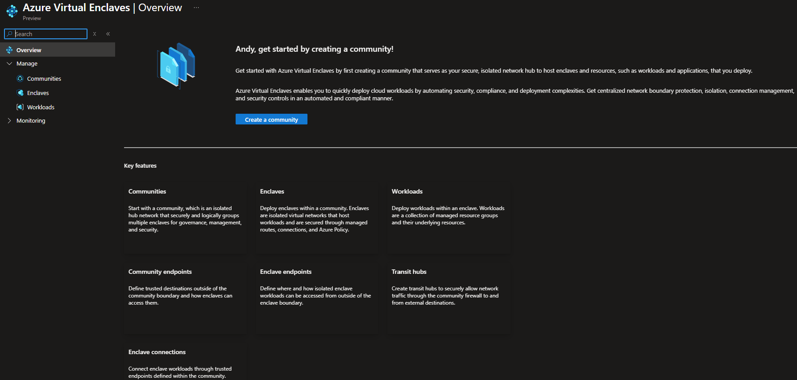
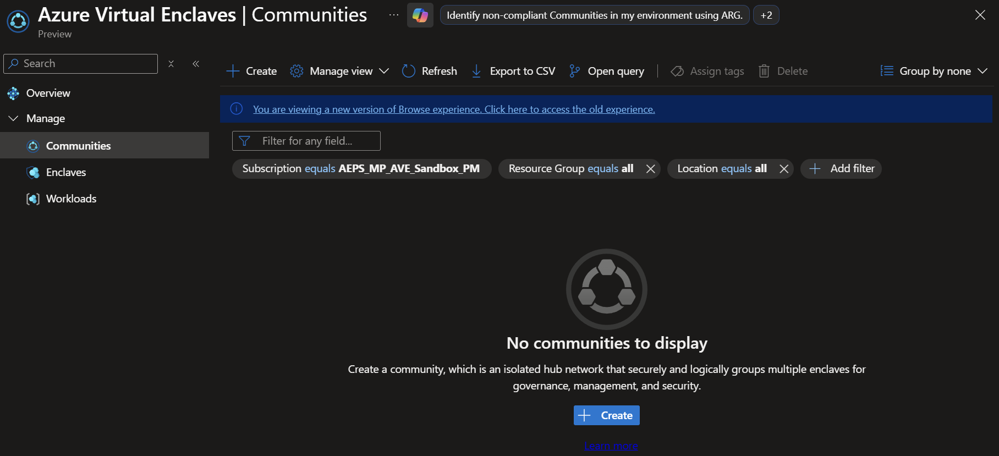
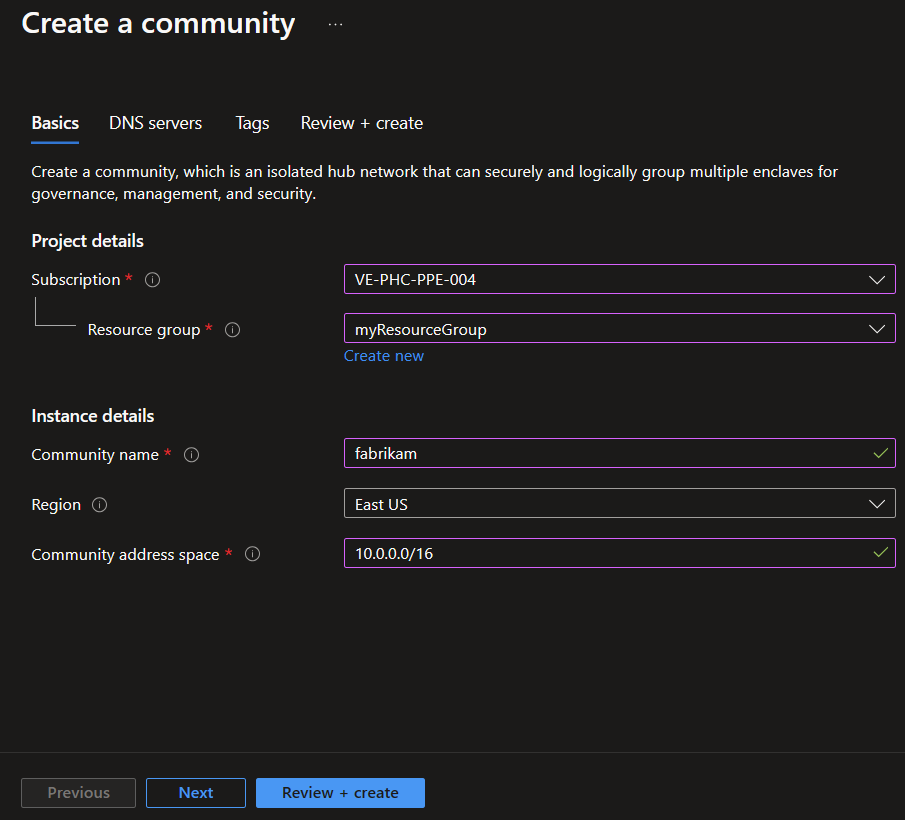
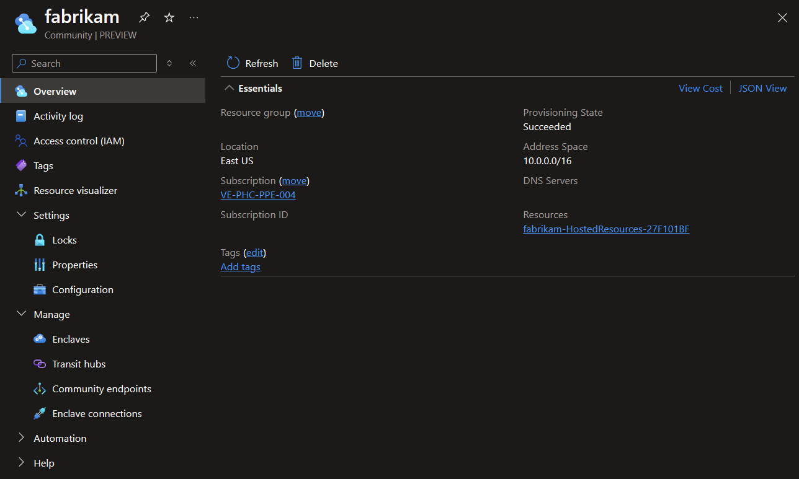
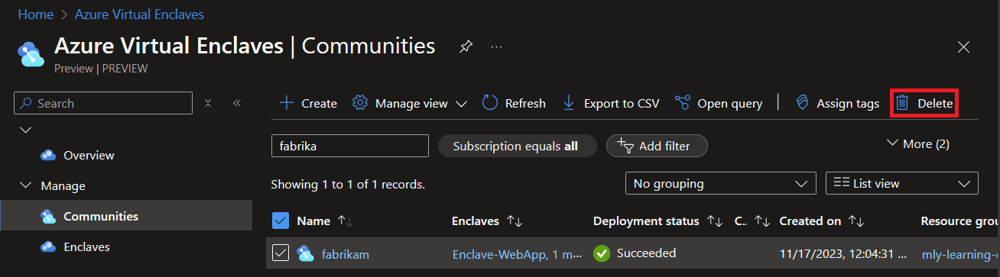

# Tutorial 1: Deploy a community on Azure Virtual Enclaves

## What is Azure Virtual Enclaves

Azure Virtual Enclaves is an Azure service that accelerates and streamlines the deployment and management of secure, isolated, and compliant cloud environments for the most sensitive mission workloads.

Communities are isolated hub networks that can securely and logically group several enclaves together for governance, management, and security purposes. A community owner can enable other communities or on-premises networks to connect through transit hub or Endpoints.

## Get started

In this tutorial, part one of eight, you prepare a monitored and secure network cloud environment in the Azure portal using Azure Virtual Enclaves. One [enclave](./what-enclave.md) contains web applications and is publicly accessible by routing traffic through a second enclave with a Web Application Gateway, Web Application Firewall, and a Public IP address. An [Enclave Endpoint](./what-enclave-endpoint.md) for the Web App and establishing an [enclave connection](./what-enclave-connection.md) between the Web App enclave and second enclaves enables the networking behavior described above.

You learn how to:
- ✅ Deploy a central community hub network
- ✅ Create several isolated enclaves as spokes in the hub-and-spoke network
- ✅ Create Azure resources into workloads within enclaves
- ✅ Utilize service catalog to quickly create apps in workloads
- ✅ Authorize and design complex business networking requirements across your community
- ✅ Monitor your community, enclaves, workloads, and other resources

## Create a community in Azure Virtual Enclaves
Before creating a community instance, you need a resource group. An Azure resource group is a logical container into which you deploy and manage Azure resources. Learn more about each of the settings of an [community](./what-community.md) and [How-To Create a community](./create-community-portal.md).

> [!Important]
>
> This tutorial uses `myResourceGroup` as a placeholder for the resource group name. If you want to use a different name, replace `myResourceGroup` with your own resource group name.

Community deployments will take around 30-45 minutes to complete. Once it completes, open your enclave and verify that the Status is **succeeded**.

1. In the **Azure Virtual Enclaves** page, select the **Communities** option in the left menu.

2. On the `Communities` page, select `Create`.

3. Enter the basic details for your community:
   - **Subscription**: Select an existing Subscription
   - **Resource Group**: `myResourceGroup`
   - **Community name**: `fabrikam`
   - **Region**: `East US`
   - **Community address space**: `10.0.0.0/16`

4. Select `Review + create` and validate the details for your enclave are correct, and select `Create`.

5. After the community has been created, you can view it in Azure portal.

## Clean up resources
If you need to delete your community created after completing this tutorial, this can be also done from the Azure portal.

## Next steps
In this tutorial, you created two sample enclaves using Azure portal. In the next tutorial, you'll learn how to create several workloads within your enclave.
