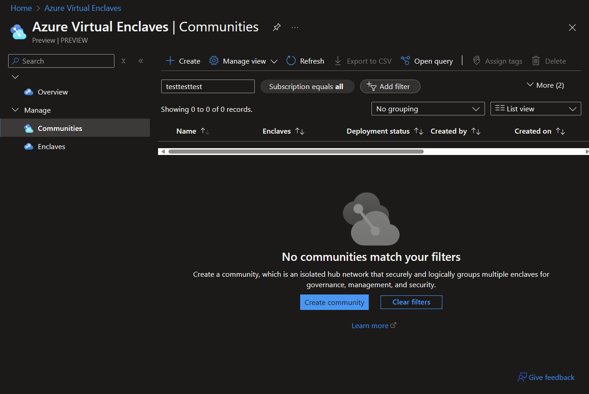
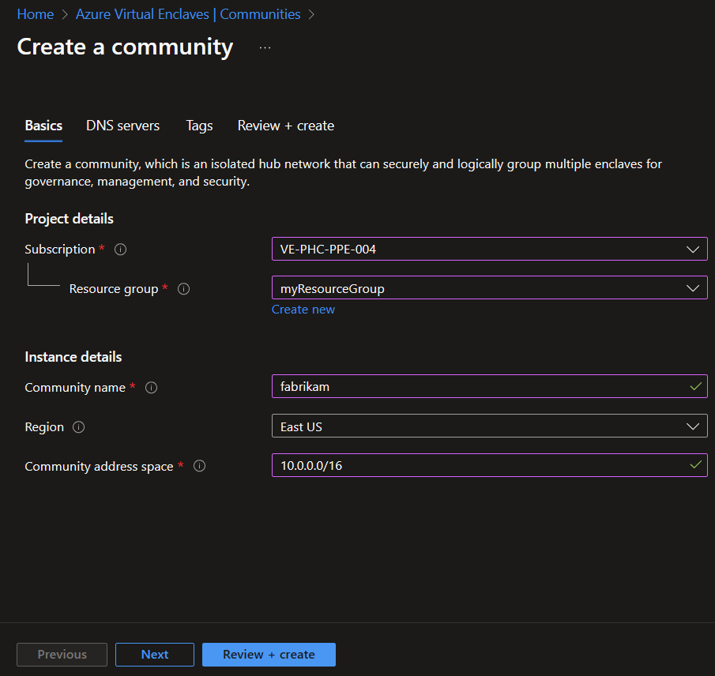
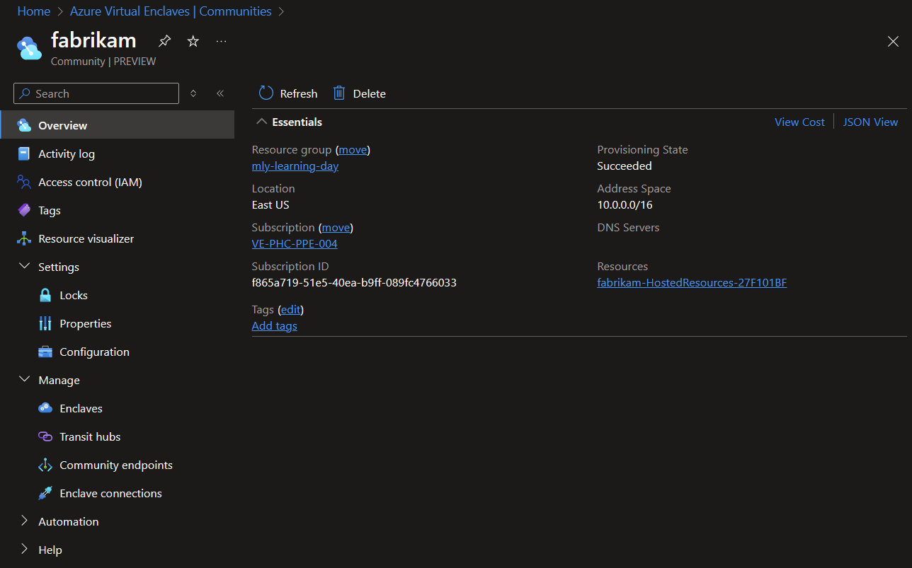
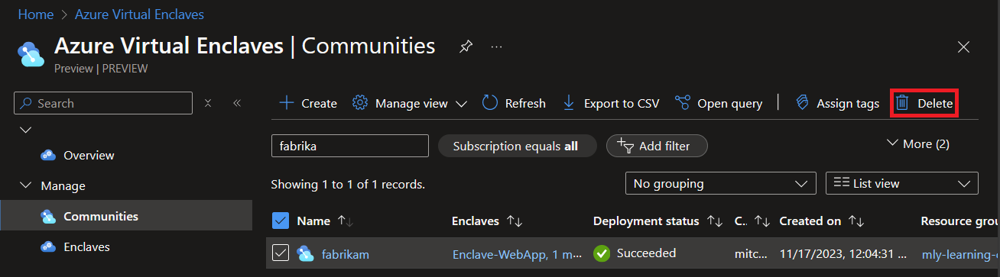

# Tutorial 1: Deploy a Community on Azure Virtual Enclaves

**Azure Virtual Enclaves is an Azure service that accelerates and streamlines the deployment and management of secure, isolated, and compliant cloud environments for the most sensitive mission workloads.**

Communities are isolated hub networks that can securely and logically group several Enclaves together for governance, management, and security purposes. A Community Owner can enable other Communities or on-premises networks to connect through Transit Hubs or Endpoints.

In this tutorial, part one of eight, you prepare a monitored and secure network cloud environment in the Azure portal using Azure Virtual Enclaves. One [enclave](./what-is-an-enclave.md) contains web applications and is publicly accessible by routing traffic through a second Enclave with a Web Application Gateway, Web Application Firewall, and a Public IP address. An [Enclave Endpoint](./what-is-an-enclave-endpoint.md) for the Web App and establishing an [Enclave Connection](./what-is-an-enclave-connection.md) between the Web App enclave and secodn enclaves enables the networking behavior described above.

You learn how to:
- ✅ Deploy a central community hub network
- ✅ Create several isolated enclave spoke networks
- ✅ Provision Azure resources into workloads within enclaves
- ✅ Utilize service catalog to quickly create apps in workloads
- ✅ Authorize and design complex business networking requirements across your community
- ✅ Monitor your community, enclaves, workloads, and other resources

## Create a community in Azure Virtual Enclaves
Before creating a community instance, you need a resource group. An Azure resource group is a logical container into which you deploy and manage Azure resources. Learn more about each of the settings of an [community](./what-is-a-community.md) and [How-To Create a Community](./create-a-community-in-the-azure-portal.md).

> **Important**:
>
> This tutorial uses `myResourceGroup` as a placeholder for the resource group name. If you want to use a different name, replace `myResourceGroup` with your own resource group name.

Community deployments will take around 30-45 minutes to complete. Once it completes, open your Enclave and verify that the Status is **succeeded**.

1. In the **Azure Virtual Enclaves** page, select the **Communities** option in the left menu.

2. On the **Communities** page, select **Create**.

3. Enter the basic details for your Community:
   - **Subscription**: Select an existing Subscription
   - **Resource Group**: `myResourceGroup`
   - **Community name**: `fabrikam`
   - **Region**: `East US`
   - **Community address space** - `10.0.0.0/16`

4. Click **Review + create**, ensure the details for your Enclave are correct, and click **Create**.

5. After the Community has been created, you can view it in Azure portal.

## Clean up resources
If you need to delete your community created after completing this tutorial, this can be also done from the Azure portal.

## Next steps
In this tutorial, you created two sample Enclaves using Azure portal. In the next tutorial, you'll learn how to create several workloads within your enclave.
