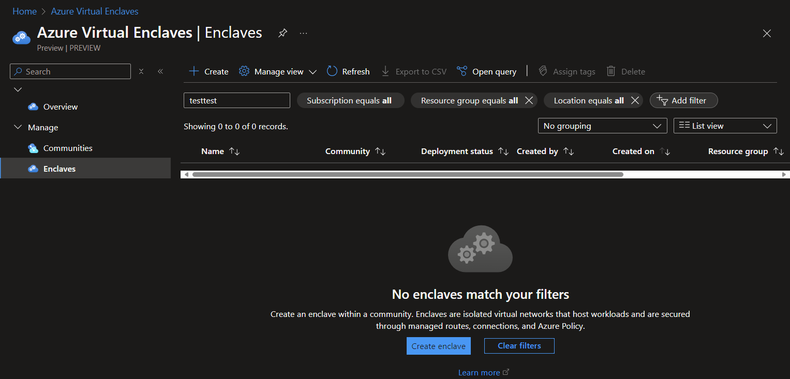
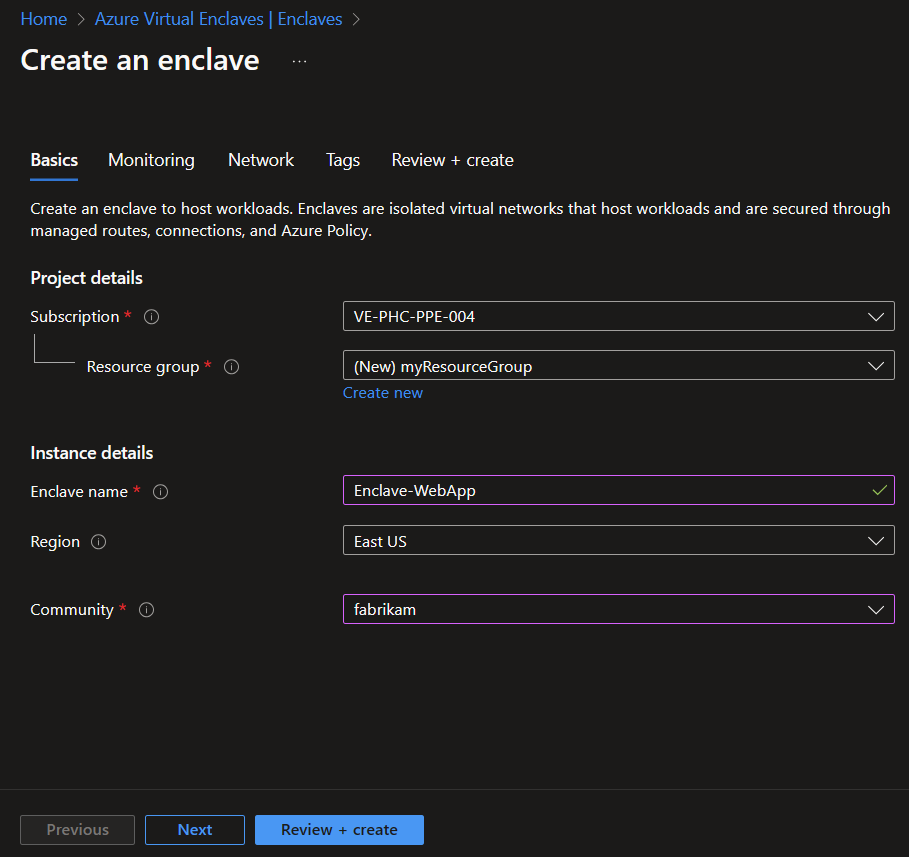
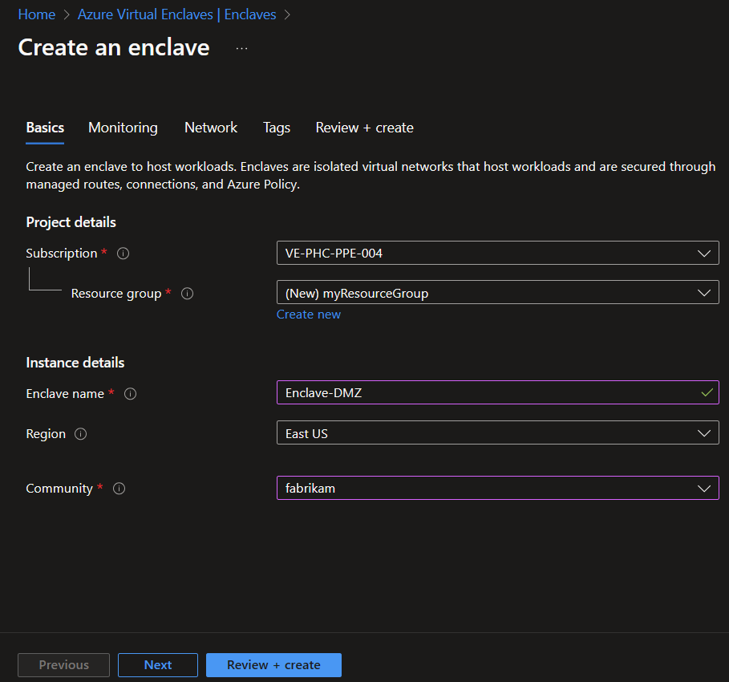
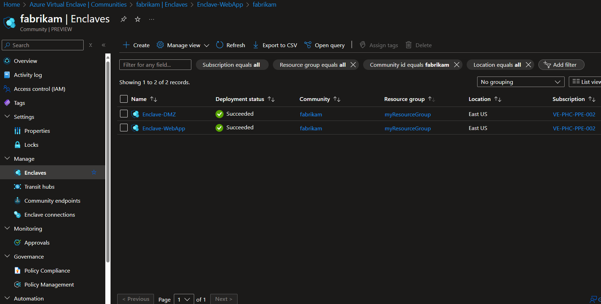
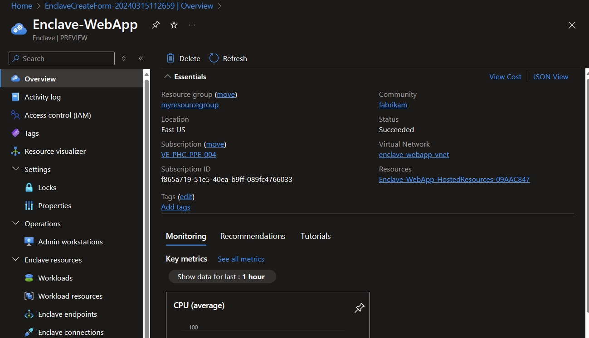
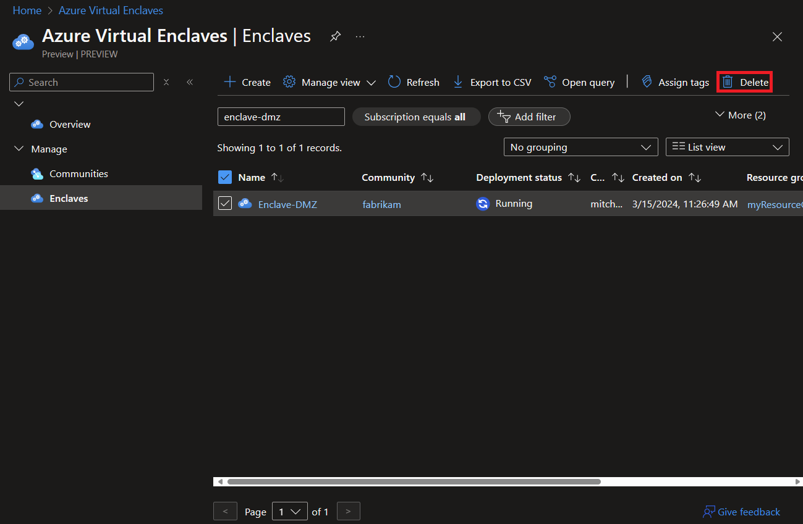

# Tutorial 2: Create Enclaves in a Community on Azure Virtual Enclaves

An enclave is an isolated Azure Virtual Network that is part of a community in which one or more workloads are hosted. 

In this tutorial, part two of eight, you deploy enclaves into a community. You learn how to:

- ✅ Create several isolated enclave spoke networks
- ✅ View enclaves in Azure portal

## Before you begin
In the previous [tutorial](./1-deploy-a-community.md), you used Azure portal to create a simple community. If you haven't created the community yet, return to [Tutorial 1 - Deploy a community](./1-deploy-a-community.md).

## Create an enclave using Azure Virtual Enclaves
Before creating an enclave instance, you need a resource group. An Azure resource group is a logical container into which you deploy and manage Azure resources. Learn more about each of the settings of an [enclave](./what-is-an-enclave.md) and [How-To Create an Enclave](./create-an-enclave-in-the-azure-portal.md).

> **Important**:
>
> This tutorial uses `myResourceGroup` as a placeholder for the resource group name. If you want to use a different name, replace `myResourceGroup` with your own resource group name.

Enclave deployments take around 30-45 minutes to complete. Once it completes, open your Enclave and verify that the Status is **succeeded**.

1. In the **Azure Virtual Enclaves** page, select the **Enclaves** in the left menu.

2. On the **Enclaves** page, select **Create**.

3. Enter the basic details for your first Enclave:
   - **Subscription**: Select an existing Subscription
   - **Resource Group**: `myResourceGroup`
   - **Enclave name**: `Enclave-WebApp`
   - **Region**: `East US`
   - **Community**: Select the Community created in the earlier tutorial `fabrikam` - [1. Deploy a community](./1-deploy-a-community.md).

4. Click **Review + create**, ensure the details for your Enclave are correct, and click **Create**.

5. Now, to deploy another Enclave -- **repeat Steps 1 and 2.** Once you are on the **Enclave Create** page, Enter these basic details for your second Enclave:
   - **Subscription**: Select an existing Subscription
   - **Resource Group**: `myResourceGroup`
   - **Enclave name**: `Enclave-DMZ`
   - **Region**: `East US`
   - **Community**: Select the Community created in the earlier tutorial `fabrikam` - [1. Deploy a community](./1-deploy-a-community.md).

6. After the Enclave resources have been created, you can view them in Azure portal from the fabrikam community.

7. Select an enclave name to view and manage the enclave
   

## Clean up resources
If you need to delete your enclaves created after completing this tutorial, this can be also done from the Azure portal.

## Next steps
In this tutorial, you created two sample Enclaves using Azure portal. In the next tutorial, you learn how to create several workloads within your enclave.
