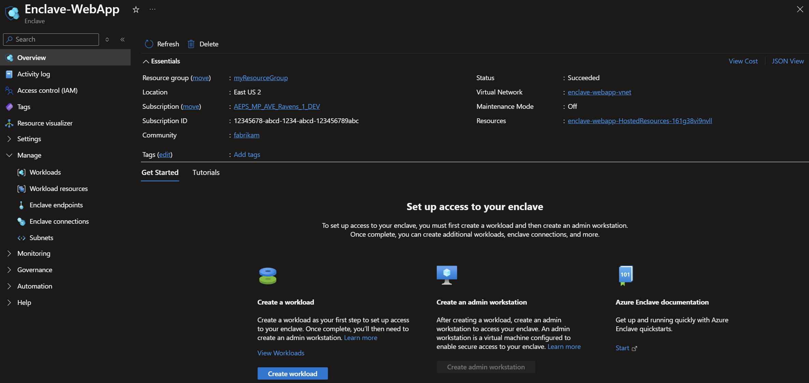
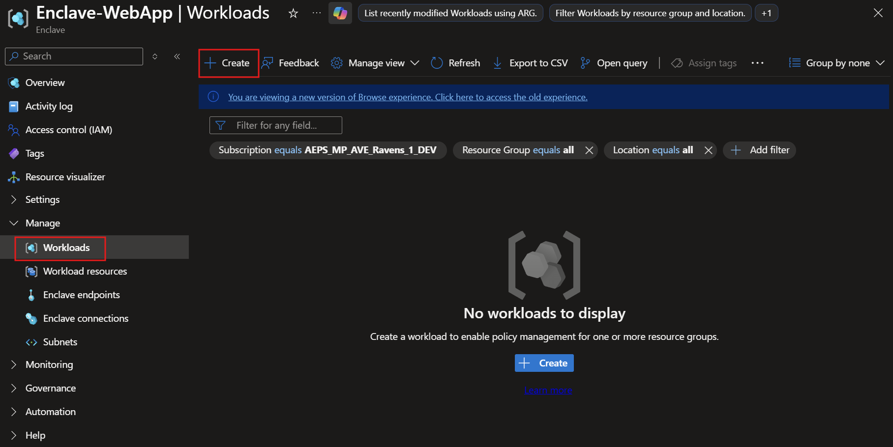
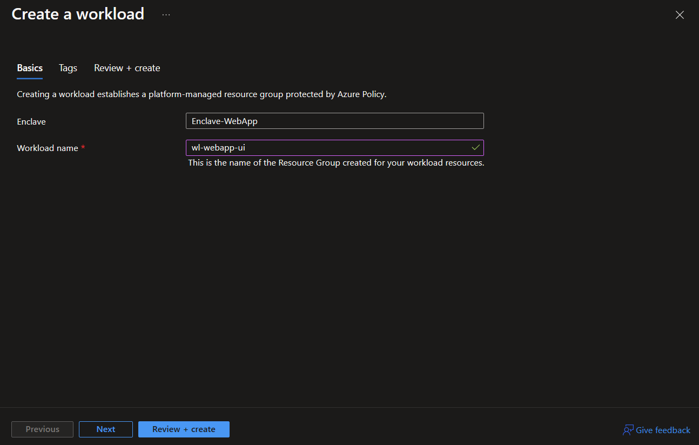
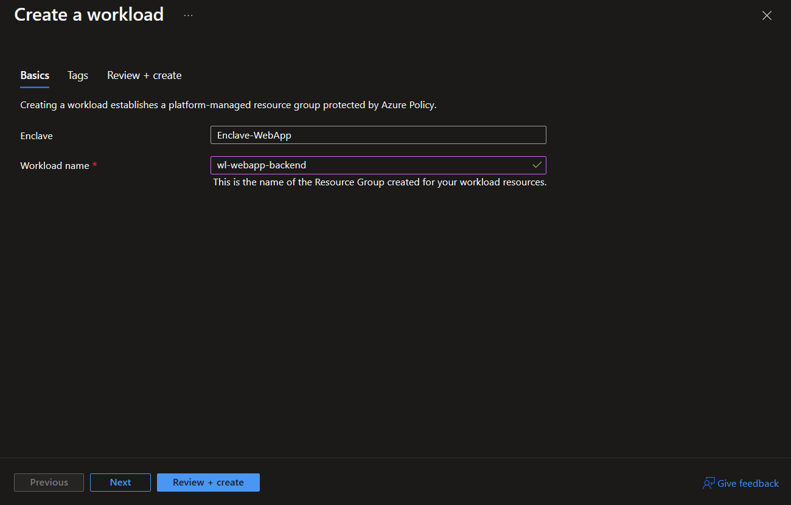
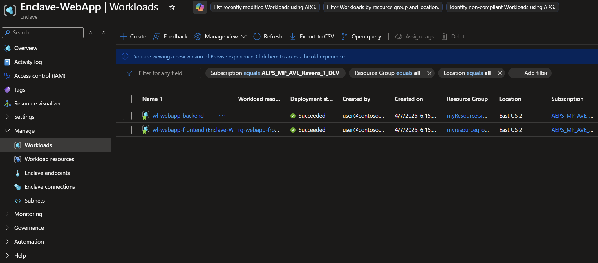

# Tutorial 3: Create workloads in an enclave on Azure Virtual Enclaves

Workloads are logical groups of Azure resources that you define to create and audit connections in Azure Virtual Enclaves (AVE). They also automatically inherit security posture and policies of their enclave.

In this tutorial, part three of eight, you deploy workloads into an enclave. You learn how to:

- ✅ Create several workloads in an enclave
- ✅ Create Azure resources into workloads within enclaves
- ✅ View workloads in Azure portal

## Before you begin
In the previous [tutorial](./2-create-enclaves-inside-community.md), you used Azure portal to create an enclave. If you didn't create the enclave yet, return to [Tutorial 2 - Create enclaves within a community](./2-create-enclaves-inside-community.md).

## Create a workload using Azure Virtual Enclaves
Before creating your resources, you need to create the AVE workload resource. Workloads are logical groups of Azure resources, similar to an Azure resource group, that you define to create and audit connections in Azure Virtual Enclaves.

> [!Important]
>
> This tutorial uses `myResourceGroup` as a placeholder for the resource group name. If you want to use a different name, replace `myResourceGroup` with your own resource group name.

1. In the `Azure Virtual Enclaves` page, select `Enclaves` in the left menu.

2. On the fabrikam `Enclaves` page, select the `Enclave-WebApp` enclave that we created in [2 - Create enclaves within a community](./2-create-enclaves-inside-community.md).

3. Go to the `Workloads` on the left underneath the `Enclave resources` section in the left-hand menu.

4. On the workloads page, select `Create`

5. Enter the basic details for your workload
   - **Enclave**: Select an existing enclave. This value is automatically applied from `Enclave-WebApp`.
   - **Workload name**: Name of the workload for this tutorial `wl-webapp-frontend`.
   - **Add**: Select to add a resource group
      - **Create new**: Select and enter the name `rg-webapp-frontend` then select `Ok`
> [!Note]
>
> Organizations should choose a workload naming convention that makes sense for the organization. Learn more about [defining your naming convention](/azure/cloud-adoption-framework/ready/azure-best-practices/resource-naming).

6. Select `Review + create` (this skips optional resource tags), ensure the details for your enclave are correct, and select `Create`.

7. Now, to create another workload. While the previous step is completing the deployment, open a new browser tab to the portal and **repeat Steps 4 through 6.** Once you're on the **Create a workload** page, enter these basic details for your second workload:
   - **Enclave**: Select an existing enclave. This value is automatically applied from `Enclave-WebApp`.
   - **Workload name**: Name of the workload for this tutorial `wl-webapp-backend`.
   - **Add**: Select to add a resource group
      - **Create new**: Select and enter the name `rg-webapp-backend` then select `Ok`

8. After the two workload resources have been created, you can view them in Azure portal.

## Clean up resources
If you need to delete your enclaves created after completing this tutorial, this can be also achieved from the Azure portal. It's best to wait until after you complete the full tutorial but if you need to, select each workload resource `wl-webapp-frontend` and `wl-webapp-backend` then select `Delete`

## Next steps
In this tutorial, you created sample workloads using Azure portal. In the [next tutorial](./4-use-service-catalog-create-azure-resources-workloads.md), you'll learn how to use the service catalog to deploy Azure resources and apps into your enclave workloads.
