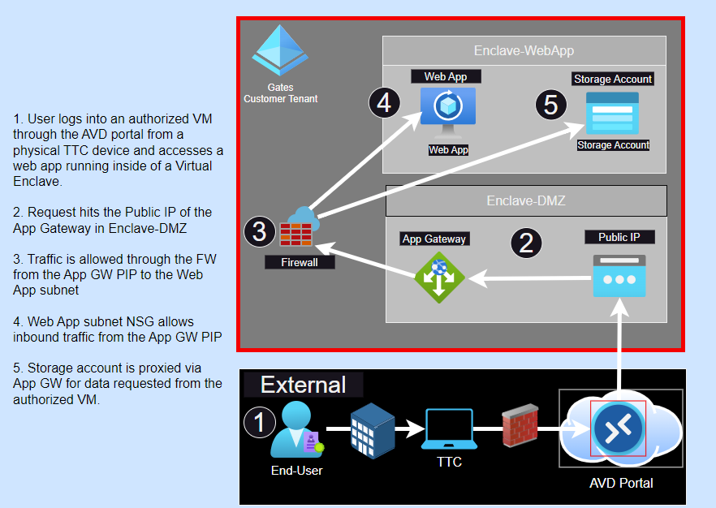

# Tutorial 7: Host a publicly accessible application in an enclave

Web applications can be hosted inside of an enclave and made publicly accessible by routing traffic through a separate Demilitarized Zone (DMZ) enclave with a Web Application Gateway, Web Application Firewall, and a Public IP address, creating an **Enclave Endpoint** for the Web App, and establishing an **enclave connection** between the Web App and DMZ enclaves.

## Public Web Applications in Azure Virtual Enclaves

## Steps to make your web app accessible from the internet in Azure Virtual Enclaves

1. Deploy an enclave to host the public Web Application (`Enclave-WebApp`).

2. Deploy an enclave to host an Application Gateway (`Enclave-DMZ`).

3. Deploy a workload and the resources required to host the web application into `Enclave-WebApp`.

4. Deploy an Endpoint that allows traffic to the web application's IP Address over port `443` and/or `80` into `Enclave-WebApp` (`endpoint-MyService`).

5. Deploy a workload and Application Gateway into `Enclave-DMZ`.

6. Configure the Web Application Storage Account to Proxy through the Application Gateway.

7. Create an enclave connection from `Enclave-DMZ` to `Enclave-WebApp`.
    - **Source Enclave**: `Enclave-DMZ`
    - **Source IP/CIDR**: `Application Gateway PIP`
    - **Destination Enclave**: `Enclave-WebApp`
    - **Destination Endpoint**: `endpoint-MyService`

## Public Web Application in the `PLx Managed Service`

## Steps to make your web app accessible from the internet in the Gates managed service

1. Create an enclave to host the public Web Application (`Enclave-WebApp`)

2. Create an enclave to host an Application Gateway (`Enclave-DMZ`) 

3. Deploy the resources required to host the web application into `Enclave-WebApp`

4. Create an outbound Network Security Group (NSG) rule on the subnet hosting the Application Gateway in Enclave-DMZ that allows traffic from the Application Gateway IP Address over port `443` and/or `80` into `Enclave-WebApp` (`endpoint-MyService`) to the Web Application IP/Subnet

5. Create a firewall rule that allows traffic from `Enclave-DMZ` into `Enclave-WebApp` that allows traffic to the web application's IP Address over port `443` and/or `80` into `Enclave-WebApp` (`endpoint-MyService`)

6. Create an inbound NSG rule on the subnet hosting the Web App in Enclave-WebApp that allows traffic from the Application Gateway IP Address over port `443` and/or `80` into `Enclave-WebApp` (`endpoint-MyService`) to the Web Application IP/Subnet

7. Configure the Web Application Storage Account to Proxy through the Application Gateway