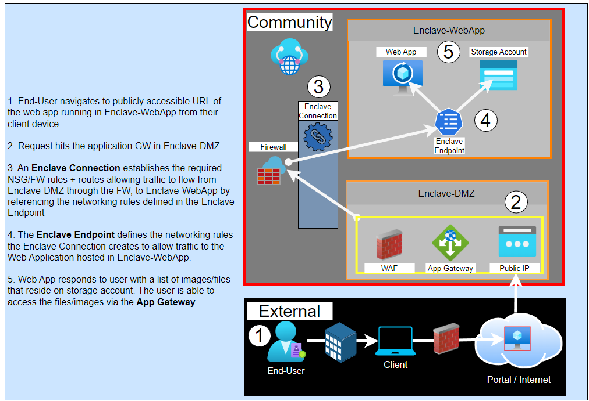

# Tutorial 8: Host a publicly accessible application in an enclave

Web applications can be hosted inside of a Virtual Enclave and made publicly accessible by routing traffic through a separate DMZ Enclave with a Web Application Gateway, Web Application Firewall, and a Public IP address, creating an **Enclave Endpoint** for the Web App, and establishing an **enclave connection** between the Web App and DMZ enclaves.

## Public Web Applications in Azure Virtual Enclaves

## Steps to make your web app accessible from the internet in Azure Virtual Enclaves

1. Deploy a Virtual Enclave to host the public Web Application (Enclave-WebApp)

1. Deploy a Virtual Enclave to host an Application Gateway (Enclave-DMZ) 

1. Deploy a workload + the resources required to host the web application into Enclave-WebApp

1. Deploy an Endpoint that allows traffic to the web application's IP Address over port 443 and/or 80 into Enclave-WebApp(Endpoint-WebApp)

1. Deploy a workload + Application Gateway into Enclave-DMZ

1. Configure the Web Application Storage Account to Proxy through the Application Gateway

1. Deploy an Enclave Connection from Enclave-DMZ to Enclave-WebApp
    - Source Enclave - Enclave-DMZ
    - Source IP/CIDR - Application Gateway PIP
    - Dest Enclave - Enclave-WebApp
    - Dest Endpoint - Endpoint-WebApp

## Public Web Application in the Gates Managed Service

## Steps to make your web app accessible from the internet in the Gates managed service

1. Create a Virtual Enclave to host the public Web Application (Enclave-WebApp)

1. Create a Virtual Enclave to host an Application Gateway (Enclave-DMZ) 

1. Deploy the resources required to host the web application into Enclave-WebApp

1. Create an outbound NSG rule on the subnet hosting the Application Gateway in Enclave-DMZ that allows traffic from the Application Gateway IP Address over port 443 and/or 80 into Enclave-WebApp(Endpoint-WebApp) to the Web Application IP/Subnet

1. Create a FW rule that allows traffic from Enclave-DMZ into Enclave-WebApp that allows traffic to the web application's IP Address over port 443 and/or 80 into Enclave-WebApp(Endpoint-WebApp)

1. Create an inbound NSG rule on the subnet hosting the Web App in Enclave-WebApp that allows traffic from the Application Gateway IP Address over port 443 and/or 80 into Enclave-WebApp(Endpoint-WebApp) to the Web Application IP/Subnet

1. Configure the Web Application Storage Account to Proxy through the Application Gateway