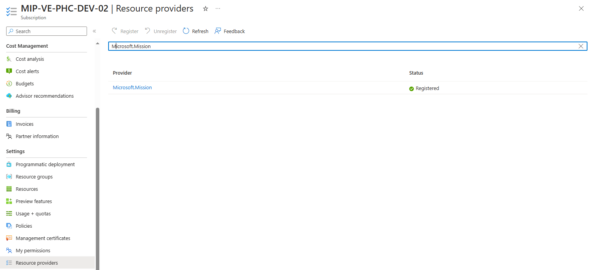
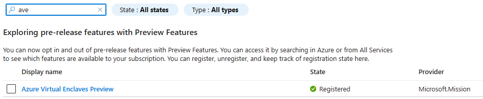

# Air-Gapped Onboarding

This guide provides the steps to onboard to Azure Virtual Enclaves (AVE) in air-gapped clouds by enabling the resource provider and granting permissions over an Azure subscription.

## Prerequisites

1. You must have an Azure tenant and subscription(s)
1. You must be in the owner role over the subscription(s)

## Register the Microsoft.Mission Resource Provider and grant permissions

### Azure Portal

1. Login to your Azure tenant and open the subscription resource
2. Open the "**Resource Providers**" blade (under "Settings")
3. Search for and select "**Microsoft.Mission**" and click "**Register**". 
   
4. Open the "**Preview Features**" blade (under "Settings")
5. Filter by "**AVE**", select "**Azure Virtual Enclaves Preview**", and click "**Register**" towards the top of the page.
   
6. Message your AVE point of contact or the AVE Product team at vepm@microsoft.com to get approval
7. Once you get approval, proceed to [next steps](#next-steps).

### Powershell

You can run the following code to quickly register all required resource providers to begin using AVE.
1. In the Azure Portal, select the `Cloud Shell` icon at the top of the window here 
1. [Set context](https://learn.microsoft.com/powershell/azure/context-persistence?view=azps-12.3.0#create-a-new-azure-context-from-subscription-information) to the subscription you registered above.
1. Transfer the script below into the air-gapped enviroment using [Pastebin](https://eng.ms/docs/cloud-ai-platform/azure-edge-platform-aep/aep-silver/sovereign-foundation-team/cloud-transfer-service/cts-onboarding/cts-portal/pastebinuserguide)**

```Powershell
# Register the Azure Virtual Enclaves Resource Provider and grant contributor permissions to the Resource Provider

$subID = (Get-AzContext).subscription.id
$objectId = (Get-AzADServicePrincipal -DisplayName "Mission Enclave").Id
$resourceProviders = @(
   "Microsoft.ADHybridHealthService",
   "Microsoft.Advisor",
   "Microsoft.AlertsManagement",
   "Microsoft.Authorization",
   "Microsoft.Automation"
   "Microsoft.Billing",
   "Microsoft.Capacity",
   "Microsoft.ChangeAnalysis",
   "Microsoft.ClassicSubscription",
   "Microsoft.CognitiveServices",
   "Microsoft.Commerce",
   "Microsoft.Compute",
   "Microsoft.Consumption",
   "Microsoft.CostManagement",
   "Microsoft.DesktopVirtualization",
   "Microsoft.DevTestLab",
   "Microsoft.Features",
   "Microsoft.GuestConfiguration",
   "Microsoft.insights",
   "Microsoft.KeyVault",
   "Microsoft.Logic",
   "Microsoft.ManagedIdentity",
   "Microsoft.MarketplaceNotifications",
   "Microsoft.MarketplaceOrdering",
   "Microsoft.Network",
   "Microsoft.OperationalInsights",
   "Microsoft.OperationsManagement",
   "Microsoft.PolicyInsights",
   "Microsoft.Portal",
   "Microsoft.ResourceGraph",
   "Microsoft.ResourceHealth",
   "Microsoft.ResourceNotifications",
   "Microsoft.Resources",
   "Microsoft.Security",
   "Microsoft.SecurityInsights",
   "Microsoft.SerialConsole",
   "Microsoft.SqlVirtualMachine",
   "Microsoft.Storage",
   "Microsoft.support",
   "Microsoft.Web",
   "Microsoft.Mission"
)

$resourceProviders | foreach {Register-AzResourceProvider -ProviderNamespace $_ -Verbose}
New-AzRoleAssignment -ObjectId $objectId -RoleDefinitionName "Contributor" -Scope "/subscriptions/$subId" -Verbose

```

Note: You may also need to enable a Feature on the subscription (specifically, the Microsoft.Insights/enableprivatelinkscopes AFEC) on the CX subscription, since AMPLS (deployed as part of enclaves) is hidden behind this feature flag.

1. First, submit a JIT for: ACIS > AFEC-PlatformServiceOperator. You can ping the lowside Teams channel, Compute Approvals, to ask for JIT approval in either Air-Gapped Cloud.

1. Once the JIT is approved, go to Jarvis > Actions > Azure Resource Manager > Feature Management > Approve Feature Registration.
- Endpoint: Feature
- Resource Provider Namespace: Microsoft.Insights
- Feature Name: enableprivatelinkscopes
- Subscription: CX Susbcription ID

1. You will also need to register a second feature flag, AVE-PREVIEW, on the subscription, since Microsoft.Mission resource types are hidden behind this feature flag.
- Endpoint: Feature
- Resource Provider Namespace: Microsoft.Mission
- Feature Name: AVE-PREVIEW
- Subscription: CX Susbcription ID

1. After these feature flags are registered, you may also need to unregister and re-register the Microsoft.Mission resource provider on your CX subscription.

1. See the AFEC documentation on how to get access / permission to create or register feature flags (either by JIT or by joining the security group) -https://eng.ms/docs/products/arm/rp_onboarding/afec/afec_jit

Then proceed to [next steps](#next-steps)

## Next Steps

1. Once the above steps have been completed, the Azure Virtual Enclaves Resource provider can begin deploying resources into your subscription on your behalf.

2. Use the following guides and start building your Virtual Enclaves Community:

   1. [Create a community](/docs/How-To-Guides/Create-a-Community-in-the-Azure-portal)
   2. [Create an enclave](/docs/How-To-Guides/Create-an-Enclave-in-the-Azure-Portal)
   3. [Create a workload](/docs/How-To-Guides/Create-a-Workload-in-the-Azure-Portal)

3. Use the following guides to establish network connectivity within your Community

   1. [Create an Enclave Endpoint](/docs/How-To-Guides/Create-a-Enclave-Endpoint-in-the-Azure-Portal)
   1. [Create an Enclave Connection](/docs/How-To-Guides/Create-an-Enclave-Connection-from-the-Azure-Portal)
   1. [Create a Transit Hub](/docs/How-To-Guides/Create-a-Transit-Hub-from-the-Azure-Portal)
   1. [Create a Community Endpoint](/docs/How-To-Guides/Create-a-Community-Endpoint-in-the-Azure-Portal)

4. Create resources within your workload(s) to meet your objectives.
   1. Create resources from the [Service Catalog](/docs/overview/List-of-Service-Catalog-Templates)
   1. Create resources with an [ARM template](https://learn.microsoft.com/azure/azure-resource-manager/templates/deploy-to-resource-group?tabs=azure-cli) or [bicep template](https://learn.microsoft.com/azure/azure-resource-manager/bicep/deploy-to-resource-group?tabs=azure-cli) from [these examples](https://github.com/Azure/azure-quickstart-templates/tree/master/quickstarts)
