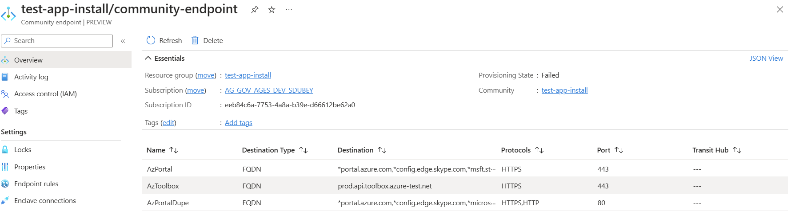
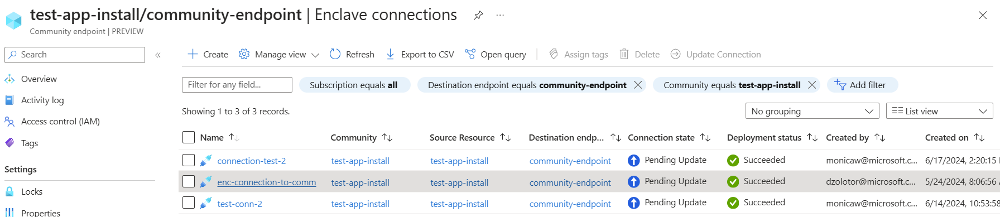
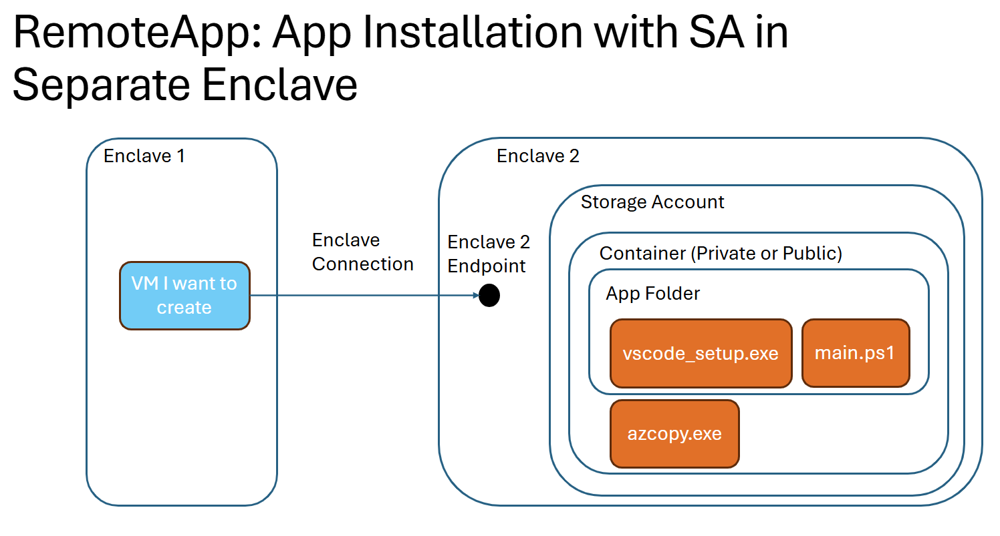
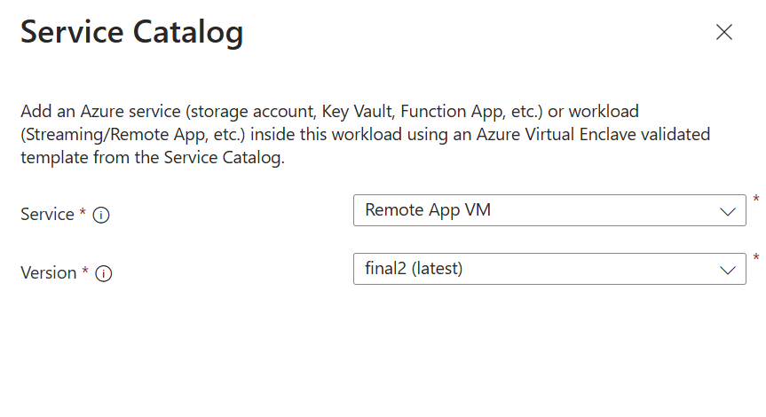
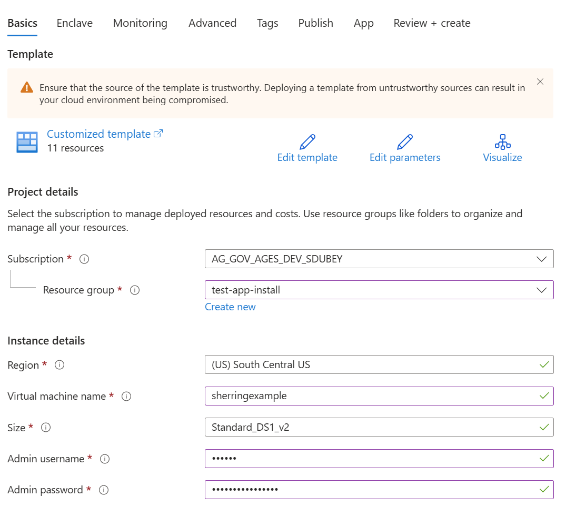
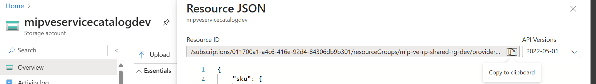
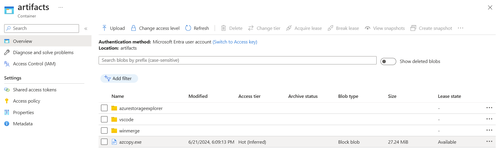
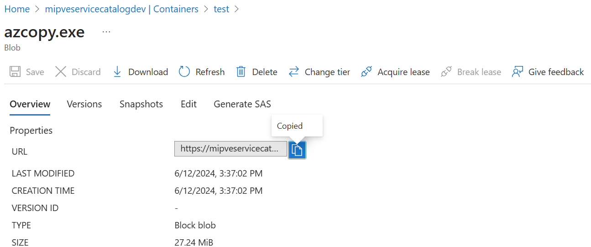
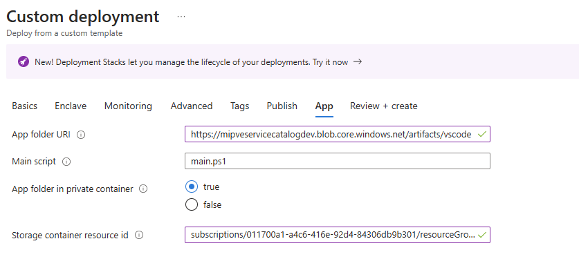
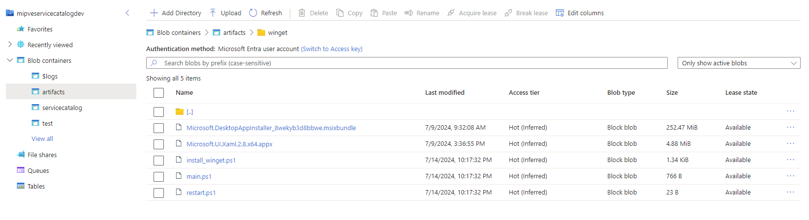

# Quickstart: Application Installation using RemoteAppVM

Install an application via RemoteAppVM Template

The application installation scripting supports the following scenarios:

1. The most common use case for the RemoteApp app installation is to deploy remote app packages which can be accessed from an AVD common desktop.
2. Install customer prerequisites such as cyber security and monitoring agents.
3. Script configuration changes for compliance or application setup.

Note: 
This sample deployment is just for demo purposes and doesn't represent all the best practices for network, systems, or applications administration.


## Prerequisites
The remote app template supports scripting to automate the process of installing applications and configuring the VM. Before you can start using the RemoteAppVM app installation, you'll need to make sure you have the following:
1. A [deployed Community](./what-is-a-community.md), [deployed Virtual Enclave](./what-is-an-enclave.md), and [deployed Workload](./what-is-a-workload.md) and permissions to create resources inside the workload.
2. A [container](../storage/blobs/blob-containers-portal.md) (artifacts) within the [storage account](./deploy-a-storage-account-from-the-service-catalog-into-a-workload.md).
1. A [community endpoint](./create-a-community-endpoint-in-the-azure-portal.md) to the storage account and AzToolBox.
2. A copy of AzCopy.exe
    1. Get AzCopy from the [AzToolBox](/docs/Quickstarts/Application-deployment-using-MAppsCli-in-AVE). Create a [community endpoint](/docs/How-To-Guides/Create-a-Community-Endpoint-in-the-Azure-Portal) to the storage account and AzToolBox.
    
        - Note: The latest version of AzCopy.exe might not be available at deployment
    1. Use my copy of [AzCopy.exe](https://learn.microsoft.com/azure/storage/common/storage-use-azcopy-v10#download-azcopy) in my Storage Account/Container.
        - Upload the AzCopy installer to the storage account at the same level as your app folder.
        - File Structure: 
            ```md
                - storage account
                    - artifacts container
                        - app folder
                        - azcopy.exe 
            ```
        
        - Like the picture above, multiple app folders can be in the same container and utilize the same copy of AzCopy.exe.
3. [Enclave connections](/docs/How-To-Guides/Create-an-Enclave-Connection-from-the-Azure-Portal) to the previously made community endpoints using IP groups `(enclave-name}`-ipg-eas and another at `{enclave-name}`-ipg-mgmt-vms.
1. Examples: 
    - Community endpoint:
    - Enclave connection:
- Note: If the storage account is in a different enclave, create an [enclave endpoint](/docs/How-To-Guides/Create-a-Enclave-Endpoint-in-the-Azure-Portal) in the enclave with the storage account and [enclave connection](/docs/How-To-Guides/Create-an-Enclave-Connection-from-the-Azure-Portal) to that storage account.


### Azure Resources Deployed

- Remote app example VM
  - NIC
  - WindowsVM 
  - Windows VM Extension


### Software Deployed

- Windows
- Application of your choice

## Installation 

### Setup Storage Account
1. Add app folder to container within storage account


    - File Structure:
        ```md
            - artifacts container
                - app folder
                    - app installer
                    - main script to install app
                    - (optional) additional scripts
                    - (optional) azcopy.exe
        ```
2. Download [Vscode.exe file](https://code.visualstudio.com/sha/download?build=stable&os=win32-x64) and upload the installer (.exe file) into the app folder
1. Upload `main.ps1` script, using whichever version of Vscode you have installed into the app folder:
    ```
        # Main powershell script that installs the application

        Start-Process 'C:/vscode/VSCodeSetup-x64-{version}.exe' -Argument "/VERYSILENT /MERGETASKS=!runcode"
    ```

### Setup Template
1. On the workload overview page, select "Add an Azure Service".

1. For `Service`, select `Remote App VM`.
1. For `Version`, if not selected by default, select the most recent version (eg: 0.0.1(latest)).

1. Select `Next`
1. Basics Tab:
    - For `Virtual Machine name`, input the name of the VM.
    - For  `Admin username` and `Admin password`, input the username and password you will use to log into your VM.
    
1. App Tab:
    - For `App folder URI` input the URI to the container. Click on an artifact within the container, copy its URI, **remove everything** after the folder name in the URI.
        

        | Original URI | Fixed URI |
        | :- | :- |
        | https://`<storage-account>`.blob.core.windows.net/`<container-name>`/`<folder-name>`/`<script>`.ps1 | https://`<storage-account>`.blob.core.windows.net/`<container-name>`/`<folder-name>` |

    - Example:
        - storageaccountexample.blob.core.windows.net/artifacts/vscode
    - For `Main Script` input the name (ex: main.ps1) of the script that installs the application.
    
### Private Container:

1. For `App folder in private container` select "true". This allows reader role access to the storage account via the VM. 
2. For `Storage container resource id` get the following three parts: `<storage-account-resource-id>` + '/blobServices/default/containers/' + `<container-name>`.
    - To get `Storage container resource id`, from the storage account, select "Overview," select "JSON View" in the far right corner, copy the storage account resource id.
        - 
    - For the container name, copy the name of the private container that holds the artifacts.
    - Example storage container resource id:
        - subscriptions/000000a0-a0a0-000a-00a0-0000aaa0a000/resourceGroups/providers/Microsoft.Storage/storageAccounts/storage-account-example/blobServices/default/containers/container-name
3. If the parameter `AzCopy File URI` is displayed, add the URI to the azcopy.exe from the container
    - Click on the file, and copy its URL:
    - 
    - 
Example Private Container Parameters:

4. Select `Review and Create`, if validations pass, select `Create`.
5. Once resources are deployed, check to see if app is installed on application VM by connecting to the Application VM. [Connect to the Application VM](./deploy-remoteapp-vm-from-the-service-catalog-into-a-workload.md#connect-to-the-application-vm)

## Additional Examples

### WinGet Installation

Folder Structure:
```
- artifacts container
    - WinGet app folder ('winget')
        - WinGet installer ('Microsoft.DesktopAppInstaller_8wekyb3d8bbwe.msixbundle')
        - Windows UI Library ('Microsoft.UI.Xaml.2.8.x64.appx')
        - main script to schedule install ('main.ps1')
        - script to install and schedule reboot('install_winget.ps1')
        - ('restart.ps1')
```


1. Download installers and upload them to the winget folder in storage container
    1. WinGet MSIX bundle ([Microsoft.DesktopAppInstaller_8wekyb3d8bbwe.msixbundle](https://github.com/microsoft/winget-cli/releases/tag/v1.8.1911))
    2. Windows UI Library ([Microsoft.UI.Xaml.2.8.x64.appx](https://github.com/microsoft/microsoft-ui-xaml/releases/tag/v2.8.6))
2. Create and upload scripts
    1. main.ps1
        ```
        # This script creates and runs a scheduled task to install the appx package and msix bundle with elevated privileges

        $installScriptPath = "C:\winget\install_winget.ps1"

        # Create a scheduled task action to run the installation script with elevated permissions
        $taskAction = New-ScheduledTaskAction -Execute 'powershell.exe' -Argument "-ExecutionPolicy Bypass -File $installScriptPath"

        # Set the task to start 30 seconds from now
        $taskTrigger = New-ScheduledTaskTrigger -Once -At (Get-Date).AddSeconds(30)
        $taskPrincipal = New-ScheduledTaskPrincipal -UserId "SYSTEM" -LogonType ServiceAccount -RunLevel Highest

        # Register the scheduled task
        Register-ScheduledTask -TaskName "InstallWinget" -Action $taskAction -Trigger $taskTrigger -Principal $taskPrincipal
        ```
    2. install_winget.ps1
        ```
        Set-ExecutionPolicy -Scope Process -ExecutionPolicy Bypass -Force

        Start-Process -FilePath "DISM.exe" -ArgumentList "/Online /Add-ProvisionedAppxPackage /PackagePath:C:\winget\Microsoft.UI.Xaml.2.8.x64.appx /SkipLicense" -NoNewWindow -Wait
        Start-Process -FilePath "DISM.exe" -ArgumentList "/Online /Add-ProvisionedAppxPackage /PackagePath:C:\winget\Microsoft.DesktopAppInstaller_8wekyb3d8bbwe.msixbundle /SkipLicense" -NoNewWindow -Wait

        $wingetDir = 'C:\Program Files\WindowsApps\Microsoft.DesktopAppInstaller_1.23.1791.0_x64__8wekyb3d8bbwe'
        $currentPath = [System.Environment]::GetEnvironmentVariable("Path", [System.EnvironmentVariableTarget]::Machine)
        [System.Environment]::SetEnvironmentVariable("Path", "$currentPath;$wingetDir", [System.EnvironmentVariableTarget]::Machine)

        # Schedule the reboot script
        $rebootScriptPath = "C:\winget\reboot.ps1"
        $taskAction = New-ScheduledTaskAction -Execute 'powershell.exe' -Argument "-ExecutionPolicy Bypass -File $rebootScriptPath"

        # Set the task to start 30 seconds from now
        $taskTrigger = New-ScheduledTaskTrigger -Once -At ((Get-Date).AddSeconds(30))
        $taskPrincipal = New-ScheduledTaskPrincipal -UserId "SYSTEM" -LogonType ServiceAccount -RunLevel Highest

        # Register the scheduled task
        Register-ScheduledTask -TaskName "Reboot" -Action $taskAction -Trigger $taskTrigger -Principal $taskPrincipal
        ```
    3.  restart.ps1
        ```
        Restart-Computer -Force
        ```
3. Proceed to [Deploy Template](#setup-template)
