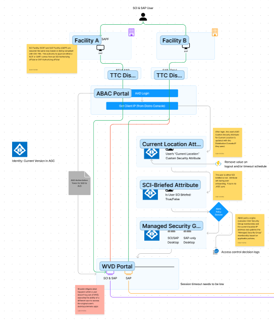

# Attribute-Based Access Controls

Attribute Based Access Control (ABAC) is an access control model used in computer security and information management. In ABAC, access to resources (such as files, databases, applications, etc.) is determined based on the attributes associated with the entities involved, such as users, objects, and the environment. It is a more flexible and dynamic approach compared to traditional access control models.

The Virtual Enclaves (VE) implementation of ABAC is a system running as a service and is primarily implemented around limiting access to Desktops and Remote Applications based on location or facility awareness which is determined at the moment the user logs into the system. Once the ABAC service identifies where a user is coming from via a system identified attribute a rules engine (comparing additional attribute applied to the user) determines what the user is able to see and access once they are in the system.

For example, a user has an attribute called "IsAdminUser". When this user signs in from Facility A, they will be presented with Facility A Administrative desktops only. They will not see Facility B Administrative desktops, nor will they see Common User desktops for either facility.

The reason this is implemented based on location is because the work performed in specific facilities cannot cross boundaries or be seen/shared across those boundaries. More specifically SCI data cannot be seen or accessed from a SAP ONLY location because the users at those SAP ONLY locations might not be briefed to know about, see or even be aware of information at the SCI/SAP level.

When a user logs into a SAP ONLY desktop between ABAC, Network Security Groups, Firewall rules, Active Directory Permissions (RBAC), and Sentris protections, they will not be able to view or be exposed to SCI data.

### Implementation Concerns

Azure Active Directly (AAD) limits the ability to apply 50 assigned attributes to a user. This means technically, a user will not be able to have more than 50 ABAC attribute assignments given to them. Additionally, once an attribute is exhausted on a user, there is no way to clear those up and reuse the space.

This is the primary limitation in ABAC at the moment. Future plans are to move the attribute system to a managed database instance inside the instance rather than rely on AAD to handle these assignments.

A secondary limitation of ABAC is the ability to assign 500 total attributes (archived or active) to an entire AAD instance. This will also be addressed in the same future update.

> **NOTE** At this time, the attribute limits should NOT be a concern for implementation or usage in the environment. If an attribute is required, it should be created, given it follows the guidance provided in this document.

### Architecture

The following is a high level diagram of the user flows and decisions made in the ABAC system:

Operational Description:

1. User will sit at a TTC in a specific facility and select the AVD 2.0 link.

> **NOTE**: The facility will be cleared for access at a specific classification level (SCI/SAP or SAP only, for example).

2. They will be presented with an Azure Active Directory (AAD) Login page and they will sign-in with their AAD (onms) credentials.
3. Since the user is accessing the TTC from a specific facility, that facility location network connection terminates in the Azure Data Center at a specific distribution console.

> **NOTE**: There is one distribution console in the data center for each facility classification level.

4. Each distribution console presents to the ABAC service a unique IP Address. 

> **For example**, all SCI/SAP facilities will appear to come from 1.1.1.1 and all SAP Only facilities will appear to come from 1.1.1.2

5. The IP Address is used by ABAC to assign a managed attribute for UserLocation.
6. ABAC then takes the user identity from the login token and looks up their other assigned attributes, such as IsCommonDesktopUser and IsSciBriefed.
7. The Attribute Rules engine then run against each rule in the system applying all the configured rules against the users attributes. All rules that result in TRUE, will then be applied.

> **For example**,we have a user logging in from a SAP ONLY facility, but their IsCommonDesktopUser is assigned to TRUE and the IsSciBriefed is also TRUE. The rules are:
> - SCI/SAP DESKTOP: Is the user SCI Briefed, are they a common desktop user and are they coming from an SCI location. The answer is FALSE, because they are coming from a SAP ONLY facility.
> - SAP ONLY DESKTOP: Is the user a common desktop user and are they coming from an SAP ONLY facility. TRUE. Because the user is coming from SAP, their IsSciBriefed attribute is not important, the location is the determining factor here, and that they are a common desktop user.
> 
> The SAP ONLY DESKTOP rule then applies to the user and their user account is assigned to the ABAC_SAP_ONLY_DESKTOP_USERS group. When the Azure Virtual Desktops page loads, they will only see the SAP ONLY Common Desktop to log into.

> **NOTE** All the applied rules will run for the user **at login** and all assignments to AAD groups will occur at that time. So, another set of rules that will apply to the user at this time are the Remote Application Rules (such as IsEnclaveUserRabbit).  

8. Once in the common desktop a user will then be able to access their assigned enclave applications.

> **For example**, if the user has the attributes IsEnclaveUserRabbit as TRUE and IsEnclaveTarantula as TRUE, then the user will see Rabbit and Tarantula applications on their start menu.

## ABAC Attribute Creation

The Attribute creation and assignment occur in the ABAC Portal (based on the Microsoft Personnel portal). The specific creation and assignment process are defined in the Operations documentation. However, in this section we cover the types of attributes, and how they are used to access resources in the VE.

### Managed vs Assigned Attributes

There are two types of attributes in the system:

* **Managed**: these are built-in and managed by the system. At the moment the only Managed attribute in use is UserLocation. The system populates this with either SAPONLY or SCICAP based on the origination ip (the distribution console where the user's connection ingresses from). A managed attribute cannot be change or assigned. 
* **Assigned**: An assigned attribute is created at the time they are needed, such as onboarding a new enclave, you might need to create a new attribute IsEnclaveUserXYZ. Attributes are then assigned to the user at the time of user creation or during regular personnel operations.An assigned attribute can be created, given range values, can be a string, number or boolean value. They can be assigned, or retired (archived).

### Methodology

ABAC is used primarily in VE for facility awareness. And the specific methodology applied is to limit what the user can see based on what attributes they have and where they are coming from. Other than the managed UserLocation attribute, the common attributes in place are:

- IsCommonDesktopUser - allows the user access to the common desktop (either SAP or SCI/SAP).
- IsSciBriefed - determines if the user has an SCI briefing and can access the SCI/SAP desktop.
- IsAdmin - allows system administrators (SA) and domain administrators (DA) users access to the vPAW systems.
- IsEnclaveUser[XXX] - publishes remote applications from the [XXX] enclave to the logged in users.
- IsEnclaveAdmin[XXX] -allows enclave administrators (EA) access to the evPAWs in the [XXX] enclave.

### Naming Convention

To maintain standard there is a standard naming convention to be applied to ABAC:

- Boolean values: begin with Is
- String values: begin with Has
- Number values: begin with descriptor of number type: Num or Age

Standard convention is to also be descriptive with the names following this pattern:

- For enclaves: IsEnclaveUser[XXX], IsEnclaveAdmin[XXX] where XXX is the name of the enclave, like Rabbit, or Tarantula.

### Attribute Usage Convention

To prevent attribute exhaust defined in the overview above, the following usage is advised:

- One attribute per enclave for users
- One attribute per enclave for EAs

### Implementation

| Attribute | Type | Description | Values | Business Rule | When to Assign/Update |
| - | - | - | - | - | - |
| CurrentLocation | Managed | stores the IP address of the user's location, which is based on the TTC DC IP | USNAT: either SAR-Only IP, or SAR/SCI IP | Location automatically captured at login | Automatically On Account Login |
| IsSciBriefed | Assigned | Denotes the user has SCI Briefing and allowed to access the system from a SCIF | T/F | True if user is SCI Briefed | Assigned at Account Creation |  
| IsCommonDesktopUser | Assigned | Give users access to the Common Desktop (in general, scope for SAP/SCI Common Desktop combined with CurrentLocation) | T/F | True if the user is a common desktop user. | Assigned at Account Creation |
| IsvPAWAdmin | Assigned | Gives users with SA or DA accounts to the Common vPAWs | T/F | True if the user account is SA/DA | Assigned at account creation |
| IsEnclaveRabbitAdmin | Assigned | Gives users with EA accounts access to the Rabbit Enclave evPAWs | T/F | True is the user account is assigned to access an evPAW | Assigned at account creation |
| IsEnclaveRabbitUser | Assigned | Attribute users to the Rabbit enclave apps | T/F | A general user who needs access to Rabbit mission apps should be set to TRUE | Assigned at account creation |

## ABAC Rules

The specific steps for creating an ABAC rule are covered in the Operation documentation. This section covers the methodology for currently implemented rules, how the rules engine works, when rules should be created, and how they get applied.

### Methodology and Application

The ABAC rules engine works by evaluating all the attributes for the user as they sign into Azure AD. Each rule criteria is evaluated to the users applied attributes, and all the rules that resolve to TRUE will result in the users account being added to a specific Azure Active Directory Group. 

> **NOTE** If you were to view any specific ABAC Managed Azure Active Directory Group without any users signed into the system, it would be empty. This is because until a user signs in and a rule is evaluated to TRUE, there are not users in these managed groups.

Additionally, these groups are added to the Azure Virtual Desktop (AVD) host pool Assignments. 

Therefore, when a user logs in, and ABAC assigned then to a managed group, and that managed group is assigned to a specific host pool in AVD, the desktops or applications in those host pool will be available to the user.

### Rules and AAD Managed Group Creation

Rules should be created at specific times, such as when a new enclave is bing on boarded. At this time you will determine which attributes need to be created for the enclave, such as IsEnclaveUser and IsEnclaveAdmin. You will laos need to create an AAD Group. This section covers these steps.

#### Create AAD Group

To begin, you need to create an Azure AD Group. The following naming rules should be used:

* Begins with **ABAC_** - this helps identify all the ABAC managed groups in the system easily. 
* Next, is Location - SAP_ONLY / SCISAP
* Next is Scope - Users / Admins
* Next is Enclave (if any)
* Last is Resource + Name - DESKTOP / APP_AppName

> **NOTE** The standard will be to have names be in ALL_CAPS

Some Examples:
- ABAC_SAP_ONLY_TARANTULA_USERS_APP_MatLab
- ABAC_SAP_ONLY_COMMON_DESKTOP_USERS
- ABAC_SAP_ONLY_TARANTULA_EVPAW_ADMINS

### Implementation

| Rule | Type | Description | Logic Statement | Associated AAD Group |
| - | - | - | - | - |
| SAP-Only Desktop | <b>Desktop</b> or RemoteApp or cloud service type | limits access to SAP-only desktop when user is in a SAPF-only | CurrentLocation == SAR-Only && IsCommonDesktopUser == TRUE | ABAC_ SAP_ONLY_COMMON_DESKTOP |
| SCI/SAP Desktop | **Desktop** or RemoteApp or cloud service type | limits access to SCI/SAP desktop when user is at a SCIF | CurrentLocation == SCI_SAR && IsCommonDesktopUser === TRUE && IsSCIBriefed === TRUE | ABAC_SCISAP_COMMON_DESKTOP |
| vPAWs | **vPAW Desktop** or cloud service types | limits access to the vPAW for SA/DA accounts only from SCIF locations | CurrentLocation == SCI_SAR && IsAdminUser == TRUE && IsSciBriefed == TRUE | ABAC_SCISAP_VPAW_ADMINS |
| SAP ONLY evPAWs | **evPAW Desktop** or cloud service types | limits access for Enclave Admins to the evPAW in their enclave from SAP ONLY locations | CurrentLocation == SAP_ONLY && IsEnclaveRabbitAdmin == TRUE | ABAC_SAP_ONLY_RABBIT_EVPAW_ADMIN |
| SCI evPAWs | **evPAW Desktop** or cloud service types | limits access for Enclave Admins to the evPAW in their enclave from SCI SAP locations | CurrentLocation == SCI_SAP && IsSciBriefed == TRUE && IsEnclaveRabbitAdmin == TRUE | ABAC_SCISAP_RABBIT_EVPAW_ADMIN | 

#### Standards for Rules and Criteria

The specifics for creating rules are covered in the ABAC Operation documentation, this section covers the standard for building rules. Rule criteria need to be readable from top to bottom in the following order:

- The CurrentLocation criteria is always first (if needed).
- IsSciBriefed criteria is next (if needed).
- Desktop / App / Enclave User criteria is next.
- Finally, if ever additional rule are needed they will follow here.

## ABAC User Assignments

User assignments are the crux of ABAC. Once all the attributes, rules and criteria are specified, a user account is then added to ABAC (using the steps provided in the ABAC Operations guide), the user will then have the attributes that they need assigned to them to access the resources they are allowed.  

### Considerations

When assigning users, it is important to make sure you are applying the correct assignment to the correct user account. Some users may have an EA and a standard user account, for example.

> **Some examples**:
>
> Susan has both a standard user and an enclave admin account, she is not SCI briefed and needs to access the enclave evPAW and the common desktop. You will setup Susan's accounts as follows:
> - SUSAN.EA: IsEnclaveRabbitAdmin == TRUE, IsSCIBriefed == FALSE
> - SUSAN (Standard user): IsEnclaveRabbitUser == TRUE, IsCommonDesktopUser == TRUE, IsSCIBriefed == FALSE
>
> Eric has both a standard user and an enclave admin account, he is SCI Briefed and needs to access the enclave evPAW and the common desktop. You will setup Eric's accounts as follows:
> - ERIC.EA: IsEnclaveRabbitAdmin == TRUE, IsSCIBriefed == TRUE
> - ERIC (Standard user): IsEnclaveRabbitUser == TRUE, IsCommonDesktopUser == TRUE, IsSCIBriefed == TRUE
>

### Diagrams

The following section are some conceptual diagrams for how each of these attributes and rules are designed with the current implementation.

#### Common Desktop + Rabbit Enclave (Common Users, SCI/SAP + SAP ONLY)

##### vPAW (SA/DA Admins, SCI/SAP)

#### evPAW - (Rabbit EA's, SCI/SAP and SAP ONLY)

## ABAC Reporting

This section is TBD

### Logging Details

This section is TBD

#### User Login and Assignments

This section is TBD

#### Service Availability

This section is TBD

#### Errors and Failures

This section is TBD
