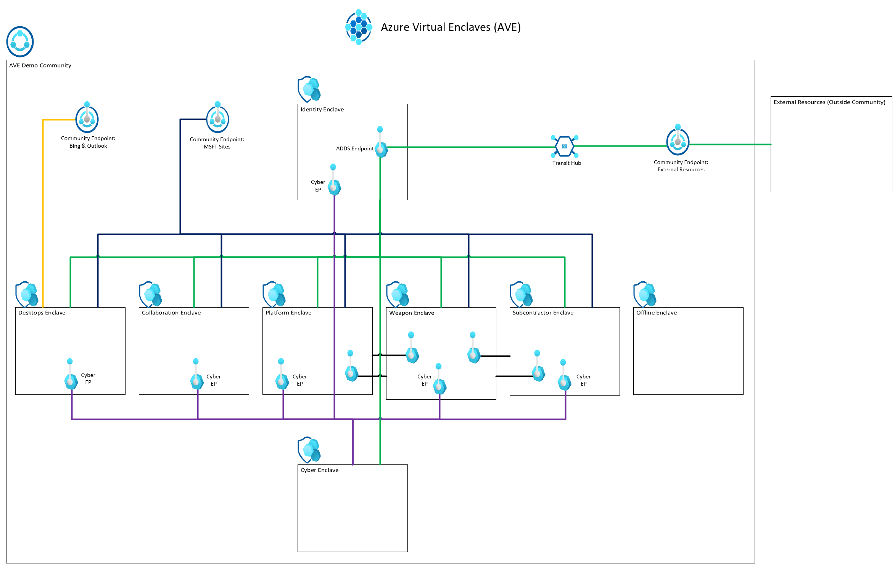

# Azure Virtual Enclaves Deployment Templates
Example templates to deploy multiple Azure Virtual Enclave resources for a sample scenario. The current templates are maintained using a [Bicep](../azure-resource-manager/bicep/overview.md) file but those are converted to [Azure Resource Manager (ARM)](../azure-resource-manager/templates/overview.md) templates for deployment from the portal.

## Secure Azure Computing Architecture (SACA) Template
An example of how to deploy the SACA within AVE.

What gets deployed:
1. One  [Community](./what-community.md)
2. Three  [Community Endpoints](./what-community-endpoint.md)
3. One  [Transit Hub](./what-transit-hub.md)
4. Four  [Enclaves](./what-enclave.md)
5. Four  [Workloads](./what-workload.md)
6. One  [Enclave Endpoint](./what-enclave-endpoint.md)
7. Nine  [Enclave Connections](./what-enclave-connection.md)

[ARM Template](https://github.com/Azure/virtual-enclaves/ave-templates/ave-saca.json) (easiest to deploy via Portal, PowerShell, or command line)

[Bicep Template](https://github.com/Azure/virtual-enclaves/ave-templates/ave-saca.bicep) (easiest to edit and maintain then convert to ARM template before deployment)

Deploy the template:
1. Open the Azure portal and type "deploy" into the top search bar and select `Deploy a Custom Template`
2. Select `Build your own template in the editor`
3. Replace the default template with the ARM template contents (for example copy the text inside the json file).  See [this article](../azure-resource-manager/templates/quickstart-create-templates-use-the-portal.md#edit-and-deploy-the-template) if you have any issues with the above steps.
4. Select `Save`
5. Select `Create New` under `Resource Group` and enter the resource group name you would like to use (for example community-template-rg) for the AVE resources.
6. Increment `Unique Number` if previous deployments are located in the same resources group.
9. Review the remaining parameters but keep the default unless you would like to test a modification.
10. Select `Review + Create` and then `Create`

## AVE Demo Environment Template

What gets deployed:
1. One  [Community](./what-community.md)
2. Three  [Community Endpoints](./what-community-endpoint.md)
3. One  [Transit Hub](./what-transit-hub.md)
4. Eight  [Enclaves](./what-enclave.md)
5. Eight  [Workloads](./what-workload.md)
6. 11 [Enclave Endpoint](./what-enclave-endpoint.md)
7. 25 [Enclave Connections](./what-enclave-connection.md)

[ARM Template](https://github.com/Azure/virtual-enclaves/ave-templates/ave-demo-env.json) (easiest to deploy via Portal, PowerShell, or command line)

[Bicep Template](https://github.com/Azure/virtual-enclaves/ave-templates/ave-demo-env.bicep) (easiest to edit and maintain then convert to ARM template before deployment)

Deploy the template:
1. Open the Azure portal and type "deploy" into the top search bar and select `Deploy a Custom Template`
2. Select `Build your own template in the editor`
3. Replace the default template with the ARM template contents (for example copy the text inside the json file).  See [this article](../azure-resource-manager/templates/quickstart-create-templates-use-the-portal.md#edit-and-deploy-the-template) if you have any issues with the above steps.
4. Select `Save`
5. Select `Create New` under `Resource Group` and enter the resource group name you would like to use (for example community-template-rg) for the AVE resources.
6. Increment `Unique Number` if previous deployments are located in the same resources group.
9. Review the remaining parameters but keep the default unless you would like to test a modification.
10. Select `Review + Create` and then `Create`

## Community and Enclaves Template

[What gets deployed](./deploy-community-enclaves-template.md#what-gets-deployed)
1. One  [Community](./what-community.md)
2. Two  [Community Endpoints](./what-community-endpoint.md)
3. One  [Transit Hub](./what-transit-hub.md)
4. One  [Enclaves](./what-enclave.md)
5. One  [Workloads](./what-workload.md)
6. One  [Enclave Endpoint](./what-enclave-endpoint.md)
7. Four  [Enclave Connections](./what-enclave-connection.md)

[ARM Template](https://github.com/Azure/virtual-enclaves/ave-templates/nightly-base.json) (easiest to deploy via Portal, PowerShell, or command line)

[Bicep Template](https://github.com/Azure/virtual-enclaves/ave-templates/nightly-base.bicep) (easiest to edit and maintain then convert to ARM template before deployment)

[Deploy the template](./deploy-community-enclaves-template.md#deploy-the-template)

### Community Template
What gets deployed:
1. One  [Community](./what-community.md)
2. Two  [Community Endpoints](./what-community-endpoint.md)
3. One  [Transit Hub](./what-transit-hub.md)

[ARM Template](https://github.com/Azure/virtual-enclaves/ave-templates/community.json) (easiest to deploy via Portal, PowerShell, or command line)

Deploy the template:
1. Open the Azure portal and type "deploy" into the top search bar and select `Deploy a Custom Template`
2. Select `Build your own template in the editor`
3. Replace the default template with the ARM template contents (for example copy the text inside the json file).  See [this article](../azure-resource-manager/templates/quickstart-create-templates-use-the-portal.md#edit-and-deploy-the-template) if you have any issues with the above steps.
4. Select `Save`
5. Select `Create New` under `Resource Group` and enter the resource group name you would like to use (for example community-template-rg). It's recommended to use the same resource group for other AVE resources but not required.
6. Under `Community Name`, enter the community name you would like to use (for example cm-template-test)
7. Select `Review + Create` and then `Create`

### Enclave Template
What gets deployed:
1. One  [Enclave](./what-enclave.md)

[ARM Template](https://github.com/Azure/virtual-enclaves/ave-templates/enclave.json) (easiest to deploy via Portal, PowerShell, or command line)

Deploy the template:
1. Open the Azure portal and type "deploy" into the top search bar and select `Deploy a Custom Template`
2. Select `Build your own template in the editor`
3. Replace the default template with the ARM template contents (for example copy the text inside the json file).  See [this article](../azure-resource-manager/templates/quickstart-create-templates-use-the-portal.md#edit-and-deploy-the-template) if you have any issues with the above steps.
4. Select `Save`
5. Select `Create New` under `Resource Group` and enter the resource group name you would like to use (for example community-template-rg). It's recommended to use the same resource group for other AVE resources but not required.
6. Enter the `Community Resource ID` which can be found on the community `Properties` page under `ID`.
7. Enter the new "Enclave Name" you would like to create (for example enc-template-test)
8. Enter the `Community Address Space` which can be found on the community "Overview" page (for example 10.0.0.0/16)
9. Enter the `Enclave Third Octet` which is a number from 2-255 that is unused by other enclaves.
10. Select `Review + Create` and then `Create`

### Endpoints Template
What gets deployed:
1. One  [Enclave Endpoint](./what-enclave-endpoint.md)

[ARM Template](https://github.com/Azure/virtual-enclaves/ave-templates/endpointsv2.json) (easiest to deploy via Portal, PowerShell, or command line)

Deploy the template:
1. Open the Azure portal and type "deploy" into the top search bar and select `Deploy a Custom Template`
2. Select `Build your own template in the editor`
3. Replace the default template with the ARM template contents (for example copy the text inside the json file).  See [this article](../azure-resource-manager/templates/quickstart-create-templates-use-the-portal.md#edit-and-deploy-the-template) if you have any issues with the above steps.
4. Select `Save`
5. Select `Create New` under `Resource Group` and enter the resource group name you would like to use (for example community-template-rg). Use the same resource group for other AVE resources or another resource group according to your needs.
6. Enter the `Enclave Name` of the existing enclave you would like to add an endpoint to (for example enc-template-test)
7. Enter the `Enclave Address Space` for the enclave you're adding the endpoint to (for example 10.0.2.0/23). You can find this by selecting on the enclave resource, on the overview page select the `virtual network` link, and select the `Address Space` page.
8. Select `Review + Create` and then `Create`

### Connections Template
What gets deployed:
1. Three  [Enclave Connections](./what-enclave-connection.md)

[ARM Template](https://github.com/Azure/virtual-enclaves/ave-templates/connectionsv2.json) (easiest to deploy via Portal, PowerShell, or command line)

Deploy the template:
1. Open the Azure portal and type "deploy" into the top search bar and select `Deploy a Custom Template`
2. Select `Build your own template in the editor`
3. Replace the default template with the ARM template contents (for example copy the text inside the json file).  See [this article](../azure-resource-manager/templates/quickstart-create-templates-use-the-portal.md#edit-and-deploy-the-template) if you have any issues with the above steps.
4. Select `Save`
5. Select `Create New` under `Resource Group` and enter the resource group name you would like to use (for example community-template-rg). It's recommended to use the same resource group for other AVE resources but not required.
6. Enter the `Community Resource ID` which can be found on the community `Properties` page under `ID`.
7. Enter the `Source Enclave Resource ID` which can be found on the source enclave `Properties` page under `ID`.
8. Enter the `ADDS Endpoint Resource ID` which can be found on the ADDS endpoint `Properties` page under `ID`.
9. Enter the `Example Endpoint Resource ID` which can be found on the Example endpoint `Properties` page under `ID`.
10. Enter the `Msft Sites Endpoint Resource ID` which can be found on the Example endpoint `Properties` page under `ID`.
11. Enter the `Source Enclave Address Space` for the source enclave in your connection (for example 10.0.2.0/23). You can find this by selecting on the enclave resource, on the overview page select the `virtual network` link, and select the `Address Space` page.
12. Select `Review + Create` and then `Create`

## Terraform
Terraform support will start after Azure Virtual Enclaves starts Public Preview.
