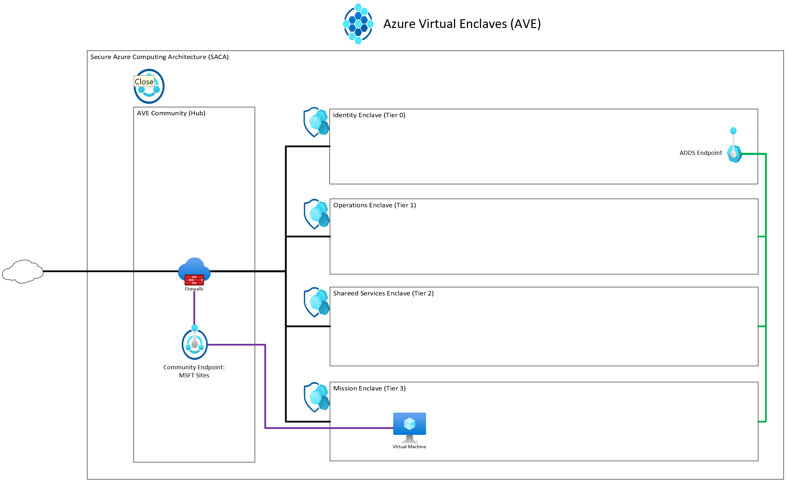
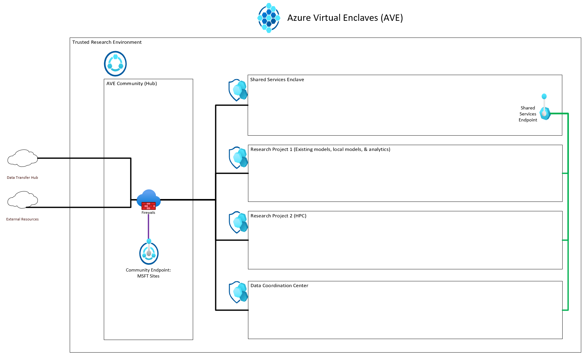

# Azure Virtual Enclaves deployment templates
Example templates to deploy multiple Azure Virtual Enclave resources for a sample scenario. The current templates are maintained using a [Bicep](../azure-resource-manager/bicep/overview.md) file but those are converted to [Azure Resource Manager (ARM)](../azure-resource-manager/templates/overview.md) templates for deployment from the portal.

## Secure Azure Computing Architecture (SACA) template
An example of how to deploy the SACA within AVE.

What gets deployed:
- One  [Community](./what-community.md)
- Four  [Enclaves](./what-enclave.md)
- Four  [workloads](./what-workload.md)
- Five  [Community Endpoints](./what-community-endpoint.md)
- One  [Enclave Endpoint](./what-enclave-endpoint.md)
- 18  [enclave connections](./what-enclave-connection.md)
- One  [Transit Hub](./what-transit-hub.md)

[ARM Template](https://github.com/Azure/virtual-enclaves/ave-templates/ave-saca.json) (easiest to deploy via Portal, PowerShell, or command line)

[Bicep Template](https://github.com/Azure/virtual-enclaves/ave-templates/ave-saca.bicep) (easiest to edit and maintain then convert to ARM template before deployment)

Deploy the template:
1. Open the Azure portal and type `deploy` into the top search bar and select `Deploy a Custom Template`.
2. Select `Build your own template in the editor`.
3. Replace the default template with the ARM template contents (for example copy the text inside the json file).  See [this article](../azure-resource-manager/templates/quickstart-create-templates-use-the-portal.md#edit-and-deploy-the-template) if you have any issues with the above steps.
4. Select `Save`.
5. Select `Create New` under `Resource Group` and enter the resource group name you would like to use (for example community-template-rg) for the AVE resources.
6. Increment `Unique Number` if previous deployments are located in the same resources group.
9. Review the remaining parameters but keep the default unless you would like to test a modification.
10. Select `Review + Create` and then `Create`.

## Trusted Research Environment (TRE) within AVE

What gets deployed:
- One  [Community](./what-community.md)
- Four  [Enclaves](./what-enclave.md)
- Four  [workloads](./what-workload.md)
- Five  [Community Endpoints](./what-community-endpoint.md)
- Two  [Enclave Endpoint](./what-enclave-endpoint.md)
- 15  [enclave connections](./what-enclave-connection.md)
- One  [Transit Hub](./what-transit-hub.md)

[ARM Template](https://github.com/Azure/virtual-enclaves/ave-templates/ave-tre.json) (easiest to deploy via Portal, PowerShell, or command line)

[Bicep Template](https://github.com/Azure/virtual-enclaves/ave-templates/ave-tre.bicep) (easiest to edit and maintain then convert to ARM template before deployment)

Deploy the template:
1. In the Azure portal, type `deploy` into the top search bar and select `Deploy a Custom Template`.
2. Select `Build your own template in the editor`.
3. Replace the default template with the template linked above (for example, copy the text inside the json file).  See [this quickstart](/azure/azure-resource-manager/templates/quickstart-create-templates-use-the-portal#edit-and-deploy-the-template) if you have any issues with the above steps.
4. Select `Save`.
5. Under `Resource Group`, select `Create New` and enter the resource group name you would like to use (for example, community-template-rg) for the AVE resources.
6. Optionally, Under `Unique Number`, increment the number if previous deployments occurred in the same resources group.
9. The remaining parameters that aren't required can be left as the default unless you would like to test a modification. It's recommended to keep the defaults for the first test deployment.
10. Select `Review + Create` and then `Create`.

## AVE demo environment template

What gets deployed:
- One  [Community](./what-community.md)
- Eight  [Enclaves](./what-enclave.md)
- Eight  [workloads](./what-workload.md)
- Five  [Community Endpoints](./what-community-endpoint.md)
- 11 [Enclave Endpoint](./what-enclave-endpoint.md)
- 39 [enclave connections](./what-enclave-connection.md)
- One  [Transit Hub](./what-transit-hub.md)

[ARM Template](https://github.com/Azure/virtual-enclaves/ave-templates/ave-demo-env.json) (easiest to deploy via Portal, PowerShell, or command line)

[Bicep Template](https://github.com/Azure/virtual-enclaves/ave-templates/ave-demo-env.bicep) (easiest to edit and maintain then convert to ARM template before deployment)

Deploy the template:
1. Open the Azure portal and type `deploy` into the top search bar and select `Deploy a Custom Template`.
2. Select `Build your own template in the editor`.
3. Replace the default template with the ARM template contents (for example copy the text inside the json file).  See [this article](../azure-resource-manager/templates/quickstart-create-templates-use-the-portal.md#edit-and-deploy-the-template) if you have any issues with the above steps.
4. Select `Save`.
5. Select `Create New` under `Resource Group` and enter the resource group name you would like to use (for example community-template-rg) for the AVE resources.
6. Increment `Unique Number` if previous deployments are located in the same resources group.
9. Review the remaining parameters but keep the default unless you would like to test a modification.
10. Select `Review + Create` and then `Create`.

## Community and enclaves template

[What gets deployed](./deploy-community-enclaves-template.md#what-gets-deployed)
- One  [Community](./what-community.md)
- One  [Enclaves](./what-enclave.md)
- One  [workloads](./what-workload.md)
- Two  [Community Endpoints](./what-community-endpoint.md)
- One  [Enclave Endpoint](./what-enclave-endpoint.md)
- Four  [enclave connections](./what-enclave-connection.md)
- One  [Transit Hub](./what-transit-hub.md)

[ARM Template](https://github.com/Azure/virtual-enclaves/ave-templates/nightly-base.json) (easiest to deploy via Portal, PowerShell, or command line)

[Bicep Template](https://github.com/Azure/virtual-enclaves/ave-templates/nightly-base.bicep) (easiest to edit and maintain then convert to ARM template before deployment)

[Deploy the template](./deploy-community-enclaves-template.md#deploy-the-template)

### Community template
What gets deployed:
- One  [Community](./what-community.md)
- Two  [Community Endpoints](./what-community-endpoint.md)
- One  [Transit Hub](./what-transit-hub.md)

[ARM Template](https://github.com/Azure/virtual-enclaves/ave-templates/community.json) (easiest to deploy via Portal, PowerShell, or command line)

Deploy the template:
1. Open the Azure portal and type `deploy` into the top search bar and select `Deploy a Custom Template`.
2. Select `Build your own template in the editor`.
3. Replace the default template with the ARM template contents (for example copy the text inside the json file).  See [this article](../azure-resource-manager/templates/quickstart-create-templates-use-the-portal.md#edit-and-deploy-the-template) if you have any issues with the above steps.
4. Select `Save`.
5. Select `Create New` under `Resource Group` and enter the resource group name you would like to use (for example community-template-rg). It's recommended to use the same resource group for other AVE resources but not required.
6. Under `Community Name`, enter the community name you would like to use (for example cm-template-test).
7. Select `Review + Create` and then `Create`.

> [!NOTE]
> 
> The community property "dnsServers" will not have any impact on the community resource deployed and can be ignored.

### Enclave template
What gets deployed:
- One  [Enclave](./what-enclave.md)

[ARM Template](https://github.com/Azure/virtual-enclaves/ave-templates/enclave.json) (easiest to deploy via Portal, PowerShell, or command line)

Deploy the template:
1. Open the Azure portal and type `deploy` into the top search bar and select `Deploy a Custom Template`.
2. Select `Build your own template in the editor`.
3. Replace the default template with the ARM template contents (for example copy the text inside the json file).  See [this article](../azure-resource-manager/templates/quickstart-create-templates-use-the-portal.md#edit-and-deploy-the-template) if you have any issues with the above steps.
4. Select `Save`.
5. Select `Create New` under `Resource Group` and enter the resource group name you would like to use (for example community-template-rg). It's recommended to use the same resource group for other AVE resources but not required.
6. Enter the `Community Resource ID` which can be found on the community `Properties` page under `ID`.
7. Enter the new `Enclave Name` you would like to create (for example enc-template-test).
8. Enter the `Community Address Space` which can be found on the community `Overview` page (for example 10.0.0.0/16).
9. Enter the `Enclave Third Octet` which is a number from 2-255 that is unused by other enclaves.
10. Select `Review + Create` and then `Create`.

### Endpoints template
What gets deployed:
- One  [Enclave Endpoint](./what-enclave-endpoint.md)

[ARM Template](https://github.com/Azure/virtual-enclaves/ave-templates/endpointsv2.json) (easiest to deploy via Portal, PowerShell, or command line)

Deploy the template:
1. Open the Azure portal and type `deploy` into the top search bar and select `Deploy a Custom Template`.
2. Select `Build your own template in the editor`.
3. Replace the default template with the ARM template contents (for example copy the text inside the json file).  See [this article](../azure-resource-manager/templates/quickstart-create-templates-use-the-portal.md#edit-and-deploy-the-template) if you have any issues with the above steps.
4. Select `Save`.
5. Select `Create New` under `Resource Group` and enter the resource group name you would like to use (for example community-template-rg). Use the same resource group for other AVE resources or another resource group according to your needs.
6. Enter the `Enclave Name` of the existing enclave you would like to add an endpoint to (for example enc-template-test).
7. Enter the `Enclave Address Space` for the enclave you're adding the endpoint to (for example 10.0.2.0/23). You can find this by selecting on the enclave resource, on the overview page select the `virtual network` link, and select the `Address Space` page.
8. Select `Review + Create` and then `Create`.

### Connections template
What gets deployed:
- Three  [enclave connections](./what-enclave-connection.md)

[ARM Template](https://github.com/Azure/virtual-enclaves/ave-templates/connectionsv2.json) (easiest to deploy via Portal, PowerShell, or command line)

Deploy the template:
1. Open the Azure portal and type `deploy` into the top search bar and select `Deploy a Custom Template`.
2. Select `Build your own template in the editor`.
3. Replace the default template with the ARM template contents (for example copy the text inside the json file).  See [this article](../azure-resource-manager/templates/quickstart-create-templates-use-the-portal.md#edit-and-deploy-the-template) if you have any issues with the above steps.
4. Select `Save`.
5. Select `Create New` under `Resource Group` and enter the resource group name you would like to use (for example community-template-rg). It's recommended to use the same resource group for other AVE resources but not required.
6. Enter the `Community Resource ID` which can be found on the community `Properties` page under `ID`.
7. Enter the `Source enclave Resource ID` which can be found on the source enclave `Properties` page under `ID`.
8. Enter the `ADDS Endpoint Resource ID` which can be found on the ADDS endpoint `Properties` page under `ID`.
9. Enter the `Example Endpoint Resource ID` which can be found on the Example endpoint `Properties` page under `ID`.
10. Enter the `Msft Sites Endpoint Resource ID` which can be found on the Example endpoint `Properties` page under `ID`.
11. Enter the `Source enclave Address Space` for the source enclave in your connection (for example 10.0.2.0/23). You can find this by selecting on the enclave resource, on the overview page select the `virtual network` link, and select the `Address Space` page.
12. Select `Review + Create` and then `Create`.

## Terraform
Terraform support will start after Azure Virtual Enclaves starts Public Preview.
