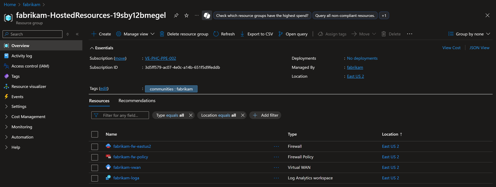
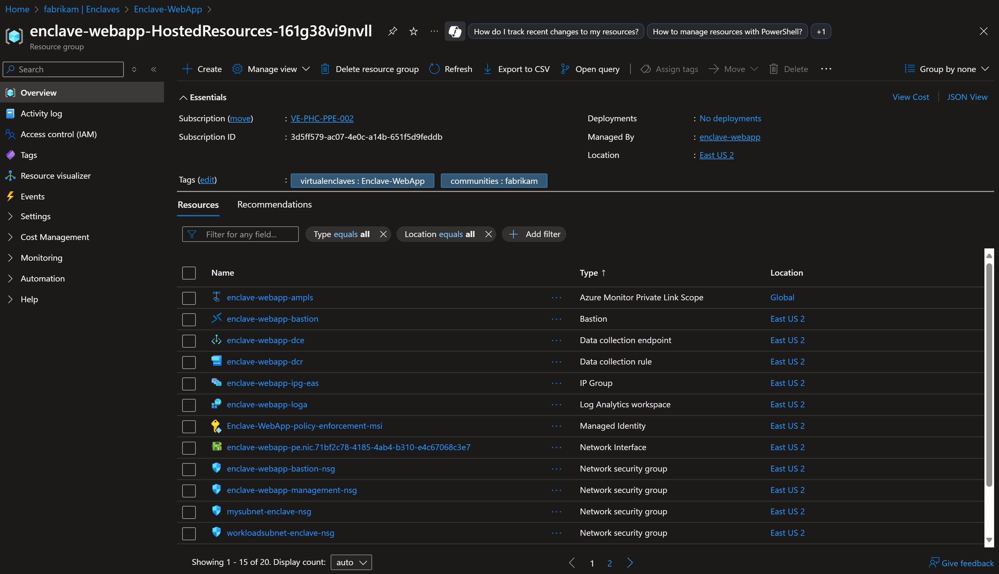

# Azure Virtual Enclaves Best Practices
This article describes key concepts and best practices for Azure Virtual Enclaves.

Azure Virtual Enclaves (AVE) accelerates and streamlines the deployment and management of secure, isolated, and compliant cloud environments for the most sensitive missions and workloads across Commercial and air-gapped environments.

Building and running workloads successfully in AVE requires understanding and implementation of some key concepts, including:

- [Networking and organizational design patterns](#networking-and-organizational-design-patterns-for-azure-virtual-enclaves)
- [Security design patterns](#security-design-patterns-for-azure-virtual-enclaves)
- [Managed resource groups](#managed-resource-groups-in-azure-virtual-enclaves)

The AVE product group, engineering teams, and field teams contributed to, wrote, and grouped the following best practices and conceptual articles. Their purpose is to help community and enclave owners and developers better understand the concepts above and implement the appropriate features.

## Networking and Organizational Design Patterns for Azure Virtual Enclaves

### Multi-tenancy
- [How to organize resources](/azure/cloud-adoption-framework/ready/azure-setup-guide/organize-resources)

### Networking design

AVE brings together the capabilities and flexibility of several Azure networking products such as Azure Virtual WAN, Azure Firewall, Azure Virtual Network, and Network Security Groups in a simplified user interface.

AVE makes the following overall recommendations:
  - [Communities](./what-community.md) should be deployed when you have networking requirements to provide an [Azure Firewall](https://aka.ms/azurefirewall), which is Azure's intelligent firewall security Platform-as-a-Service.
  - Communities should be deployed when you have organizational or data sensitivity requirements to separate a hub-and-spoke virtual wide-area-network (VWAN) from another hub-and-spoke VWAN.
  - Communities should be deployed when you have networking requirements to support systems spanning [multiple Azure regions](/azure/cloud-adoption-framework/ready/azure-setup-guide/regions), in which each region requires its own Azure Firewall. [Learn more about multi-hub Azure Firewall use-cases](/azure/firewall/firewall-multi-hub-spoke). 
  - Communities should be deployed when you have networking requirements to support a large number of systems on a distributed, hub-and-spoke wide area network. Learn more about [Azure VWAN](/azure/virtual-wan/virtual-wan-faq).
  - [Enclaves](./what-enclave.md) should be deployed when you have networking requirements to deploy similar workloads as part of the same private network.
  - Enclaves should be deployed when you have a planned workload requirement that needs to be within the same VWAN as an existing community for ease of network management.

#### Community network design considerations
AVE advises customers to follow, wherever possible, underlying Azure service best practices documentation when planning their community networks. Including these best practices:
- [Azure Firewall best practices](/azure/firewall/firewall-best-practices)
- [Azure Firewall multi-hub-and-spoke](/azure/firewall/firewall-multi-hub-spoke)
- [Hub-and-spoke Azure VWAN Architecture](/azure/architecture/networking/hub-spoke-vwan-architecture)
- [Azure VWAN Network topology](/azure/cloud-adoption-framework/ready/azure-best-practices/virtual-wan-network-topology)
- [Azure VWAN FAQ](/azure/virtual-wan/virtual-wan-faq)

#### Enclave network design considerations
AVE advises customers to follow, wherever possible, underlying Azure service best practices documentation when planning their enclave networks. Including these best practices:
- [Azure Virtual Network concepts and best practices](/azure/virtual-network/concepts-and-best-practices)
- [Network security groups overview](/azure/virtual-network/network-security-groups-overview)

Learn more about overall [Azure networking best practices](/azure/security/fundamentals/network-best-practices).

### Workload deployment
- Workloads contain a managed resource group, which enclave contributors can use to deploy Azure resources to
- By default, all AVE workloads are [governed](./what-azure-virtual-enclaves.md#multi-layered-governance-security-and-monitoring) through built-in Azure Policy initiatives
- Workloads associated with a [community](./what-community.md) that has a custom governance setup, will use this unique configuration instead of the default AVE governance configuration.
- [Considerations for naming Azure resources](/azure/azure-government/documentation-government-concept-naming-resources)

## Security design patterns for Azure Virtual Enclaves

### Security boundaries
AVE employs a defense-in-depth approach when it comes to cybersecurity. When you deploy a community and enclaves within a community, AVE establishes several layers of network isolation, security, access controls, and logging and monitoring capabilities. 

### Shared security responsibilities
As a service on Azure, AVE also is committed to upholding the [shared responsibility model](/azure/security/fundamentals/shared-responsibility) in the cloud. For AVE specifically, [workloads](./what-workload.md) are the customer's responsibility. Platform shared responsibility is inherited in workloads if the customer deployed PaaS services into their workloads.

Customer instances of [communities](./what-community.md) and [enclaves](./what-enclave.md) represent a shared responsibility. Communities and enclaves are shared responsibilities in that the AVE Resource Provider creates a secured, preconfigured hub-and-spoke network environment for the customer. This network environment can then be managed by the customer by creating [enclave endpoints](./create-enclave-endpoint-portal.md), [community endpoints](./create-community-endpoint-portal.md), [transit hubs](./create-transit-hub-portal.md), or [enclave connections](./create-enclave-connection-portal.md). Certain preview versions of AVE also allow the customer to manually make changes to the network through underlying controls provided by [Azure VWAN](/azure/virtual-wan/virtual-wan-about), [Azure Virtual Network](/azure/virtual-network/virtual-networks-overview), and other underlying Azure networking services.

AVE [governance](./what-azure-virtual-enclaves.md#multi-layered-governance-security-and-monitoring) is also a shared responsibility. The AVE Resource Provider creates a secured, preconfigured list of [Azure Policy initiatives](/azure/virtual-enclaves/aks-initiative) per [workload](./what-workload.md) deployment. However, [communities](./what-community.md) now have the capability to configure their own list of Azure Policy Initiatives, which overrides the preconfigured list for the workload. Despite this, customers retain the ability to make manual [exemptions](./policy-compliance-exemptions.md) to these Azure Policy Initiative assignments depending on their compliance or governance requirements.

### Azure Security best practices
AVE recommends following [Microsoft Azure Security best practices and patterns](/azure/security/fundamentals/best-practices-and-patterns) for deploying Azure resources and implementing workloads. Certain exclusions to the general rule apply where the recommendation was implemented as part of the default settings deployed by the AVE Resource Provider or was slightly modified as part of the broader hub-and-spoke network architecture and design patterns of AVE.

Customers are also recommended to follow the [Azure security best practices - Cloud Adoption Framework](/azure/cloud-adoption-framework/secure/security-top-10) for organizing their systems, cloud infrastructure, IT personnel and teaming structures, and corporate cybersecurity awareness trainings.

## Managed resource groups in Azure Virtual Enclaves
The resource groups that contain resources managed by Azure Virtual Enclaves.

### Community managed resource group
The _Community managed resource group_ contains the infrastructure resources described in [What is a community?](./what-community.md).

The community managed resource group name follow this naming convention `myCommunityName-HostedResources-<GUID>`. Every community deployment creates this resource group and creates the community infrastructure inside. When you delete your community, the Azure Virtual Enclaves resource provider automatically deletes the community managed resource group.

The community managed resource group has the following limitations:
- You can't specify an existing resource group for the community managed resource group.
- You can't specify a different subscription for the community managed resource group.
- You can't change the community managed resource group name after the community is created.
- You can't specify names for the managed resources within the community managed resource group.
- You can't modify or delete Azure-created tags of managed resources within the community managed resource group.

If you modify or delete Azure-created tags, resources, and other resource properties in the community managed resource group, you could get unexpected results, such as network, access, and monitoring errors. As Azure Virtual Enclaves manages the lifecycle of infrastructure in the community managed resource group, any changes could potentially move your enclave into an unsupported state.

A common scenario where customers want to modify resources is through tags. Azure Virtual Enclaves allows you to create and modify tags that are propagated to resources in the community managed resource group, and you can add those tags when creating the community. You might want to create or modify custom tags, for example, to assign a business unit or cost center. This can also be achieved by creating Azure Policies with a scope on the community managed resource group.

> [!NOTE]
> 
> If you don't have community managed resource group lockdown enabled, you can directly modify any resource in the community managed resource group. Directly modifying resources in the community managed resource group can cause your enclave to become unstable or unresponsive.

### Enclave managed resource group
The _Enclave managed resource group_ contains the infrastructure resources described in [What is an Enclave?](./what-enclave.md).

The enclave managed resource group name follow this naming convention `myEnclaveName-HostedResources-<GUID>`. Every enclave deployment creates this resource group and creates the enclave infrastructure inside. When you delete your enclave, the Azure Virtual Enclaves resource provider automatically deletes the enclave managed resource group.

The enclave managed resource group has the following limitations:
- You can't specify an existing resource group for the enclave managed resource group.
- You can't specify a different subscription for the enclave managed resource group.
- You can't change the enclave managed resource group name after the enclave is created.
- You can't specify names for the managed resources within the enclave managed resource group.
- You can't modify or delete Azure-created tags of managed resources within the enclave managed resource group.

If you modify or delete Azure-created tags, resources, and other resource properties in the enclave managed resource group, you could get unexpected results, such as network, access, and monitoring errors. As Azure Virtual Enclaves manages the lifecycle of infrastructure in the enclave managed resource group, any changes could potentially move your enclave into an unsupported state.

A common scenario where customers want to modify resources is through tags. Azure Virtual Enclaves allows you to create and modify tags that are propagated to resources in the enclave managed resource group, and you can add those tags when creating the enclave. You might want to create or modify custom tags, for example, to assign a business unit or cost center. This can also be achieved by creating Azure Policies with a scope on the enclave managed resource group.

> [!WARNING]
> 
> Modifying resources in the enclave managed resource group can cause your enclave to become unstable or unresponsive.

### Workload resource group
The workload is linked to one or more resource groups where you can create and organize your Azure resources.

#### Add a resource group to a workload
Adding a new resource group normally requires the user to have permissions to create a new resource group. Subscription `Owner` or `Contributor` roles have this permission but the person creating the workload resource group might not have or need this privileged permission. Azure Virtual Enclaves attempts three ways to create the new resource group, by following a tiered approach, ranging from the highest to lowest user permission requirements, offering flexibility for the user:
  - Option 1: Requires the most privileged permissions for the individual creating or updating the workload, providing full control but necessitating elevated access.
  - Option 2: Involves manual intervention by the user to [grant our `Mission Enclave` app ownership at the subscription level](./onboard.md), which might not align with all customers’ preferences.
  - Option 3: Requires no permissions for either the user or our FPA, making it the easiest method but imposing a strict 1:1 relationship between the resource group and workload.

Each option has benefits and limitations, balancing control, convenience, and flexibility to fit varying needs. These options are each evaluated starting with Option 1 and the first option to succeed is used to create the new resource group.

After you create on workload resource group using Option 3, a warning will be displayed to alert you that method #1 or #2 will be needed for more workload resource groups on this workload. You can also create a new workload and then create a new workload resource group using Option 3 again.

Add a resource group to your enclave:
1. Open the Azure portal page for the Workload
2. Select `Manage` and then `Resource Groups`
3. Select `Add a resource group`
4. In the side window that opens, select `Create new` to provide the name of the new, empty resource group or select the `Resource Group` drop-down to select an existing resource group.
5. Select `Ok` and then `Save`

#### How is a workload resource group different from other Azure resource groups?
A workload resource group is a critical component of the Azure Virtual Enclaves security and compliance because that is where important customer resources are created. Since these workload resource groups are linked to a workload, and the workload is linked to an enclave, [deletion of the workload managed resource groups](#workload-deletion) is managed by Azure Virtual Enclaves.

Additionally, policy is applied to the workload resource groups. Similar to how the community policies flow down to the enclave, the enclave policies flow down to the [workload](./what-workload.md) resources and [workload resource groups](./what-workload.md#workload-resource-group). When you create a new workload resource group, the roles are set at the enclave level and inherited from the subscription. Some of these policies are inherited from the community and you can also create policies on the enclave that flow down to workloads and workload resource groups.

#### Organizing resources in workload resource groups
If you wanted to split your resources into two resource groups, you can choose either of these options:

- split those resources between two resource groups linked to one workload
- split those resources between two workloads each having one or more resource groups 

#### Workload deletion
When a workload deletion is requested, the workload resource groups are checked to make sure they're empty. If the workload resource groups contain resources, the requested workload deletion with fail and show an error. If you want to delete the workload and workload resource groups, the workload resource groups need to be empty. This help to avoid deleting important resources by accident.

Deletion of a resource that is linked to the workload also follows this same behavior. For example: if a Community deletion is requested but all of the workload resource groups aren't empty, the operation shows an error. Empty the workload resource groups and try again.

The workload managed resource group has the following limitations:
- You can't specify an existing resource group for the workload managed resource group.
- You can't specify a different subscription for the workload managed resource group.
- You can't change the workload managed resource group name after the workload is created.
- You can't modify or delete Azure-created tags of managed resources within the workload managed resource group.

A common scenario where customers want to modify resources is through tags. Azure Virtual Enclaves allows you to create and modify tags that are propagated to resources in the workload managed resource group, and you can add those tags when creating the workload. You might want to create or modify custom tags, for example, to assign a business unit or cost center. This can also be achieved by creating Azure Policies with a scope on the workload managed resource group.

## Other Azure best practices
As you build your communities, enclaves, and workloads in Azure, it's important to keep in mind the following universal design principles:

- [Networking architecture design in Azure](/azure/architecture/guide/networking/networking-start-here)
- [Hub-spoke network topology in Azure](/azure/architecture/reference-architectures/hybrid-networking/hub-spoke?tabs=cli)
- [Azure Private Link in a hub-and-spoke network](/azure/architecture/guide/networking/private-link-hub-spoke-network)
- [Azure Firewall - Well-Architected Framework](/azure/well-architected/services/networking/azure-firewall)
- [Considerations for naming Azure resources](/azure/azure-government/documentation-government-concept-naming-resources)
- [Microsoft Azure Security best practices and patterns](/azure/security/fundamentals/best-practices-and-patterns)
