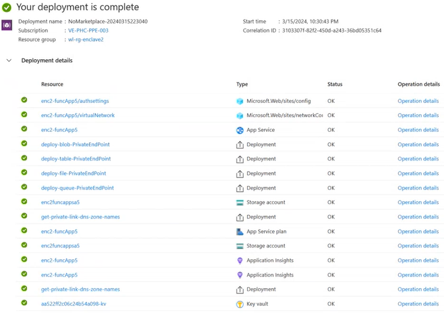

# Deploy a Service Catalog Template into a Workload

Azure Virtual Enclaves (AVE) is a cloud networking service that provides organizations with highly sensitive data the ability to quickly deploy and manage workloads across Commercial and air-gapped Azure clouds at scale. In this article, you:

- Deploy a Service Catalog template for a Function App into an existing Workload from the Portal.

> **Note**:
> 
> This sample deployment is just for demo purposes and doesn't represent all the best practices for network, systems, or applications administration.

## Before you begin
- This article assumes a basic understanding of networking and Azure Virtual Enclaves concepts. For more information, see [Concepts and best practices of Azure Virtual Enclaves](/docs/concepts/Concepts-and-best-practices).

- You need an Azure account with an active subscription. If you don't have one, [create an account for free](https://azure.microsoft.com/free/).

- A [deployed Community](./what-is-a-community.md), [deployed Virtual Enclave](./what-is-an-enclave.md), and [deployed Workload](./what-is-a-workload.md) and permissions to create resources inside the workload.

## Prerequisites:

There are guardrails in the enclaves to ensure a Function App is isolated with private endpoints. The App Service also requires a subnet delegation in the enclave virtual network to provide more control to the service. It is important to note that a private endpoint cannot be created on a delegated subnet.

1. [Create new subnet](#Create-New-Subnet) for Function App delegation. In the AVE product, the subnet management is under the customer's control as there is currently no deny assignments on the virtual network resource. In order to create a new subnet, the existing resource `AzureVirtualEnclaveSubnet` must be broken down since it is utilizing the entire address space. 
**Note:** you will not be able to resize a subnet once resources have been deployed inside of it.
    - Before deleting the subnet in the next step, copy (e.g. to notepad) the NSG name used by the current subnet for use later.
    - Change the address space of subnet `AzureVirtualEnclaveSubnet` (e.g. 10.0.2.0/23 [10.0.2.0 - 10.0.3.255]) to 10.0.2.0/26 [10.0.2.0 - 10.0.2.63] 
        - Use this for the "Private Link Subnet Name" (step 5 below)
    - Create new subnet `FunctionAppSubnet` (e.g. 10.0.2.128/26 [10.0.2.128 - 10.0.2.191])
        - Add previous NSG rule set
        - Add subnet delegation `Microsoft.Web/serverFarms`
        - Use this subnet for "Subnet Name" later on when deploying (step 5 below)

>Note this leaves space in the subnet for additional subnets. If these are the only subnets needed, they can be resized according to your needs.
2. A Key Vault that supports CMK and a key that can be leveraged for CMK encryption. [Setup CMK](docs/How-To-Guides/Set%2Dup-customer%2Dmanaged%2Dkey-\(CMK\)-encryption-within-an-enclave). Follow the instructions in the [CMK](docs/How-To-Guides/Set%2Dup-customer%2Dmanaged%2Dkey-\(CMK\)-encryption-within-an-enclave) article to:
    - Create an RSA (2048 or greater) key in the enclave Key Vault in the `HostedResources` resource group for the enclave.
    - Create a user managed identity with access to the CMK key.
    - Create an Access Policy in the Key Vault above for this identity with the following Key Permissions: `Unwrap Key, Wrap Key, Recover, Get`

## Deploy the template
1. Navigate to the workload for the intended deployment.
2. Select "Add Service" button.
3. Select the Function App service template from the [Catalog](/docs/How-To-Guides/Service-Catalog) of templates (the dropdown list) and select the required version (default: `latest`)
4. On the Basics tab enter all the required parameters. The Storage Account name will be the name of a storage account that will be created **NOT** the existing SA within the enclave.
5. After creating two subnets above, on the Networking tab enter the new subnet names as explained above.
7. On the Encryption tab, enter the name of the new key added to the Key Vault for the Customer Managed Key (CMK) setup.
8. Enter the User Managed Identity Name created during the CMK setup.
9. Adjust any of the prepopulated or default parameters as needed.
10. Select Review + Add then Add.

It can take 10 minutes to finish all resource creation. Wait for the deployment to be successfully completed before you take any actions within your deployed resources.

## Validate the deployment
1. You should see a list of deployed resources similar to the following:

2. Go to the specified Resource Group to confirm the intended resources were created. Including: Function App and new SA

### Open the Function App resource
1. Open the Function App resource
1. On the overview page, check functions

## Delete the deployment
If you don't plan on keeping these resources, clean up unnecessary resources to avoid Azure charges. If no other deployments exist in the Resource Group, the whole Resource Group can be deleted.

## Recommendations
- [Add tags](https://learn.microsoft.com/azure/azure-resource-manager/management/tag-resources) to Service Catalog deployments to track important information for that resource such as:
-- Owner: <main POC>
-- Deployer: <yourName>
-- Purpose: <publish abc app to users>
-- Service Catalog Name: <RemoteApp>
-- Service Catalog Version: <version you deployed>
- Consider adding an [Azure Policy to enforce and inherit tags](https://learn.microsoft.com/azure/azure-resource-manager/management/tag-policies)
