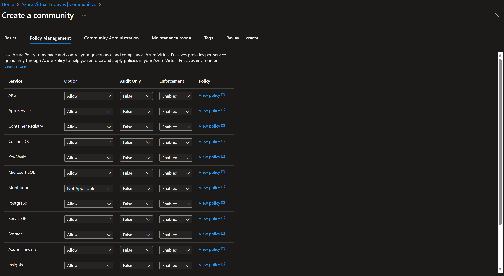

# Configure community governance

Governance options for communities are configurable during the community creation and can be managed after the community is created.

## Prerequisites

- To access Azure Virtual Enclaves, you'll need an Azure subscription. If you don't already have a subscription, create a [free account](https://azure.microsoft.com/free/) before you begin.
- Before you can create an enclave, you must [create a community](./create-community-portal.md) using the Azure portal.
- **If you are using on-prem/custom DNS** - each enclave _must deploy a DNS resolver_ workload in order to resolve private endpoints for Azure Storage, Key Vault, and Log Analytics. 

## Customize governance settings on community creation
Go to community creation and customize your governance settings.

 In the context of governance for communities, the following settings can be specified for each service:
 

 - Enforcement: This setting determines whether the rules defined for a service are actively enforced. When enforcement is enabled, any action that violates the rules will be blocked or flagged.
 - Audit Mode: This option allows for the monitoring of services without actively enforcing the rules. It is useful for understanding the impact of potential governance policies by logging all actions that would violate the rules if enforcement were > enabled.
 - Options: This setting declares whether the service is:
   - Allow: The service is allowed in the policies
   - Deny: The service isn't allowed in the policies
   - ExceptionOnly: The service isn't allowed in the policies, but manual [Policy Exemptions](./policy-compliance-exemptions.md) can be made.

> [!NOTE]
> 
> This governance options will be applied all of the workloads that are part of the community, overriding the default governance configuration for workloads.
